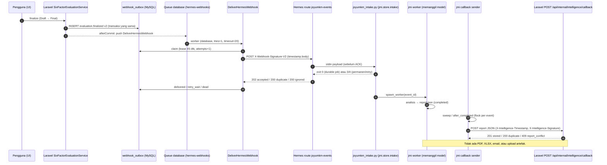
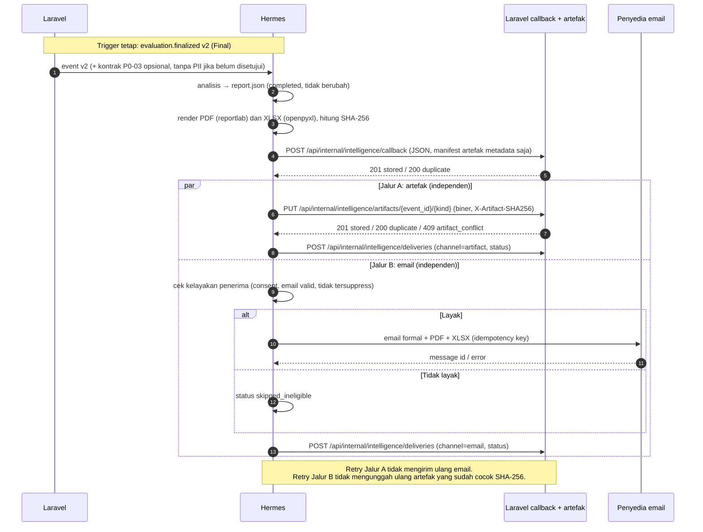

# P0 — Audit & Kontrak Integrasi JoyUMKM × Hermes Agent

Tanggal audit: 2026-11-23
Mode: **AUDIT ONLY**. Tidak ada perubahan source code, migration, konfigurasi, atau Git. Tidak ada evaluasi baru yang di-finalisasi, tidak ada event baru yang dikirim ke Hermes, tidak ada email, tidak ada pemanggilan model AI.

---

## 0. Ringkasan eksekutif

| Gate | Status | Alasan singkat |
|---|---|---|
| **P0-01** Audit kode & runtime | **PARTIAL** | Kode dan test Laravel serta callback Hermes terverifikasi. Rekonsiliasi lintas-sistem menemukan 3 event `delivered` di Laravel yang tidak punya job di Hermes. |
| **P0-02** HMAC, timestamp, idempotensi, retry, recovery, 7 archived | **PARTIAL** | Kontrak keamanan terverifikasi di kode dan test. Angka 7 `archived_unmatched` sesuai keputusan owner. Belum ada penjelasan untuk 3 event yatim di sisi Laravel. |
| **P0-03** Kontrak data perubahan | **PARTIAL** | Kontrak dirancang. Data email penerima tersedia untuk 2 dari 25 UMKM. Belum ada consent, belum ada periode, dan `evaluations` (V1) tidak punya `finalized_at`. |
| **P0-04** Kontrak artefak & delivery | **PARTIAL** | Kontrak dirancang. Library PDF/XLSX sudah ada di Hermes. Endpoint upload, tabel artefak, dan tabel delivery belum ada. Dua keputusan (skema signature upload, PII penerima) belum dijawab owner. |

**Hal yang wajib diperhatikan sebelum P1:**
1. **Konfigurasi dev mengaktifkan pengiriman Hermes** (`HERMES_WEBHOOK_ENABLED=true`). Setiap finalisasi baru di dev akan masuk ke intake Hermes dan memicu analisis AI. Jangan finalisasi evaluasi untuk uji sampai pengiriman dinonaktifkan atau diarahkan ke receiver uji.
2. **Tiga event Laravel berstatus `delivered` tidak punya job di Hermes** (evaluasi 9, 10, 11). Log gateway menunjukkan ketiganya diproses oleh sesi agent pada 22 Nov pukul 13:10, 13:58, dan 14:31, bukan oleh pipeline jmi. Ini perlu keputusan owner (lihat §6).
3. **Tujuh job archived untuk evaluasi 11** tidak punya baris outbox di Laravel. Asal-usulnya belum terverifikasi. Kemungkinan terkait pemulihan database dev, tetapi ini belum dibuktikan.
4. **23 dari 25 UMKM tidak punya `business_email`.** Alur email ke UMKM tidak bisa jalan untuk mayoritas data sekarang.

---

## 1. Ruang lingkup, metode, dan bukti

### 1.1 Yang diperiksa
- **Laravel:** `SixFactorEvaluationService`, `HermesWebhookOutbox`, `HermesWebhookSender`, `WebhookOutbox`, `DeliverHermesWebhook`, `VerifyIntelligenceCallbackSignature`, `IntelligenceCallbackController`, `IntelligenceCallbackRequest`, `IntelligenceCallbackPayload`, `IntelligenceReportService`, `IntelligenceReportController`, `IntelligenceReportResource`, migration `intelligence_reports`, `routes/api.php`, `routes/console.php`, `config/services.php`, `docs/HERMES_WEBHOOK.md`.
- **Hermes (runtime, read-only):** container `hermes-agent`, path `/opt/data/joyumkm-intelligence/jmi/` (`callback.py`, `store.py`, `parse.py`, `engine.py`, `callback_registry.json`), route script `/opt/data/scripts/joyumkm_intake.py`, `/opt/data/scripts/jmi_recover.py`, `/opt/data/webhook_subscriptions.json` (hanya struktur, secret disunting), `/opt/hermes/gateway/platforms/webhook.py`, `/opt/hermes/gateway/platforms/_shared.py`, `/opt/data/logs/gateway.log`.
- **Data (read-only):** agregat dari DB dev via `php artisan tinker --execute` yang hanya berisi `count`, `pluck`, dan `select` tanpa payload.

### 1.2 Test yang dijalankan (bukan hanya membaca PRD)

| Suite | Perintah | Hasil |
|---|---|---|
| Laravel callback & report API | `php artisan test --compact` pada `IntelligenceCallbackTest`, `IntelligenceCallbackConcurrencyTest`, `IntelligenceReportApiTest` | **45 passed**, 336 assertions |
| Laravel outbox & evaluasi | `php artisan test --compact` pada `HermesWebhookOutboxTest`, `HermesWebhookWorkerTest`, `Unit/HermesWebhookSignatureTest`, `SixFactorEvaluationServiceTest`, `SixFactorEvaluationConcurrencyTest`, `SixFactorEvaluationDatabaseTest` | **114 passed**, 1176 assertions |
| Hermes callback | `docker exec -u hermes -e PYTHONDONTWRITEBYTECODE=1 hermes-agent python3 -m unittest tests.test_callback` | **58 OK** (memakai `JMI_HOME` sementara) |

Catatan: `phpunit.xml` memaksa `DB_DATABASE=joyumkm_testing`, `MAIL_MAILER=array`, dan `QUEUE_CONNECTION=sync`. Tidak ada email nyata dan database dev tidak tersentuh oleh test.

### 1.3 Belum dijalankan / NOT VERIFIED
- **NOT RUN:** `tests.test_jmi` dan `tests.test_review` di Hermes. Baseline dari memori proyek: 73 test gagal sebelum P4-04C (validator V4 vs fixture lama). Perlu dibandingkan set kegagalannya, bukan dianggap hijau.
- **NOT RUN:** suite Laravel penuh.
- **NOT VERIFIED:** jadwal cron `jmi_recover.py` (dokumen menyebut setiap 5 menit). Pemeriksaan cron diblokir classifier, jadi belum dikonfirmasi langsung.
- **NOT VERIFIED:** apakah queue worker `hermes-webhooks` dan `schedule:run` sedang berjalan di dev.
- **NOT VERIFIED:** isi `backups/` Hermes yang bisa menjelaskan hilangnya job untuk 3 event yatim.
- **NOT VERIFIED:** apakah dev database pernah dipulihkan dari backup. Dokumen P4-04C menyebut "database development telah dipulihkan", tetapi asal-usul pemulihan tidak dicek.

### 1.4 Keterbatasan
- Dua perintah Bash dan satu perintah PowerShell diubah oleh hook lalu diblokir classifier. Pembacaan `docs/HERMES_WEBHOOK.md` diganti dengan tool Read. Pemeriksaan route dan cron yang gagal ditandai NOT VERIFIED, tidak diulang.
- Secret tidak ditampilkan di mana pun. Kecocokan secret dibandingkan lewat hash, dan hasilnya cocok.

---

## 2. Matriks EXISTING / REUSE / GAP / CHANGE REQUIRED

Legenda: **EXISTING** = sudah ada dan berfungsi; **REUSE** = dipakai ulang tanpa perubahan; **GAP** = belum ada; **CHANGE** = perlu perubahan (kode/schema/kontrak) pada fase berikutnya.

### 2.1 P0-01 — Laravel → Hermes (event dan delivery)

| # | Komponen | Status | Bukti | Catatan |
|---|---|---|---|---|
| 1.1 | Transisi Draft→Final dan event dalam satu transaksi | EXISTING | `app/Services/SixFactorEvaluationService.php:138-157` (`transition`), `:151-153` memanggil `recordFinalization` di dalam transaksi | Event hanya dibuat saat status menjadi `final`. Cancel tidak membuat event. |
| 1.2 | Outbox `webhook_outbox` dengan `event_id` UUID unik | EXISTING | `app/Services/HermesWebhookOutbox.php:31-74`; `app/Models/WebhookOutbox.php` | `event_version` 2 untuk event baru. Payload tidak memuat email, alamat, koordinat, NIB, atau data pribadi. |
| 1.3 | Dispatch setelah commit | EXISTING | `HermesWebhookOutbox.php:73` (`afterCommit`), `:216-224`, `:226-263` (`enqueueSafely`, dedup dengan `queued_job_id`) | Dedup scan memakai `queued_job_id` dan `reserved_at`. |
| 1.4 | Job `DeliverHermesWebhook` | EXISTING | `app/Jobs/DeliverHermesWebhook.php` (`tries=1`, `timeout=20`, queue `hermes-webhooks`) | Retry dikelola outbox, bukan retry bawaan queue. |
| 1.5 | Lease, claim, dan status | EXISTING | `HermesWebhookOutbox.php:175-214` (`deliver`), `:265-297` (`claim`, lease 45 detik, `attempt_limit`) | Status: `pending`, `processing`, `retry_wait`, `delivered`, `dead`. |
| 1.6 | Backoff dan batas attempt | EXISTING | `HermesWebhookOutbox.php:299-311`; default 5 attempt, base 30 detik, cap 900 detik, jitter | Konfigurasi di `config/services.php:46-55`. |
| 1.7 | Sender dan validasi ACK | EXISTING | `app/Services/HermesWebhookSender.php:55-135` | `202 accepted` (route, event, delivery_id cocok) dan `200 duplicate` dianggap sukses. `200 ignored` menjadi `dead`. |
| 1.8 | Header signature event Laravel→Hermes | EXISTING | `HermesWebhookSender.php:49-52`, `:67-75` | `X-Webhook-Signature-V2` = HMAC-SHA256 atas `timestamp.body`. `X-Request-ID` = `event_id`. |
| 1.9 | Scanner dan requeue | EXISTING | `routes/console.php:16-71` (`hermes:webhook-scan` setiap menit, `hermes:webhook-requeue`, `hermes:webhook-status`) | Scheduler harus berjalan (lihat NOT VERIFIED). |
| 1.10 | Business context dan three_dimension dalam snapshot | EXISTING | `HermesWebhookOutbox.php:82-108`, `:117-142` | V1 dibaca dengan `COALESCE(submitted_at, created_at) <= finalized_at`. Skala 0–100 tidak diubah. |
| 1.11 | Laravel mengirim ke Hermes dan Hermes memvalidasi | EXISTING (terverifikasi di Hermes) | `/opt/data/webhook_subscriptions.json` route `joyumkm-events`: `events=[evaluation.finalized]`, `signature=generic`, `enabled=true`, `script=joyumkm_intake.py`. `/opt/hermes/gateway/platforms/webhook.py`: `generic` menerima `v2`/`standard`. `_shared.py:31`: replay window 300 detik. | Ini menjawab pertanyaan P0-02 soal `X-Webhook-Signature-V2`. |
| 1.12 | Intake Hermes | EXISTING | `/opt/data/scripts/joyumkm_intake.py` memanggil `store.intake` lalu `engine.spawn_worker` sebelum ACK. `jmi/store.py` `intake()`: idempotent per `event_id` dan `payload_hash`, konflik disimpan sebagai `conflict-*.json`. `jmi/parse.py:196-198`: `event_version` harus 1 atau 2. | Intake sendiri tidak memanggil model, tetapi worker yang dinyalakannya memanggil model. Jadi event Laravel **memicu analisis AI**. |
| 1.13 | Log dispatch dan status tanpa payload | EXISTING | `HermesWebhookOutbox.php:259` (`Log::warning` tanpa payload), `:65` (QueryException dibungkus) | Sesuai aturan privasi. |
| 1.14 | Job lifecycle di Hermes | EXISTING | `jmi/engine.py`: `pending` → `processing` → `completed`/`failed`; `retry`, `_auto_retry_due`, `spawn_worker` | Job lama yang `completed` tidak dianalisis ulang oleh recovery (`engine.py:208-209`). |
| 1.15 | Recovery Hermes | EXISTING (kode), NOT VERIFIED (jadwal) | `/opt/data/scripts/jmi_recover.py` memanggil `engine.recover` dan `callback.sweep` | Jadwal dari dokumen dan memori. |

### 2.2 P0-01 — Callback Hermes → Laravel

| # | Komponen | Status | Bukti | Catatan |
|---|---|---|---|---|
| 2.1 | Route `POST /api/internal/intelligence/callback` tanpa Sanctum, dengan middleware HMAC | EXISTING | `routes/api.php:20-22` | Benar: server-ke-server. |
| 2.2 | Middleware: secret ≥ 32, body ≤ 2 MiB, timestamp ±300 detik, HMAC, Content-Type `application/json` | EXISTING | `app/Http/Middleware/VerifyIntelligenceCallbackSignature.php:20-43` | Kode status: 503, 413, 401, 415. |
| 2.3 | Controller dan request validation | EXISTING | `IntelligenceCallbackController.php:18-34`; `IntelligenceCallbackRequest.php` (aturan lengkap, `integerRule`, `objectRule`, `listRule`, `limitations` wajib untuk `partial`) | Status 201 `stored`, 200 `duplicate`, 409 `report_conflict`. |
| 2.4 | Decode ketat dan deteksi key ganda | EXISTING | `app/Services/IntelligenceCallbackPayload.php:40-54`, `:97-138` (`hasDuplicateKeys`) | Dekode ganda: array dan objek agar `{}` tidak berubah jadi `[]`. |
| 2.5 | Hash semantik dan canonical JSON | EXISTING | `IntelligenceCallbackPayload.php:67-94` | Hash atas metadata stabil + report, tanpa timestamp HTTP dan signature. |
| 2.6 | Validasi identitas terhadap outbox dan snapshot Final | EXISTING | `app/Services/IntelligenceReportService.php:82-120` (`assertMatchesFinalization`), `:128-143` (`sixFactorSnapshot`, v1 dan v2) | Snapshot dibandingkan dengan evaluasi saat ini. Karena Final tidak bisa diubah, perbandingan ini aman. |
| 2.7 | Penyimpanan immutable, unik, dan idempotent | EXISTING | `IntelligenceReportService.php:35-77`; migration `2026_11_23_050328_create_intelligence_reports_table.php` (`event_id` unik, `evaluation_id` unik, FK `restrictOnDelete`); `app/Models/IntelligenceReport.php` (`performUpdate` dan `delete` melempar exception) | Race ditangani dengan `UniqueConstraintViolationException` lalu `lockForUpdate`. |
| 2.8 | Retry dan klasifikasi di Hermes | EXISTING | `jmi/callback.py`: `classify()` (201/200 sukses, 409 dan 422 permanen, 401/413/415 config, 404 `unmatched_event`, 408/429/5xx retry), `backoff_seconds()` (base 60, cap 3600, jitter 20%), `MAX_ATTEMPTS` 8 | Budget retry dan delivery terpisah dari status analisis. |
| 2.9 | Lock dan crash recovery di Hermes | EXISTING | `jmi/callback.py`: `flock(f"{eid}.cb")`, `claim` dengan `lease_until`, `sweep` menangani `sending` yatim | Claim dan lock per event. |
| 2.10 | Payload integrity di Hermes | EXISTING | `callback.py`: `payload_hash` disimpan, `PAYLOAD_INTEGRITY_CONFLICT` → `failed_permanent` | Body disimpan dan dikirim byte yang sama pada setiap attempt. |
| 2.11 | Secret callback sama di kedua sisi | EXISTING (dibandingkan lewat hash) | `.env` Laravel dan `state/callback.env` Hermes (mode 0600): hash cocok, panjang 64 | Tidak ditampilkan. |
| 2.12 | GET API laporan | EXISTING | `routes/api.php:51-58`; `IntelligenceReportController.php` (`latest`, `index`, `show`); `IntelligenceReportResource` menyertakan `report` penuh | Hanya pemilik UMKM (`ensureOwned`). Riwayat memakai `SUMMARY_COLUMNS` tanpa `report`. |

### 2.3 P0-02 — Audit keamanan, idempotensi, dan konsistensi lintas-sistem

| # | Pemeriksaan | Status | Bukti / hasil |
|---|---|---|---|
| 3.1 | HMAC Laravel→Hermes | **PASS (kode + kecocokan skema)** | Hermes menerima `v2` untuk route `generic`. Body-only V1 ditolak. |
| 3.2 | HMAC Hermes→Laravel | **PASS (kode + test)** | Laravel: `hash_hmac('sha256', ts.'.'.body, secret)`, `hash_equals`. Hermes: `hmac.new(secret, ts.b"."+body)`. Test Laravel dan Hermes lulus. |
| 3.3 | Timestamp tolerance 300 detik | **PASS** | Laravel `services.hermes_intelligence_callback.tolerance_seconds=300`. Hermes `WEBHOOK_REPLAY_WINDOW_SECONDS=300`. Hermes callback membuat timestamp baru pada setiap attempt. |
| 3.4 | Body limit 2 MiB | **PARTIAL** | Laravel: 2 MiB, tetapi `$request->getContent()` membaca seluruh body sebelum dicek. Tidak ada throttle pada route callback. Hermes: `MAX_BODY_BYTES` 2 MiB. Sender Laravel tidak punya batas, tetapi payload event kecil. |
| 3.5 | event_version 1/2 | **PASS** | Laravel `IntelligenceReportService.php:90` menerima 1 dan 2. Hermes `parse.py:196-198` menerima 1 dan 2. Snapshot V1 (`data.*`) dan V2 (`data.six_factor.*`) ditangani di `sixFactorSnapshot`. |
| 3.6 | Idempotensi event (`event_id`) | **PASS** | Laravel: unik di `webhook_outbox` dan `intelligence_reports`. Hermes: `intake` per `event_id`. |
| 3.7 | Idempotensi laporan | **PASS** | Hash semantik. Duplikat → 200 `duplicate`. Hash berbeda → 409 `report_conflict`. Laravel `report_conflict` dipetakan ke `FAILED_PERMANENT` di Hermes. |
| 3.8 | Payload hashing | **PASS** | Laravel: `IntelligenceCallbackPayload::hash()`. Hermes: `payload_hash` pada outbox dan job. |
| 3.9 | Retry independen | **PASS** | Budget Laravel (5 attempt, base 30, cap 900) dan Hermes (8 attempt, base 60, cap 3600) tidak bergantung satu sama lain. Analisis ulang tidak pernah dipicu oleh retry. |
| 3.10 | Concurrency | **PASS (test)** | Laravel: `IntelligenceCallbackConcurrencyTest`, `SixFactorEvaluationConcurrencyTest`, `HermesWebhookWorkerTest` lulus. Hermes: flock per event. |
| 3.11 | Recovery crash | **PARTIAL** | Laravel: lease 45 detik dan `scan`. Hermes: `sending` yatim dipulihkan saat `.cb` bebas. Jadwal recovery NOT VERIFIED. |
| 3.12 | `attempt_limit` pada outbox | **RISIKO** | `HermesWebhookOutbox.php:275-283`: jika crash setelah `send` tetapi sebelum hasil tersimpan dan attempt sudah maksimum, event menjadi `dead` padahal Hermes mungkin sudah menerima. Requeue manual aman karena Hermes membalas `duplicate`. |
| 3.13 | 7 job `archived_unmatched` | **SESUAI KEPUTUSAN, belum tuntas** | Hermes `state/jobs`: 10 job `completed`, `callback`: `delivered` 3, `archived_unmatched` 7. `callback_registry.json`: `verified_eligible`=3, `archived_unmatched`=7, `archive_reason=NO_LARAVEL_OUTBOX_PAIR`. Job archived tetap ada dan tidak dihapus. Tidak ada kode `archived_unmatched` di `app/` Laravel (benar, karena status ini milik Hermes). |
| 3.14 | Rekonsiliasi Laravel ↔ Hermes | **FAIL / BLOCKED sampai keputusan owner** | Lihat §2.4. |

### 2.4 Rekonsiliasi lintas-sistem (bukti utama P0-02)

Data DB dev (read-only): outbox 6 baris, semuanya `delivered` (v1: 1, v2: 5). `intelligence_reports`: 3. Evaluasi Final: 10.

| Event Laravel (prefix) | Versi | Evaluasi | Dibuat (UTC) | Job Hermes | Callback | Catatan |
|---|---|---|---|---|---|---|
| 78b9bc38 | 1 | 9 | 22 Nov 13:10 | **tidak ada** | — | Log gateway 13:10: diproses sesi agent (`platform=webhook`, bukan route script jmi). |
| 277c219f | 2 | 10 | 22 Nov 13:58 | **tidak ada** | — | Log gateway 13:58: sesi agent. |
| ba108a92 | 2 | 11 | 22 Nov 14:31 | **tidak ada** | — | Log gateway 14:31: sesi agent. |
| 0a644a17 | 2 | 12 | 23 Nov 01:16 | ada (`created` 01:39) | delivered | Laporan tersimpan. |
| 5d13a225 | 2 | 13 | 23 Nov 03:50 | ada (03:50) | delivered | Laporan tersimpan. |
| 6accac11 | 2 | 14 | 23 Nov 03:59 | ada (04:00) | delivered | Laporan tersimpan. |
| — (tidak ada di outbox) | — | 11 | 22 Nov 14:58–15:45 | 7 job | archived_unmatched | Event ID tidak ada di outbox. Asal-usul belum terverifikasi. |

Temuan:
- Evaluasi **1, 2, 6, 8** adalah Final sebelum outbox ada. Sesuai dokumen, tidak di-backfill. Ini bukan bug.
- Evaluasi **9, 10, 11** berstatus `delivered` di Laravel, tetapi Hermes tidak punya job untuk event-event itu. Status `delivered` di Laravel berarti receiver mengakui penerimaan HTTP. Pada saat itu receiver adalah route webhook yang memicu sesi agent, bukan intake jmi. **Tidak ada bukti bahwa laporan untuk evaluasi 9–11 pernah dibuat oleh pipeline jmi.**
- Hermes memiliki **7 job** untuk evaluasi 11 dengan event ID yang tidak ada di outbox. Kemungkinan penyebab (belum dibuktikan): payload uji, replay manual, atau data outbox yang hilang saat pemulihan dev database.
- Evaluasi 9, 10, 11 tidak punya laporan di Laravel. UI akan menampilkan `awaiting_report` tanpa batas.

### 2.5 P0-03 — Ketersediaan data (bukti langsung dari DB dev)

| Data | Ketersediaan | Implikasi |
|---|---|---|
| `umkms.business_email` | **2 dari 25** terisi (23 NULL) | Email penerima tidak tersedia untuk mayoritas UMKM. |
| `umkms.owner_name` | 2 dari 25 terisi | Sapaan email tidak bisa personal. |
| `umkms.omzet_period`, `umkms.omzet` | 2 dari 25 terisi | `business_context.revenue` mayoritas `null`. |
| `umkms.business_capital` | 1 dari 25 terisi | Mayoritas `null`. |
| Consent / opt-in / suppression email | **GAP** (tidak ada kolom, tidak ada kode `unsubscribe`/`consent`) | Pengiriman email tidak bisa diizinkan secara sah tanpa ini. |
| `six_factor_evaluations.finalized_at` | Ada, `TIMESTAMP` UTC | Basis histori dan periode. |
| Final per UMKM per bulan | **maksimum 9** dalam satu bulan (1 UMKM) | Aturan "Final terakhir per periode" wajib ada. |
| `evaluations` (V1) status final | 49 final, 4 draft; maksimum 7 final per UMKM; 0 final tanpa `submitted_at` | Tidak ada kolom `finalized_at` di V1. Tidak ada constraint unik per periode. |
| Periode / bulan | Tidak ada kolom periode. `DashboardService::comparison` hanya snapshot UMKM terbaru. | **GAP** untuk "rekapan bulan sebelumnya vs berjalan". |
| Zona waktu | `config/app.php`: `UTC`. | Batas bulan harus ditetapkan (UTC atau WIB). |
| Tiga Dimensi INS/ECT/OPS | Kolom nullable di `evaluations`; `is_complete` dihitung di snapshot | Tersedia sebagian. Dimensi tanpa pertanyaan aktif bernilai `null`. |

### 2.6 P0-04 — Kemampuan Hermes untuk artefak

| Kemampuan | Status | Bukti |
|---|---|---|
| Penulisan Excel | **EXISTING library** (`openpyxl`, `xlsxwriter`) | Hermes venv `/opt/hermes/.venv`. Belum dipakai `jmi/`. |
| Penulisan PDF | **EXISTING library** (`reportlab`); `jinja2` tersedia; `fpdf` dan `weasyprint` tidak ada | Hermes venv. |
| Kode PDF/XLSX/email di `jmi/` | **GAP** (grep kosong) | Belum ada generator artefak. |
| Pengiriman email dari Hermes | **GAP** (tidak ada SMTP/provider) | Laravel juga tidak punya implementasi `Mail`/`Notification` untuk UMKM. |
| Upload artefak privat ke Laravel | **GAP** | Tidak ada route, middleware, atau storage. |
| Tabel artefak dan delivery | **GAP** | `intelligence_reports` hanya menyimpan JSON di kolom `report`. |

---

## 3. Sequence diagram

### 3.1 Alur aktual (terverifikasi)



### 3.2 Alur target (rancangan P0-04, belum diimplementasikan)



---

## 4. Draft kontrak data (P0-03) — tanpa implementasi

### 4.1 Identitas dan snapshot

| Field | Sumber | Status | Catatan |
|---|---|---|---|
| `event_id` | `webhook_outbox.event_id` (UUID) | EXISTING | Kunci idempotensi lintas sistem. |
| `event_type` | `evaluation.finalized` | EXISTING | |
| `event_version` | `1` legacy, `2` sekarang | EXISTING | Perubahan additive tetap di v2. Keputusan di §6. |
| `occurred_at` | `finalized_at` UTC | EXISTING | Dipakai sebagai waktu finalisasi. |
| `data.umkm_id` | `umkms.id` | EXISTING | |
| `data.evaluation_id` (six_factor) | `six_factor_evaluations.id` | EXISTING | Aggregate ID outbox. |
| `data.six_factor.status` | `final` | EXISTING | |
| `data.six_factor.scores` | 6 faktor, 1–5 masing-masing | EXISTING | DB CHECK: `sumber_daya` … `kinerja`. |
| `data.six_factor.total_score` | 6–30 | EXISTING | DB CHECK: jumlah 6 faktor. |
| `data.six_factor.category` | Kurang Sehat ≤12, Cukup Sehat ≤18, Sehat ≤24, Sangat Sehat ≤30 | EXISTING | Label V2. |
| `data.six_factor.finalized_at` | `six_factor_evaluations.finalized_at` | **GAP** | Tidak ada di payload. Sekarang hanya `occurred_at`. Tambahkan jika diperlukan histori. |
| `data.three_dimension.*` (INS/ECT/OPS) | `evaluations` V1 status final, `COALESCE(submitted_at, created_at) <= finalized_at`, id terbesar | EXISTING | Skala 0–100. Kategori V1 `SANGAT BAIK`, `BAIK`, `CUKUP`, `KURANG`, `KRITIS`. **Tidak digabung dengan Enam Faktor.** |
| `data.three_dimension.is_complete` | Semua `ins`, `ect`, `ops` tidak null | EXISTING | |
| `data.three_dimension.finalized_at` | `evaluations` V1 tidak punya kolom ini | **GAP** | Hanya `submitted_at`, yang nullable dan bukan penanda Final. |
| `data.business_context.name` | `umkms.name` | EXISTING | |
| `data.business_context.*` (sector, location, employee_count, dst.) | `umkms` | EXISTING | Mayoritas `null` pada data dev. |
| `data.business_context.contact` (email penerima, nama PIC/owner) | `umkms.business_email`, `owner_name`, `pic_name` | **GAP / KEPUTUSAN** | Sengaja tidak dikirim. Perlu persetujuan owner (§6). |

### 4.2 Kelayakan penerima email (usulan)

Penerima layak jika **semua** terpenuhi. Jika salah satu gagal, status `skipped_ineligible` dengan kode alasan.

| Syarat | Sumber | Status |
|---|---|---|
| UMKM milik user yang terdaftar dan belum dihapus | `umkms` | EXISTING |
| `business_email` terisi dan format valid | `umkms.business_email` | EXISTING (sebagian: 2 dari 25 terisi) |
| Consent pengiriman laporan tercatat (`notification_consent_at` NOT NULL) | kolom baru | **GAP** |
| Tidak ada suppression (bounce/complaint/unsubscribe) | tabel baru | **GAP** |
| Evaluasi sumber berstatus Final dan laporan `completed` | `six_factor_evaluations`, `intelligence_reports` | EXISTING |

### 4.3 Histori dan rekap periode (usulan)

- **Kunci periode:** `period_month` = `YYYY-MM` dihitung dari `finalized_at`. Zona waktu harus disepakati (UTC default aplikasi, atau WIB). Disimpan tetap UTC.
- **Final terakhir per periode:** per `(umkm_id, period_month)` ambil six_factor `final` dengan `finalized_at` terbesar, dengan `id` terbesar sebagai pemutus seri. Seluruh Final tetap disimpan dan ditampilkan sebagai histori.
- **Rekap bulan sebelumnya vs berjalan:** per UMKM, bandingkan Final terakhir bulan sebelumnya dan bulan berjalan. Jika salah satu tidak ada, nilainya `null` dan dicatat sebagai `data_gap`. Tidak ada pencampuran dengan V1.
- **Tiga Dimensi:** memakai aturan snapshot yang sudah ada. Tidak diratakan ke skala 6–30.
- **Batas yang harus diperhatikan:** dalam satu bulan bisa ada hingga 9 Final untuk satu UMKM, dan V1 hingga 7. Aturan "Final terakhir" wajib dipakai untuk rekap, bukan rata-rata semua Final.

### 4.4 Gap data yang harus ditandai

| Gap | Dampak |
|---|---|
| 23/25 UMKM tanpa `business_email` | Email UMKM tidak bisa dikirim untuk mayoritas data. |
| Tidak ada consent / suppression | Email tidak boleh dikirim tanpa ini. |
| Tidak ada kolom periode | Rekap bulanan harus dihitung dari `finalized_at`. |
| V1 tanpa `finalized_at` dan tanpa unique periode | Aturan "Final terakhir" untuk V1 harus memakai `COALESCE(submitted_at, created_at)` seperti sekarang. |
| `business_context` mayoritas null | Ringkasan profil di laporan dan email akan banyak `data_gap`. |
| Histori Final sebelum outbox (evaluasi 1, 2, 6, 8) | Tidak punya snapshot event. Hanya dapat dibaca dari tabel evaluasi. |

---

## 5. Draft kontrak artefak dan delivery (P0-04) — tanpa implementasi

### 5.1 Identitas

- **Kunci stabil lintas sistem:** `event_id` (UUID). Sudah unik di outbox dan laporan, sudah dipakai Hermes sebagai ID job, dan tersedia **sebelum** baris `intelligence_reports` dibuat.
- **`report_id`:** ID internal Laravel (`intelligence_reports.id`). Baru diketahui setelah callback diterima. Artefak diunggah dengan `event_id`, lalu Laravel mengaitkannya ke `report_id`.
- **Artefak:** `kind` ∈ {`pdf`, `xlsx`}. JSON **tidak** diunggah sebagai artefak terpisah karena isi canonical sudah ada di kolom `intelligence_reports.report`. Keputusan di §6.

### 5.2 Metadata artefak

| Field | Contoh | Aturan |
|---|---|---|
| `kind` | `pdf` | enum |
| `filename` | `laporan-umkm-5-ev-14.pdf` | tanpa nama UMKM atau data pribadi |
| `mime` | `application/pdf`, `application/vnd.openxmlformats-officedocument.spreadsheetml.sheet` | harus cocok dengan `kind` |
| `size_bytes` | `482133` | ≤ batas per artefak (usulan 10 MiB) |
| `sha256` | 64 hex lowercase | wajib, dicek saat upload dan saat finalisasi |
| `created_at` | UTC | |

### 5.3 Callback dengan manifest (kompatibel, JSON tetap kecil)

Callback tetap berisi JSON laporan (sekarang). Manifest ditambahkan secara **opsional** dan **additive**. Konsumen yang tidak mengenal field ini harus mengabaikannya, sesuai aturan yang sudah ada di `HERMES_WEBHOOK.md`.

```json
{
  "event_id": "<uuid>",
  "evaluation_id": 14,
  "umkm_id": 5,
  "...": "field laporan yang sudah ada tidak berubah",
  "artifacts": [
    {"kind": "pdf",  "mime": "application/pdf", "size_bytes": 482133, "sha256": "<64 hex>"},
    {"kind": "xlsx", "mime": "application/vnd.openxmlformats-officedocument.spreadsheetml.sheet", "size_bytes": 39120, "sha256": "<64 hex>"}
  ]
}
```

- Tidak ada Base64 dan tidak ada URL bertanda tangan di callback. Ukuran tambahan ±300 byte.
- `artifacts` tidak masuk hash laporan (`report_hash`). Dengan begitu, retry dan artefak yang datang belakangan tidak menyebabkan `report_conflict`. Ini perlu dikonfirmasi di tahap P2.
- Ketika `artifacts` berubah antar attempt untuk `event_id` yang sama, Laravel menjawab 409 `artifact_conflict` dan Hermes memperlakukannya sebagai `failed_permanent`.

### 5.4 Endpoint upload artefak (privat)

| Aspek | Usulan |
|---|---|
| Route | `PUT /api/internal/intelligence/artifacts/{event_id}/{kind}` |
| Auth | HMAC dengan skema **terpisah** dari callback JSON. Usulan: `X-Intelligence-Timestamp` + `X-Artifact-SHA256`, signature atas `timestamp.sha256(body)`. Tidak membaca seluruh body dalam middleware. Keputusan di §6. |
| Content-Type | `application/pdf` atau `application/vnd.openxmlformats-officedocument.spreadsheetml.sheet` |
| Batas | 10 MiB per artefak (usulan). Dicek dengan `Content-Length` dan streaming. |
| Penyimpanan | Disk privat Laravel (`storage/app/private/...`), nama file acak, tanpa nama UMKM. |
| Respons | 201 `stored`, 200 `duplicate` (SHA-256 sama), 409 `artifact_conflict` (SHA-256 berbeda), 404 jika event/laporan belum ada, 422 jika checksum tidak cocok dengan manifest |
| Download | Hanya oleh pemilik UMKM lewat route GET yang memakai `ensureOwned` (**belum ada**, GAP). |

Urutan yang dianjurkan: **callback dulu, lalu upload**. Dengan urutan ini, callback yang sudah teruji tidak berubah, dan artefak selalu bisa dikaitkan ke `report_id`. Konsekuensi: `intelligence_reports` punya status artefak `pending` sampai semua artefak yang dimanifestkan diterima dan SHA-256-nya cocok.

### 5.5 Status delivery (terpisah)

| Dimensi | Penyimpan | Status | Idempotensi |
|---|---|---|---|
| Analisis | Hermes `job.status` | `pending`, `processing`, `completed`, `failed` | `event_id` |
| Callback laporan | Hermes `job.callback.status`; Laravel `intelligence_reports` | `delivered`, `retry_wait`, dst. | `event_id` + `report_hash` |
| Upload artefak | Laravel `intelligence_artifacts` (**baru**) | `pending`, `stored`, `conflict` | `(event_id, kind)` + `sha256` |
| Email | Hermes (state) + Laravel `intelligence_deliveries` (**baru**) | `queued`, `sent`, `failed_retryable`, `failed_permanent`, `skipped_ineligible` | `(event_id, channel='email', recipient_fingerprint, artifact_set_hash)` |

Kedua jalur (artefak dan email) berjalan independen. Kegagalan email tidak memblokir upload, dan sebaliknya. Keduanya tidak memanggil analisis ulang.

Endpoint status delivery (usulan): `POST /api/internal/intelligence/deliveries` dengan HMAC yang sama seperti callback. Body: `{event_id, channel, status, attempt_no, provider_message_id?, error_code?, occurred_at}`. Transisi status monotonik. Duplikat dibalas 200.

### 5.6 Penjelasan penting untuk email

- **Penerima tidak masuk payload sekarang.** Mengirim `business_email` ke Hermes berarti PII ikut masuk `evidence.json`, log, dan job Hermes. Pilihan yang lebih aman adalah Hermes mengambil alamat pada saat kirim dengan endpoint GET bertanda tangan. Keputusan di §6.
- Email memakai **PDF dan XLSX yang sudah diunggah**, bukan membuat ulang. Jika artefak belum ada, email ditunda, bukan dibuat ulang diam-diam.
- Idempotency key email: `intelligence:{event_id}:email:{sha256(lower(email)+pepper)}:{artifact_set_hash}`. Dengan begitu retry tidak mengirim dua kali. Penyedia email yang mendukung `Idempotency-Key` memakainya.

### 5.7 Perubahan schema yang akan diperlukan (ditandai, tidak dibuat sekarang)

| Fase | Perubahan | Jenis |
|---|---|---|
| P2 | Tabel `intelligence_artifacts`: `id`, `report_id` FK, `event_id` FK ke `intelligence_reports.event_id`, `kind` ENUM(`pdf`,`xlsx`), `storage_disk`, `storage_path`, `mime`, `size_bytes`, `sha256` CHAR(64), `created_at`; unik `(report_id, kind)` | Migration baru |
| P2 | Tabel `intelligence_deliveries`: `id`, `event_id`, `channel` ENUM(`artifact`,`email`), `status`, `attempt_no`, `recipient_fingerprint` NULL, `provider_message_id` NULL, `error_code` NULL, `sent_at` NULL; unik `(event_id, channel, recipient_fingerprint)` | Migration baru |
| P2 | Kolom `intelligence_reports.artifact_status` ENUM(`pending`,`complete`,`partial`) default `pending` | Migration ALTER |
| P2 | Kolom `umkms.notification_consent_at` TIMESTAMP NULL; tabel `email_suppressions` | Migration baru (butuh persetujuan karena menyentuh data pribadi) |
| P2 | Kolom `six_factor_evaluations.period_month` CHAR(7) NULL, terisi saat finalisasi; indeks `(umkm_id, period_month, finalized_at)` | Migration ALTER (kalau keputusan periode disetujui) |
| P3 | Tidak ada perubahan schema Laravel untuk artefak JSON (memakai kolom `report`) | — |

Tidak ada perubahan pada `webhook_outbox` kecuali keputusan `event_version` 3 diambil.

---

## 6. Risiko, keputusan terbuka, dan rekomendasi

### 6.1 Risiko

| # | Risiko | Tingkat | Mitigasi |
|---|---|---|---|
| R1 | **Finalisasi di dev memicu analisis AI** (`HERMES_WEBHOOK_ENABLED=true`, `HERMES_WEBHOOK_ALLOWED_HOST=127.0.0.1`). | **Tinggi** | Matikan pengiriman di dev saat uji, atau arahkan ke receiver uji. Dokumentasikan dalam runbook. |
| R2 | **3 event `delivered` (evaluasi 9–11) tanpa job jmi.** Status Laravel tidak membuktikan ada laporan. | **Tinggi** | Investigasi sebelum P1 (lihat §6.2 K1). |
| R3 | Email UMKM tidak tersedia untuk 23/25 data. | **Tinggi** untuk alur email | Jalur email hanya untuk UMKM yang lolos kelayakan. Ini tidak mengubah jalur artefak. |
| R4 | Tidak ada consent / suppression untuk email. | **Tinggi** (hukum dan etika) | Wajib sebelum P5. |
| R5 | Callback membaca body penuh sebelum cek ukuran. | Sedang | Batasi dengan `Content-Length` dan konfigurasi web server. Tambahkan throttle. |
| R6 | `attempt_limit` pada outbox bisa membuat event `dead` setelah crash ambigu. | Sedang | Requeue manual aman karena Hermes membalas `duplicate`. Dokumentasikan. |
| R7 | Kunci `HERMES_INTELLIGENCE_CALLBACK_SECRET` muncul dua kali di `.env` (nilai sama). | Rendah | Hapus salah satu baris. Tidak ada perubahan perilaku. |
| R8 | Hermes hanya punya test callback yang lulus; `test_jmi` belum dijalankan. | Sedang | Jalankan dan bandingkan dengan baseline 73 kegagalan. |
| R9 | Artefak dibuat ulang saat retry dapat menghasilkan SHA-256 berbeda. | Sedang | Artefak dibuat sekali dan disimpan di Hermes dengan SHA-256 tetap. Retry hanya mengunggah ulang file yang sama. |
| R10 | PDF/XLSX belum ada generatornya. Library tersedia, tetapi belum diuji. | Sedang | Fase P3 dengan test golden file. |
| R11 | Dev database pernah dipulihkan (P4-04C). Asal-usul 7 job archived belum diverifikasi. | Sedang | Lihat K2. |

### 6.2 Keputusan terbuka (perlu owner)

| # | Pertanyaan | Opsi | Rekomendasi |
|---|---|---|---|
| **K1** | Bagaimana status 3 event `delivered` (evaluasi 9, 10, 11) yang tidak punya job jmi? | (a) Anggap tidak pernah diproses, buat laporan via requeue jmi, atau (b) tandai sebagai `legacy_agent_processed` dan jangan disentuh | Lakukan pemeriksaan backup Hermes dan `worker.log` dulu. Setelah itu pilih (a) jika owner ingin laporan untuk evaluasi tersebut. |
| **K2** | Apa asal-usul 7 job archived untuk evaluasi 11? | Terima sebagai uji/historis (sesuai keputusan owner sebelumnya), atau telusuri ke pemulihan dev DB | Terima sebagai historis, tetapi catat asal-usulnya di dokumen operasi. |
| **K3** | Apakah email UMKM boleh dikirim ke Hermes, dan melalui push atau pull? | Push (di payload) vs pull (Hermes ambil dengan GET bertanda tangan saat kirim) | **Pull** saat kirim, supaya PII tidak tersimpan di evidence/log Hermes. |
| **K4** | Apakah consent pengiriman laporan wajib sebelum email? Dari siapa? | Consent eksplisit per UMKM vs default opt-out | Consent eksplisit. Legacy UMKM tanpa consent tidak menerima email. |
| **K5** | Zona waktu batas periode bulanan. | UTC (default app) vs Asia/Jakarta (WIB) | WIB, karena pengguna dan laporan berbasis Indonesia. Simpan `finalized_at` tetap UTC. |
| **K6** | Aturan "Final terakhir per periode". | Terakhir per bulan vs semua Final | Final terakhir per bulan untuk rekap. Semua Final tetap tampil di histori. |
| **K7** | Versi event untuk penambahan field periode dan artefak. | Additive di v2 vs v3 | Additive di v2 jika field baru opsional dan konsumen mengabaikan field tak dikenal (sesuai kontrak yang ada). |
| **K8** | Skema signature upload artefak. | Reuse secret callback dengan skema body-hash vs secret terpisah `HERMES_INTELLIGENCE_ARTIFACT_SECRET` | Secret terpisah. Blast radius lebih kecil. |
| **K9** | Apakah JSON diunggah sebagai artefak? | Ya (file JSON terpisah) vs tidak (pakai kolom `report`) | Tidak. Hindari duplikasi sumber kebenaran. |
| **K10** | Apakah UMKM boleh mengunduh PDF/XLSX dari Laravel? | Ya (GET privat ber-`ensureOwned`) vs hanya lewat email | Ya, dengan GET privat. |
| **K11** | Penyedia email. | Belum dipilih (Resend, Postmark, SES, SMTP) | Owner pilih. Konfigurasi ada di `config/services.php` untuk Resend/Postmark/SES, tetapi tidak dipakai Hermes. |

### 6.3 Rekomendasi per fase

Fase di bawah adalah usulan. Nama dan urutan P1–P5 belum ditetapkan di dokumen yang diberikan.

| Fase | Fokus | Output | Prasyarat |
|---|---|---|---|
| **P1** Stabilisasi dan rekonsiliasi | Selesaikan K1 dan K2. Matikan pengiriman dev saat uji (R1). Hapus duplikasi `.env` (R7). Jalankan `tests.test_jmi` Hermes dan bandingkan baseline. Verifikasi cron `jmi_recover` dan queue worker. | Laporan rekonsiliasi tertulis. Tidak ada perubahan fitur. | Keputusan K1, K2 |
| **P2** Schema dan kontrak data | Migration `intelligence_artifacts`, `intelligence_deliveries`, kolom `artifact_status`, `period_month`, dan consent. Kontrak `period_month` dan kelayakan. Tes migration. | Migration, model, factory, test schema. | K4, K5, K6, K7 |
| **P3** Generator artefak Hermes | Renderer PDF (reportlab) dan XLSX (openpyxl) dari `report.json`. SHA-256 dan simpan file di Hermes. Golden test. Tidak memanggil model. | Modul `jmi/artifacts.py`, test, sampel file. | P2 selesai untuk kontrak artefak |
| **P4** Upload, manifest, dan callback | Endpoint `PUT .../artifacts/...` dengan middleware baru dan secret terpisah. Manifest opsional di callback. Status `artifact_status`. Recovery upload. Test idempotensi dan konflik. | Route, middleware, service, test, dokumen. | K8, K9, K10 |
| **P5** Email dan status delivery | Jalur email independen. Kelayakan, suppression, idempotency key, retry. Endpoint status delivery. Penyedia email. | Pengiriman email uji ke alamat uji, endpoint status, test retry. | K3, K4, K11, P4 selesai |

Setiap fase harus dijalankan **tanpa** pemicu analisis ulang dan **tanpa** email nyata sampai owner menyetujui penyedia dan alamat uji.

---

## 7. Status PASS / PARTIAL / BLOCKED

| Gate | Status | Syarat untuk PASS |
|---|---|---|
| **P0-01** | **PARTIAL** | Rekonsiliasi §2.4 selesai (K1). `test_jmi` Hermes dijalankan. Jadwal cron dan queue worker diverifikasi. |
| **P0-02** | **PARTIAL** | Sama dengan P0-01. Kontrak keamanan dan idempotensi sudah PASS di kode dan test. |
| **P0-03** | **PARTIAL** | Kontrak §4 disetujui owner (K3–K6). Gap data §4.4 diterima sebagai batasan atau ditutup. |
| **P0-04** | **PARTIAL** | Kontrak §5 disetujui owner (K8–K11). Library PDF/XLSX diuji dengan sampel. |

Tidak ada gate yang **BLOCKED** dari sisi akses: Laravel dan Hermes dapat diakses dan diuji. Blokir yang tersisa berasal dari keputusan owner (K1, K3, K4), bukan dari akses.

---

## 8. Handoff untuk review

1. **Bukti kode dan test:** Laravel 159 test lulus pada tiga suite terkait (45 + 114). Hermes `test_callback` 58 OK. `test_jmi` dan suite penuh belum dijalankan.
2. **Keadaan runtime:** 10 job Hermes (3 delivered, 7 archived). Laravel: 6 outbox delivered, 3 laporan, 10 Final.
3. **Temuan paling penting:** 3 event `delivered` di Laravel tanpa job di Hermes (evaluasi 9–11). Diproses oleh sesi agent sebelum intake jmi, berdasarkan log gateway.
4. **Gap data:** 23/25 UMKM tanpa email. Tidak ada consent. Tidak ada periode. V1 tanpa `finalized_at`.
5. **Konfigurasi:** `HERMES_WEBHOOK_ENABLED=true` di dev. Finalisasi di dev akan memicu analisis AI.
6. **Yang belum:** P1 belum dimulai. Tidak ada migration, tidak ada perubahan kode, tidak ada email, tidak ada pemanggilan model.
7. **Keputusan yang diperlukan dari owner:** K1 (paling mendesak), K3, K4, K5, K6, K8.

**Lampiran teknis:** perintah yang dijalankan bersifat read-only atau test pada database `joyumkm_testing`. Tidak ada `migrate`, tidak ada `migrate:fresh`, tidak ada `php artisan` yang menulis ke database dev.
