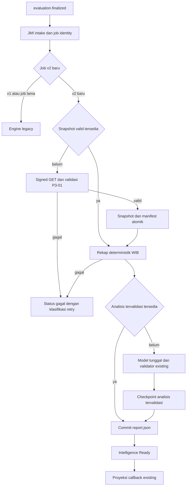

# P3-02 JoyUMKM × Hermes

**Status P3-02: PASS.** Terdapat 122 tes terfokus Hermes yang lulus, termasuk 11 tes baru. Perbandingan identitas kegagalan historis Laravel dan Hermes menghasilkan nol regresi baru.

## Alur implementasi

Job v2 baru memakai worker dan lock existing. Snapshot diambil sebelum analisis, dengan satu snapshot valid per event. Gagal sementara memakai cooldown existing 600 detik secara default, naik per siklus dengan maksimum tiga siklus retry otomatis. Kesalahan autentikasi dan dataset yang tidak valid berhenti pada tahap snapshot. Operator dapat memulihkan snapshot lewat CLI existing. Recovery memakai kembali checkpoint valid bila penulisan report final terganggu.

## Runtime dan berkas

Laravel memakai `HERMES_INTELLIGENCE_SNAPSHOT_SECRET` dan `HERMES_INTELLIGENCE_SNAPSHOT_TOLERANCE_SECONDS`. Konfigurasi lokal dimuat ulang dengan `php artisan config:clear`. Hermes menyimpan `INTELLIGENCE_SNAPSHOT_BASE_URL` dan `INTELLIGENCE_SNAPSHOT_SECRET` pada `/opt/data/joyumkm-intelligence/state/snapshot.env`, mode 0600 milik `hermes:hermes`. Base Docker yang diverifikasi ialah `http://host.docker.internal:8000/api/internal/intelligence/events`. Secret identik antarsisi dan terpisah dari secret webhook/callback.

- Laravel: konfigurasi `.env` lokal dan evidence/dokumen P3-02. Endpoint dan kode aplikasi memakai implementasi P3-01.
- Hermes: `jmi/store.py`, `jmi/engine.py`, `jmi/prompt.py`, `jmi/callback.py`, `jmi/monthly.py`, `tests/test_monthly.py`, `tests/test_jmi.py`, dan `tests/test_review.py`. Kode disalin ke volume persisten dengan verifikasi SHA-256 di container one-off.
- Backup kode sebelumnya berada di `backups/jmi-pre-p3-02-20261124015800.tar.gz`. Backup tambahan untuk pembaruan tes dan penguatan validator dicatat bersama daftar hash final di evidence.
- Webhook Laravel tetap `false`. QA memakai model palsu dan data sintetis dengan database serta direktori job terisolasi.

## Handoff

- [Kontrak data dan petunjuk generator](../evidence/p3-02-data-contract.md)
- [Hasil tes dan perbandingan regresi](../evidence/p3-02-test-regression.md)
- [Sampel JSON dan rekap](../evidence/p3-02/samples)

Definisi indikator mengikuti metodologi existing. Model menulis tafsir dalam batas bukti dan validator memeriksa bentuk, referensi, angka serta frasa kebijakan. QA otomatis tidak mengukur kualitas narasi provider model nyata. Bulan berjalan merepresentasikan kondisi sampai cutoff. File `report.json` di Hermes memuat paket lengkap, sementara callback Laravel menerima proyeksi kompatibel. Jalur produksi berikutnya perlu menggunakan paket Hermes untuk membuat PDF dan Excel.

