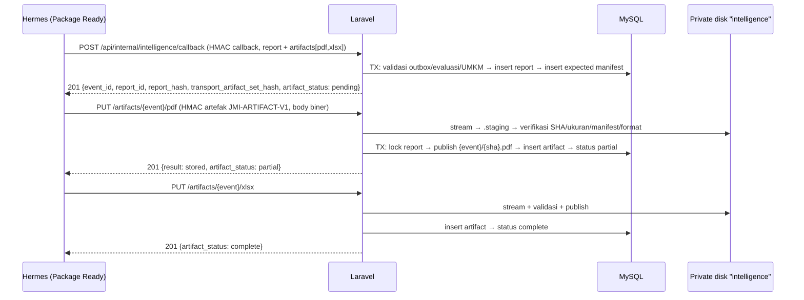

# P4-01 – P4-03 — Receiver Completion (JoyUMKM × Hermes)

## A. Verdicts
- **P4-01 FULL COMPLETION — PASS**
- **P4-02 FULL COMPLETION — PASS**
- **P4-03 FULL COMPLETION — PASS**

## B. Arsitektur

## C. Implementasi
- Route: `PUT api/internal/intelligence/artifacts/{eventId}/{kind}` (`internal.intelligence.artifacts.upload`); callback existing diperluas.
- Middleware: `VerifyIntelligenceArtifactSignature`. Controller: `IntelligenceArtifactController`. Form Request: `IntelligenceArtifactUploadRequest`.
- Services: `IntelligenceArtifactSignature`, `IntelligenceArtifactReceiver`, `IntelligenceArtifactFormatValidator`, `IntelligenceArtifactUploadException`; diubah: `IntelligenceReportService`, `IntelligenceCallbackPayload`, `IntelligenceCallbackRequest`, `IntelligenceCallbackController`.
- Model: `IntelligenceArtifactManifest`. Migration: `2026_11_24_100000_create_intelligence_artifact_manifests_table` (aditif; belum diterapkan ke dev).
- Config: `config/filesystems.php` disk `intelligence`; `config/services.php` `hermes_intelligence_artifact`; rate limiter `joyumkm-intelligence-artifact`.
- Env keys (tanpa nilai): `HERMES_INTELLIGENCE_ARTIFACT_SECRET`, `HERMES_INTELLIGENCE_ARTIFACT_TOLERANCE_SECONDS`, opsional `INTELLIGENCE_ARTIFACT_ROOT`.
- Dependensi baru: tidak ada.

## D. QA
- Baseline: lihat `p4-03-test-regression.md` (436 tes; 5 identitas stabil = baseline P3; 7 lainnya bergantung-urutan, tidak reproduksi).
- Tes baru: Auth 18, Storage 24 (1 skip), Manifest 31, Concurrency MySQL 6, + HMAC vectors PHP/Python 5/5.
- Suite penuh: 515 tes / 509 lulus / 1 skip / 5 gagal baseline → **0 regresi baru**.
- Lima kasus receiver: byte-identik dengan SHA Hermes, `transport_artifact_set_hash` identik dengan `manifest.json` Hermes.
- Keamanan: HMAC terikat method/path/event/kind/MIME/panjang/digest; replay/expired/future; secret kosong fail-closed; storage tidak publik; ZIP/PDF hostile ditolak.
- Failure injection & recovery: lihat `p4-02-storage-recovery.md`.
- Lab migration (fresh, rollback, re-upgrade): `p4-03-lab-migration.txt`.

## E. Handoff klien Hermes P4-04
- **Callback**: POST `/api/internal/intelligence/callback`, header `X-Intelligence-Timestamp` + `X-Intelligence-Signature` = HMAC-SHA256(callback secret, `"{ts}.{body}"`), body ≤ 2 MiB, JSON `Content-Type: application/json`, sertakan `artifacts` (transport projection pdf+xlsx). Respons 201/200 memberi `report_id`, `report_hash`, `transport_artifact_set_hash`, `artifact_status`. Simpan `transport_artifact_set_hash` dan pastikan sama dengan nilai manifest lokal.
- **Upload**: PUT `/api/internal/intelligence/artifacts/{event_id}/{kind}`, kontrak lengkap + golden vectors di `docs/evidence/p4-01-upload-api-contract.md`, `p4-01-hmac-vectors.json`, `p4-01-verify-vectors.py`.
- Batas 10.485.760 byte; `Content-Length` wajib; tanpa chunked/encoding.
- Sukses: 201 `stored`, 200 `duplicate` (keduanya final). Retryable: 429, 503, 404 (callback belum terproses), kegagalan jaringan. Permanen: 401 (setelah satu resign), 409, 413, 415, 422 (kecuali verifikasi ulang digest lokal gagal).
- Urutan PDF/XLSX bebas; selesai bila respons `artifact_status=complete`.
- **Konsumsi aman**: sebelum transport, Hermes harus memverifikasi paket (Package Ready) dan membaca byte persis yang diikat manifest (hash ulang file yang akan dikirim = `sha256` manifest; tolak symlink/file berubah) lalu mengirim byte yang sama.

## F. Deployment
- Implementasi source: SELESAI. Migration dev: **BELUM diterapkan** (Pending). Receiver belum aktif di dev/produksi.
- Persyaratan: ekstensi `zip`; secret artefak ≥32 byte acak (berbeda dari secret lain); root privat dengan izin/ACL terbatas; batas body web server ≥ 11 MiB; HTTPS non-lokal; jalankan migration saat rollout P4-07.
- Tetap: `HERMES_WEBHOOK_ENABLED=false`, `JMI_ARTIFACT_PIPELINE_ENABLED=0`.
- **NOT RUN**: migration di dev; uji symlink Linux & izin 0600/ACL Windows; klien Hermes nyata (P4-04); upload nyata ke dev/produksi; suite Hermes (tidak diubah); HTTP melalui nginx/PHP-FPM sungguhan.
- Catatan: `vendor/bin/pint --dirty` memformat ulang `docs/evidence/p3-07/seed.php` (kosmetik).
