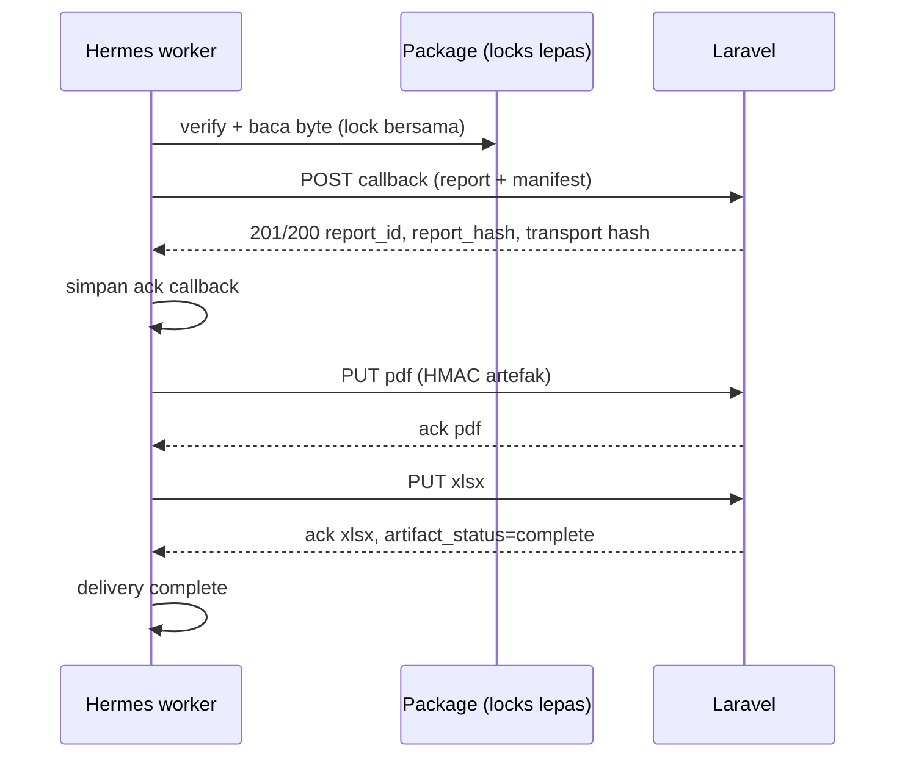
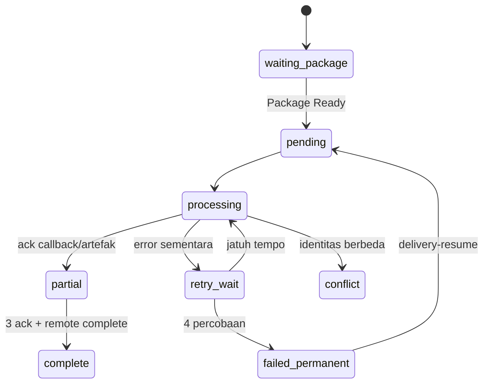
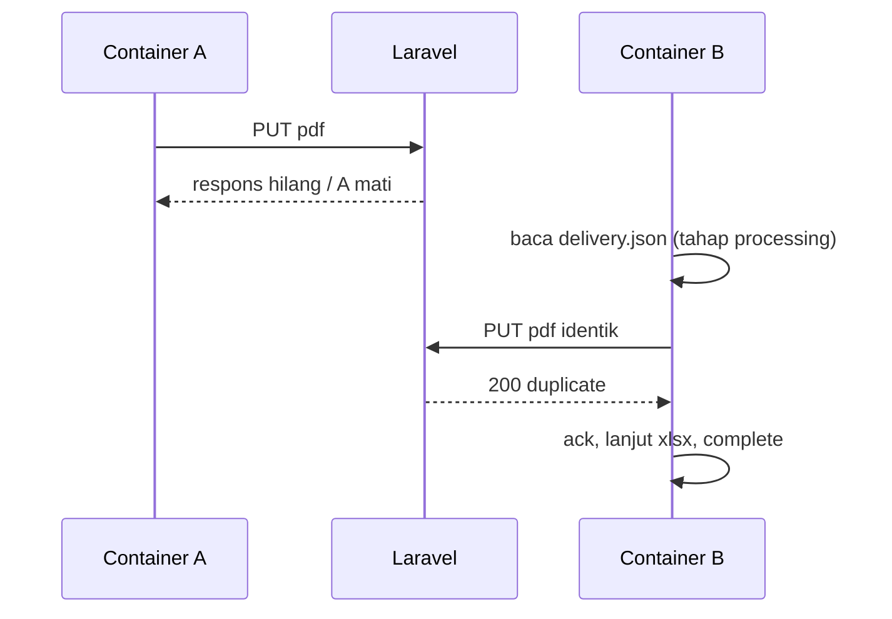

# P4-04 & P4-05 — Delivery Completion

## A. Verdict
P4-04 FULL COMPLETION — PASS. P4-05 FULL COMPLETION — PASS (dengan batas yang tercantum di [audit P4-05](P4-05_JoyUMKM_Automatic_Delivery_Recovery.md)). P4-06 tidak dimulai.

## B. Arsitektur

## C. Implementasi
Modul: `transport.py`, `delivery.py`; ubahan `callback.py` (`http_request`), `artifacts.py` (`read_package`), `store.py` (`delivery_eligible`, penanda), `engine.py` (hook process/recover), `__main__.py` (CLI). Skema `delivery.json`, retry, urutan lock `.delivery→.pipeline→dir→.proc→.snap→.lock→pdf→xlsx`, konfigurasi: lihat kontrak P4-04/P4-05. File berubah di Hermes: 5 diubah, 2 modul baru, 3 berkas tes + 1 fixture. Laravel: tidak ada perubahan kode (dokumen/evidence saja).

## D. QA
Lihat [P4-04 QA](../evidence/p4-04-transport-qa.md), [integrated](../evidence/p4-05-integrated-qa.md), [recovery](../evidence/p4-05-recovery-evidence.md), [regresi](../evidence/p4-05-test-regression.md).

## E. Handoff P4-06
Identitas: `event_id` → satu `intelligence_reports` (`id` = `report_id`, tersimpan di `delivery.callback.report_id`); satu `intelligence_artifact_manifests` (unik per report; hash transport = `manifest.json.transport_artifact_set_hash`); dua `intelligence_artifacts` (pdf, xlsx). `artifact_status`: pending → partial → complete (hanya maju). Disk `intelligence` (privat, tanpa URL); `IntelligenceArtifactReceiver::verifyStored()` membuktikan file ada, ukuran, SHA-256 — wajib dipakai sebelum melayani unduhan. Akses unduhan harus terotorisasi (pemilik UMKM/role) dan tidak boleh mengembalikan path. `complete` di Hermes hanyalah ack historis; kebutuhan P4-06: API status per event/report dan unduhan terotorisasi, serta (opsional) endpoint verifikasi integritas remote. Hermes tidak mendeteksi korupsi remote.

## F. Handoff P4-07
Migration P4 belum diterapkan ke dev (hanya di DB QA terisolasi); provisioning `HERMES_INTELLIGENCE_ARTIFACT_SECRET` (Laravel) dan `INTELLIGENCE_ARTIFACT_SECRET`/`BASE_URL` (Hermes, `artifact.env` 0600) — belum dikonfigurasi di runtime; verifikasi ACL Windows dan izin/symlink Linux; QA nginx/PHP-FPM (`client_max_body_size 11m`, `post_max_size ≥ 11M`; image QA default 8M membuat satu tes P4-01 gagal); validasi PDF terkompresi di receiver terbatas; worker/scheduler harus memuat env rollout (`JMI_ARTIFACT_PIPELINE_ENABLED`, `JMI_ARTIFACT_DELIVERY_ENABLED`) dan menjalankan `recover`; rollout bertahap dengan kill switch (`JMI_ARTIFACT_DELIVERY_PAUSED` atau `JMI_HOME/delivery.pause`); job historis (evaluasi 9–11, 3 report, 7 archived_unmatched) tetap tidak di-enroll; sisa cek operasional P1.

## G. Handoff P5
Antarmuka lokal: `jmi.pipeline.get_ready_package(event_id)` / `transport.prepare_verified_package(event_id)` (byte PDF/XLSX terverifikasi, `artifact_set_hash` imutabel). Gmail wajib independen: P5 tidak boleh bergantung pada keberhasilan delivery Laravel. Consent/pull penerima dan SMTP tetap scope P5 (tidak dikerjakan).

## H. Deployment & cleanup
Backup `backups/jmi-pre-p4-04-p4-05-20261124.tar.gz`; 11 file dideploy ke `hermes_data:/joyumkm-intelligence/`, SHA-256 cocok ([daftar](../evidence/p4-05/deployment-sha256.txt)); flag produksi tetap mati; `state/` produksi identik. Docker: dihapus semua container `jmi-*` (p302–p307, p405) dan 5 container uji bernama acak yang terbukti menjalankan tes JMI, 2 network `jmi-*`, 20 volume bernama `jmi-*` serta volume anonim milik container tersebut (67 → 7 volume). Dipertahankan: `hermes-agent`, `hermes-webhook-proxy`, `hermes_data`, `joyumkm-p0-mysql`, dan seluruh container lain (quizzical_*, optimistic_euclid, qa3-php, pami-*, hermes-agent-backup*, redis, dokumen-kita-redis).
