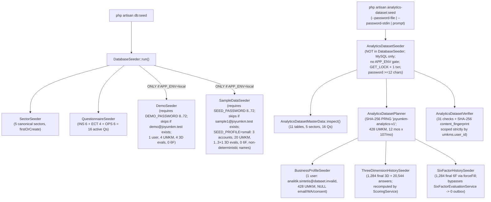

# P0-02 — Database & Seeder Reconciliation Audit

- **Audit Timestamp:** `2026-11-27T19:04:15+07:00` – `2026-11-27T19:06:07+07:00` (`Asia/Jakarta`)
- **Raw Evidence:** [database-readonly-results.md](evidence/database-readonly-results.md)
- **Gate Status (`G0-02`):** **PASS** — Full static schema, seeder, planner, verifier, side-effect, AND live MySQL 8.4.3 read-only verification completed across `joyumkm-v2`, `joyumkm_p1_prod`, `joyumkm_testing`, and `joyumkm_analytics_ro` grants.

---

## 1. Database Targets & Configuration Inventory (Verified Live)

| Environment / Purpose | Driver / Host / Port | Effective Database Name | Evidence Source | Live Verified Status |
|---|---|---|---|---|
| Local App (`.env`) | `mysql` / `127.0.0.1` / `3306` (`+00:00` UTC in Laravel, `utf8mb4`, `strict=true`) | **`joyumkm-v2`** | `.env` (sanitized), `config/database.php:47-66`, live PDO | **ONLINE** (`28` base tables, `0` views, `22` migrations `max_batch=10`, `456` `umkms`) |
| Isolated Analytics/QA (Jobsheet 6) | `mysql` / `127.0.0.1` / `3306` | **`joyumkm_p1_prod`** | `analytics-views.sql`, live PDO | **ONLINE** (`24` base tables, **`3` `SQL SECURITY DEFINER` views**, `22` migrations, `428` `umkms`) |
| Automated Testing (`phpunit.xml`) | `mysql` (`force="true"`) | **`joyumkm_testing`** | `phpunit.xml:26-28`, `tests/TestCase.php:21-24`, live PDO | **ONLINE** (`24` base tables, `0` views, `22` migrations, master seeded, `0` users/umkms) |
| Production | Not accessible from local workspace | Remote MySQL (out of scope in P0) | `docs/deployment/DOMAINESIA_DEPLOYMENT_RUNBOOK.md` | Not touched |

> **Critical CLI Safety Warning (Verified):** There is **no `.env.testing` file** in the repository. Running `php artisan migrate:fresh --env=testing` outside PHPUnit targets `.env`'s `joyumkm-v2` (`docs/jobsheets-6/runbook-P1-analytics-dataset-seeder.md:104`).

---

## 2. Actual Schema Inventory (22 Migrations Verified Live in `joyumkm-v2`)

All 22 migration files in `database/migrations/` match the live `migrations` table in `joyumkm-v2` (`max_batch=10`), `joyumkm_p1_prod`, and `joyumkm_testing` (plus 4 historical P2 timezone audit tables retained in `joyumkm-v2` only):

| Table Group | Tables | Key Constraints, FKs, Indexes & Special Properties |
|---|---|---|
| Auth & Infra | `users`, `password_reset_tokens`, `sessions`, `personal_access_tokens`, `cache`, `cache_locks`, `jobs`, `job_batches`, `failed_jobs` | `users.name` capped to `120`; `users.email` UNIQUE. **Zero `role` column, zero `is_active` column, zero `deleted_at` (no SoftDeletes anywhere).** |
| Master Data | `sectors`, `factors`, `questions` | 5 sectors (`slug` UNIQUE); 3 factors (`code` UNIQUE: `INS`, `ECT`, `OPS`); 16 active `questions` (FK→`factors.id` RESTRICT, UNIQUE `(factor_id, sort_order)`). |
| UMKM Core | `umkms` | FK `user_id`→`users.id` **CASCADE ON DELETE**; FK `sector_id`→`sectors.id` RESTRICT; **`name` COLLATE `utf8mb4_0900_ai_ci` + UNIQUE `(user_id, name)`**; 21 business profile columns incl. `business_email(254)`, `whatsapp_number(20)`, `wa_registration_status`, `business_capital`; 3 consent columns (`notification_consent_at`, `notification_consent_version`, `notification_consent_by_user_id` FK→`users.id` `NULL ON DELETE`) + CHECK `umkms_notification_consent_pair_check`. **NO cohort/synthetic tag column.** |
| Three Dimension | `evaluations`, `evaluation_answers` | `evaluations.umkm_id`→`umkms.id` CASCADE; `status` ENUM(`draft`,`final`); `ins/ect/ops_score` `decimal(7,4)`; `average_score` `decimal(4,1)`. `evaluation_answers`: FK→`evaluations.id` CASCADE, FK→`questions.id` RESTRICT, UNIQUE `(evaluation_id, question_id)`. |
| Six Factor | `six_factor_evaluations` | Explicit `ENGINE=InnoDB DEFAULT CHARSET=utf8mb4 COLLATE=utf8mb4_0900_bin`. FK `umkm_id`→`umkms.id` **RESTRICT ON DELETE**. Stored generated `active_draft_umkm_id` UNIQUE (single active draft per UMKM). `period_month CHAR(7)` (WIB) + CHECKs (`six_factor_scores_check`, `six_factor_status_check`, `six_factor_period_format_check`, `six_factor_period_status_check`). |
| Outbox & Intelligence | `webhook_outbox`, `intelligence_reports`, `intelligence_artifact_manifests`, `intelligence_artifacts`, `intelligence_deliveries`, `email_suppressions` | `webhook_outbox`: UNIQUE `event_id`, UNIQUE `(event_type, aggregate_id)`. `intelligence_reports`/`manifests`/`artifacts`: `RESTRICT ON DELETE` + **6 MySQL `BEFORE UPDATE`/`BEFORE DELETE` immutability triggers** (allowing only `artifact_status` `pending -> partial|complete`, `partial -> complete`). `intelligence_deliveries`: `synced_email_event` generated UNIQUE + JSON snapshot & CHECKs. `email_suppressions`: `email_fingerprint CHAR(64)` UNIQUE + hex CHECK. |
| Analytics Cohort | `analytics_dataset_cohorts` | `dataset_key` UNIQUE, `dataset_version`, **`user_id` UNIQUE FK→`users.id` RESTRICT ON DELETE**, `reference_start_month`, `reference_end_month`, counts, `content_fingerprint CHAR(64)`, `completed_at`. |
| P2 Timezone Audit (`joyumkm-v2` only) | `timezone_offset_anchors` (6), `timezone_offset_columns` (35), `timezone_offset_corrections` (1), `timezone_offset_snapshot` (70) | Retained historical recovery tables in `joyumkm-v2`; absent from `joyumkm_p1_prod` & `joyumkm_testing`. |

---

## 3. Seeder Call Graph & Live Compatibility Findings

### 3.1 Current Verified Seeder Call Graph

### 3.2 Critical Live Discoveries on `joyumkm-v2` vs Historical Assumptions

1. **Historical assumption corrected — `AnalyticsDatasetSeeder` WAS ALREADY RUN on `joyumkm-v2` on `2026-11-26 12:01:19`:**
   - Although `runbook-P1-analytics-dataset-seeder.md` and `FINAL_HANDOFF.md` stated P1/Jobsheet 6 targeted `joyumkm_p1_prod`, live inspection proves `joyumkm-v2` **already contains** migration #22 (`batch 10`) AND `analytics_dataset_cohorts` row #1 (`user_id=7`, `analitik.sintetis@dataset.invalid`, `428` UMKM `id 29..456`, `1,284` 3D, `1,284` 6F, `20,544` answers, identical `content_fingerprint` `229e3dc0...`, `0` contact/consent/WA, `0` outbox rows).
   - Meanwhile, **`joyumkm-v2` has `0` SQL views** (`analytics_*` views and `joyumkm_analytics_ro@localhost` `SELECT` grants currently point ONLY to `joyumkm_p1_prod`).
2. **Can the existing `AnalyticsDatasetSeeder` run again against `joyumkm-v2` right now?**
   - If invoked via `php artisan analytics-dataset:seed` with the matching secret, `verifyExisting()` would run as a read-only verification no-op (`428` intact under `user#7`), UNLESS `--reference-end` differs or any row drifted.
   - **Why it MUST NOT be kept as-is for P3:**
     1. It binds all `428` synthetic UMKM to `user#7` (`analitik.sintetis@dataset.invalid`), whereas the approved P0–P8 target requires **`458` synthetic UMKM split `153 / 153 / 152` across `sample1/2/3@joyumkm.test`** with a transfer-resilient cohort identity independent of `user_id`.
     2. **Immediate Monitoring Exposure Confirmed Live:** Because `id 29..456` are already in `joyumkm-v2`, `SixFactorMonitoringController` (`ORDER BY id LIMIT 100`) currently returns `28` pre-existing UMKM **plus `72` synthetic UMKM (`id 29..100`, of which `26` have `< 13` *Prioritas Intervensi*)**, while crowding out `356` synthetic UMKM and all future operational UMKM (`id > 456`)!
3. **Existing `sample1/2/3@joyumkm.test` Legacy Records Classified Live:**
   - `sample1` (`11` UMKM, `4` w/ `business_email`, `2` w/ consent, `4` w/ WA, `22` 3D final, **`31` 6F evals (`27` final, `1` draft, `3` cancelled)**), `sample2` (`5` UMKM, `10` 3D evals, `0` 6F), and `sample3` (`7` UMKM, `19` 3D evals, `0` 6F) = **`23` legacy/QA UMKM** (IDs `5..28` excluding `26`).
   - Verified **`0` case-insensitive UMKM name collisions** between `user#7`'s 428 synthetic names and `sample1/2/3`'s 23 existing UMKM. Thus, redistributing `user#7`'s 428 records into `sample1/2/3` (`UNIQUE(user_id, name)`) will NOT collide!
4. **16-Answer Contract & 428 → 458 Math:**
   - Live `joyumkm-v2` confirms `1,335/1,335` final 3D evaluations have `min=16, max=16` answers (`1,374 × 16 = 21,984` target valid).
   - Adding `30` profiles (`429..458`, `90` evals/type across 12 months) requires an isolated deterministic PRNG stream (`429..458`) preserving existing `001..428` profiles verbatim and updating `AnalyticsDatasetVerifier` month-count checks (`114..115/month`).

---

## 4. Cohort Identity & Account Reconciliation Matrix (Live Verified vs Target)

| Account / Cohort Class | Live `joyumkm-v2` Counts (`2026-11-27 19:04 WIB`) | Live `joyumkm_p1_prod` | Approved Target (`joyumkm-v2` Post-P3) |
|---|---|---|---|
| Superadmin account | **Does not exist** (`users.role` absent) | N/A | Provisioned Superadmin (`role=superadmin`); owns 0 synthetic UMKM |
| `user#1:demo@joyumkm.test` | `4` UMKM (`id 1..4`), `4` 3D (`1d,3f`), `64` ans, `0` 6F | `0` | `role=user`; **preserved intact** (credentials, IDs, data untouched) |
| `user#2:sample1@joyumkm.test` | `11` legacy/QA UMKM (`id 5..28`, `4` w/ email, `2` w/ consent), `22` 3D final, `352` ans, `31` 6F (`1d,3c,27f`) | `0` | `role=analyst`; **153** synthetic cohort UMKM (`459` 3D, `459` 6F, `7,344` ans) + non-cohort legacy disposition per operator decision |
| `user#3:sample2@joyumkm.test` | `5` legacy UMKM (`id 13..17`), `10` 3D (`1d,9f`), `154` ans, `0` 6F | `0` | `role=analyst`; **153** synthetic cohort UMKM (`459` 3D, `459` 6F, `7,344` ans) + non-cohort legacy disposition |
| `user#4:sample3@joyumkm.test` | `7` legacy UMKM (`id 18..24`), `19` 3D (`2d,17f`), `272` ans, `0` 6F | `0` | `role=analyst`; **152** synthetic cohort UMKM (`456` 3D, `456` 6F, `7,296` ans) + non-cohort legacy disposition |
| `user#5:p6-2bb54ae3bcb8bd@joyumkm.test` | `0` UMKM | `0` | `role=user`; **preserved intact** |
| `user#6:p6-2f3d519610120b@joyumkm.test` | `1` UMKM (`id 26`, P6 UAT, email+consent+WA), `0` 3D, `1` 6F final | `0` | `role=user`; **preserved intact** (incl. report #4 & artifacts) |
| `user#7:analitik.sintetis@dataset.invalid` | **`428` synthetic UMKM (`id 29..456`), `1,284` 3D final, `20,544` ans, `1,284` 6F final** (`2025-11..2026-10`) | `428` UMKM (`1..428`), `1,284` 3D, `20,544` ans, `1,284` 6F | Reconcile `428` existing records into `sample1/2/3` + add `30` (`458` total) under UMKM-level cohort identity; retire/preserve `user#7` cleanly |
| **Total `joyumkm-v2` Rows** | **`7` users · `456` UMKM (`28` non-synth + `428` synth) · `1,339` 3D · `21,386` ans · `1,316` 6F** | `1` user · `428` UMKM · `1,284` 3D · `20,544` ans · `1,284` 6F | **Preserved 28 existing UMKM + 458 synthetic cohort UMKM (`486` total if legacy kept)** (`1,374` 3D / `1,374` 6F / `21,984` ans in cohort) |

---

## 5. Seeding Side-Effect Audit & Mandatory Pre-P3 Isolation Requirement

| Side-Effect Vector | Current Mechanism | Triggered During Seeding Today? | Mandatory Isolation Rule |
|---|---|---|---|
| Model Observers / Event Listeners | **None exist** (`app/Observers/` absent; 0 `Event::listen`) | No | Never attach outbound webhooks/emails to Eloquent model events (`User::created`, `Umkm::created`, `SixFactorEvaluation::created`). |
| Model `booted()` hooks | `SixFactorEvaluation::saving` (computes WIB `period_month`); `Umkm::updating` (revokes consent on email change) | `period_month` runs (pure local); `updating` N/A on insert | Keep pure local; safe during seeding/reconciliation. |
| Onboarding Webhook (`user.registered` v1) | Explicit push inside `AuthService::register()` | **No** (verified `0` onboarding jobs) | Seeders must NEVER call `AuthService::register()` or `AnalystProvisioningService` onboarding dispatch. |
| Six Factor Outbox (`evaluation.finalized` v2) | Explicit `HermesWebhookOutbox::recordFinalization()` inside `SixFactorEvaluationService::finalize()` | **No** (verified `0` `webhook_outbox` rows for `user#7`) | Keep direct model write inside transactional seeder; assert `0` new `webhook_outbox` rows & `0` new `jobs` rows in verifier. |
| OpenWA HTTP Check & Auto-Consent | Explicit inside `UmkmService::store()` | **No** (`428/428` `user#7` rows have `NULL` email/WA/consent) | Preserve `NULL` contact/consent on all 458 synthetic UMKM. |
| **Scheduled Monitoring (`SixFactorMonitoringController`)** | Reads `Umkm::query()->orderBy('id')->limit(101)` | **YES — ALREADY EXPOSED IN `joyumkm-v2`** (`72` synthetic UMKM, `26` `< 13`, and crowding out `id > 456`) | **MANDATORY REQUIREMENT:** **Isolasi monitoring (`SixFactorMonitoringController`) terhadap dataset sintetis WAJIB selesai dan terverifikasi SEBELUM P3 seeding dijalankan** (dan sebelum `workflow:umkm-monitoring` diaktifkan kembali). |

---

## 6. Proposed Data-Preserving Reconciliation Strategy (P2–P3 Proposal)

1. **Additive Stable Cohort Identity (P2):** Add `analytics_cohort_umkms` (`cohort_id`, `umkm_id` UNIQUE FK→`umkms.id` RESTRICT, `external_key` UNIQUE `joyumkm-analytics-v1:001..458`, `initial_analyst_slot` `1..3`) and drop the single-owner `UNIQUE` constraint on `analytics_dataset_cohorts.user_id` (making it nullable).
2. **Pre-P3 Gate — Monitoring Isolation:** Refactor `SixFactorMonitoringController` to exclude all UMKM belonging to the synthetic cohort (plus test in P2/pre-P3) **BEFORE** running P3 seeding.
3. **Non-Destructive 428→458 Reconciliation in `joyumkm-v2` (P3):**
   - Preserve `user#1..6` and all `28` pre-existing UMKM (including `sample1/2/3`'s `23` legacy/QA records, `demo`'s `4` records, and `user#6` UMKM `26` with its intelligence report/artifacts/delivery) completely intact outside `analytics_cohort_umkms`.
   - Backfill `analytics_cohort_umkms` (`external_key` `001..428`) for existing `user#7` UMKM `id 29..456` **in-place (preserving `umkms.id`, evaluations, answers, timestamps, and `NULL` contact/consent)** and reassign `umkms.user_id` initially as `001..153` → `sample1`, `154..306` → `sample2`, `307..428` → `sample3` (confirmed `0` name collisions!).
   - Generate deterministic profiles `429..458` via an isolated sub-stream (`30` UMKM → `sample3`, bringing totals to **`153 / 153 / 152 = 458`**), keeping `001..428` untouched.
   - Make rerun lookup key strictly by `analytics_cohort_umkms.external_key` so subsequent reruns **never overwrite `umkms.user_id`** after legitimate Superadmin transfers.
4. **Seeder Entry Point (P3):** Local `php artisan db:seed` runs master seeders → `DemoSeeder` → Role/Superadmin & Analyst seeder → 458 cohort reconciliation/seeder (when `SEED_PASSWORD` / local flags allow); production `db:seed` runs master seeders only, requiring explicit opt-in CLI command + per-run password.
