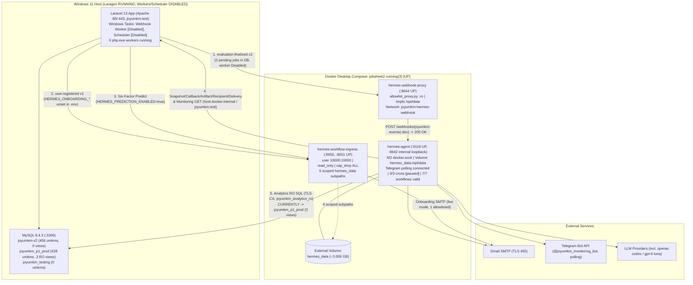

# P0-06 — Hermes Runtime, Docker & Workflow Inventory

- **Audit Timestamp:** `2026-11-27T19:02:27+07:00` – `2026-11-27T19:07:06+07:00` (`Asia/Jakarta`)
- **Raw Evidence:** [hermes-runtime-baseline.md](evidence/hermes-runtime-baseline.md)
- **Gate Status (`G0-06`):** **PASS** — Full live verification completed across Docker Compose (`jobsheet2 running(3)`), all 3 Hermes containers, listeners, all 7 Visual Workflows, webhook subscriptions, queues/receipts/dedupe state, analytics MySQL RO config/grants, Windows Scheduled Tasks (`Disabled`), and Hermes cron jobs (`[paused]`).

---

## 1. Verified Live Topology Diagram (`2026-11-27 19:03 WIB`)

---

## 2. Complete Live Hermes Workflow & Automation Inventory (§6.1 Mandatory Fields)

All **7 Visual Workflows** + **2 Webhook Subscriptions** + **3 Cron Jobs** verified live at `2026-11-27 19:03–19:07 WIB`:

| Workflow ID / Name | Trigger & Live State (`2026-11-27 19:03 WIB`) | Laravel Dependency | Data Source | Output Channel | Contract (Auth / Version / State) | Evidence (Sanitized) | Change Classification | Risk & P1 Validation |
|---|---|---|---|---|---|---|---|---|
| **1. Intelligence Reporting Pipeline (`joyumkm-events` & `joyumkm-events-dev`)** | Webhook `POST :8644` via `hermes-webhook-proxy` → `hermes-agent:8644` (`200 ok`); recovery crons `jmi-recover` (`5fa98346fe3a`) & `jmi-recover-prod` (`7371e7373803`) **`[paused]`**; JMI job dirs: `17 completed, 2 failed, 0 active` | `HermesWebhookOutbox` (`2` pending / `6` dead / `16` delivered), `jobs` (`2` queued on `hermes-webhooks`), 5 internal HMAC endpoints (`host.docker.internal` / `joyumkm.test`) | Laravel signed snapshot & recipient APIs (`joyumkm-v2`), `/opt/data/joyumkm-intelligence/state` (`uat-scope.json=False`) | Canonical report + PDF/XLSX upload + Gmail SMTP (**LIVE DISCREPANCY:** `email.env` `ENABLED=1 / PAUSED=0`; `delivery-status.env` `ENABLED=0 / PAUSED=1`) | `evaluation.finalized` v2; 6 distinct HMAC secrets; `202 accepted`/`200 duplicate`; monotonic revision & immutable DB triggers | `hermes-runtime-baseline.md`, `database-readonly-results.md`, `allowlist_proxy.py` | **PROTECTED** | **HIGH** — Before starting workers, reconcile `.env` `HERMES_WEBHOOK_ENABLED=true`, `email.env` `ENABLED=1/PAUSED=0`, and `2` pending outbox/`jobs` rows (#23/#24). |
| **2. `joyumkm-user-onboarding`** | Webhook `POST 127.0.0.1:8650/joyumkm-onboarding` (`Up`, `:8650/health` `200 ok`); `receipts.sqlite3`: `3` total, **`0` pending**, `2` `smtp_started`; `settings.json`: `enabled=True, mode=live, allowlist_count=1` | `AuthService::register`, `DeliverHermesOnboardingWebhook` (`hermes-onboarding` queue — **`HERMES_ONBOARDING_*` unset in `.env`**, `0` queued jobs) | Signed JSON payload + `receipts.sqlite3` + `email.env:ro` | Welcome HTML/plain email via SMTP (gated by `allowlist` + `JOYUMKM_ONBOARDING_LIVE_ENABLED=1` + single `JOYUMKM_ONBOARDING_LIVE_RECIPIENT`) | `user.registered` v1; `X-JoyUMKM-Signature: sha256=...` (no timestamp); `202 accepted`/`200 duplicate`/`409 conflict`; atomic `smtp_started` claim | `hermes-runtime-baseline.md`, `onboarding.py`, `onboarding_receiver.py` | **PROTECTED** (controlled reuse in P4 for real Analysts) | **HIGH** — Reconcile `.env` onboarding vars & Hermes `app_url` (`127.0.0.1:8013` legacy port in `settings.json`) / recipient allowlist; P1 test with mocked/approved recipient only. |
| **3. `umkm-predict`** | Synchronous Webhook `POST 127.0.0.1:8651/webhook/predict` (`Up`, GET probe → `405`); design `umkm-predict.json` `active=True, synchronous=True, valid=True` | `POST /api/umkms/{id}/six-factor-evaluations/predict` (`HERMES_PREDICTION_ENABLED=true` in `.env`) | Signed 6-score payload (`1..5`); `/opt/data/joyumkm-prediction/secret:ro` | Synchronous HTTP `200` / `400` + `X-JoyUMKM-Prediction-Run` | `X-JoyUMKM-Prediction-Timestamp` (60s window) + `Signature` (`ts\npath\nbody`); read-only (0 DB writes) | `hermes-runtime-baseline.md`, `prediction_receiver.py` | **PROTECTED** | **MEDIUM** — Verify Superadmin/Analyst auth on Laravel proxy route in P4; assert 0 DB/outbox writes on preview in P1. |
| **4. `umkm-monitoring`** | Scheduled Cron `04ca49ee0a72` (`workflow:umkm-monitoring`, `*/10 * * * * Asia/Jakarta`, `no_agent`) — **`[paused]` (`enabled=False`)**; `umkm-monitoring.json` `valid=True`; `monitoring-dedupe.json` `2` entries | `GET /api/internal/monitoring/six-factor/latest-finals` (`SixFactorMonitoringController`, `MAX_UMKMS = 100`) | Laravel monitoring API (`joyumkm-v2`) via `snapshot.env`; **live simulation shows `28` operational + `72` synthetic (`26` `< 13`) already in first 100 rows!** | Telegram HTML alert **Prioritas Intervensi** (`total_skor < 13`) to authorized DM via `@joyumkm_monitoring_bot`; `>= 13` logged | `VerifyIntelligenceSnapshotSignature` (`ts\nGET\n/api/...`); `MAX_RESPONSE_BYTES = 256 KB`; ledger key `{evaluation_id}:prioritas-intervensi` | `hermes-runtime-baseline.md`, `database-readonly-results.md`, `monitoring.py` | **CONTROLLED CHANGE (Mandatory Pre-P3)** | **HIGH** — **Monitoring isolation against the synthetic dataset MUST be completed BEFORE P3 seeding** and BEFORE resuming this cron! |
| **5. `umkm-analytics-assistant`** | Telegram `/analytics` (`umkm-analytics-assistant.json` `9` nodes `valid=True`), Telegram polling **`Connected`** (`12:01:52Z`); P7/P8/P10 historically `PARTIAL` | None on HTTP API; reads MySQL via 3 `SQL SECURITY DEFINER` views | **LIVE CONFIRMED:** `/opt/data/joyumkm-analytics/mysql.json` → `joyumkm_analytics_ro` (`ssl_type=ANY`) → **`joyumkm_p1_prod`** (exact 3 `SELECT` grants on `analytics_*` views = `428 / 1,284 / 1,284`) | Telegram reply to authorized operator DM | `gpt-6-luna` (`openai-codex`, fail-closed), `sqlglot 27.28.1` AST validator, `?` binding, `MAX_EXECUTION_TIME <= 5000ms`, `READ ONLY`, cap 200 rows | `hermes-runtime-baseline.md`, `database-readonly-results.md`, `analytics-views.sql` | **CONTROLLED CHANGE (P6)** | **HIGH** — Cutover RO grants & 3 views from `joyumkm_p1_prod` → `joyumkm-v2` (using UMKM-level cohort key for 458 across 3 Analysts) in P6 only. |
| **6. `uji-persisten`** | Manual native workflow (`uji-persisten.json` `valid=True`, `sha12=55b47e497210`) | None | Local workflow state | RunStore only (`83` run JSON files total) | Visual Workflow schema v1.1.0 | `hermes-runtime-baseline.md` | **UNAFFECTED** | **LOW** — Include 1 smoke run after P6 restart to verify `hermes_data` persistence. |
| **7. `jobsheet3-email` & `jobsheet3-agent-dryrun`** | Manual/historical native workflows (`valid=True`, SHA-256 unchanged: `bea9982668fc`, `f42b4e2ba730`) | None | Local workflow state | Local / dry-run | Visual Workflow schema v1.1.0 | `hermes-runtime-baseline.md`, `existing-workflows-before.sha256` | **UNAFFECTED** | **LOW** — Verify SHA-256 unchanged after P6. |
| **8. Dynamic Webhook Extensibility (`:8651/webhook/<slug>`)** | Shared ingress route in `hermes-workflow-ingress` (`Up`, hardened) | None currently active | `/opt/data/workflow-designs/*.json` + `/opt/data/joyumkm-prediction/secret:ro` | HTTP JSON response | `X-Hermes-Signature: sha256=...` | `hermes-runtime-baseline.md` | **UNAFFECTED** | **LOW** — Preserve `hermes-workflow-ingress` security boundary. |

---

## 3. Deep-Dive Impact Assessments (Confirmed Live)

### 3.1 Scheduled Monitoring (`umkm-monitoring`) — Confirmed Active Crowd-Out & Mandatory Pre-P3 Gate (`HIGH`)
- **Live `joyumkm-v2` Simulation (`2026-11-27 19:05 WIB`):**
  - `SixFactorMonitoringController` (`MAX_UMKMS = 100`, `ORDER BY id`) currently reads **`28` non-synthetic UMKM (`id 1..28`) PLUS `72` synthetic UMKM (`user#7` `id 29..100`)**.
  - Among those 72 synthetic rows, **`26` already have latest Six Factor `< 13` (*Prioritas Intervensi*)**!
  - `356` synthetic UMKM (`id 101..456`) and any new operational UMKM (`id > 456`) are **already crowded out** (`truncated=true`).
- **Mandatory Requirement:** **Isolasi monitoring (`SixFactorMonitoringController`) terhadap dataset sintetis WAJIB diselesaikan dan diverifikasi SEBELUM P3 seeding** (serta sebelum cron `workflow:umkm-monitoring` pernah diaktifkan kembali). Implementasi harus mengecualikan seluruh UMKM cohort sintetis tanpa mengubah kontrak JSON endpoint maupun membocorkan PII.

### 3.2 Conversational Analytics (`umkm-analytics-assistant`) — Controlled P6 Cutover (`HIGH`)
- **Live Verified:** `/opt/data/joyumkm-analytics/mysql.json` connects as `joyumkm_analytics_ro@localhost` (`ssl_type=ANY`, TLS CA verified) to **`joyumkm_p1_prod`**, where it holds **exactly 3 `SELECT` grants** on `analytics_umkms` (`428`), `analytics_evaluations` (`1,284`), and `analytics_six_factor_evaluations` (`1,284`). `joyumkm-v2` currently has **0 views** and **0 grants** for `joyumkm_analytics_ro`.
- **P6 Cutover Plan:** Create the 3 `SQL SECURITY DEFINER` views in `joyumkm-v2` joining the P2 UMKM-level cohort key (`458` synthetic UMKM across `sample1/2/3`, transfer-safe, excluding `demo`, legacy `23` sample rows, and all operational UMKM), grant `SELECT` ONLY on those 3 `joyumkm-v2.analytics_*` views (with TLS), update `mysql.json` `database` to `joyumkm-v2` in P6, and verify `sqlglot` AST allowlist + column compatibility.

### 3.3 Persistence, Volumes & Security Notes
- **Volume `hermes_data` (`~3.006 GB`, external):** Mounted cleanly across `hermes-agent` & `hermes-workflow-ingress` (6 subpaths). **Never run `docker compose down -v` or `docker volume prune`**.
- **Pre-existing Issues Confirmed Live:**
  - `Baseline Failure #1` (`:8644` webhook listener): **RESOLVED** (live `200 {"status": "ok", "platform": "webhook"}`).
  - `Baseline Failure #2` (`:8642` Hermes API): Listening internally inside `hermes-agent` (`connect_ex=0`), intentionally kept loopback-only.
  - **Open Credential Hygiene (`RSK-01`):** Historical OPENWA & Hermes webhook credential rotation remains pending (NOT rotated in P0).
