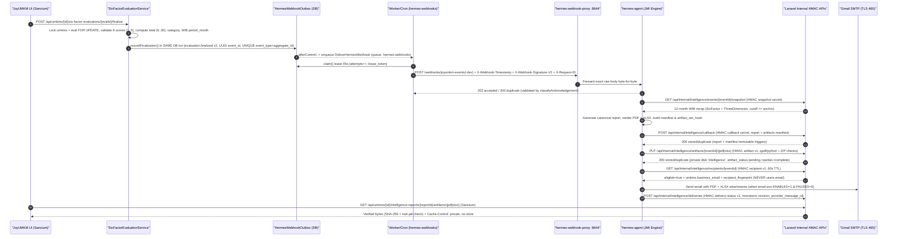
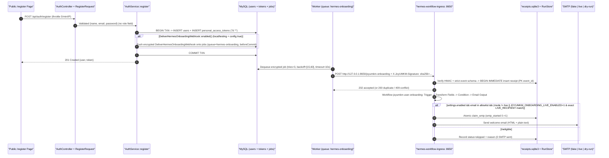

# P0-04 & P0-05 — Protected Flow Contracts Audit

- **Audit Timestamp:** `2026-11-27T18:35:53+07:00` – `2026-11-27T18:43:24+07:00` (`Asia/Jakarta`)
- **Gate Statuses:** `G0-04` **PASS** (code contract + local artifact storage verified; live DB aggregate counts linked to `G0-02` `UNKNOWN` while MySQL is stopped) · `G0-05` **PASS** (full code & Hermes receiver contract verified; critical `.env` & single-recipient live gate discrepancies documented)

---

## PART A — P0-04: Six Factor Finalization → Outbox → Hermes → PDF/XLSX → Callback → Download & Real Email

### 1. Actual End-to-End Sequence Diagram (Verified from Source)

### 2. Protected Contract Inventory (Verified Field Names & Security Boundaries — No PII/Secrets)

| Boundary | Route / Queue / File | Verified Auth & Replay Protection | Contract Fields & Invariants |
|---|---|---|---|
| **3D Assessment** | `POST /api/umkms/{id}/evaluations` (`EvaluationService.php:34-89`, `ScoringService.php:11-61`) | `auth:sanctum`, `StoreEvaluationRequest` prohibits client-supplied scores | 16 active questions (`6 INS 1..3`, `4 ECT 1..5`, `6 OPS 1..5`). Final requires all 16 answered; draft allows partial/empty. Normalized factor scores `precision=4`, `average_score` `precision=1` (`PHP_ROUND_HALF_UP`). Categories: `>=85` SANGAT BAIK, `>=70` BAIK, `>=55` CUKUP, `>=40` KURANG, `>=0` KRITIS, `null` BELUM DINILAI. |
| **6F Assessment** | `GET/PUT/PATCH /draft`, `POST /{id}/finalize`, `POST /{id}/cancel` (`SixFactorEvaluationService.php:32-152`, `SixFactorEvaluation.php:29-116`) | `auth:sanctum`, `PreserveSixFactorHttpMethod` strips method override | 6 int scores `1..5`; single active draft enforced by generated column `active_draft_umkm_id`; `total_score` `6..30`; categories `6..12` Kurang Sehat, `13..18` Cukup Sehat, `19..24` Sehat, `25..30` Sangat Sehat; WIB `period_month` auto-set on `saving`; `final`/`cancelled` strictly immutable in PHP & DB; `ON DELETE RESTRICT` on `umkms`. |
| **Outbox Event** | `webhook_outbox` + queue `hermes-webhooks` (`HermesWebhookOutbox.php:22-322`, `HermesWebhookSender.php:15-218`) | `X-Webhook-Timestamp` + `X-Webhook-Signature-V2 = HMAC-SHA256("{ts}.{rawBody}", secret)` + `X-Request-ID`; host allowlist (`127.0.0.1` HTTP only in `local`/`testing`, else HTTPS FQDN); optional UAT UUID pin | **Verified:** `event_type = "evaluation.finalized"`, `event_version = 2`, `event_id` (UUID v4), `source = "joyumkm"`, `occurred_at` (ISO-UTC), `data: {umkm_id, business_context, six_factor, three_dimension}`. Zero contact/PII/address/NIB in payload. Lease `45s`, `max_attempts` `1..10` (default 5), exponential backoff `30s..900s` + jitter + `Retry-After`. Non-retryable 4xx / invalid ACK → `dead`. |
| **Snapshot Pull** | `GET /api/internal/intelligence/events/{eventId}/snapshot` (`VerifyIntelligenceSnapshotSignature.php`, `IntelligenceSnapshotService.php`) | `X-Intelligence-Snapshot-Timestamp` + `Signature = HMAC-SHA256("{ts}\nGET\n/{path}", secret)` (tol `300s`, secret `>=32`, distinct from callback/webhook) | `schema_version: 1`, `event_id`, `event_type`, `event_version: 2`, `umkm_id`, `evaluation_id`, `cutoff`, `period_timezone: "Asia/Jakarta"`, `period_month`, `previous_period_month`, `history_months: 12`, `current`, `previous`, `history[12]`, `availability`, `source`. `Cache-Control: no-store`. |
| **Report Callback** | `POST /api/internal/intelligence/callback` (`VerifyIntelligenceCallbackSignature.php`, `IntelligenceCallbackPayload.php`, `IntelligenceReportService.php`) | `X-Intelligence-Timestamp` + `Signature = HMAC-SHA256("{ts}.{rawBody}", secret)` (tol `300s`, max 2 MiB, rejects duplicate JSON keys) | Strict typed payload (`event_id`, `evaluation_id`, `umkm_id`, `status: "completed"`, `source_event_version: 1..2`, `schema_version: 1`, `prompt_version`, `knowledge_version`, `methodology_status`, `provider`, `model`, `generated_at`, optional `artifacts[2]`, `report`). Computes canonical `report_hash` & `transport_artifact_set_hash`. Idempotent (`200 duplicate`), conflict (`409`), DB immutability triggers. |
| **Artifact Upload** | `PUT /api/internal/intelligence/artifacts/{eventId}/{pdf\|xlsx}` (`VerifyIntelligenceArtifactSignature.php`, `IntelligenceArtifactReceiver.php`, `IntelligenceArtifactFormatValidator.php`) | `JMI-ARTIFACT-V1` HMAC over method/path/ts/event/kind/MIME/length/body-sha256 (`120/min/IP`, max 10 MiB, no transfer/content encoding) | Streams to `.staging`, verifies SHA-256 & manifest match; PDF validated via isolated `python -I validate-intelligence-pdf.py` + `qpdf` (8s/384MB cap, rejects encrypted & 30+ unsafe keys); XLSX validated for zip bomb/macros/external links. Stored on private disk `intelligence` (`{event_id}/{sha256}.{kind}`). *(Minor code note: `IntelligenceArtifactContract::STORAGE_DISK` still says `'local'`, while receiver writes & verifies `'intelligence'`.)* |
| **Recipient Pull & Consent** | `GET /api/internal/intelligence/recipients/{eventId}` (`VerifyIntelligenceRecipientSignature.php`, `IntelligenceRecipientEligibilityService.php`, `IntelligenceRecipientFingerprint.php`) | `JMI-RECIPIENT-V1` HMAC (`60/min/IP`, secret distinct from 4 others + `recipient_pepper`, tol `300s`, TTL `60s`, HTTPS outside local/testing) | Strictly reads **`$umkm->business_email`** (verified zero fallback to `users.email` or actor email anywhere in `app/`). Order: `evaluation_not_final` -> `no_consent` -> `no_business_email` -> `invalid_email` -> `suppressed` (HMAC fingerprint w/ `recipient_pepper`) -> `eligible: true` + 60s TTL. `Umkm::updating` auto-revokes consent if `business_email` changes without simultaneous re-grant. |
| **Delivery Status Sync** | `POST /api/internal/intelligence/deliveries` (`VerifyIntelligenceDeliverySignature.php`, `IntelligenceDeliveryStatusController.php`) | `JMI-DELIVERY-STATUS-V1` HMAC (`60/min`, max 16 KB, secret distinct from 5 others + pepper, exempt from `trimStrings`) | Exact 19-key JSON object; monotonic `revision` (`<` stale, `==` duplicate/409, `>` enforces pinned hashes/fingerprint/message_id/terminal immutability); maps `waiting_package/processing/sending -> queued`, `recipient_changed -> skipped_ineligible`; persists `provider_message_id` and contract `idempotency_key` (fixed in P6-05). |
| **Download & UI** | `GET /api/umkms/{id}/intelligence-reports/{reportId}/artifacts[/{kind}]` (`IntelligenceArtifactDownloadController.php`, `resources/js/pages/intelligence-report*.js`) | `auth:sanctum` + `IntelligenceReportService::ensureOwned()` | Verifies manifest + disk SHA-256 + symlink/root-jail (`409 artifact_unavailable` on mismatch). `Cache-Control: private, no-store`, `X-Content-Type-Options: nosniff`. |

### 3. Runtime & Historical State Summary (Live Verified `2026-11-27 19:04–19:07 WIB`)

- **Live DB Aggregate Counts (`joyumkm-v2`, see [database-readonly-results.md](evidence/database-readonly-results.md)):**
  - `webhook_outbox`: `24` rows (`1` v1 delivered, `15` v2 delivered, `6` v2 dead, **`2` v2 pending** IDs `23, 24` created `2026-11-26 09:44–09:58`, `attempts=0`).
  - `jobs`: **`2` queued jobs** (IDs `30, 31` on queue `hermes-webhooks`, matching pending outbox rows `23, 24`); `failed_jobs`: `0`.
  - `intelligence_reports`: `10` rows (`6` `complete`, `4` `pending`, all `methodology_status=partial`); `intelligence_artifact_manifests`: `6`; `intelligence_artifacts`: `12` (`6` `pdf` + `6` `xlsx` on disk `intelligence`); `intelligence_deliveries`: `1` (`email`, `sent`, `with_msg_id=1`); `email_suppressions`: `0`.
- **Live Local Filesystem Verification (`storage/app/private/intelligence/`):** **6 event UUID folders** exist on disk, each containing a paired `.pdf` + `.xlsx` named by SHA-256 (`a424c677-...` from `2026-11-25 07:15`, plus 5 events from `2026-11-25 11:47–12:06`).
- **Live Host & Hermes Flag Discrepancies Noted (CRITICAL BEFORE ENABLING WORKERS/CRONS):**
  1. Laravel `.env` has `HERMES_WEBHOOK_ENABLED=true` targeting `http://127.0.0.1:8644/webhooks/joyumkm-events-dev`, AND `joyumkm-v2` holds `2` pending outbox/`jobs` rows (`#23/#24` from `2026-11-26`).
  2. Hermes `/opt/data/joyumkm-intelligence/state/email.env` currently has **`JMI_EMAIL_DELIVERY_ENABLED="1"` and `JMI_EMAIL_DELIVERY_PAUSED="0"`** (contradicting P6 handoff claim `ENABLED=0 / PAUSED=1`), while `delivery-status.env` has `ENABLED="0" / PAUSED="1"`, `uat-scope.json` is absent (`False`), and JMI `jobs/` has `19` dirs (`17 completed, 2 failed, 0 active`).
  3. No live dispatch or email is occurring currently **only because** both Windows Scheduled Tasks (`JoyUMKM Hermes Webhook Worker`, `JoyUMKM Laravel Scheduler`) are **`Disabled`**, `0` `php.exe` workers are running, and all `3` Hermes crons (`jmi-recover`, `jmi-recover-prod`, `workflow:umkm-monitoring`) are **`[paused]`**. **Operator must explicitly reconcile `.env`, `email.env`, and the 2 pending outbox rows before enabling any worker or cron!**
- **Historical P6 UAT Evidence (`2026-11-25`):** Event `a424c677-7c5a-4c59-86aa-e35d9d348364` (eval 15, UMKM 26) passed canonical report, PDF (10 pages), XLSX (5 sheets), manifest, callback, upload, **SMTP DATA 250 acceptance** (1 send), status sync (`provider_message_id` & `idempotency_key` reconciled), and Playwright UI download. **Inbox delivery confirmation was NOT RUN** (no inbox access).

---

## PART B — P0-05: Registration & Real Onboarding Email

### 1. Actual Registration & Onboarding Sequence Diagram (Verified from Source)

### 2. Verification of Historical Claims vs Observed Code & Runtime Config

| Historical Claim | Verification Verdict | Observed Fact & Exact Source |
|---|---|---|
| Event `user.registered` v1 | **CONFIRMED** | `app/Jobs/DeliverHermesOnboardingWebhook.php:46-58` (`event_id`, `event_type: "user.registered"`, `event_version: 1`, `source: "joyumkm"`, `occurred_at`, `data: {user_id, name, email, registered_at}`). |
| Queue `hermes-onboarding` | **CONFIRMED** | Dedicated connection & queue `'hermes-onboarding'` (`config/queue.php:47-54`, `driver: database`, `table: jobs`, `retry_after: 60`, `after_commit: false`). Job implements `ShouldBeEncrypted` (`DeliverHermesOnboardingWebhook.php:17`). |
| Dispatch-after-commit | **CORRECTED (NUANCE)** | Does **NOT** use `afterCommit`; uses **`beforeCommit()`** (`DeliverHermesOnboardingWebhook.php:34`, `config/queue.php:53`) so `users`, `personal_access_tokens`, and `jobs` commit atomically in the **same MySQL transaction** (`AuthService.php:29-48`). Rollback leaves 0 jobs. |
| HMAC signing | **CONFIRMED (NO TIMESTAMP)** | `X-JoyUMKM-Signature: sha256=<hmac_sha256(rawBody, secret)>` (`DeliverHermesOnboardingWebhook.php:81`, `onboarding_receiver.py:55-59`). Unlike v2 evaluation webhook, has **no timestamp header** (replay guarded solely by `event_id` PK in `receipts.sqlite3`). |
| Environment & receiver restrictions | **CONFIRMED (STRICT LOCAL/LOOPBACK)** | `DeliverHermesOnboardingWebhook::enabled()` (`L37-40`) requires `app()->environment('local', 'testing') && config('services.hermes_onboarding.enabled') === true`. URL regex (`L72`) strictly enforces `http(s)://127.0.0.1:<port>/joyumkm-onboarding` and `strlen(secret) >= 32`. **Cannot run in `production` without code change.** |
| Active `.env` config presence | **DISCREPANCY FOUND** | `HERMES_ONBOARDING_ENABLED`, `HERMES_ONBOARDING_WEBHOOK_URL`, and `HERMES_ONBOARDING_WEBHOOK_SECRET` are **ABSENT from active `.env`** (`config/services.php:58-62` defaults `enabled=false`). Meanwhile `C:\laragon\jobsheet2\.env` DOES have `JOYUMKM_ONBOARDING_LIVE_ENABLED=[SET]` and `JOYUMKM_ONBOARDING_LIVE_RECIPIENT=[SET]`. |
| Hermes live email policy | **CRITICAL GATE FOUND** | `onboarding.py:101-113` requires BOTH `email in settings["allowlist"]` AND (in `mode="live"`) `JOYUMKM_ONBOARDING_LIVE_ENABLED == "1"` AND **exact single-recipient match** `JOYUMKM_ONBOARDING_LIVE_RECIPIENT == email`. Any other real address returns `skipped` (`recipient_not_allowlisted` or `live_recipient_not_authorized`). |
| Historical live Gmail UAT | **NOT RUN (Historical)** | Jobsheet 3 handoff (`FINAL_HANDOFF.md:3`): fake SMTP DATA 250 PASS; real Gmail live & inbox check recorded **NOT RUN**. Post-consolidation `08-persistence-results.md:20` showed `3` receipts (`0` pending). |

### 3. Current vs Target Registration & Analyst Onboarding Matrix

| Flow | Public Registration (`POST /api/auth/register`) | Seeded Accounts (`Demo`, `sample1/2/3`, `Superadmin`) | Future Superadmin-Created Real Analyst (`P4`) |
|---|---|---|---|
| Assigned Role | `user` (locked; never user-selectable) | Explicit role per seeder (`user` / `analyst` / `superadmin`) | `analyst` (server-enforced on Superadmin route) |
| Sanctum Token Issued? | Yes (returned to registering user) | No | **No** (must NOT leak Analyst token to Superadmin) |
| Onboarding Webhook Triggered? | Yes, when `hermes_onboarding.enabled` is true | **NEVER** (seeders write `User` directly, zero observers) | **Yes** — reuses extracted transactional `HermesOnboardingDispatcher` (`user.registered` v1) |
| Real Email Delivery Prerequisites | Operator enables `HERMES_ONBOARDING_*` in `.env`, ensures worker runs on `hermes-onboarding`, and authorizes recipient/policy in Hermes (`onboarding.py` currently gates to allowlist + single `LIVE_RECIPIENT`) | Always 0 emails | Same controlled Hermes SMTP policy; **never** embed plaintext passwords in webhook payloads; use approved test recipients only in P1/P4/P7. |
