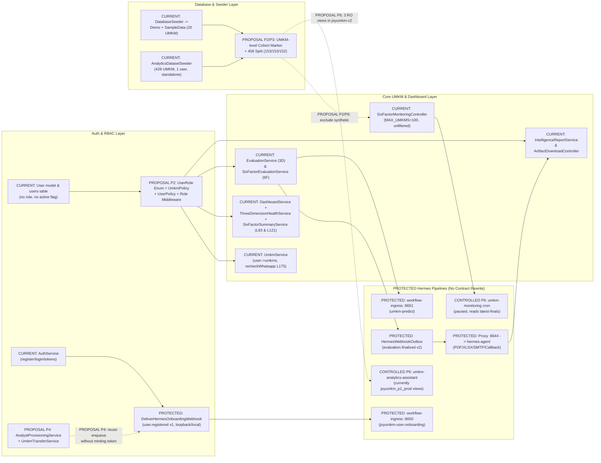

# P0-01 — Repository & Dependency Map

- **Audit Timestamp:** `2026-11-27T18:35:20+07:00` (`Asia/Jakarta`)
- **Workspace:** `C:\laragon\www\joyumkm`
- **Branch / Commit:** `main` @ `aaa05da4a1d88fa72ec95401c6ab6d80a35213f7` (`origin/main` local ref matches `HEAD`)
- **Working Tree (Pre-Audit):** Clean except 1 untracked PRD folder `docs/prd/Enhanced Superadmin-Analyst-Owner/`
- **Raw Evidence:** [repository-baseline.md](evidence/repository-baseline.md)
- **Gate Status (`G0-01`):** **PASS**

---

## 1. Architecture Summary (Verified Code vs Proposed Scope)

JoyUMKM is a **Laravel 13.17 / PHP 8.3.36 / MySQL 8.4.3** API-driven application with a **Blade + Vanilla ES Modules SPA workspace shell** (Vite 8, Tailwind CSS v4, ApexCharts, Leaflet). Authentication uses stateless **Laravel Sanctum 4.0 Bearer tokens** stored in browser `localStorage`; there are **zero** Web auth controllers, **zero** Policies (`app/Policies/` absent), **zero** Enums (`app/Enums/` absent), **zero** Observers (`app/Observers/` absent), and **no** `spatie/laravel-permission` or Breeze/Fortify packages.

### Module Inventory (Verified in `C:\laragon\www\joyumkm`)

| Layer | Count | Key Verified Files & Boundaries |
|---|---:|---|
| Routing | 3 files | `routes/web.php` (11 Blade view shells, no auth middleware), `routes/api.php` (2 public auth, 8 internal HMAC, 34 Sanctum routes), `routes/console.php` (3 `hermes:*` commands + `everyMinute()` scan) |
| Bootstrap / Providers | 3 files | `bootstrap/app.php` (middleware stack + JSON exception mapper; lacks explicit `403` message case), `bootstrap/providers.php`, `app/Providers/AppServiceProvider.php` (6 rate limiters, 0 Gates/Policies) |
| Controllers (`app/Http/Controllers/Api/`) | 16 | 10 Sanctum user-facing (`Auth`, `Dashboard`, `Umkm`, `Evaluation`, `SixFactorEvaluation`, `SixFactorPrediction`, `IntelligenceReport`, `IntelligenceArtifactDownload`, `Questionnaire`, `Location`); 6 Internal HMAC (`IntelligenceCallback`, `IntelligenceArtifact`, `IntelligenceDeliveryStatus`, `IntelligenceRecipient`, `IntelligenceSnapshot`, `SixFactorMonitoring`) |
| Middleware (`app/Http/Middleware/`) | 7 | `PreventApiResponseCaching`, `PreserveSixFactorHttpMethod`, and 5 distinct HMAC verifiers (`VerifyIntelligence{Callback,Delivery,Recipient,Snapshot,Artifact}Signature`) |
| Models (`app/Models/`) | 15 | Core (`User`, `Umkm`, `Sector`, `Factor`, `Question`, `Evaluation`, `EvaluationAnswer`, `SixFactorEvaluation`); Intelligence (`WebhookOutbox`, `IntelligenceReport`, `IntelligenceArtifact`, `IntelligenceArtifactManifest`, `IntelligenceDelivery`, `EmailSuppression`); Analytics (`AnalyticsDatasetCohort`) |
| FormRequests (`app/Http/Requests/`) | 21 | `ApiRequest` + Auth (2), Dashboard (5), Evaluation (4), Intelligence (3), UMKM (6). Four requests enforce inline ownership checks directly (`UpdateUmkmRequest`, `StoreEvaluationRequest`, `SixFactorEvaluationRequest`, `SixFactorPredictionRequest`). |
| Services (`app/Services/`) | 36 + 1 py | 9 user-scoped domain services, 19 shared/integration/intelligence services, 8 `Analytics/` deterministic dataset services, `validate-intelligence-pdf.py` |
| Jobs (`app/Jobs/`) | 2 | `DeliverHermesWebhook` (`hermes-webhooks` queue), `DeliverHermesOnboardingWebhook` (`hermes-onboarding` queue, `ShouldBeEncrypted`) |
| Console Commands (`app/Console/Commands/`) | 3 | `HermesWebhookCron` (`hermes:cron`), `AnalyticsDatasetSeedCommand`, `AnalyticsDatasetExportCommand` |
| Migrations (`database/migrations/`) | 22 | Chronological `0001_01_01_000000` through `2026_11_26_035046_create_analytics_dataset_cohorts_table.php` (6 DB immutability triggers, 0 SoftDeletes, 0 role columns) |
| Seeders (`database/seeders/`) | 8 | `DatabaseSeeder`, `SectorSeeder`, `QuestionnaireSeeder`, `DemoSeeder`, `SampleDataSeeder`, `AnalyticsDatasetSeeder`, `Analytics/{BusinessProfile,ThreeDimensionHistory,SixFactorHistory}Seeder` |
| Frontend (`resources/`) | Blade + ES Modules | `layouts/{public,app}.blade.php`, 11 views, 12 Blade components, `resources/js/{api,auth,app,workspace}.js` + page modules (`intelligence-report*.js`, `six-factor-evaluation.js`, etc.) |
| Tests (`tests/`) | 51 PHP + 15 JS | 47 Feature (406 methods), 4 Unit (12 methods), 6 Node unit tests, 7 Playwright mocked browser specs, 2 JS fixtures, 6 PHP/JSON fixtures. `phpunit.xml` forces MySQL `joyumkm_testing` (no SQLite). |

---

## 2. Graphify Availability & Freshness

- **Status:** Installed & present under `graphify-out/` (`4,646` nodes, `9,640` edges, last built `2026-11-26 11:08 WIB`).
- **Freshness:** **STALE (6 commits behind `HEAD`)** — built from commit `c009b2dd` vs `HEAD` `aaa05da4`.
- **Missing Commits from Graph:** `58e2ea1` (6F category helper), `46e1310` (Hermes prediction), `e614a39` (monitoring internal endpoint), `94ff72a` (analytics dataset seeder/cohort), `3778ab6` (analytics PRDs/runbook), `aaa05da` (Jobsheet 6 SQL views/evidence).
- **P0 Action:** Read metadata only; **no rebuild executed** per PRD §4.1. Every dependency claim below was verified directly against source files.

---

## 3. Dependency Impact Map (Verified Current Boundaries vs Proposed P2–P6 Touchpoints)

> **Diagram status:** Current verified modules (`CURRENT`) mapped to **PROPOSAL** future phase touchpoints (`P2`–`P6`). Do not treat proposed nodes as existing implementation.

---

## 4. Architecture Constraints & High-Risk Phase Boundaries (P2–P6)

| Phase | Proposed Target Scope | Files Likely Touched (Proposal Only) | Protected Boundary / Do-Not-Break Constraint |
|---|---|---|---|
| **P2** | Additive RBAC (`role` enum/column, optional active/audit columns), UMKM-level synthetic cohort marker, ownership transfer audit table, centralized `UmkmPolicy` / query scopes | New migrations, `app/Models/User.php`, `app/Models/Umkm.php`, new `app/Enums/UserRole.php`, new `app/Policies/UmkmPolicy.php`, `bootstrap/app.php` (403 handling) | Preserve `users` credentials/IDs; keep `six_factor_evaluations` & `intelligence_*` immutability triggers untouched; do not add `role` to `User` fillable. |
| **P3** | Reconcile 428→458 synthetic cohort across `sample1/2/3@joyumkm.test` (153/153/152), integrate safe local `db:seed` path + explicit prod opt-in, preserve `demo@joyumkm.test` & existing real data | `database/seeders/*`, `app/Services/Analytics/*`, `config/analytics_dataset.php`, `app/Console/Commands/AnalyticsDataset*.php` | Zero `webhook_outbox` rows, zero `jobs` rows, zero OpenWA/SMTP calls, zero destructive deletes of existing demo/operational UMKM; preserve `umkms.business_email` rules. |
| **P4** | Superadmin CRUD/management APIs (Analysts + global UMKM + ownership transfer with audit & lock), Analyst onboarding reuse, refactor scattered `$user->umkms()` checks | `routes/api.php`, `UmkmService`, `DashboardService`, `ThreeDimensionHealthService`, `SixFactorSummaryService`, `SixFactorEvaluationService`, `EvaluationService`, `IntelligenceReportService`, `UpdateUmkmRequest`, `StoreUmkmRequest`, new Superadmin controllers/services | Preserve `POST /api/auth/register` default = `user`; preserve `umkms.business_email` & consent; never leak Sanctum token during admin Analyst creation; preserve all 6 internal HMAC endpoints & contracts. |
| **P5** | Role-aware Blade/JS UI (Superadmin global dashboard, Analyst management, transfer UI, Analyst/User scoped views) | `resources/views/layouts/app.blade.php`, `resources/views/components/navigation.blade.php`, `resources/js/{workspace,auth,api}.js`, dashboard/UMKM page JS, new Superadmin views | Keep Blade shells PII-free (`PreventApiResponseCaching`); keep existing Design System (`DESIGN.md` / Tailwind v4 tokens); never rely on `localStorage` for authorization. |
| **P6** | Cutover Hermes Conversational Analytics views & read-only MySQL grants from `joyumkm_p1_prod` to `joyumkm-v2` (filtering by UMKM-level cohort marker); isolate `SixFactorMonitoringController` from synthetic cohort | `SixFactorMonitoringController.php`, SQL views & RO MySQL grants in `joyumkm-v2`, Hermes `/opt/data/joyumkm-analytics/mysql.json` (in P6 only) | Preserve all 7 Visual Workflows, `:8644` proxy/subscriptions, `:8650`/`:8651` ingress, `hermes_data` volume, paused cron states, and SMTP/Telegram credentials. |
