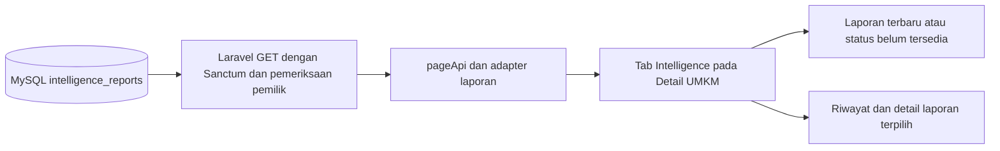
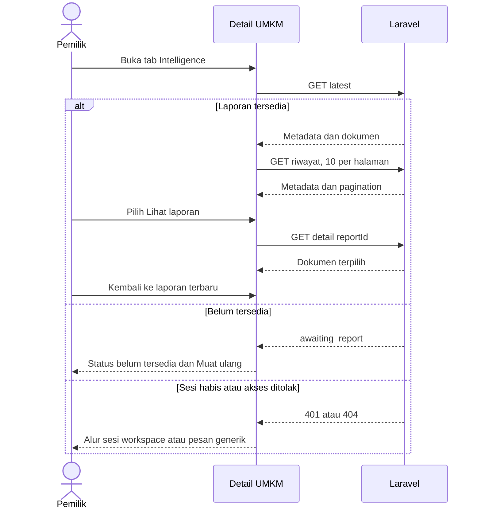

# P4-05 Frontend Intelligence Reports

**Status verifikasi: PARTIAL.** Implementasi frontend dan pengujian yang bisa dilakukan dalam batas GET read-only selesai. Login browser dengan akun pemilik aktual belum diuji.

- Repo Laravel lokal dengan baseline `c68aef1f7ba9f57d27d619a3fa2365e4b1f6020c`. Perubahan P4-04, konfigurasi, dan PRD yang sudah ada di working tree dipertahankan.
- Implementor Codex. PRD menetapkan profil Codex 6.2 Sol. Nama profil runtime tidak tersedia untuk dikonfirmasi dari sesi ini.
- Pekerjaan berhenti di P4-05. Pemeriksaan GET tidak mengirim callback atau permintaan AI/Hermes dan tidak mengubah data laporan.

## Implementasi

| Berkas | Peran |
|---|---|
| [umkm-detail.blade.php](../../resources/views/umkm-detail.blade.php) | Tab Intelligence dan region untuk laporan terbaru, riwayat, serta detail terpilih. |
| [umkm-detail.js](../../resources/js/pages/umkm-detail.js) | Aktivasi tab, identitas UMKM, dan lifecycle halaman. Profil Usaha tetap menjadi tab awal. |
| [intelligence-report.js](../../resources/js/pages/intelligence-report.js) | GET lewat `pageApi`, skeleton lokal, histori 10 per halaman, buka detail, dan kembali ke laporan terbaru. |
| [intelligence-report-data.js](../../resources/js/pages/intelligence-report-data.js) | Pemetaan metadata dan konten V4 ke struktur yang dirender sebagai teks. |
| [dashboard.css](../../resources/css/dashboard.css) | Gaya panel terbatas pada Intelligence, termasuk daftar kartu riwayat di layar kecil. |
| [Tes adapter](../../tests/js/intelligence-report.test.js), [tes Chrome](../../tests/js/intelligence-report-browser.mjs), [fixture](../../tests/js/intelligence-fixture.mjs) | Pengujian pemetaan dan interaksi dengan laporan sintetis. |

Header menggabungkan identitas UMKM, evaluasi, waktu lokal browser, status metodologi, dan aksi muat ulang. Bagian laporan memakai panel, tipografi Poppins, spacing, badge, tombol, skeleton, dan fokus dari [DESIGN.md](../../DESIGN.md). Riwayat memakai baris metadata di desktop dan kartu satu kolom pada breakpoint Detail UMKM. Tidak ditemukan selisih visual PRD yang memerlukan token baru.

## Kontrak terverifikasi

| GET P4-04B | Respons | Pemetaan UI |
|---|---|---|
| `/api/umkms/{id}/intelligence-reports/latest` | `{status, data}` | `available` berisi metadata dan dokumen. `awaiting_report` dengan `data: null` berarti laporan belum tersedia. |
| `/api/umkms/{id}/intelligence-reports?page=1&per_page=10` | `{data, links, meta}` | Daftar metadata dan pagination dari `meta.current_page` dan `meta.last_page`. Tombol membuat path relatif menggunakan nomor halaman. Batas backend 50. |
| `/api/umkms/{id}/intelligence-reports/{reportId}` | `{data}` | Metadata dan `data.report`. Adapter memeriksa ID laporan dan UMKM sebelum merender. |

Laporan aktual memiliki sembilan bagian. `findings[].statement` dipetakan menurut `type`, temuan lintas penilaian memakai `observation` dan `caveat`, dan rencana aksi memakai `action` serta `metric` per tahap 1–30, 31–60, dan 61–90 hari. Urutan prioritas mengikuti respons. Rencana menghubungkan `priority_id` ke judul prioritas jika ada. Skor ditampilkan hanya jika temuan memuat angka valid. Referensi bukti internal, provider, model, dan hash tidak masuk tampilan. Metodologi `partial` selalu terhubung ke bagian Keterbatasan.

## Bukti dan hasil

| Gate | Hasil | Bukti |
|---|---|---|
| G-05-01 | PASS | Status dan diff awal, kontrak Laravel, `DESIGN.md`, inventaris skill dan agen, serta tiga laporan aktual diaudit. |
| G-05-02 | PASS | Chrome membuka Profil Usaha sebagai default dan menemukan tab Intelligence pada detail yang sama. |
| G-05-03 | PASS | Chrome membuktikan GET lazy dengan header Bearer sintetis. Kernel Laravel mengembalikan latest, histori, dan detail aktual untuk pemilik. |
| G-05-04 | PASS | Chrome memverifikasi skeleton, available, awaiting, histori kosong, 401, 404, 5xx, timeout, retry, serta pembatalan saat berganti tab dan UMKM. |
| G-05-05 | PASS | Tes adapter memverifikasi sembilan bagian, metodologi parsial, field kosong, urutan prioritas, rencana bertahap, dan skor nol yang tersedia. |
| G-05-06 | PASS | Chrome memverifikasi halaman 1 → 2 → 1, buka detail, dan kembali ke latest. Histori aktual berisi metadata. |
| G-05-07 | PASS | XSS tampil sebagai teks tanpa node HTML. GET kernel menghasilkan 404 untuk nonpemilik pada ketiga endpoint dan 401 untuk guest. |
| G-05-08 | PASS | Chrome 1440×900, 768×1024, dan 390×844 memverifikasi ARIA, perpindahan fokus, tombol riwayat 44 px, dan tidak ada overflow dokumen. |
| G-05-09 | PASS | Chrome memverifikasi Profil, Lokasi, Kontak, Penilaian, navigasi internal, serta redirect sesi. |
| G-05-10 | PARTIAL | Build, unit, browser sintetis, dan GET aktual read-only lulus. Login browser menggunakan akun aktual tetap NOT RUN. |
| G-05-11 | PASS | MySQL menjalankan transaksi `READ ONLY`. Hash laporan sama sebelum/sesudah pengujian. Laravel mencatat nol permintaan HTTP keluar dalam smoke test. |
| G-05-12 | PASS | Skill dan agen yang digunakan tercatat di bawah. |
| G-05-13 | PASS | Poppins, kartu, border, spacing, tombol, badge, dan skeleton diperiksa melalui source dan Chrome. |

- `npm test` PASS, 44/44 termasuk tiga tes adapter baru.
- `npm run build` PASS. Vite melaporkan peringatan ukuran chunk grafik sekitar 938 kB sebelum gzip.
- `node tests/js/intelligence-report-browser.mjs` PASS pada tiga viewport dengan Chrome 158.0.8127.36, Playwright Core lokal, dan Blade/Vite aktual. Semua request API browser diintersepsi. Aplikasi uji dijalankan di loopback dengan sesi array dan SQLite in-memory sebagai pengaman.
- `php artisan route:list --path=intelligence-reports --method=GET --no-interaction -v` mengonfirmasi tiga route dengan middleware `auth:sanctum`.
- Smoke kernel Laravel pada `joyumkm-v2` memakai pengguna existing yang dipasang pada guard Sanctum dalam proses uji. Latest adalah evaluasi 14. Histori berisi 14, 13, dan 12. Ketiga detail menghasilkan 200 dan memuat keterbatasan. Halaman 2 dengan ukuran 2 berisi evaluasi 12. Guest mendapat 401. Laporan yang hilang dan akses nonpemilik mendapat 404.
- `git diff --check` dan `graphify update .` PASS.

Tangkapan layar berisi data sintetis. Literal HTML pada ringkasan adalah fixture pengujian XSS.

- [Desktop 1440](../../evidence/p4-05-intelligence-reports/1440-available.png) dan [riwayat desktop](../../evidence/p4-05-intelligence-reports/1440-history.png)
- [Tablet 768](../../evidence/p4-05-intelligence-reports/768-available.png) dan [riwayat tablet](../../evidence/p4-05-intelligence-reports/768-history.png)
- [Mobile 390](../../evidence/p4-05-intelligence-reports/390-available.png), [riwayat](../../evidence/p4-05-intelligence-reports/390-history.png), [belum tersedia](../../evidence/p4-05-intelligence-reports/390-awaiting.png), dan [error](../../evidence/p4-05-intelligence-reports/390-error.png)

## Skill dan agen

| Skill atau agen | Path lokal | Penggunaan |
|---|---|---|
| Superpowers | `C:/Users/itsba/.agents/skills/superpowers/skills/{using-superpowers,brainstorming,writing-plans,test-driven-development,verification-before-completion}/SKILL.md` | Mengikuti PRD terkunci, memeriksa cakupan sebelum edit, menjalankan tes adapter merah lalu hijau, dan mengulang pemeriksaan final. |
| Ponytail | `C:/Users/itsba/.codex/plugins/cache/ponytail/ponytail/5.3.3/skills/ponytail/SKILL.md` | Memakai komponen, API, dan tooling proyek. |
| Graphify | `C:/Users/itsba/.agents/skills/graphify/SKILL.md` | Menelusuri dependensi dan memperbarui graph kode lokal. |
| Tailwind CSS Development | `C:/laragon/www/joyumkm/.agents/skills/tailwindcss-development/SKILL.md` | Memakai kelas skeleton yang tersedia dan menguji efek reset terhadap penanda daftar. |
| Design Taste | `C:/Users/itsba/.agents/skills/design-taste/SKILL.md` | Meninjau hierarki header, kartu, breakpoint, dan fokus keyboard. |
| Humanizer | `C:/Users/itsba/.agents/skills/humanizer/SKILL.md` | Menyesuaikan pesan singkat dan jelas dalam bahasa Indonesia. |
| QA Engineer | `C:/Users/itsba/.codex/agents/qa_engineer.toml` | Mengaudit Chrome/Playwright dan metode GET read-only. |
| Frontend Engineer | `C:/Users/itsba/.codex/agents/frontend_engineer.toml` | Review independen untuk render teks, fokus, kontrak, dan lifecycle. Nomor prioritas serta status loading setelah error diperbaiki dari temuannya. |
| Ponytail Review | `C:/Users/itsba/.codex/plugins/cache/ponytail/ponytail/5.3.3/skills/ponytail-review/SKILL.md` | Dipakai oleh agen Frontend Engineer. |

## Verifikasi tersisa

T-17 baru mencakup GET pada kernel dengan pengguna pemilik yang dipasang pada guard. Login browser aktual belum diuji karena login menerbitkan token dan GET dengan Bearer biasa dapat memperbarui `last_used_at` token. Suite PHP yang menjalankan migrasi juga tidak dijalankan. Verifikasi pembaca layar fisik tidak dilakukan. Bukti aksesibilitas berasal dari pemeriksaan DOM, keyboard, ukuran kontrol, dan fokus di Chrome.
