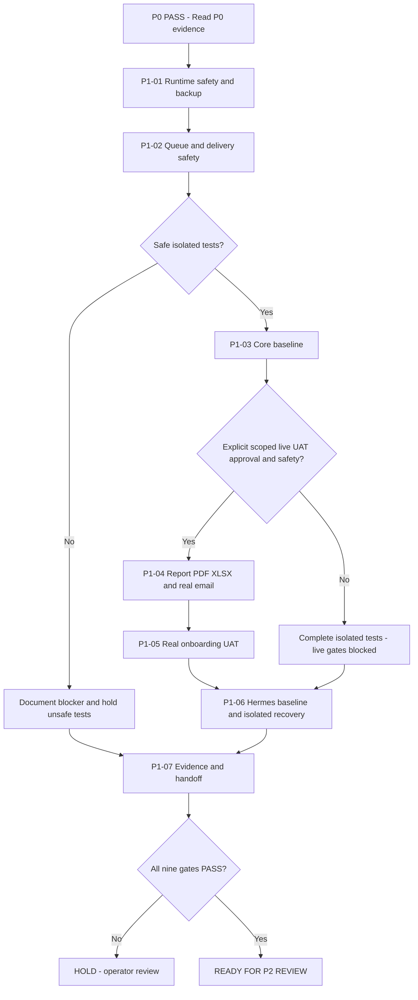

# PRD P1 — Existing Workflow Baseline & Controlled UAT

**Project:** JoyUMKM — Multi-Role Management, Unified Analytics & Workflow Preservation  
**Phase:** P1 / P0–P8  
**Version:** 1.0 · 27 November 2026  
**Repository:** `https://github.com/joytimess/dip-joyumkm`  
**Local workspace:** `C:\laragon\www\joyumkm`  
**Execution agent:** Gemini 4 Hydrogen · High effort (operator-selected)  
**Authorization:** P1 baseline verification only; live side effects require the explicit authorization boundary in section 4.  
**Status:** READY FOR EXECUTION; no P1 tests have been executed by the author of this PRD.

---

## 1. Mandate

Act as a senior Laravel QA engineer, MySQL database engineer, integration reliability engineer, and Hermes workflow auditor. Establish a reproducible, evidence-backed baseline for the existing application and all Hermes integrations before implementation of multi-role access, ownership transfer, and the expanded analytics cohort.

Read the actual repository and P0 handoff before doing anything. P0 is reported PASS (8/8 gates), but its findings are not proof that live business flows work. P1 must distinguish source inspection, structural validation, automated test results, isolated execution, and actual end-to-end delivery. Do not claim success on a stronger evidence level than what was observed.

P1 is an assessment and controlled UAT phase, not RBAC implementation or a general repair phase. Do not implement the permanent monitoring fix, add roles, transfer data, seed the 458 cohort, migrate analytics, or change protected business contracts. Stop at the P1 handoff. Do not proceed to P2 automatically.

## 2. Required source of truth and P0 handoff

Open the following local files (resolve exact paths if renamed):

- `docs/prd/Enhanced Superadmin-Analyst-Owner/PRD-P0-JoyUMKM-Comprehensive-Audit.md`
- `docs/development/multi-role-unified-analytics/phase-0/P0-FINAL-HANDOFF.md`
- `docs/development/multi-role-unified-analytics/phase-0/P0-AUDIT-REPORT.md`
- `docs/development/multi-role-unified-analytics/phase-0/P0-P1-BASELINE-TEST-PLAN.md`
- `docs/development/multi-role-unified-analytics/phase-0/P0-RISK-REGISTER.md`
- `docs/development/multi-role-unified-analytics/phase-0/P0-BACKUP-AND-ROLLBACK-PLAN.md`
- `docs/development/multi-role-unified-analytics/phase-0/P0-PROTECTED-FLOW-CONTRACTS.md`
- `docs/development/multi-role-unified-analytics/phase-0/P0-DATABASE-SEEDER-AUDIT.md`
- `docs/development/multi-role-unified-analytics/phase-0/P0-RBAC-AND-OWNERSHIP-AUDIT.md`
- `docs/development/multi-role-unified-analytics/phase-0/P0-HERMES-WORKFLOW-INVENTORY.md`
- The four evidence files and repository/dependency map in the P0 directory.

Review all 14 P0 documents, relevant tests, runtime scripts, configuration and actual code. Reconcile any discrepancy between this PRD, the P0 evidence and current local runtime. Do not overwrite P0 evidence. This PRD was authored from the operator's P0 closure summary and prior approved requirements, not from independent inspection of the 14 local files; therefore the execution agent must verify them directly.

### 2.1 Reported P0 closure anchor

P0 runtime closure: 2026-11-27 19:02–19:12 WIB (Asia/Jakarta). Reported source SHA: `aaa05da4a1d88fa72ec95401c6ab6d80a35213f7`, branch `main`. All observations below are historical anchors to recheck, not live facts guaranteed at P1 execution.

| Component | Reported P0 state |
|---|---|
| MySQL | 8.4.3, port 3306, 22 migrations in `joyumkm-v2`, max batch 10 |
| Main database | `joyumkm-v2`: 456 UMKM total; 428 cohort + 28 non-cohort |
| Synthetic cohort | user #7 `analitik.sintetis@dataset.invalid`; IDs 29–456; 1,284 3D evaluations, 20,544 answers, 1,284 6F evaluations, no cohort outbox |
| Non-cohort | 4 demo, 23 sample1/2/3, 1 P6 UAT (user #6); no name collision between old cohort and sample accounts at P0 |
| Analytics DB | `joyumkm_p1_prod`: 3 SQL SECURITY DEFINER views, counts 428/1,284/1,284; read-only principal `joyumkm_analytics_ro@localhost` with SSL requirement and SELECT on those views only |
| Main DB analytics views | None at P0; do not create them in P1 |
| Test DB | `joyumkm_testing`: 22 migrations, zero users/UMKM at P0; verify again before any destructive test helper is allowed |
| Compose | `jobsheet2`: `hermes-agent`, `hermes-workflow-ingress`, `hermes-webhook-proxy`; all three running |
| Visual Workflow | 7/7 structurally valid; functional execution not yet established |
| Runtime endpoints | 9119 health HTTP 200; 8650 health HTTP 200; 8651 predict GET 405; proxy to 8644 health 200; 8642 loopback internal. A GET 405 is not successful prediction |
| Pending application events | `webhook_outbox` #23/#24 pending; `jobs` #30/#31 on `hermes-webhooks` |
| Hermes state | 3 receipts, 0 pending; 17 completed JMI jobs, 2 failed, 0 active; monitoring dedupe 2 entries |
| Windows automation | `JoyUMKM Hermes Webhook Worker` and `JoyUMKM Laravel Scheduler` Disabled; 0 php.exe processes at P0 |
| Hermes cron | `jmi-recover`, `jmi-recover-prod`, `workflow:umkm-monitoring`: all paused |
| Delivery flags | `HERMES_WEBHOOK_ENABLED=true`; Hermes dev `email.env`: delivery enabled=1, paused=0; `delivery-status.env` enabled=0, paused=1; no `uat-scope.json` at P0 |
| Onboarding | `user.registered` v1; encrypted `hermes-onboarding` queue; transactional outbox/beforeCommit according to P0; `.env` missing `HERMES_ONBOARDING_*`; existing local/testing + loopback guard and single approved live-recipient gate |
| Monitoring | `MAX_UMKMS=100 ORDER BY id`: 72 cohort members selected, 26 with 6F score <13; 356 cohort members omitted; possible exclusion of later operational records |
| Backups | Prior `joyumkm-v2.sql` dated 2026-11-23 reported stale |
| Testing inventory | 51 PHPUnit files/418 methods; 15 JS/Playwright files; historical failures must be reconciled with actual test selection |
| Graphify | Existing graph reportedly 6 commits stale; source code is authoritative |
| Secret hygiene | RSK-01/RSK-08 include outstanding credential rotation and sensitive backup file; do not rotate/delete without separate approval |

### 2.2 Approved future architecture (reference only)

- `joyumkm-v2` is the target single operational database. There are already 428 synthetic profiles in it; do not re-import or reseed them in P1.
- P3 target: 458 synthetic UMKM (428 existing + 30 new), 153/153/152 split across `sample1@joyumkm.test`, `sample2@joyumkm.test`, `sample3@joyumkm.test`; 1,374 3D evaluations, 1,374 6F evaluations, 21,984 answers, 12-month history. Preserve existing 28 non-cohort records; projected total 486 absent intervening changes. Initial allocation applies to cohort only, not total Analyst holdings.
- Future Superadmin global access; Analyst owns and manages own UMKM/evaluations; public registration remains User; future authorized Analyst creation reuses onboarding. Preserve account credentials, demo and operational records. P1 tests existing registration, not an unimplemented role.
- Cohort membership independent of owner; permanent monitoring isolation must be implemented and verified in P2 before P3 seeding and before the actual monitoring cron is ever reactivated. Analytics cutover is P6, not P1.

## 3. Protected business behavior and compatibility contract

The following are non-negotiable. Baseline tests must prove current behavior or record the exact pre-existing failure; do not rewrite it to obtain a PASS.

1. Preserve `umkms.business_email` exactly as existing: schema, values outside approved UAT fixtures, validation, recipient semantics, and consent/suppression/eligibility logic. Never substitute the authenticated actor, `users.email`, Analyst or Superadmin email as the report recipient. No new global allowlist, broad mail disablement, or weakened eligibility to pass tests. A fixture may use the approved test address through normal application input.
2. Preserve 3D/6F scoring and categories, questionnaire validation, draft/final semantics, immutable finalized assessments, and history.
3. Preserve existing `evaluation.finalized` v2 contract, event identity, outbox/queue, HMAC, retry and deduplication; verify actual code before asserting any field or behavior.
4. Preserve PDF/XLSX generation, snapshot, artifact manifest/checksums, upload/callback, authorized download, Intelligence UI, real report email and delivery status synchronization.
5. Preserve existing registration service, `user.registered` v1, encrypted onboarding queue, environment and receiver guards, and actual SMTP delivery. Future creation of real Analysts must reuse this baseline; no Analyst feature now.
6. Preserve workflow definitions, subscriptions, Compose topology, persistent volume, queue state, credentials, API contracts, all seven workflows and other integration dependencies. Do not create a container, rewrite a workflow or change production.
7. Preserve pending events and old failures. A successful new test must not be achieved by dropping, consuming, canceling, replaying or altering unrelated events or records.

## 4. Execution authority, safety and fail-closed gates

### 4.1 Authorized immediately

- Read-only inspection of source and runtime; targeted automated tests using a proven isolated MySQL database; local isolated test artifacts; safe backups outside the application working tree; creation of P1 documentation/evidence only.
- Run isolated/mocked transports, in-process tests, or dedicated test server/worker with no access to unrelated operational queues and no outbound side effects. A separate Laravel process is acceptable; no new Docker containers. Verify actual network and DB targets, queue routing and configuration caching before starting.
- Use actual existing test tools and scripts where safe. Maximum **3 subagents total** if supported, otherwise execute sequentially. Primary agent is accountable for all side effects; do not allow concurrent live runs or conflicting state mutations. Do not spend effort benchmarking models.

### 4.2 Separate explicit operator authorization required

P1 approval is not blanket approval to send email, process old events, change secrets or enable automation. Before the first real side effect, present one concise consolidated preflight decision sheet, including:

- The exact approved test email mailbox (operator supplies or confirms ownership/control; redact it in evidence), authorized use for report and onboarding, and how inbox receipt will be verified. If the same address cannot satisfy registration uniqueness, ask for an approved alias or second mailbox. Do not infer authorization from P0 historical test addresses or existing database contacts.
- Proposed execution DB, app URL, queue/worker boundary, Hermes job scope, event correlation and allowlisted IDs, cleanup plan, bounded AI calls/cost, and maximum expected outbound actions (default: one report email and one onboarding email; no additional real sends without approval). Report may contain both PDF and XLSX as expected by existing contract; do not change the contract merely to satisfy the test.
- Any temporary local config/flag change with exact scope, old/new values (non-secret only), reason, restoration command and abort condition. No production config or broad flag enablement. Verify whether existing UAT guards or recipient gate can provide isolation; if not, report BLOCKED rather than invent or weaken a guard.
- Any planned write to `joyumkm-v2` (only uniquely identified, approved UAT fixture records via existing app flow; never use an existing real record or cohort member). Prefer isolated DB + compatible Hermes local endpoints; use main DB only if integration requires it and safe scoping is proven. Preserve test artifacts according to approved retention/cleanup.
- Any destructive reset of `joyumkm_testing` by test traits/migrations must be explicitly confined to that verified disposable schema and its authorized credential. If no disposable DB can be proven, do not run such tests.
- If actual pending #23/#24 and #30/#31 require action, present a separate proposed disposition per event; default is leave untouched. Do not treat approval of a fresh UAT as approval to replay old events.

Proceed autonomously with safe work while approval is outstanding. If approval is unavailable, finish all independent isolated tests and mark live gates BLOCKED/PARTIAL. Do not use fake PASS or substitute a mock for real delivery. No repetitive per-command approval requests where the operator has already authorized the exact operation class, but never bypass tool safety controls.

### 4.3 Prohibited throughout P1

- No RBAC, seeder rewrite, 428→458 mutation, ownership transfer, permanent monitoring fix, analytics DB cutover, new SQL views/grants in operational DBs, or protected business-code rewrite.
- No blanket `queue:work`, `queue:retry all`, `queue:flush`, `queue:clear`, replay/recovery job, global scheduler/cron activation, or real operational notifications. Keep both Windows Scheduled Tasks Disabled and all three existing Hermes cron jobs paused. Do not run any production recovery path, including `jmi-recover-prod`.
- No `migrate:fresh`, `db:wipe`, reset, mass delete, or seeding against `joyumkm-v2`, `joyumkm_p1_prod` or any operational/production schema. Never run destructive test helpers if connection fallback or cached config might target an operational DB.
- No Docker create/recreate/restart/remove/prune, Compose topology change, volume reset, plugin installation, broad configuration changes, or deployment. If unavailable services require startup, ask operator to handle it only after confirming auto-start risks.
- No full SQLite suite; use targeted MySQL and targeted JS/Playwright tests. Do not install packages or update lockfiles. No commit/push, Git reset/clean/checkout or destructive cleanup. Do not write application code/tests merely to turn baseline failures green; use isolated harness/evidence scripts only if they do not change tracked application behavior. Record missing coverage as such.
- No raw secret exposure, environment dumps, unredacted payloads, raw real customer email/contact data, sensitive mail screenshots or backup artifacts in Git/evidence. Never print passwords, HMAC keys, tokens, signed URLs, SMTP auth data or hashes of passwords. Never use `docker inspect` raw `.Config.Env`. Do not rotate OPENWA/Hermes credentials or delete the sensitive old backup in P1 without a separately authorized remediation task.

## 5. Work packages

### P1-01 — Runtime Safety & Backup

**Goal:** establish the baseline and prove the test environment is safe before test mutation or outbound execution.

- Read all P0 deliverables; inspect current SHA/branch/working tree, existing graph and relevant source. Record drift from P0; do not regenerate Graphify unless separately approved. Identify exact tests, test config and existing fixture helpers.
- Recheck MySQL connection, actual effective database for normal app and tests, schemas, table counts, existing cohort, critical outbox/job records, SMTP config presence, Compose project/container health, ports, runtime flags, paused cron and Disabled tasks. Inspect bounded logs without dumping secrets.
- Confirm no broad worker/scheduler running and no uncontrolled processing path. Compare pending event counts and identifiers against P0. If unexpected active processing exists, stop live path, report immediately, and request operator review rather than killing services blindly.
- Create a fresh, consistent, access-restricted backup of relevant local data and state before approved mutations. Verify the target is local and not production. Use the native MySQL backup procedure reviewed in P0 with an authorized credential, no plaintext secret in CLI/logs, and account for routines/views/triggers as applicable. Avoid exposing secrets or operational data to Git; store backups in restricted local storage outside the repo. For Hermes, capture minimum necessary state/config/workflow snapshot using a safe existing method; no raw secret copies in evidence. If live snapshot consistency cannot be assured, record limitation and hold mutation.
- Record backup timestamp, target, method, size, integrity digest, access restrictions, and restore procedure. Where approved and safe, validate restore against an already authorized isolated disposable target, never the operational DB or running Hermes volume. Otherwise clearly mark restore rehearsal NOT RUN. Do not claim a backup can be restored based solely on existence of a file. Do not overwrite stale backups.
- Prove effective testing DB using runtime configuration and `SELECT DATABASE()` from the actual test process/connection before any mutating test. Inspect `phpunit.xml`, `.env.testing`, config cache, database traits, subprocess workers and child connections. Establish least-privilege separation, including ability to deny access to operational schemas; if no reliable separation, hold destructive tests. Capture initial test DB counts.
- Prepare explicit inventory of allowed UAT records/events/recipient(s), outbound budget and safe cleanup. Verify monitoring cron remains paused and no synthetic cohort event is dispatched.

**Output:** `P1-RUNTIME-SAFETY.md`, baseline snapshots, backup metadata and preflight authorization record. **Gate:** G1-01.

### P1-02 — Pending Queue & Delivery Reconciliation

**Goal:** establish a safe fresh-event path without consuming stale events or creating duplicate deliveries.

- Inspect actual `webhook_outbox` #23/#24 and jobs #30/#31 (or current equivalents), linked evaluation/UMKM/event identifiers, enqueue/attempt timestamps, correlation, eligibility state, queue reservation/retry state and evidence of previous Hermes receipts/artifacts/email delivery. Do not print private payloads. Do not assume pending means not sent.
- Inspect the two reported failed JMI jobs, classify causes and whether they are related to stale pending events. Compare receipts, artifact manifests, callback status, delivery fingerprints and recorded SMTP outcomes, where available; distinguish unknown from failed.
- Reconcile `HERMES_WEBHOOK_ENABLED`, webhook worker state, actual route destinations and HMAC configuration (presence only), dev vs prod state path, `JMI_EMAIL_DELIVERY_ENABLED`, `JMI_EMAIL_DELIVERY_PAUSED`, delivery-status flags, onboarding gate and missing `uat-scope.json`. Read actual scripts to learn safe mode semantics; do not create arbitrary scope files or flip flags without approved plan. Verify status sync can be proven for only the new UAT event.
- Produce per-event disposition table: ID/correlation, current state, possible prior delivery, risk, recommendation (leave pending / separate approved investigation / separately approved remediation), authorization state. Default preserve existing records. Never delete queue rows or reclassify delivery as successful to make a test pass.
- Establish isolation for fresh P1 work by using existing supported per-event/queue scoping and a dedicated local execution path, with an isolated DB or explicit event-specific processing. Verify that unrelated queues, pending events and cron cannot be consumed. If the architecture only supports a broad worker, do not start it on the operational queue. Use isolated harness or block live UAT pending a safe approved approach.
- Verify receiver safeguards and exact destination of all outbound channels. Demonstrate with isolated negative tests that unknown event IDs, unexpected recipients, unauthorized callbacks and out-of-scope tasks cannot escape the test boundary. Existing production controls must remain unchanged.
- Record initial state, authorized temporary settings if any, restoration plan and post-run reconciliation. No global disable/enable as a shortcut. Continue isolated core tests if live safety is not established.

**Output:** `P1-QUEUE-RECONCILIATION.md`, pending event matrix, flag matrix, safety proof. **Gate:** G1-02 (hard prerequisite to any live UAT).

### P1-03 — Core Assessment & Application Baseline

**Goal:** capture current application behavior and reproducible regression assertions, independent of later RBAC.

- Inventory test files and test methods by feature. Select targeted MySQL suites for registration/auth, UMKM CRUD/ownership, 3D evaluation, 6F evaluation, scoring/summary/finalization, outbox, report authorization and recipient eligibility. Review test setup, transport fakes and DB reset semantics first. Record selection and omissions; no full SQLite suite.
- Execute the targeted tests on the proven disposable MySQL database. Capture actual command, exit code, counts/assertions, duration and failure messages. Do not modify existing test expectations or business code. If failure occurs, compare to P0/historical evidence and current source; label `KNOWN_BASELINE_FAILURE`, `NEWLY_OBSERVED_FAILURE`, `ENVIRONMENT_BLOCKER` or `UNCLASSIFIED` with evidence. Do not claim a historical match without reproduction or a reliable prior reference.
- Validate existing account registration and login, credential handling, duplicate registration, valid/invalid inputs and own-account access. Test cross-account access rejection under current ownership rules, not future RBAC.
- Validate CRUD UMKM, current uniqueness constraints, `business_email` normal validation/persistence and consent rules, without modifying existing records.
- Validate 3D questionnaire count/required answers and score/category boundaries from actual domain rules; validate draft→final and finalized immutability. Capture sample expected and actual scores based on existing fixtures/source.
- Validate 6F factor range and total/category boundaries, persistence, summary, finalization, exactly one outbox event where applicable, and repeat submission/retry behavior. Use fakes/isolated sinks in automated baseline; test real delivery only in P1-04.
- Exercise targeted UI/Playwright flows if existing app/browser environment supports them: login, UMKM, assessment, finalization, Intelligence UI and download authorization. Use test users/data and no real outgoing events except separately approved UAT. Record viewport and browser. Desktop is mandatory where practical; mobile coverage according to existing test plan. If unavailable, mark missing evidence, not PASS.

**Output:** `P1-CORE-ASSESSMENT-BASELINE.md`, commands/results, score matrix, UI evidence. **Gate:** G1-03.

### P1-04 — Intelligence Report: PDF, XLSX, Real Email & Status Sync

**Goal:** prove the complete existing Six Factor report flow, with one authorized real delivery and no processing of unrelated events.

**Preconditions:** G1-01 and G1-02 PASS; approved fixture, mailbox, event-specific execution mechanism, outbound budget, local runtime settings and rollback; verify no production destination; establish an auditable correlation ID/fixture marker before finalization. If any precondition fails, do not send or finalize against a live operational pipeline.

1. Create a new uniquely marked UAT user/UMKM or use a separately approved dedicated fixture via the normal application flow. Do not reuse the synthetic cohort, a customer record or pending #23/#24. Set `business_email` to the approved mailbox and capture valid consent via existing mechanism. Do not insert forged consent or change email rules. Prepare representative history where required using the approved safe fixture strategy.
2. Complete a valid 6F assessment through actual UI/API. Record expected vs actual score and category, evaluation ID, UMKM ID, event ID, outbox status and queue correlation. Confirm exactly one `evaluation.finalized` event with existing version/contract and transaction boundary. Do not dump PII payloads.
3. Process only that event through the existing authorized webhook route, HMAC validation and Hermes intake. Verify snapshot ownership/resource identity, existing report generation, bounded retries and processing status. Capture evidence from actual handlers and job state; do not fabricate status.
4. Generate actual PDF and XLSX artifacts through the real existing pipeline. Validate PDF readability and page count, XLSX opens and expected sheets/content, MIME/extension, size, manifest/checksum and SHA-256 equality across generation/upload/download as applicable. Verify required report sections and source evaluation identity against existing report specification. If a local parser is missing, use existing validation utilities or report limitation; no package installation just to pass.
5. Verify callbacks, uploads, report/artifact persistence and the authorized Tab Intelligence download in Laravel. Test unauthorized download/invalid callback with isolated negative paths, not a real malicious request against production. Confirm current user access rules.
6. Verify recipient resolved from `umkms.business_email` and consent/eligibility is valid. Send at most one real report email using existing delivery mechanism, only to the approved test mailbox. Verify SMTP acceptance and inbox receipt separately; operator may provide redacted inbox evidence. Check attachment/link contract as actually implemented, not an invented email format. If no inbox access/evidence, mark inbox receipt UNVERIFIED and G1-05 cannot PASS.
7. Verify delivery status sync using the existing callback/status mechanism and correct event/evaluation identity, including UI-visible status. Reconcile SMTP acceptance, inbox observation, Hermes delivery state and Laravel state. If email accepted but status missing, do not resend; record failure and only perform safe status reconciliation for the approved event if already authorized.
8. Test negative scenarios in isolation: missing consent, invalid/missing recipient, suppression, duplicate event, invalid HMAC/callback, failed status callback and retry. Prove PDF/XLSX behavior as specified by actual contract even when email is skipped. No real negative-case mail. Duplicate/retry test must prove no extra real send through mock/sink or existing dedupe evidence; never resend a real report just to exercise a test.
9. Compare old queue/outbox/JMI state and cohort to baseline. Capture UAT artifact paths and evidence with redaction; follow approved cleanup/retention. Never remove reports or events belonging to another user.

**Output:** `P1-INTELLIGENCE-REPORT-UAT.md`, correlated lifecycle trace, artifact metadata/hash table, redacted UI and inbox evidence, status reconciliation matrix. **Gates:** G1-04 and G1-05; recovery evidence contributes to G1-08.

### P1-05 — Registration & Real Onboarding Email

**Goal:** establish the existing onboarding baseline without implementing Analyst or weakening registration guards.

- Recheck preflight, approved unique mailbox, onboarding destination and route, `HERMES_ONBOARDING_*` presence, local/testing + loopback restrictions, encrypted `hermes-onboarding` job, transactional enqueue behavior and existing `onboarding.py` live-recipient guard. Use actual source, not assumptions about exact variable names or configuration semantics.
- If configuration is missing, document the minimal local temporary change required using existing supported options; obtain explicit approval before applying it. Do not add production support, bypass allowlist, relax recipient checks or expose credentials. If a safe configuration cannot be supplied, mark real UAT BLOCKED and still execute isolated registration tests.
- Register exactly one new account via existing normal public UI/API with the approved address. No privileged role or future Analyst feature. Record registration and committed user ID, correlated `user.registered` v1 event, queue identity, encrypted payload evidence (metadata only), receiver result and actual workflow execution.
- Process only approved onboarding event via existing scoped mechanism; at most one real onboarding email. Confirm SMTP acceptance, mailbox receipt and correct template/recipient contract. Do not send to sample/demo addresses or existing unrelated users. Verify no accidental report email triggered by registration.
- Validate invalid registration, duplicate email, unauthorized role selection where applicable, rollback behavior, duplicate event and retry in isolated tests. Do not trigger additional real emails. Confirm no unexpected new jobs in operational queue.
- Preserve real onboarding contract as later P4/P7 regression target for Superadmin-created Analyst accounts. P1 cannot claim future Analyst onboarding PASS, since RBAC is out of scope.

**Output:** `P1-ONBOARDING-EMAIL-UAT.md`, correlated event/receipt proof, redacted inbox evidence and isolated negative tests. **Gate:** G1-06.

### P1-06 — Hermes Workflow Compatibility & Recovery Baseline

**Goal:** build a complete, reproducible baseline of the actual Hermes deployment and all workflows without activating global automation or changing workflow definitions.

- Reconcile all seven Visual Workflow IDs/names against the P0 inventory and current designer definitions. Inventory additional scripts, subscriptions, routes, cron jobs and integration handlers separately; do not confuse a workflow group with an actual designer graph. Capture structural validation result, definition hash/version, trigger, input/output contract, dependencies, expected behavior, test method and result for every item.
- Verify each workflow with the safest existing supported test path: isolated functional execution, mock/sink output, scoped UAT or read-only analytics query. Record structural validation separately from functional execution. If the workflow cannot safely run with isolated external actions, mark its functional gate BLOCKED; do not substitute HTTP health or designer validation for successful execution.
- Verify UMKM Predict via the existing authorized route and valid fixture input; assert response schema, score and category against Laravel domain rules. Test boundary/invalid inputs and authentication as supported. Prior HTTP 405 from GET is not a functional PASS. Use existing endpoint/contract; do not rewrite prediction logic.
- Verify Scheduled Monitoring with an isolated fixture or snapshot and a fake/sink notification transport. Demonstrate current selection/order/cap, classification thresholds, filtering, dedupe and alert construction. Reproduce the reported inclusion of synthetic data read-only where feasible. Record RSK-06 as a pre-existing operational safety blocker; keep `workflow:umkm-monitoring` paused and never send operational Telegram alerts. Do not implement the permanent fix in P1. A controlled fixture can prove monitoring logic works for intended inputs but cannot certify the current operational scope is safe.
- Verify Conversational Analytics against its CURRENT source `joyumkm_p1_prod`, not the future target. Confirm actual DSN target without exposing credentials, read-only principal/grants, SSL requirement, allowed views and query policy. Compare safe aggregate queries with existing reference data; check 428 profiles and 1,284/1,284 evaluations if unchanged. Run representative analytical questions with expected deterministic SQL/results, and validate rejection of disallowed SQL, writes, unauthorized tables or cross-scope access using validator tests without executing unsafe SQL. Any real AI call requires the bounded approved UAT budget. No analytics views/grants/cutover on `joyumkm-v2` in P1.
- Verify onboarding and report delivery using P1-04/P1-05 evidence; avoid redundant live sends. Cover WhatsApp/Telegram/other integrations only with isolated sinks, recorded mocks or separately authorized bounded execution to an approved test destination. Never assume disabled external integrations passed live testing.
- Verify recovery and retry through isolated event-specific tests: transient ingress failure, delayed callback, duplicate event, retry limits, report recovery, delivery status sync retry and deduplication. Distinguish idempotency of report generation, webhook processing, email delivery and delivery-status callbacks. Verify a completed SMTP delivery is not resent when only status synchronization fails. Preserve the two old failed Hermes jobs and all pending operational records. Do not enable cron or run production recovery.
- Compare workflow definitions, state, runtime configuration, topology and unrelated jobs before/after. Classify intentional approved UAT state changes separately from unexpected drift. All three existing cron remain paused; both Windows tasks remain Disabled. No new containers or persistent workflow changes.

**Output:** `P1-HERMES-WORKFLOW-BASELINE.md`, per-workflow inventory/functional evidence, analytics comparisons, monitoring known-defect reproduction, retry/idempotency matrix. **Gates:** G1-07 and G1-08.

### P1-07 — Evidence, Regression Matrix & Final Handoff

**Goal:** preserve a reliable regression baseline for P2–P8 and leave the local environment in the approved safe state.

- Consolidate every test result and artifact with source SHA, actual DB target, execution method, command, exit code, timestamp, fixture/event identifiers and sanitized evidence path. Classify evidence as source-only, structural, automated isolated, controlled integration, or live end-to-end.
- Compare all results against P0, historical test evidence and approved expected behavior. Preserve original baseline defects and do not attribute them to future phases. Document gaps, causes, severity, remediation scope, phase and owner. No fabricated PASS.
- Restore approved temporary config/flags to the exact recorded initial values unless operator explicitly approved a different safe terminal state. Do not restore a state that would immediately trigger an unsafe send; hold and report conflict for operator decision. Stop only the isolated processes started for this UAT. Verify pre-existing services remain unchanged. Keep scheduled tasks Disabled and cron paused; no broad worker activation.
- Apply only the approved fixture cleanup or retention plan. Preserve audit references and authorized report artifacts. Never delete unrelated events/records or reset a shared database. Recheck old pending outbox/jobs, 428-member cohort and counts, existing owners, workflow definitions, SMTP/config state and Git diff. Identify expected UAT row deltas separately; do not claim total row count unchanged if authorized UAT added records.
- Update risk register for P2, including RSK-06 mandatory monitoring isolation before P3 and before any monitoring reactivation; owner-independent cohort membership; authorization hotspots; unique `(user_id, name)` collision; concurrency/finalization and ownership/consent concerns. Retain RSK-01 and RSK-08 until separately resolved. Do not rotate or delete anything as part of handoff.
- Produce an actionable regression matrix for each future phase, including expected tests, specific baseline evidence references, protected contracts, fixture prerequisites, and rerun triggers. Mark any unresolved live gate as BLOCKED/PARTIAL rather than waiving it.
- Produce final handoff and stop. No automatic P2, commit, push or deployment.

**Output:** `P1-BASELINE-REPORT.md`, `P1-REGRESSION-MATRIX.md`, `P1-FINAL-HANDOFF.md`, final integrity and restoration evidence. **Gate:** G1-09.

## 6. Mandatory test and contract matrix

Adapt test file names and exact expected values to actual source. Do not create arbitrary assertions that conflict with current domain rules. Existing report tests must distinguish an actual artifact from a fixture or stub. Every test needs evidence and an explicit isolation level.

| ID | Scenario | Expected baseline / assertion | Evidence level |
|---|---|---|---|
| T1-01 | DB guard and backup | Correct local targets; isolated test connection; safe backup metadata; no operational reset | Runtime safety |
| T1-02 | Old outbox/jobs and email flags | Disposition documented; unrelated events not consumed; fresh-event isolation proven | Runtime safety |
| T1-03 | Register/login | Existing normal registration and authentication; duplicate and invalid input rejected appropriately | Isolated MySQL + UI/API |
| T1-04 | UMKM CRUD/ownership | Existing own-data flow works; cross-account access rejected; business_email semantics unchanged | Isolated MySQL |
| T1-05 | Three Dimension | Valid questionnaire and expected score/category; draft/final rules; answer counts from source | Isolated MySQL |
| T1-06 | Six Factor | Valid score/category boundaries; persisted final evaluation and appropriate outbox | Isolated MySQL |
| T1-07 | Duplicate finalization | Existing idempotency and transaction semantics; no extra event | Isolated MySQL |
| T1-08 | Fresh authorized event | Actual Laravel→Hermes webhook and snapshot; correlated event; no old queue consumption | Controlled integration |
| T1-09 | PDF and XLSX | Actual valid artifacts, correct evaluation identity, manifest and checksum; upload/callback | Controlled integration |
| T1-10 | Download/UI | Artifacts accessible to authorized account; unauthorized access rejected | Controlled integration + UI |
| T1-11 | Real report email | Correct approved business_email, valid consent, exactly one delivery, SMTP acceptance and inbox evidence | Live controlled UAT |
| T1-12 | Delivery status | Actual synchronized report delivery state; correct event correlation; UI reflects state | Live controlled UAT |
| T1-13 | No consent/invalid recipient/suppression | Existing eligibility decisions; artifact behavior follows contract; no real email | Isolated test |
| T1-14 | Onboarding | Actual registration event, encrypted queue, ingress and one real email to approved mailbox | Live controlled UAT |
| T1-15 | Onboarding negative/retry | Duplicate/invalid/rollback behavior; unauthorized destination rejected; no duplicate real email | Isolated test |
| T1-16 | Predict | Existing route accepts valid input; score/category matches source; invalid input handled | Controlled integration |
| T1-17 | Monitoring | Intended fixture classifications and dedupe; existing 100-row limit/synthetic contamination reproduced; no live operational alerts | Isolated + read-only |
| T1-18 | Analytics | Existing DB/views/principal, exact known aggregates, representative queries and validator rejection | Read-only + isolated validator |
| T1-19 | Recovery/retry | Duplicate event handling, bounded retry, status-only retry not resending email; failed old jobs untouched | Isolated test |
| T1-20 | All actual workflows | Every inventoried workflow has individual functional evidence and known limitations | Appropriate per workflow |
| T1-21 | Integrity and restore | Approved changes only; config restored, old jobs unchanged, cohort unchanged, cron/tasks remain paused/disabled | Before/after reconciliation |

For each test use this record format:

`Test ID | Gate ID | Actual test/command | DB/environment | Isolation | Expected | Observed | Exit code/status | Evidence path | Failure classification | Timestamp`

Allowed result values: PASS, FAIL, PARTIAL, BLOCKED, NOT RUN. `NOT APPLICABLE` requires an explicit source-backed justification and cannot replace a mandatory requirement. Historical results and current results are separate columns where both exist.

## 7. Quality gates and decision policy

| Gate | PASS criteria |
|---|---|
| G1-01 — Runtime Safety & Backup | Current source/runtime verified; fresh protected backup with consistency/limitations documented; isolated test target proven; no uncontrolled automation; preflight authorization recorded for any live execution |
| G1-02 — Queue & Delivery Safety | Old pending events and failed jobs classified without mutation; delivery flag mismatch understood; fresh event/recipient/worker scoping demonstrably prevents unrelated processing; approved local test settings and restoration plan recorded. Hard stop for live UAT if unmet |
| G1-03 — Core Business Logic | Targeted MySQL and applicable UI/API baseline executed; registration/auth, CRUD, 3D/6F and current access rules supported by reproducible evidence; mandatory failures not waived |
| G1-04 — Intelligence Report | Actual fresh authorized finalization reaches Hermes and produces valid PDF/XLSX; existing snapshot, upload/callback, manifest/checksum and authorized UI/download verified |
| G1-05 — Real Report Email | Exactly one authorized report email, actual business_email recipient and consent verified, SMTP acceptance and inbox receipt evidenced, delivery status synced; no duplicate send |
| G1-06 — Real Onboarding Email | Existing registration path executes real onboarding for approved mailbox, event/queue/ingress correlated, one email accepted and received; no duplicate send |
| G1-07 — Hermes Workflow Compatibility | Every actual workflow inventoried and functionally exercised by approved method; prediction/analytics/monitoring evidence recorded. Known monitoring defect must be reproducible, explicitly bounded and scheduled for P2; no operational readiness claim for monitoring while unresolved. Any required workflow not safely tested remains BLOCKED/PARTIAL |
| G1-08 — Recovery & Idempotency | Isolated duplicate, retry, recovery, negative recipient/consent and status-only retry evidence proves no extra outbound effects; unrelated operational jobs unchanged |
| G1-09 — Integrity & Regression Handoff | Evidence complete; authorized mutations reconciled, temporary settings restored or operator-approved safe state documented; all known failures and P2 prerequisites explicit; no unauthorized changes or disclosure |

**Overall verdict rules:**

- **PASS / READY FOR P2 REVIEW:** all nine mandatory gates PASS, no unresolved blocker to safe P2 implementation, and all pre-existing defects explicitly documented with safeguards and owner-approved disposition where needed. P1 PASS does not authorize reactivating monitoring or claim production readiness. P2 remains unapproved until operator review.
- **PARTIAL / HOLD:** useful evidence exists but one or more mandatory tests incomplete, baseline defect requires decision, or proof weaker than required. If a known baseline failure is reproduced, retain FAIL on that test; do not relabel it PASS. Record scope of successful verification separately.
- **BLOCKED / HOLD:** necessary permissions, test isolation, recipient confirmation, runtime safety, backup or configuration preconditions prevent meaningful safe testing. Complete independent safe tasks and give exact next action.
- **FAIL / HOLD:** unexpected regression or mandatory functional failure prevents gate closure, integrity violation, unauthorized side effect or unsafe execution. Stop affected testing immediately and document containment; never silently repair or continue to P2.

Live authorization is a hard precondition, not a bureaucratic scoring item. A missing approved mailbox is not a reason to send to an arbitrary address. A previously accepted email with unsynced status is not a reason to retry SMTP. Do not count health checks or mocks as live delivery proof.

## 8. Deliverables and evidence

Write Markdown in the following directory; preserve P0 files. Create only the files actually supported by evidence. Use sanitized logs/screenshots or metadata in `evidence/` as needed; actual database dumps, real report artifacts containing private data, raw inbox content and secret-bearing configuration belong in restricted approved local storage, not Git. A path/reference in evidence is enough to identify a protected artifact.

```text
docs/development/multi-role-unified-analytics/
└── phase-1/
    ├── P1-BASELINE-REPORT.md
    ├── P1-RUNTIME-SAFETY.md
    ├── P1-QUEUE-RECONCILIATION.md
    ├── P1-CORE-ASSESSMENT-BASELINE.md
    ├── P1-INTELLIGENCE-REPORT-UAT.md
    ├── P1-ONBOARDING-EMAIL-UAT.md
    ├── P1-HERMES-WORKFLOW-BASELINE.md
    ├── P1-REGRESSION-MATRIX.md
    ├── P1-FINAL-HANDOFF.md
    └── evidence/
        ├── preflight-and-authorization.md
        ├── runtime-before-after.md
        ├── backup-metadata.md
        ├── queue-and-flags.md
        ├── mysql-test-results.md
        ├── ui-test-results.md
        ├── intelligence-event-trace.md
        ├── artifact-integrity.md
        ├── mail-receipt-and-status.md
        ├── onboarding-event-trace.md
        ├── workflow-results.md
        ├── retry-idempotency-results.md
        └── execution-action-log.md
```

Use a new timestamped run subdirectory rather than overwriting evidence of earlier execution attempts. Record Asia/Jakarta timestamps (or timezone-aware ISO 8601). Evidence must state actual command/action, target, result, and any redaction. Where user-supplied inbox proof is needed, request only the minimum redacted evidence; no credentials or mailbox access tokens.

### Regression matrix for P2–P8

For each protected flow, record baseline test ID(s), exact command or manual test procedure, fixture requirements, observed baseline result, expected invariant, affected future phases, regression triggers, and evidence reference. In particular:

- P2: current registration, own-account authorization, 3D/6F logic, report generation/recipient/status, cohort schema compatibility, and monitoring synthetic isolation before P3/any reactivation.
- P3: seed/reseed zero side effects, preserve 428 existing cohort identities/history, add 30, distribute cohort 153/153/152, preserve non-cohort data, and demonstrate monitoring exclusion before operational seeding.
- P4: real Analyst creation through existing onboarding, global Superadmin/own Analyst authorization, atomic transfer, pending report/consent/delivery behavior, uniqueness and concurrency.
- P5: role-specific UI without loss of normal assessment, Intelligence report downloads and delivery status UX.
- P6: analytics cutover with equivalent aggregates, owner-independent cohort, least privilege, monitoring isolation/pagination and all affected workflow regression tests.
- P7: controlled full application/integration regression, MySQL concurrency, security tests and authorized real UAT.
- P8: backup, controlled rollout, smoke test and rollback readiness; no production deployment without separate authorization.

### Final handoff required structure

1. Overall verdict, execution window, exact branch/SHA and actual environment.
2. G1-01 through G1-09 status matrix, supporting evidence and remaining blockers.
3. Automated test summary by selected suite: total, passed, failed, skipped, errors, assertions, actual exit codes. Separate known baseline failures from new observations and environment blockers.
4. Fresh report event trace, artifact validation and delivery results, including whether inbox receipt and status sync were observed.
5. Fresh onboarding trace and actual email receipt results.
6. Per-workflow table for all seven actual Visual Workflows, plus separate runtime integration/recovery inventory; structural vs functional vs live evidence.
7. Pending #23/#24 and #30/#31 disposition (or current equivalent), old failed JMI jobs, email flag reconciliation, monitoring defect and current safe automation state.
8. Actual backup/restore-verification status; authorized changes, fixture deltas, cleanup/retention, configuration restoration, Git diff and secret scan. Report any exceptions explicitly.
9. Updated risks and decisions for P2–P8; monitoring fix is a prerequisite to P3 seeding and any operational monitoring reactivation; P1 does not implement it.
10. Recommendation `READY FOR P2 REVIEW` or `NOT READY`; exact next action. Stop at handoff without automatically progressing.

## 9. Execution flow and stopping conditions



Immediate stop conditions for the affected execution path: unknown target DB, unexpected real recipient, old pending job consumption, unintended SMTP send, missing event scoping, unexpected worker/cron activation, wrong environment or production destination, secret exposure, protected contract modification, destructive DB command outside isolated test DB, or loss of rollback capability. Do not hide partial effects; record them and request operator action. Continue only independently safe work after a blocker.

## 10. Agent execution instruction

Begin P1 now with P0 evidence review and non-mutating preflight. Use Gemini 4 Hydrogen with High effort as selected by the operator, maximum three subagents, and the actual local environment. Work independently through all safe tasks. Present a single consolidated live-UAT authorization request when necessary; do not re-ask facts already verified or request raw secrets. Do not wait idly for live authorization if isolated baseline tasks can proceed. Use targeted MySQL and existing JS/Playwright tests; skip full SQLite. Do not fix source code, alter the 428 cohort, implement RBAC, globally enable workers/cron, send uncontrolled email, create Docker containers, or touch production. All results must be supported by actual evidence. Stop at P1 final handoff; P2 requires explicit operator approval.
