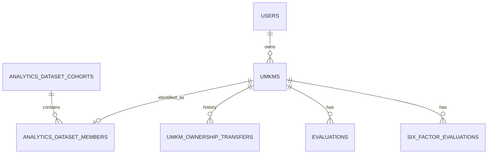

# PRD P2 — Database Schema & RBAC Foundation

**Project:** JoyUMKM — Multi-Role Management, Unified Analytics & Workflow Preservation  
**Version:** 1.0 | 27 November 2026  
**Repository:** `joytimess/dip-joyumkm`  
**Workspace:** `C:\laragon\www\joyumkm`  
**Target:** Local MySQL `joyumkm-v2`  
**Execution agent:** Gemini 4 Hydrogen — High Effort (continue existing session unless operator selects another model)  
**Authorization:** P2 only; no automatic progression to P3.  
**Strategy:** Implement first, verify essential changes only, reuse existing evidence.

## 1. Objective

Build the database and authorization foundation for Superadmin, Analyst and User; establish an owner-independent synthetic cohort; eliminate synthetic contamination of operational monitoring; and strengthen scoped Hermes event isolation. Preserve the existing assessment, report generation, email and automation behavior.

This is an implementation phase, not another comprehensive audit or QA phase. Make the smallest coherent changes required. Do not repeat P0/P1, build a large testing framework or repair unrelated legacy defects.

## 2. Timebox — mandatory

Maximum **30 minutes wall-clock per execution run**, including tool calls, inspection, implementation, verification and handoff. Record actual start time and deadline at the beginning. Use the elapsed time to decide when to stop; do not reset the clock for subtasks or subagents.

| Activity | Budget |
|---|---:|
| Preflight and reading relevant handoff/source | 3 min |
| Implementation, migration and configuration | 19 min |
| Targeted verification | 5 min |
| Final handoff | 3 min |
| **Total** | **30 min** |

- At minute 22 stop starting new implementation work; at minute 27 stop testing and write the handoff.
- Maximum one retry per failed check, within its time budget. Maximum two minutes investigating any single failure; record unresolved issues and move on only if safe.
- Maximum three subagents total, optional. Parallel work must have disjoint files and must not concurrently mutate the database or Hermes runtime.
- No full PHPUnit, pytest, SQLite, Playwright or regression suite; no new exhaustive test suite; no repeated repository-wide audit.
- Use short command timeouts and bounded polling. Do not wait indefinitely on services, dependency installation, model responses or approvals. Continue independent safe work if a prerequisite is missing.
- If the budget is exhausted, stop new work, safely complete or roll back any in-progress mutation, and report actual progress. Safety/rollback may exceed the timebox only when necessary to leave a consistent state. Do not claim PASS because time expired.
- A follow-up closure run, if separately authorized, is limited to 10 minutes. No automatic additional run.

## 3. Baseline and required reading

Read the existing P0/P1 final handoffs, relevant portions of the risk register and regression matrix, and the affected source files. Use Graphify if its existing graph is useful; it was reported stale, so source is authoritative. Do not rebuild the graph as a prerequisite to P2.

```text
 docs/development/multi-role-unified-analytics/phase-0/P0-FINAL-HANDOFF.md
 docs/development/multi-role-unified-analytics/phase-0/P0-RISK-REGISTER.md
 docs/development/multi-role-unified-analytics/phase-0/P0-RBAC-AND-OWNERSHIP-AUDIT.md
 docs/development/multi-role-unified-analytics/phase-0/P0-DATABASE-SEEDER-AUDIT.md
 docs/development/multi-role-unified-analytics/phase-0/P0-PROTECTED-FLOW-CONTRACTS.md
 docs/development/multi-role-unified-analytics/phase-1/P1-FINAL-HANDOFF.md
 docs/development/multi-role-unified-analytics/phase-1/P1-BASELINE-REPORT.md
 docs/development/multi-role-unified-analytics/phase-1/P1-REGRESSION-MATRIX.md
```

Reported P1 verdict: **CLOSED — WITH ACCEPTED LIMITATIONS**, not full PASS. Previous anchor `main @ aaa05da4a1d88fa72ec95401c6ab6d80a35213f7`. Recheck the local source; do not assume unchanged runtime or exact row counts. Do not overwrite P0/P1 evidence.

| Relevant reported evidence | Implication for P2 |
|---|---|
| 428 synthetic UMKM in `joyumkm-v2`, originally owner #7, IDs 29–456 at P0; 1,284 3D, 1,284 6F, 20,544 answers | Backfill membership from verified cohort provenance, preserve identities/history |
| P0 total 456 UMKM including 28 non-cohort; P1 added a report UAT fixture (UMKM ID 457), onboarding account (user ID 8), evaluation ID 1317, outbox #25 | Preserve all existing data, including UAT; confirm actual totals instead of interpreting IDs as counts |
| 22 migrations at P0; no role column/policy/enum; 17 ownership checks identified | Add schema and reconcile authorization at actual access boundaries |
| Current cohort row uses unique `user_id`; 3 analytics views in `joyumkm_p1_prod` rely on old owner | Preserve legacy cohort metadata and analytics compatibility; add membership independent of owner; no analytics cutover until P6 |
| Monitoring `MAX_UMKMS=100`, ordered by ID; previously 72 cohort selected, 26 scores below 13 | RSK-06: exclude cohort before LIMIT, verify zero selected cohort members; required before P3 or monitoring cron reactivation |
| Report and onboarding real email received in inbox; PDF/XLSX API downloads verified; UI not clicked | Reuse P1 evidence, do not resend or regenerate reports |
| Laravel scoped dispatch isolated outbox #25; Hermes in `normal` mode was not independently scoped | Mandatory P2 isolation improvement; preserve normal operational mode and report/email capabilities |
| Pending outbox #23/#24 and jobs #30/#31 preserved in Run 2; closure could not re-query them | Recheck read-only before mutation if accessible, never consume/replay them |
| P1 backup and isolated restore rehearsal PASS | Reuse evidence; verify freshness/scope and create a fresh restricted backup if required before P2 mutations |
| Windows tasks Disabled; 3 Hermes cron paused; no general worker; email.env restored to 1/0, status sync previously 0/1 | Keep safe runtime state; verify actual settings without printing secrets |
| APP_URL points to localhost:8000 (wrong app); JoyUMKM reported at joyumkm.test | Verify actual local origin before changing APP_URL; no wrong-host requests |
| Legacy seeder/browser/analytics and JMI_HOME failures; methodology_status=partial | Do not treat these as new regressions or expand P2 into unrelated repair |

P1 documentation contains inconsistent historical PHPUnit totals. Do not reconcile by rerunning the suites. The relevant reported targeted result is 565 passed, 1 skipped; other historical failures remain documented. P2 must independently check only its own changed boundaries.

## 4. Approved target and scope boundary

### P2 must deliver

1. Additive schema for role, owner-independent cohort membership and ownership transfer audit foundation.
2. Safe role mapping and Superadmin provisioning; public registration defaults to User.
3. Centralized authorization for existing UMKM, assessment, dashboard and report access, preserving protected business behavior.
4. Membership backfill for the verified 428 existing synthetic UMKM, with no owner reassignment or dataset regeneration.
5. Monitoring isolation before its existing 100-record cap.
6. Hermes scoped isolation that does not require globally unguarded normal-mode processing or disable artifact generation and delivery in scoped UAT.
7. Local APP_URL reconciliation and compact verification/handoff.

### Explicitly out of scope

- P3: 30 additional synthetic UMKM, initial distribution 153/153/152, analytics seeder rewrite, legacy seeder test fixes, re-running seeders.
- P4: new management API/UI for creating Analysts, actual ownership transfer, transfer orchestration and onboarding changes.
- P5: role-based UI redesign, legacy browser specs and Tab Intelligence UI verification.
- P6: analytics MySQL connection/view cutover, analytics formatting/FakeCtx defects and methodology_status investigation.
- Production rollout, credential rotation, RSK-01/RSK-08 remediation without separate authority, live Telegram/WhatsApp/analytics LLM testing, deleting old lock/password files or UAT fixtures.

The future target remains 458 synthetic UMKM in `joyumkm-v2`, split 153/153/152 among three sample Analysts, with 1,374 3D and 1,374 6F evaluations and 21,984 answers at initial seed. Preserve all non-cohort data. P2 does not change this dataset size or redistribute it.

## 5. Safety and protected contracts

- Work locally only. No production changes, commit/push, Docker container creation/recreation, full database reset, `migrate:fresh`, `db:wipe`, or operational seeding.
- Additive migrations are authorized on verified local `joyumkm-v2` after safe preflight and backup. Confirm effective DB target, inspect migration SQL/DDL and existing schema, and check rollback feasibility before running. MySQL DDL can implicitly commit; do not assume a single transaction makes an entire migration atomic. Avoid destructive down migrations or automatic rollback that drops data; document safe recovery for partial migration.
- Never reset existing passwords, remove users, overwrite business_email, fake consent, change finalized assessments, or alter old outbox/jobs/artifacts. Preserve original records and IDs, except intended role fields and new membership rows. Do not globally disable model events to hide side effects.
- Keep both Windows tasks Disabled, all three Hermes cron paused, and general workers stopped. Do not process old #23/#24 or #30/#31, re-run #25, or retry failed JMI jobs. No workflow execution, SMTP, Telegram, WhatsApp or AI calls in P2.
- No change to `umkms.business_email` schema/semantics/values, recipient resolution, eligibility, suppression, consent, score calculation, finalization lifecycle, webhook event schema/version, HMAC, idempotency, PDF/XLSX contents, callback/upload/manifest contracts, delivery/status sync or existing onboarding semantics.
- Hermes safety changes must be narrow and backward-compatible; no global flag changes, production path edits, plugin reset or replacement of existing workflows. Before writing any local Hermes state/script/config, verify actual source of truth and use a restricted backup. Do not hot-patch an ephemeral container file and present it as persistent implementation; if no supported durable path is available, record blocker.
- No secret values in source, terminal output or handoff. Do not inspect raw `.env` or `.Config.Env` into logs. Do not invent or reset passwords. Do not remove existing UAT evidence or credentials. Do not enable new outward-facing privileges just to verify a test.
- If backup is stale or actual DB/runtime scope cannot be proven, continue code-only work and mark runtime migration/application BLOCKED. No unsafe shortcuts. If a critical gate fails, do not proceed to P3.

## 6. Implementation packages

### P2-01 — Additive database migration

Inspect actual tables and migration conventions. Prefer the existing Laravel architecture over new frameworks/packages.

- Add a non-null `users.role` with safe default `user`, constrained to `superadmin`, `analyst`, `user` using a backed enum and appropriate validation/database constraints supported by the current stack. Add an index only if justified. Existing records must remain readable throughout migration; unknown roles fail closed, never default to privileged access.
- Add owner-independent membership (suggested `analytics_dataset_members`) linked to existing `analytics_dataset_cohorts` and `umkms` using FK/unique constraints, stable synthetic identity and compatible deletion rules. Adapt names/keys to actual schema; do not duplicate equivalent structures. A UMKM can belong to at most one active target cohort; identity remains unchanged after ownership changes. Reuse verified stable keys from the current generator where available. Keep old cohort `user_id` metadata and its existing compatibility behavior until the P3/P6 transition is planned.
- Prepare append-only ownership transfer audit structure if not already present: UMKM identity, from/to owner, performing actor, timestamp, and appropriate references. No transfer service execution in P2. Do not expose public write endpoints for audit records.
- Make data backfill rerunnable and safe. Separate schema changes from deterministic data backfill if useful; no destructive migration/reset. No model observers or external dispatch during migration/backfill.
- Document each intended schema/data delta, migration ordering, and safe rollback implications. Use current DB engine constraints, not speculative schema.

Suggested structure (logical only):



### P2-02 — Role and account foundation

| Account | Role after P2 |
|---|---|
| `superadmin@joyumkm.test` | Superadmin (proposed local default account; new only if absent and safely authorized) |
| `sample1@joyumkm.test` | Analyst |
| `sample2@joyumkm.test` | Analyst |
| `sample3@joyumkm.test` | Analyst |
| `demo@joyumkm.test` | User |
| `analitik.sintetis@dataset.invalid` | User temporarily; retains existing cohort ownership |
| Existing regular and P1 UAT users | User |
| New public registrants | User |

- Preserve user IDs, email addresses, password hashes and existing account state. Map the exact three verified sample accounts only; no role assignment based on arbitrary email prefix/domain. Do not overwrite any pre-existing privileged account or silently repurpose a conflicting Superadmin address. Do not create duplicate sample accounts if expected accounts are missing; report and defer missing account creation to P3 unless existing safe provisioning can be reused.
- Provision the local Superadmin through a minimal explicit, idempotent, local-only mechanism using an operator-provided secure secret or existing approved provisioning path. Never hardcode or log a password, create a publicly known default, or use the sample password by assumption. Do not trigger onboarding for this infrastructure account. If no secure credential is available, finish role implementation and mark provisioning pending; do not block independent safe work or fabricate credential. Production provisioning is separate.
- Public registration remains the existing flow with server-assigned `user` role. Reject or ignore untrusted `role`/privilege fields consistently; block mass assignment, profile updates and arbitrary request parameters from elevating a user. Preserve the existing onboarding event/queue.
- Add minimal role helpers and centralized Gate/Policy integration using repository conventions. Do not use a blanket global Gate::before grant for every ability or bypass domain rules.

### P2-03 — Centralized authorization

Introduce reusable resource authorization and query scoping. Inspect the 17 P0 ownership checks rather than adding scattered conditional logic. Relevant starting points: `UpdateUmkmRequest`, `UmkmService`, `SixFactorSummaryService`, `EvaluationService`, six-factor evaluation controllers/services, dashboard queries, history/report listing and `IntelligenceArtifactDownloadController`. Verify actual names/routes.

| Capability | Superadmin | Analyst | User |
|---|---|---|---|
| Read/list/aggregate UMKM and related assessments | Global | Own only | Own only |
| CRUD UMKM, draft/edit/finalize assessments | Authorized global | Own only | Own only |
| Download reports and view statuses | Authorized global | Own only | Own only |
| Manage Analyst / transfer UMKM | Future P4 only; prepare abilities | Deny | Deny |

- Keep existing per-resource business rules, immutable finals and validation for all roles. Superadmin authorization is not permission to bypass consent, scoring, validation or state transitions.
- Separate authenticated actor ID from resource owner ID. Never change `umkms.user_id`, `business_email`, report snapshot identity or consent provenance merely because a Superadmin acts on a resource. For any global creation path whose owner is ambiguous, keep own-creation behavior or require an explicit validated existing owner; no arbitrary owner injection. Full owner-management workflow belongs to P4.
- Apply scopes consistently to list, detail, search/filter, summary/dashboard, update/delete, nested assessment endpoints, report download and status. Derive parent access from the actual linked UMKM; reject mismatched nested IDs. Preserve existing response contracts and 403/404 conventions. Do not leak counts or existence through unscoped queries.
- Keep trusted integration endpoints under their existing authentication/authorization and event constraints, not browser role logic. Do not add a generic Superadmin bypass to Hermes HMAC/internal routes or callback validation.
- Preserve current own-user CRUD and registration behavior. Note unaddressed transfer/finalization race and `UNIQUE(user_id,name)` collision for P4; do not implement transfer mechanics now.

### P2-04 — Cohort backfill

- Identify the exact existing cohort using verified dataset key/version, cohort metadata and actual generator provenance. Historical owner #7 and IDs 29–456 are cross-checks, not sufficient standalone criteria. Do not classify all UMKM under sample accounts or use an ID range alone; exclude demo, existing sample and P1 UAT records.
- Backfill membership for all verified 428 records in a bounded transaction or safe idempotent upsert with uniqueness and FK constraints. If identity is ambiguous or actual cohort cardinality differs, stop the backfill and report the discrepancy rather than adding/removing profiles to reach 428.
- Preserve original UMKM owner, names, business_email, evaluations, answers, report artifacts and old cohort row. No generator execution, no new synthetic UMKM, no transfer or ownership reassignment.
- Verify membership count, no duplicate membership/orphans, and unchanged original UMKM/evaluation counts and ownership. A rerun should not create duplicate rows or reset ownership.
- Leave `joyumkm_p1_prod` views/grants and existing Hermes analytics connection unchanged; future views use membership in P6. Document compatibility risk of old owner-based logic for P3, so P3 must not silently break seed verification or analytics.

### P2-05 — RSK-06: operational monitoring isolation (mandatory)

Locate the actual `SixFactorMonitoringController` query and existing response contract. Implement an owner-independent synthetic exclusion using the verified cohort membership relationship (e.g. `whereNotExists` or `whereDoesntHave`). Apply the exclusion to both count/truncation metadata and row selection **before ORDER BY/LIMIT**.

- Preserve authorization, score thresholds, output shape, status codes, ordering and existing maximum per response. Do not invent a new monitoring pagination contract; document operational scale limitation for P6 if needed.
- Do not exclude non-cohort sample/demo/operational records solely because of their owner role; preserve current eligibility rules and keep P1 UAT fixture untouched. No notifications are sent.
- Verify the membership backfill is complete before declaring the exclusion operationally safe. If migration/backfill is incomplete, keep monitoring disabled; do not claim zero contamination based on an empty membership table.
- Use one bounded read-only query or authenticated read-only endpoint probe to show 0 cohort members selected and eligible non-cohort records are not displaced by synthetic entries. The total eligible count may exceed 100; report truncation honestly.
- RSK-06 is a hard prerequisite to P3 seeding and any future monitoring cron reactivation. Even after PASS, keep cron paused in P2.

### P2-06 — Hermes scoped event isolation (mandatory)

P1 showed that the Laravel pinned outbox route alone did not establish independent Hermes isolation: `JMI_DEV_OPERATION_MODE=normal` was necessary for artifact/delivery enrollment, whereas other modes disabled it. Do not simply flip mode, disable artifacts or add a global restriction that breaks ordinary real report delivery.

- Inspect actual dev intake (`joyumkm_intake.py`), supported UAT pin/config, artifact/delivery/status enrollment and recovery handlers. Reuse existing scope contract and identity fields where feasible; distinguish scoped UAT from regular dev normal operation and production. Do not change external `evaluation.finalized` v2 or onboarding event contracts.
- Implement a narrow explicit scoped-execution guard that is enforced even with normal-mode artifact/delivery capability. If scoped mode is requested, require valid scope and exact permitted event/UMKM/evaluation identifiers before new work or enrollment. Reject missing, malformed, mismatched or expired scope as appropriate to existing contract. Check the scope at any affected downstream delivery/recovery/status entrypoint that can independently process work; prevent out-of-scope side effects even if an old job is already present. Keep existing HMAC, consent, fingerprint, idempotency and recipient protections; scope is an additional constraint, not an alternative to them.
- Ordinary non-UAT normal mode must continue to use existing legitimate application flow when no scoped execution is requested. Do not accidentally reinterpret a missing/malformed active UAT configuration as permission to fall back to unrestricted mode. Do not modify production scripts/config.
- Preserve allowed scoped artifact PDF/XLSX generation, callback/upload, eligible email delivery and status sync. Preserve status-only reconciliation without resending SMTP. Do not consume old events or invoke real delivery to prove this.
- Persist changes through actual supported local source/config/deployment mechanism. If runtime activation would require unauthorized restart/rebuild or risky state changes, provide the patch and safe application instructions; mark runtime verification pending rather than claiming active protection.
- Minimal verification: one existing narrowly selected isolated test or small no-network check with fake output for matching scope and mismatched/missing active scope; prove allowed path retains enrollment and denied path reaches no external dispatch. Check any independent recovery/delivery entrypoint affected by the guard. No real workflow runs, no LLM, no email. If a shared guard cannot be proven across relevant entrypoints within budget, G2-05 remains PARTIAL/BLOCKED. Do not waive it to advance P3.
- Pin `JMI_HOME` to a writable isolated location in the already known ambiguous-outcome test only if directly relevant to this work and trivially safe. No broad pytest repair; retain unrelated backlog otherwise.

### P2-07 — APP_URL and lightweight integration checks

- Confirm the effective local JoyUMKM origin using a harmless read-only probe or actual Laragon virtual host configuration; reported `joyumkm.test` is a candidate, not proof. Do not target localhost:8000 if it serves another application.
- Correct the local APP_URL only after verifying scheme/host and checking relevant callback/signed URL dependencies. Make a restricted backup, record non-secret old/new values, do not change unrelated endpoints, webhook secrets or production. Avoid global cache commands that disrupt unrelated runtime; if application/config cache prevents safe activation, record pending action. Do not break existing links or integration host allowlists to force a change.
- Confirm protected contracts remain intact through a quick review of changed files. No need for a new real report or onboarding UAT. UI and analytics cutover remain later phases.

## 7. Minimal verification — maximum 5 minutes total

Reuse P0/P1 evidence wherever dependencies are unchanged. Prioritize actual safety and authorization over report volume. The following is a small set of focused checks, not a new QA program. Use existing targeted tests, a few lightweight isolated assertions, or safe read-only probes. For mutating checks, use a proven isolated existing `joyumkm_testing` connection; confirm effective target and no side effects before running. No reset of operational DB and no new Docker containers. If a check cannot safely run within budget, record NOT RUN and its consequence.

| Check | Required minimum evidence |
|---|---|
| V2-01 Schema & role | Migration status and actual role column/constraints; exact three sample roles; regular/default role; existing credential preservation by code/diff or safe comparison; no password/hash output |
| V2-02 Authorization | One compact isolated check of Superadmin global access, Analyst/User own access, cross-owner denial (include nested assessment/report access if changed), public registration/profile privilege escalation denied; use fakes for any onboarding dispatch |
| V2-03 Cohort & monitoring | Verified 428 membership rows, unchanged original owners/counts; no duplicates/orphans; 0 cohort in monitoring selection after filter; eligible non-cohort not displaced |
| V2-04 Hermes scoped guard | Allowed scope preserves enrollments; invalid/mismatched active scope denied before side effects, including independently reachable changed handlers; no external sends; normal non-UAT behavior preserved by focused check or code review, accurately labeled |
| V2-05 Integrity | Git diff/changed files, PHP/Python syntax checks on affected files, pending jobs/outbox read-only comparison if available, cron/tasks state, APP_URL target and protected flow contracts unchanged; no new outbound actions |

Use at most one retry for a failing check and at most two minutes of investigation per issue, both within the overall verification budget. Do not fix unrelated baseline failures. Avoid broad testing even if convenient. Source-only evidence is not equivalent to runtime PASS; distinguish implemented, applied and verified.

## 8. Quality gates (six only)

| Gate | Acceptance condition |
|---|---|
| G2-01 Schema Integrity | Additive migration applied safely to verified local target; actual schema and preserved records verified; rollback path documented |
| G2-02 Role Foundation | Valid roles and safe public default, three existing sample Analysts, Superadmin provisioned safely, no credential reset or privilege injection |
| G2-03 Authorization | Centralized scopes/authorization cover changed access boundaries; minimal positive/negative checks substantiate global vs own-only behavior and no escalation |
| G2-04 Cohort & Monitoring | Verified 428 membership rows with original ownership intact; RSK-06 isolation applied and demonstrated before LIMIT; cron stays paused |
| G2-05 Hermes Safety | Independent scoped isolation implemented and applied through supported local path; narrow no-network verification of allowed and denied paths; protected ordinary workflow/contract behavior preserved; no claim of new live UAT |
| G2-06 Final Integrity | Local changes within scope, pending jobs protected, no unexpected outbound effects, configuration/backup status and actual remaining gaps documented |

Gate statuses: PASS / PARTIAL / BLOCKED / FAIL / NOT RUN. P2 PASS requires all six gates evidenced. Do not classify a missing test, unsafe pending migration or undeployed patch as PASS. **G2-04 and G2-05 are mandatory P3 entry requirements**; P3 also requires operator acceptance of all remaining P2 results. No automatic P3 even if all gates pass. If timebox expires, give exact continuation scope rather than restarting the phase.

## 9. Deliverables — three concise Markdown files only

Create or update:

```text
docs/development/multi-role-unified-analytics/phase-2/
├── P2-IMPLEMENTATION-REPORT.md
├── P2-VERIFICATION-RESULTS.md
└── P2-FINAL-HANDOFF.md
```

Do not create a large evidence hierarchy or duplicate P0/P1 content. Refer to existing evidence paths. Include relevant code paths/line references and short sanitized command results in these files. If an existing local output would be overwritten, preserve its prior history.

Final handoff format (compact):

- Actual start/end time, elapsed minutes and timebox result.
- Overall verdict and G2-01–G2-06 table with evidence and blockers.
- Changed files, actual migration status, role/account mapping and cohort count; no secrets.
- Monitoring selection result and Hermes scope implementation/activation result, distinguishing code-only from runtime verification.
- Protected contracts, pending event/automation integrity, backup/config status and zero outbound sends/LLM calls.
- Remaining backlog assigned to P3/P4/P5/P6 or separate authorization. Note known P1 failures without repeating them.
- Recommendation: READY FOR P3 REVIEW or NOT READY. State exact unfinished work if timebox reached. Stop.

## 10. Execution instruction

Begin implementation now under the approved P2 scope. Continue the existing local session using the actual repository and P0/P1 evidence. Prioritize additive schema, roles, authorization, cohort backfill, monitoring exclusion and Hermes isolation. Use the 30-minute timebox, maximum 5 minutes of targeted verification and maximum three subagents. Do not spend time on elaborate testing, QA, regressions, evidence duplication or unrelated fixes. Preserve business_email, report generation, real onboarding, existing Hermes workflow contracts and all operational data. Do not send any email or start any workflow. Do not begin P3, commit, push or deploy. Finish with the compact handoff and stop.
