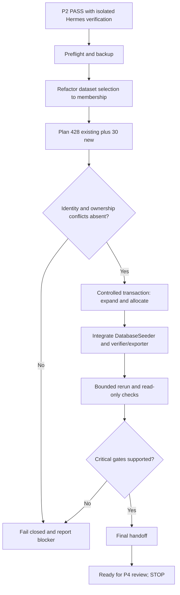
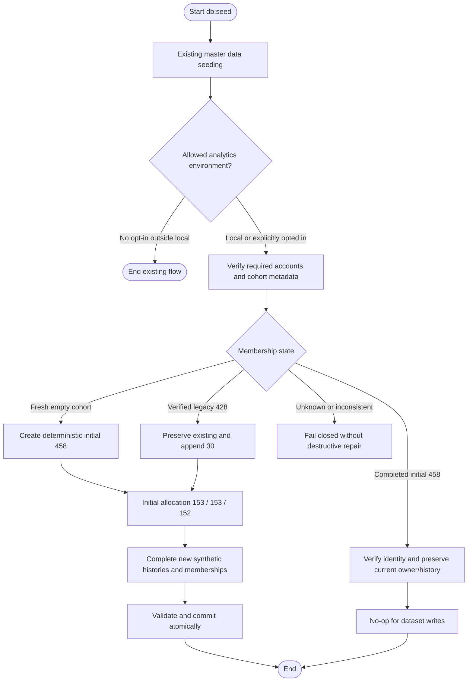
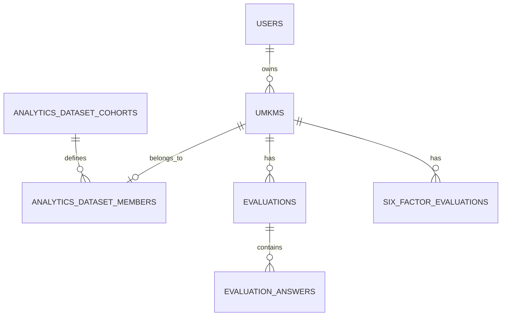

# PRD P3 — Account & Analytics Dataset Seeder

**Project:** JoyUMKM — Multi-Role Management & Unified Analytics  
**Version:** 1.0 — 27 November 2026  
**Execution:** Claude Code — Sonnet (model selected by operator)  
**Workspace:** `C:\laragon\www\joyumkm`  
**Repository:** `joytimess/dip-joyumkm`  
**Database:** Local MySQL `joyumkm-v2`  
**Scope:** P3 only. Implementation-first, targeted verification, strict timebox.

## 1. Objective

Upgrade the existing synthetic analytics dataset from 428 to 458 UMKM, preserve its existing identities and assessment histories, distribute the cohort initially among three existing Analysts (153/153/152), and integrate a safe, repeatable dataset seeder into Laravel's standard `db:seed` flow.

Use the owner-independent cohort membership introduced in P2 as the dataset source of truth. Keep all non-cohort data, accounts, credentials, assessment logic, PDF/XLSX generation, real report/onboarding email and existing Hermes workflow contracts intact. Do not rebuild the application or repeat P0–P2.

## 2. Execution constraints — hard timebox

| Stage | Maximum |
|---|---:|
| Preflight, relevant skills and source inspection | 3 minutes |
| Implementation and controlled data reconciliation | 19 minutes |
| Targeted verification | 5 minutes |
| Final handoff | 3 minutes |
| **Total wall-clock** | **30 minutes** |

- Record actual start time and deadline. Include skill discovery, tool calls, subagents, database writes and polling in the same wall-clock budget.
- At minute 22 stop starting new implementation; at minute 27 stop verification and document the outcome. Reserve time for safe commit/rollback of database transactions (not Git commits).
- Maximum one retry per check, maximum two minutes investigating any single failure; no indefinite polling. No automatic follow-up run; separately authorized closure is at most 10 minutes.
- Maximum three subagents total, optional; single writer for shared files and all database operations. Do not spend time orchestrating agents if direct implementation is faster.
- No full PHPUnit, SQLite, pytest, Playwright, broad regression suite, elaborate QA matrix, new test framework, live report/onboarding UAT, additional LLM calls or extensive evidence collection.
- When time expires, stop safely and state PARTIAL/BLOCKED as appropriate. Only necessary safety/rollback may exceed the deadline. Never force PASS.

## 3. Claude Code skills, agents and project instructions

Read relevant repository/global `CLAUDE.md`, `AGENTS.md`, and actual available skill descriptions. Check Claude Code's exposed skill/agent list and relevant local directories (e.g. `.claude/skills`, `.claude/agents`, user-level `.claude`, and shared `.agents/skills` if accessible). Skills previously used are candidates, not a guarantee that they are currently installed or discoverable by this session.

| Candidate skill/tool | Application in P3 |
|---|---|
| Superpowers — `executing-plans` | Follow this approved PRD directly; no new elaborate planning phase |
| Superpowers — `verification-before-completion` | Verify essential integrity before verdict; within five-minute verification budget |
| Superpowers — `systematic-debugging` | Only for a concrete blocker, within two minutes; no exhaustive investigation |
| Superpowers — `test-driven-development` | If installed and relevant, use the smallest focused check for a changed invariant; do not build a new broad suite |
| Graphify | Targeted inspection of seeder, planner, verifier, exporter and ownership dependencies; confirm graph findings against source |
| Ponytail (if exposed) | Favor small, maintainable implementation; no unnecessary abstractions |

Graphify was previously installed in the shared skills directory (`%USERPROFILE%\.agents\skills\graphify\SKILL.md`). Use it if available and relevant; respect local instructions, discover actual supported commands, avoid invented syntax. A stale graph is not authoritative. Do not rebuild the graph or perform a full repository scan unless explicitly required by local instructions and feasible within the timebox; otherwise record why skipped.

Optional subagents, if actually available: `backend-engineer` (seeder and data implementation), `system-architect` (membership/legacy compatibility review), `qa-engineer` or `security-auditor` (one focused review of side effects/ownership integrity). At most three total, with disjoint responsibilities. Do not install new plugins, launch unrelated frontend/design skills or invoke the Hermes `joyumkm-intelligence` skill/model for this phase. Respect applicable local safety rules; if they conflict with the time budget, stop and report instead of circumventing them. In the handoff list only skills/agents actually used and what they contributed.

## 4. Starting evidence and prerequisites

Read the P2 implementation report, verification results and final handoff; use P1 protected-flow evidence only where needed.

```text
docs/development/multi-role-unified-analytics/phase-2/P2-IMPLEMENTATION-REPORT.md
docs/development/multi-role-unified-analytics/phase-2/P2-VERIFICATION-RESULTS.md
docs/development/multi-role-unified-analytics/phase-2/P2-FINAL-HANDOFF.md
docs/development/multi-role-unified-analytics/phase-1/P1-FINAL-HANDOFF.md
```

Reported P2 baseline (verify actual current state before mutation):

- Three additive migrations applied; role enum/default, `analytics_dataset_members`, append-only ownership audit table. `umkm_id` unique and `(cohort_id, synthetic_key)` unique; original cohort metadata and `user_id` retained.
- 428 membership rows backfilled; existing cohort owned by original synthetic account (historical ID 7). Membership keys previously derived from generator identity/name; preserve exact stored keys and treat them as immutable, not mutable display names.
- 457 total UMKM: 428 cohort + 29 non-cohort (including P1 UAT fixture). P2 verified all database totals: 1,339 3D evaluations, 1,317 6F evaluations and 21,386 answers. These are **whole-database** counts, not cohort counts.
- Sample accounts `sample1@joyumkm.test`, `sample2@joyumkm.test`, `sample3@joyumkm.test` are Analysts. Operator subsequently provisioned `superadmin@joyumkm.test` and verified exactly one Superadmin. If handoff still says G2-02 PARTIAL, use the operator's later evidence and confirm current role read-only. Do not create/reset this account again.
- P2 monitoring exclusion before LIMIT verified: 29 non-cohort and 0 cohort. Hermes scoped guard implemented in persistent volume, verified without network; no new live UAT.
- P2 handoff explicitly flags `AnalyticsDatasetSeeder`, Verifier and Exporter as still owner-based. Backfill command also uses legacy owner/count and must not fail or repopulate incorrectly after redistribution.
- Pending outbox #23/#24 and jobs #30/#31 preserved, #25 delivered; Windows worker/scheduler tasks Disabled, three Hermes crons paused. Keep existing states. APP_URL corrected to `http://joyumkm.test`.
- Legacy seeder tests: DemoSeederTest 2 failures; SampleDataSeederTest 1 failure and 2 errors at P1. Do not assume every failure remains identical in current code.

Preflight: verify effective local DB, actual role/account/cohort counts, membership provenance, clean enough execution state (no active write jobs/other seeder), safe backup outside repository with restricted access, and absence of concurrent ownership changes. Preserve existing uncommitted P2 work. Take a fresh pre-P3 backup of the affected database, verify successful dump and readable checksum; reuse P1 restore rehearsal evidence, do not repeat a full restore exercise. If runtime target or backup is unsafe, continue code-only work and mark application blocked. Do not print secrets.

## 5. Target data and account allocation

| Entity | Existing synthetic target baseline | P3 initial target | Delta |
|---|---:|---:|---:|
| Cohort UMKM / membership | 428 | 458 | +30 |
| 3D evaluations | 1,284 | 1,374 | +90 |
| 6F evaluations | 1,284 | 1,374 | +90 |
| 3D questionnaire answers (16 per evaluation) | 20,544 | 21,984 | +1,440 |
| Non-cohort UMKM | 29 | 29 | 0 |
| Whole DB UMKM | 457 | 487 | +30 |
| Whole DB 3D evaluations | 1,339 | 1,429 | +90 |
| Whole DB 6F evaluations | 1,317 | 1,407 | +90 |
| Whole DB answers | 21,386 | 22,826 | +1,440 |

Whole-database projections assume no new independent operational writes after P2. If there are legitimate newer records, preserve them and report adjusted totals. Verify cohort-specific counts independently; if unexpected assessment history exists, do not delete or rewrite it to match a target. The initial dataset has three 3D and three 6F historical evaluations per UMKM, spanning the existing 12-month analytics design. The count targets describe initial seed, not a permanent restriction on later legitimate assessments.

| Account | Role | Initial synthetic members |
|---|---|---:|
| `sample1@joyumkm.test` | Analyst | 153 |
| `sample2@joyumkm.test` | Analyst | 153 |
| `sample3@joyumkm.test` | Analyst | 152 |
| `superadmin@joyumkm.test` | Superadmin | Global visibility, no mandatory cohort ownership |
| `analitik.sintetis@dataset.invalid` | User | 0 after successful allocation; retain account/legacy metadata |
| `demo@joyumkm.test` and all other accounts | User (unless existing authorized role differs) | Existing non-cohort preserved |

153/153/152 applies only to cohort members, not the existing sample UMKM already owned by these Analysts. Do not enforce initial distribution permanently; later legitimate ownership transfers must survive all seeder reruns.

## 6. Architecture and diagrams

### 6.1 Development flowchart



Implement compatible code, verifier/exporter and command guards **before** applying redistribution to live local data. The diagram's integration stage represents completion of wiring, not permission to mutate first with incompatible code.

### 6.2 Activity diagram — `php artisan db:seed`



### 6.3 Logical data model after P3



Membership determines analytics inclusion independently of ownership. Legacy cohort `user_id` is compatibility/provenance metadata only after the transition, not a selection criterion. Existing `joyumkm_p1_prod` connection and analytics views remain untouched until P6.

## 7. Implementation requirements

### P3-01 — Refactor dataset identity and compatibility

- Inspect actual `DatabaseSeeder`, `AnalyticsDatasetSeeder`, generation/planning helpers, Verifier, Exporter, cohort model, membership model and backfill command. Identify all dataset-related owner-based lookup/count/reconciliation paths with targeted search. Use real filenames and signatures, not invented classes.
- Resolve existing synthetic records by cohort membership and immutable stored `synthetic_key`. Preserve primary keys, keys, cohort ID and provenance. Do not rebuild identity from a changed `name`, current owner or guessed ID range. Keep generator parameters, version/seed and metadata coherent; if target expansion requires a version bump, migrate metadata explicitly without creating a second cohort or duplicate identities.
- Refactor planner/generator to append deterministic unique keys for 30 new profiles. Do not let old 428 entries shift because random draws, loop count, seed or target version changed. Preserve existing rows rather than regenerating their content. Update verifier/exporter and any dataset lookup to join/filter membership before ownership redistribution. Keep export format/ordering and CLI interfaces compatible unless strictly required and documented.
- Reconcile `analytics-dataset:backfill-members` and legacy owner fallback: it may perform verified legacy migration only before membership is established; after migration it must verify membership/no-op, never reclassify all profiles owned by Analysts, repopulate by original owner, or reset ownership. Do not make legacy owner uniqueness a blocker to existing metadata compatibility.
- Future legitimate changes (ownership, name, additional evaluation) must not become destructive repair signals. Separate initial seed invariants from ongoing operational verification. Record a durable, unambiguous completion/version state in existing cohort metadata if suitable; add a minimal additive field only if needed. Do not use current owner distribution alone to infer whether initial allocation occurred.

### P3-02 — Expand dataset safely

- Reuse current generator taxonomy, sectors, geographic data, scoring/rubrics, date ranges and deterministic seed conventions. Add 30 new believable but clearly synthetic profiles consistent with existing distribution; do not invent real customer contact data. Existing assessment scoring remains canonical; no new scoring model or business rules.
- For each new UMKM create three 3D and three 6F historical evaluations, 16 valid questionnaire answers per 3D evaluation, and membership. Use existing seed-safe logic, valid foreign keys, historical timestamps and final state conventions. Do not invoke live finalization APIs, observers that emit events, notification pipelines or external lookups. Scope any event suppression to the synthetic seed path only; normal application events must remain intact.
- Preserve every existing UMKM field and assessment/answer except authorized cohort `user_id` redistribution and necessary cohort metadata. Never overwrite `business_email`, existing consent, phone, timestamps, report references, scores or account credentials. New synthetic addresses use the repository's established non-deliverable test convention; no real destinations and no fabricated consent. If existing records contain real delivery eligibility or pending dependent work, halt affected migration and report instead of silently bypassing.
- On a fresh authorized local dataset, create the complete deterministic 458 cohort using the same identity/initial allocation contract. On verified 428 legacy baseline, append only missing 30. On complete migrated dataset, no reset/rebalance/regeneration. Unknown partial or conflicting states: fail closed with precise discrepancy, or resume only if provenance and transaction/checkpoint guarantee the intended result.

### P3-03 — Initial ownership allocation

- Verify exactly the three intended sample account emails, their Analyst roles and safe existing IDs. Do not touch existing password hashes or email addresses. Missing sample account: reuse approved provisioning convention only with authorized secure credential and suppressed onboarding for synthetic fixtures; otherwise mark blocked. Never reuse or reset Superadmin credential.
- Build a deterministic allocation plan for the entire 458 cohort, exactly 153/153/152. Assign by stable membership key order or another reproducible documented mapping. Preserve non-cohort ownership. Initial allocation is a one-time data migration, not P4's general ownership-transfer API.
- Before writes check `UNIQUE(user_id,name)` using actual MySQL collation, including conflicts with each Analyst's existing non-cohort UMKM and all planned members. If a collision exists, use a different deterministic allocation preserving target counts and all existing names if feasible. If not feasible, stop and report; do not rename, merge or delete existing records to force completion.
- Inspect related tables for redundant owner references (e.g., assessments, report snapshots, outbox) and dependencies. If existing cohort carries a report, pending delivery, consent or denormalized owner reference that would make a simple ownership update unsafe, stop affected operation and report. Do not rewrite immutable history or recipient snapshots. Keep old account, cohort metadata and references intact.
- Execute controlled local writes atomically using a single writer, bounded transaction and appropriate locks; verify expected initial state under lock and fail if it changed. Ensure new membership and allocation commit together with new histories and completion marker. Use explicit seed-safe data operations that preserve timestamps where required. Keep worker/scheduler/crons paused. No production operation.
- Document initial old-owner/new-owner mapping (compact aggregate and deterministic reconstruction or internal mapping evidence, no secrets). Reuse append-only transfer history only if its existing actor/reason/FK semantics permit a truthful authorized seed migration; do not invent a runtime actor or introduce P4 transfer logic. Otherwise record initial allocation in seed metadata/handoff as migration provenance. Never update/delete existing audit rows. Future transfers must not be undone by reseeding.

### P3-04 — Integrate `DatabaseSeeder` safely

- Preserve existing master/sector/questionnaire seeding and demo/sample account behavior. Make analytics dataset integration automatic in the `local` environment, using existing explicit config convention for opt-in outside local (particularly production). Default production remains **off**; tests must not accidentally auto-create 458 records. Use Laravel configuration and correct boolean parsing; do not treat string `false` as true or rely on raw env reads when config cached.
- Document exact command and config key(s), prerequisites, credential handling and expected behavior. Keep production opt-in code inert during P3; do not execute production or opt-in it here. Outside local, do not automatically create demo accounts merely because analytics is opted in; use explicit approved account provisioning prerequisites. Avoid changing production behavior of unrelated seeders.
- On local fresh seed, provision required sample accounts only through the existing secure, environment-gated convention; do not hardcode secrets or trigger onboarding. Superadmin remains separate explicit provisioning. On existing local database, preserve demo/sample/non-cohort data and credentials; do not call a destructive or non-idempotent legacy branch just to demonstrate `db:seed`.
- Refactor only relevant legacy seed behavior: fix overlapping demo/sample test expectation by testing intended environment/flag contract, not reducing assertions; fix small-profile evaluation cap so added draft is included in cap; resolve the two known SampleDataSeeder errors only if current source reproduces a direct relevant issue and fits timebox. Do not modify existing live sample records to repair historical baseline. If unresolved, document exact remaining defect and impact on standard `db:seed` readiness.
- Apply P3 to verified live local DB with the narrowest intended seeder/command, not an indiscriminate full `db:seed` if unrelated seeders are not proven safe. Verify the integration branch with a focused isolated check or code review, label evidence accurately. The standard `db:seed` path must not undo initial allocation or touch completed dataset records.

### P3-05 — Idempotency, integrity and Hermes compatibility

- Completed dataset rerun is no-op for data, ownership, password, metadata timestamps and existing history; it must not restore initial distribution after future P4 transfers, recreate deleted/altered records blindly, or fill arbitrary new evaluations. Detect inconsistent membership and report explicit manual reconciliation requirements; do not delete data. Test no-op using one bounded rerun of the exact analytics path after successful local application, if safe.
- Preserve P2 centralized RBAC and cohort exclusion before monitoring LIMIT. Verify all new members excluded and non-cohort selection unchanged. Keep monitoring cron paused. No need to change Hermes scripts, run a workflow, call LLM or touch old analytics DB/views/grants; P6 owns connection/view transition.
- No event creation or outbound activity from seed/backfill/allocation: report/onboarding webhook, queue job, notifications, OpenWA, Telegram, SMTP, artifacts, LLM. Compare relevant outbox/job counts and IDs before/after; if unexpected side effects occur, stop safely, do not dispatch/replay them, document and isolate according to operator authority. Never silently delete evidence.

## 8. Protected scope and prohibited operations

- No production deployment, Git commit/push, new/recreated Docker containers, full schema reset, `migrate:fresh`, `db:wipe`, destructive rollback, broad database restore, or automatic P4 progression.
- No changes to public registration role/default or onboarding logic; no real Analyst creation via P4 API, no password resets, no deletion of old synthetic account or UAT fixture.
- No changes to `business_email` values/schema/recipient resolution, consent/suppression, report fingerprints, PDF/XLSX, finalization, HMAC/webhook contract, callback/upload/manifest, status sync or scoring. Existing IDs and history preserved.
- Do not consume/replay pending #23/#24, jobs #30/#31 or #25; keep existing Windows tasks disabled, workers stopped and Hermes cron paused. Do not change global delivery flags or rename scope/lock files to facilitate this phase.
- No live email, WhatsApp, Telegram, workflow execution or AI calls. No secret dumps or raw `.env` output. No changes to production Hermes scripts or `joyumkm_p1_prod` analytics views/connection.
- If backup, membership, uniqueness, integrity, actor semantics or protected-flow safety cannot be proven, stop before unsafe writes. Code-only completion is not runtime PASS. If transactional writes fail, roll back only the authorized operation; do not overwrite newer independent records with a broad restore. Escalate to operator for recovery beyond this scope.

## 9. Minimal verification — five minutes total

Use compact read-only SQL/Tinker queries and existing targeted tests against a verified isolated MySQL `joyumkm_testing` connection where mutation is needed. Do not reset the live DB. No new large test suite. Avoid redundant assertions across files; one combined count/query result can support multiple gates. No full suite or browser/AI/live UAT.

| Check | Minimum evidence |
|---|---|
| V3-01 Membership & history | 458 unique members, 428 original IDs/keys retained, 30 new; no orphan/duplicate; cohort 3D/6F/answers 1,374/1,374/21,984 at initial seed, correct per-UMKM counts on new members; existing histories preserved |
| V3-02 Allocation & preservation | Initial 153/153/152 by exact account; old cohort owner 0 members; non-cohort IDs/ownership/count unchanged (account for independent new records); no password/business_email mutation; collision-free |
| V3-03 Seeder integration & compatibility | Verifier/Exporter and backfill use membership correctly; local auto/production default-off policy; focused existing seeder test(s) only when relevant and within budget; no live production invocation |
| V3-04 Idempotency | One bounded rerun of authorized analytics seed on completed state or isolated equivalent; no new writes/reset; minimal isolated check or code-review evidence that later ownership changes are preserved (do not transfer live data merely to test it) |
| V3-05 Protected runtime | 0 cohort members selected by monitoring; queue/outbox preserved; cron/tasks paused; zero external sends, LLM or workflow calls; syntax check affected PHP and short diff review |

If a focused check fails, maximum one retry and two minutes investigation within shared budget. Mark NOT RUN/PARTIAL if not proven. Reuse P1/P2 evidence only for unchanged components. Do not retest the entire RBAC or report pipeline.

## 10. Six quality gates

| Gate | PASS criteria |
|---|---|
| G3-01 Seeder Compatibility | Membership-based planner/seeder/verifier/exporter and safe legacy backfill behavior implemented; no dependency on current owner for cohort inclusion |
| G3-02 Dataset Integrity | Initial 458-member cohort with expected new histories and preserved 428 existing identities/assessments, no duplicates/orphans; counts evidenced |
| G3-03 Ownership Distribution | Exact initial 153/153/152; no existing non-cohort ownership or credential changes; initial migration recorded |
| G3-04 Seeder Integration | Local default analytics path and production explicit opt-in/default-off; relevant standard seed path safe, prerequisites documented; no unsafe legacy branch |
| G3-05 Idempotency & Safety | No-op rerun; future legitimate ownership not reset; no outbound effects or destructive operations |
| G3-06 Final Integrity | P2 monitoring exclusion still effective, pending jobs protected, scope and backup documented; concise handoff |

Statuses: PASS / PARTIAL / BLOCKED / FAIL / NOT RUN. P3 PASS requires all six evidenced. G3-01/02/03/05 and monitoring safety in G3-06 are hard prerequisites to P4; unresolved legacy failures must be classified by actual impact, not automatically waived. Any remaining limitations require operator review. Do not start P4 automatically.

## 11. Scope boundary and later phases

| P3 delivers | Not P3 |
|---|---|
| Membership-based seeder/verifier/exporter | Analyst management endpoints and ongoing transfer service (P4) |
| 30 new synthetic UMKM and initial history | Role-based UI (P5) |
| One-time 153/153/152 allocation | Hermes analytics connection/views cutover (P6) |
| Standard local seeding and explicit production opt-in | Live end-to-end workflow UAT (P7) |
| Focused seeder hygiene | Credential rotation and production rollout (separate authority/P8) |

P4 must still handle transfer audit writer, uniqueness collision, transfer-versus-finalization race, active drafts, consent rules, token revocation and role management. P5 owns `/auth/me` role/UI work and legacy browser specs. P6 owns owner-based legacy analytics views, monitoring pagination/cap, methodology partial and analytics formatting/FakeCtx. Preserve those boundaries.

## 12. Deliverables — three Markdown files only

```text
docs/development/multi-role-unified-analytics/phase-3/
├── P3-IMPLEMENTATION-REPORT.md
├── P3-VERIFICATION-RESULTS.md
└── P3-FINAL-HANDOFF.md
```

Keep them concise. Reuse evidence instead of creating many screenshot/log files. Report actual source paths and commands; omit secrets. Record:

- Actual start/end/elapsed, deadline result, skills/subagents actually used.
- Six gates with compact evidence, limitations and blockers.
- Before/after cohort and whole DB totals, Analyst allocation, preserved non-cohort data, no-op result.
- Changed files, exact local seed command and production opt-in configuration, legacy compatibility and backup location/rollback guidance.
- Monitoring result, queue/runtime status, outbound effects, known baseline issues, NOT RUN items.
- Overall verdict and READY FOR P4 REVIEW / NOT READY. Stop.

## 13. Execution instruction for Claude Code Sonnet

Begin P3 now in the existing local workspace. Read applicable local instructions and use available relevant skills within the three-minute preflight budget. Implement the approved work packages and diagrams as the intended flow; adapt implementation to actual source and report deviations. Prioritize membership compatibility, safe deterministic expansion and one-time ownership allocation, standard seeder integration and idempotency. Maximum 30 minutes including five minutes of lightweight verification. Do not create elaborate tests, QA or regression work. Preserve all existing protected flows and data. No external workflow calls, production changes, commit, push or P4. Finish with the three-file handoff and stop.
