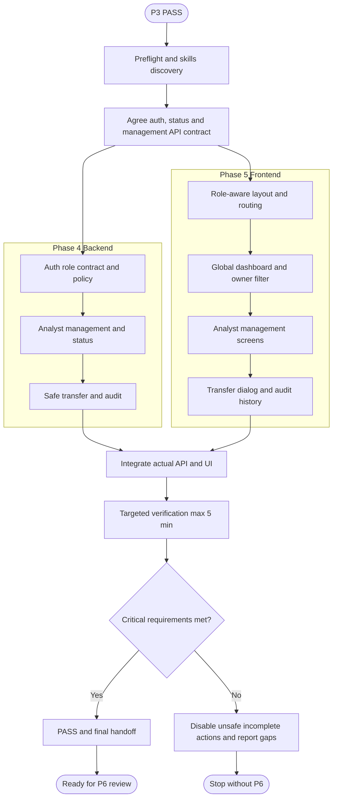
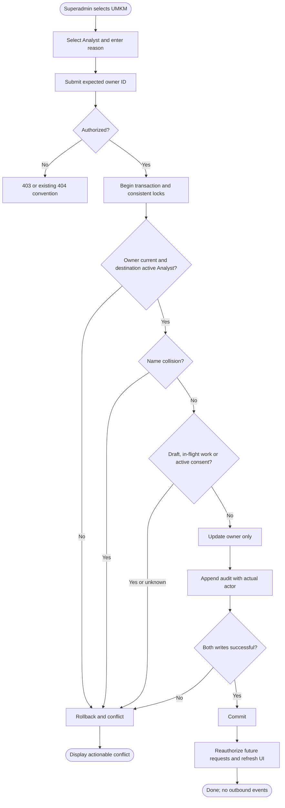
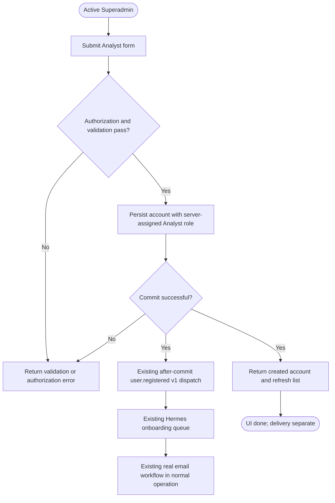

# PRD P4+P5 — Superadmin Management & Role-Based Frontend

**Project:** JoyUMKM — Enhanced Superadmin–Analyst–Owner & Unified Analytics  
**Version:** 1.0 — 27 November 2026 (WIB)  
**Execution:** Claude Code — Sonnet  
**Repository:** `joytimess/dip-joyumkm`  
**Workspace:** `C:\laragon\www\joyumkm`  
**Stack:** Existing Laravel API, Vue frontend, MySQL (Laragon), Hermes Agent  
**Target local DB:** `joyumkm-v2`; isolated tests: `joyumkm_testing`  
**Authorization:** Implement P4 and P5 as a single run; stop before P6.  
**Strategy:** Implementation-first, existing design system, targeted verification, no complex QA.

## 1. Objective

Deliver a usable full-stack multi-role application on top of P2 RBAC and P3 dataset. Superadmin can view global portfolio, filter by Analyst, create/edit/deactivate/reactivate Analyst accounts, transfer individual UMKM between Analysts, and inspect ownership history. Analysts and regular Users retain their existing personal UMKM and assessment experience. Preserve all real-world report and onboarding workflows, existing data, and the owner-independent synthetic cohort.

P4 (backend) and P5 (frontend) are one delivery milestone with distinct work packages and a shared API contract. Do not finish with backend only and call the combined milestone PASS. Do not introduce a second frontend, rewrite the existing dashboard, or use mock data as production UI.

## 2. Strict execution budget

Maximum **30 minutes wall-clock for the entire combined run**, not 30 minutes per phase or per agent. Record actual start/deadline (Asia/Jakarta) before work.

| Work window | Minutes | Output |
|---|---:|---|
| Preflight, skills discovery, API contract | 3 | Existing architecture and runtime safety understood |
| P4 backend | 10 | Auth, Analyst management, transfer and audit APIs |
| P5 frontend | 9 | Role-aware UI wired to actual APIs |
| Targeted verification | 5 | Small essential checks and build/smoke |
| Compact final handoff | 3 | Actual status, changes and next action |
| **Total** | **30** | Stop |

Parallel implementation is permitted once contracts are agreed, with no shared-file races. Maximum 3 subagents total. At minute 22 stop starting new implementation; at minute 27 stop testing and write handoff. Maximum one retry per failure and 2 minutes investigation per problem, inside the allotted window. Bound command/build/test timeouts; do not wait indefinitely for approvals or services. No exhaustive test matrix, full PHPUnit/pytest/SQLite/Playwright suites, full seeder rerun, regression framework, repeated P0–P3 audit, live report/onboarding UAT, or unnecessary screenshots.

If a feature cannot safely be finished, keep the route/action unavailable or fail closed, report PARTIAL/BLOCKED and stop. Finish in-flight transactions and mandatory recovery safely even if the timebox is exceeded; report the exception. Optional closure run max 10 minutes only after separate operator approval. No automatic continuation into P6.

## 3. Skills and agents

Discover skills already available in the actual Claude Code session (project instructions, skill descriptions and installed plugins). Use only relevant available skills; do not install anything, invoke unavailable names as if installed, or spend the budget on discovery. Candidates:

| Candidate skill / capability | Use |
|---|---|
| Graphify | Orient to existing auth, UMKM, evaluation, report and Vue dependencies; verify against source; do not require expensive graph rebuild |
| Frontend Design | Reuse JoyUMKM's existing layout, typography, tokens, components and interaction patterns |
| Superpowers: Executing Plans | Execute these work packages without generating another elaborate plan |
| Ponytail | Small coherent changes; avoid speculative abstractions and duplicated state |
| Verification Before Completion | Obtain minimal concrete evidence before declaring PASS |
| Systematic Debugging | Only for material blockers; bounded by timebox |
| Test Driven Development (if appropriate) | A few targeted assertions for auth/transaction boundaries, not broad new suites |

Suggested agents, if actually available: backend-engineer, frontend-engineer, integration-reviewer (or security-auditor). Maximum three subagents, optional. Main agent owns contract, database mutations, merge/integration and final verdict. Backend owns Laravel files, frontend owns Vue assets, reviewer performs focused read-only review. No agent may independently seed/migrate live DB or launch workers. Direct implementation is valid if skills/agents are unavailable; report what was actually used. If inexpensive, update existing Graphify index once after code changes; otherwise leave a note, not a blocker.

## 4. Baseline and dependency evidence

Read relevant parts of `docs/development/multi-role-unified-analytics/phase-2/` and `phase-3/` (FINAL-HANDOFF, IMPLEMENTATION-REPORT, VERIFICATION-RESULTS), P1 protected flow contracts/handoff, and actual repository source. Reuse previous evidence, not old assumptions. Preserve all uncommitted P0–P3 changes. Do not reset, stash away or overwrite unrelated work.

P0 PASS; P1 CLOSED WITH ACCEPTED LIMITATIONS; P2 role provisioning was completed manually by operator after its original PARTIAL handoff (query confirmed exactly one `superadmin@joyumkm.test`); P3 PASS. P2 Hermes guard is applied to persistent volume and verified without network, not live gateway UAT. P3 did not re-query Hermes cron, perform live transfer, full live `db:seed`, or fresh DB end-to-end seeding with real password. Do not claim otherwise.

| Baseline P3 | Count / state |
|---|---|
| Users | 1 Superadmin, 3 Analysts, 5 Users (verify current counts) |
| Whole DB | 487 UMKM, 1,429 3D, 1,407 6F, 22,826 answers |
| Synthetic cohort v2 | 458 UMKM, 1,374 3D, 1,374 6F, 21,984 answers |
| sample1@joyumkm.test | 153 cohort + 11 non-cohort = 164 |
| sample2@joyumkm.test | 153 cohort + 5 non-cohort = 158 |
| sample3@joyumkm.test | 152 cohort + 7 non-cohort = 159 |
| Other users | 6 non-cohort UMKM; legacy synthetic owner ID 7 owns 0 |
| Monitoring | 29 eligible non-cohort, 0 cohort selected; cap 100 |
| Pending state | Outbox #23/#24 pending; #25 delivered; jobs #30/#31 untouched |
| Transfer audit | Existing append-only `umkm_ownership_transfers`, 0 rows at P3 |

Counts are baseline snapshots, not hardcoded UI/API expectations once real changes occur. No real Analyst or UMKM transfer is authorized merely to demonstrate a feature. Operational DB should retain the same records and initial allocation throughout implementation, apart from explicitly approved additive schema/default metadata. Verify actual counts before/after; report any pre-existing drift.

Key architecture already present: `UserRole`, `User::accessibleUmkms()`, `UmkmPolicy`, `analytics_dataset_members`, audit FKs and update/delete rejection triggers, P3 v2 seeder no-op preserving legitimate owner/name changes. `transfer` and `manageAnalysts` are deny-all placeholders; `/auth/me` lacks role in P2 evidence. `UNIQUE(user_id,name)` uses case-insensitive MySQL semantics. P3 initial allocation is documented seed provenance, not an audit event with fabricated actor. Analytics legacy connection/views remain owner-based in `joyumkm_p1_prod`; reconciliation belongs to P6.

## 5. Scope and permissions

| Capability | Superadmin | Analyst | User |
|---|---|---|---|
| Dashboard / UMKM list / report access | Global; optional Analyst filter | Own only | Own only |
| UMKM CRUD and existing evaluations | Global resource authorization, existing business rules | Own only | Own only |
| Manage Analyst accounts and status | Yes | No | No |
| Transfer single UMKM between Analysts | Yes | No | No |
| View transfer audit history | Yes | No | No |
| Grant notification consent for other owner | No | No | No |
| Public registration role | Always User | Always User | Always User |

No new role hierarchy, Analyst-to-Superadmin promotion, public Analyst signup, arbitrary owner injection on ordinary CRUD, mass transfer, permanent account deletion, separate dashboard stack, redesign of public landing/auth/assessment pages, or P6 analytics integration. Superadmin account itself and User accounts are not editable through Analyst management. Existing Superadmin own-create behavior stays unchanged unless an already-approved explicit ownership flow exists.

## 6. Development flowchart



## 7. P4 — Backend work packages

### P4-01 — Authentication contract & centralized authorization

- Expose current `role` in existing `/auth/me` and any necessary login/auth response; additive fields only. Expose account status where needed. No password hashes, raw token secrets, or unnecessary personal data.
- Use the existing authentication guard, enum, policy and scopes. Enable `manageAnalysts` and `transfer` only for authenticated, active Superadmin, restricted to their intended resources. Do not add blanket Gate::before or client-side-only authorization. Keep existing 403/404 conventions (foreign resource IDs not exposed).
- Server derives role/actor from authenticated account; ignore/reject untrusted role or owner fields; public registration remains User. Existing Superadmin update must not silently change owner or grant consent for another owner.
- Deactivated account cannot login or access authenticated application endpoints through existing tokens/sessions. Enforce current status on every relevant authenticated request; revoke existing API tokens and invalidate sessions/remember credentials where applicable. Reactivation never revives old credentials/tokens; user must authenticate again. Internal HMAC/workflow endpoints retain existing authentication and behavior.

### P4-02 — Global portfolio API and filters

- Reuse `accessibleUmkms()` and existing dashboard/summary services. Superadmin default all UMKM including User-owned and synthetic; optional validated `analyst_id` filter restricts to that Analyst's portfolio. Propagate filter to list, counts, charts and summary calculations consistently. Reject unsupported/unauthorized filter values; never expose foreign counts to Analyst/User.
- Provide total UMKM, total Analysts (clearly distinguish active vs all), actual 3D and 6F evaluation counts, and per-Analyst owned UMKM counts (cohort/non-cohort breakdown where useful). Label total evaluations vs latest/final metrics accurately. Preserve existing health score logic and chart definitions. Avoid per-row query loops; use existing pagination and aggregated queries.
- Include owner identity and status only on authorized Superadmin resources. Analyst/User response and UX remain compatible. No hardcoded numbers or analytics queries to legacy DB.

### P4-03 — Analyst Management API

- Superadmin only: paginated list, search, status filter, detail, create, edit name/email and activate/deactivate. Reuse existing validation, normalized email uniqueness, password policy and account creation infrastructure. No permanent delete, impersonation, automatic owner redistribution or editing role via general form.
- Add minimal `is_active`/equivalent status schema only if absent; default existing users active, additive migration, no reset of passwords or timestamps unrelated to migration. Scope status changes to verified Analyst records. Deactivation keeps ownership, history, reports and audit; inactive Analyst visible in global statistics and cannot be transfer destination. Allow transfer out of inactive source if all safety checks pass. Status transitions must coordinate with transfer destination checks; revoke tokens/sessions atomically where possible, and enforce status on every request.
- Creation uses existing trusted registration/account creation service with server-controlled Analyst role at persistence, never by forwarding untrusted `role` from public request. Reuse existing encrypted `user.registered` v1 onboarding event, recipient and queue semantics. Dispatch exactly once after successful account commit using existing mechanism; duplicate/failed validation or rollback must not dispatch. Do not send plaintext credentials in response, logs, event payload or email unless existing explicitly approved encrypted contract already requires it; never weaken that contract. Use secure password input or existing invitation flow; do not invent real passwords or send test emails. Public User onboarding remains unchanged. Editing/deactivation/reactivation/transfer must not produce new onboarding.
- Email edits use existing verified email-change semantics; if existing code has no safe mechanism, prohibit email changes for accounts with pending onboarding or verification-sensitive conflicts and report limitations rather than silently retargeting queued mail. Never edit `umkms.business_email` through account profile management. Do not change pending report recipient or suppress existing legitimate deliveries just because account is inactive.

### P4-04 — Single ownership transfer service

Provide a dedicated transactional service and route, not general `PATCH user_id`. Single UMKM between distinct Analyst accounts, with mandatory non-blank reason (bounded length), actual Superadmin actor and expected current owner ID supplied by UI to detect stale state. Server derives current owner and validates target role/status. Source/target must be Analysts (source may be inactive); User-owned and Superadmin-owned UMKM remain outside this transfer workflow. No bulk transfer.

1. Authorize actor; start a MySQL transaction. Establish consistent lock order with account-status changes and all relevant UMKM write paths. Lock the UMKM parent row and relevant accounts, reload state and reauthorize after waiting for locks; reject stale owner or changed target status. Do not rely on UI checks or an earlier query.
2. Reject same-owner transfer, missing target, invalid role, inactive destination and `UNIQUE(user_id,name)` collision under actual DB collation. Handle duplicate-key race as controlled conflict, roll back; no auto-rename, overwrite or record merge.
3. Reject while any relevant 3D/6F draft, evaluation finalization, pending/in-flight report generation, artifact delivery, email or status reconciliation can race with ownership. Identify real existing states in source; ambiguous/unknown dependency state is a conflict, not assumed safe. Use persisted Laravel/outbox/report status and existing workflow guarantees; do not make network calls inside transaction. If an external in-flight process cannot be excluded reliably, block the affected transfer rather than pretend safe. No cancelling jobs, replay or global disabling.
4. Shared parent-row serialization: every affected draft creation/update/finalization, deletion, consent mutation and ownership mutation path must participate in the same parent lock protocol and re-check ownership/eligibility after lock. Include missing 3D path if current code lacks locking. Keep changes limited to synchronization and authorization; do not alter scores/finalization or dispatch contracts. Verify consistent lock order; catch deadlock/constraint failures safely. Do not write a large concurrency harness.
5. Consent: preserve historical consent actor/timestamps; never treat prior-owner consent as new-owner authorization or rewrite history. Conservative default for P4: block transfer of records with active owner-bound notification consent until it has been revoked through the existing legitimate flow and outstanding delivery resolved. Do not silently clear or copy consent, send messages, change recipient, or re-enroll notifications. New owner can use existing consent flow after successful transfer. Do not require unnecessary consent for synthetic records with none.
6. Change only `umkms.user_id` and legitimate normal update metadata; preserve ID, name, business_email, cohort key/membership, evaluation IDs/history/answers, artifacts, report manifests and snapshots. Append exactly one audit entry in the same transaction using existing schema: UMKM, from/to users, real authenticated actor, reason, transferred_at. If audit insertion fails, roll back ownership. Repeated/stale requests must not duplicate successful audit; no fake historical rows for P3 seed allocation.
7. Commit; immediately new reads use current owner, previous owner loses access to nested evaluations, reports and download authorization. Review existing signed links/session/HTTP cache and download access paths: do not leak ownership-protected artifacts via stale URLs; use existing revocable authorization or conservatively block cases not safely supported. Previously downloaded files cannot be recalled. Transfer itself emits no report/onboarding/outbound message and does not touch Hermes state. Return updated owner and audit reference; UI refreshes state from server.

### Activity diagram — transfer



### P4-05 — Ownership audit & deletion safety

- Read-only paginated history (global and per UMKM), restricted to Superadmin, showing source, destination, performed-by, time (display WIB), reason and UMKM. Use existing immutable `umkm_ownership_transfers` and triggers/FKs; never update/delete history or backfill P3 with fictitious actor.
- P2 audit FKs restrict deletion of UMKM or referenced users. Preserve those restrictions, return understandable conflict instead of SQL exception. Additionally, do not hard-delete completed cohort members through ordinary CRUD if it would invalidate v2 membership integrity; provide explicit conflict and defer cohort retirement to separate authorized design. No soft-delete redesign or cascade workaround. Ordinary non-cohort deletion retains existing behavior subject to audit/FK and business rules.
- Never run the P3 targeted rollback after P4 transfers exist; provenance would be corrupted. No rollback that drops audit after real use. Correct actual erroneous transfers via an explicitly approved new audited action, not by deleting history. For implementation failures before real use, use restricted backup and targeted reversible migration only after confirming no newer data; MySQL DDL auto-commits.

### Proposed API contract (adapt to existing route prefix and envelope)

These are logical endpoint names; inspect actual conventions and agree before parallel frontend work. Do not duplicate existing endpoints when additive extension suffices. All management routes require existing auth + active Superadmin middleware/policy; existing public/auth routes keep existing behavior.

| Method / logical route | Purpose | Request / response contract |
|---|---|---|
| GET `/auth/me` | Session identity | Existing fields + `role`, status where needed |
| GET existing dashboard endpoint | Global/personal summary | Optional `analyst_id` for Superadmin; additive global metrics |
| GET existing UMKM list/detail | Global/personal resources | Owner fields for admin; pagination/filter preserved |
| GET `/admin/analysts` | List | Search/status/page, owner counts, paginated |
| POST `/admin/analysts` | Create | Validated name/email/password or existing invite; 201, no secrets |
| GET `/admin/analysts/{id}` | Detail | Safe account fields, counts, status |
| PATCH `/admin/analysts/{id}` | Edit | Allowed profile fields only; 200 |
| PATCH `/admin/analysts/{id}/status` | Activate/deactivate | Explicit active boolean, idempotent; 200 |
| POST `/admin/umkms/{id}/transfer` | Transfer | `expected_owner_id`, `to_user_id`, `reason`; 200/201 with new owner and audit ID |
| GET `/admin/ownership-transfers` | History | `umkm_id` / from / to filters as needed, paginated |

Use 401 unauthenticated, existing 403/404 policy, 422 validation, 409 stale/conflicting/unsafe state (or existing equivalent). Provide stable machine-readable reason codes for transfer conflicts without leaking internal/SQL details. Frontend must handle these faithfully; no optimistic success before server commit.

## 8. Activity diagram — create Analyst and preserve real onboarding



During development verification only, fake the external dispatch/queue and check one intended event; no real account creation, onboarding email, report generation, or live Hermes invocation on `joyumkm-v2`. A successful API account creation is not confirmation of email delivery; UI must not claim inbox success. Real authorized user action after rollout uses existing workflow.

## 9. P5 — Role-based frontend

### P5-01 — Existing design system and auth integration

- Read actual Vue routes, stores, auth service, dashboard shell and shared form/table/dialog components; use current build tool and CSS/design tokens. Preserve desktop/mobile layout, typography, colors, icon conventions and localization (Indonesian). No new frontend framework, UI library, external CDN or package installation unless separately approved. No landing-page rewrite.
- Use backend `/auth/me` as session authority; role-aware navigation and guards after auth hydration, no privileged-content flash, no role read from arbitrary localStorage as authority. Handle expired/revoked tokens and inactive account (clear auth and redirect using existing flow). On login or reload, route all roles to existing dashboard adapted to their scope. Direct URL to admin route by Analyst/User denied; UI guard complements server auth, never replaces it.
- Superadmin menu: Dashboard Global, Seluruh UMKM, Manajemen Analyst, Transfer Kepemilikan (route to selection or UMKM list), Riwayat Transfer, existing assessment/history/profile routes. Analyst/User: retain existing Dashboard, UMKM Saya, assessment/history, profile and Intelligence. Show role indicator using existing label style. Exact menu labels adapt to actual navigation, avoid duplicate routes.

### P5-02 — Global/personal dashboard and UMKM list

- Superadmin default global portfolio: total UMKM, total/active Analyst counts, 3D/6F summary, existing charts and per-Analyst portfolio distribution. Show all owners (including non-Analyst users); analyst filter updates metrics/chart/list consistently. Clear filter restores global. Use dynamic API data; no hardcoded 487/164/158/159 except documented baseline.
- Reuse existing charts, cards, query/filter patterns, paging and sorting. Label metric semantics; distinguish all evaluations vs latest/final. Provide loading, empty/error and retry states. Preserve own-only dashboard for Analyst/User and existing routes for evaluations and report history.
- Global UMKM table/detail: owner column and filter for Superadmin; show transfer action only for applicable records, with final server validation. No accidental exposure of internal synthetic account secrets/metadata. Use server pagination; do not fetch every full assessment just for counts. Display responsive tables/actions on mobile without clipping.

### P5-03 — Analyst management screen

- Searchable/paginated list, status indicator, owned UMKM count, add/edit form, detail and activate/deactivate confirmation. Use existing dialog/form/table components, field-level server validation, duplicate email feedback and disable submit while request pending. Password input masked; never persist password in local storage, logs, frontend cache or table. Clear sensitive form data after submit/close. No hard delete or arbitrary role selector.
- Deactivation confirmation explains loss of login access and retained UMKM/history; show inactive owners in global list. Reactivation requires new login. Refresh only after successful API response; distinguish account created from actual onboarding delivery. Do not manually send an email from frontend.

### P5-04 — Transfer UI and history

- Single UMKM selected from authorized list/detail; show current owner from API (read-only), active Analyst destination picker excluding source, required reason, explicit confirmation. Show that ID, evaluation history, report files and business_email are preserved; no outbound event triggered. Do not promise successful transfer until server returns success. Disable double-submit and handle stale source, inactive destination, duplicate name, draft/in-flight/consent conflict with clear Indonesian guidance. Never silently auto-rename or retry unsafe write.
- On success, refresh UMKM owner, portfolio counts, analyst table and audit list; clear stale cached protected records upon account changes. History screen paginated with time WIB, UMKM name/ID, former owner, new owner, actor and reason; optional filter by UMKM. Label records before first transfer as seed allocation only if needed; do not invent historical entries.
- Keep existing detail/assessment forms, score display, report tab and downloads. Check Tab Intelligence click-through on existing accessible record if safe local credentials/session already available; read-only, no report generation or retry. If credentials unavailable, use existing isolated/mocked auth and state limitations; no password reset or request for secrets in logs.

### P5-05 — Integration and UI polish

- Wire real endpoints, auth response hydration and coherent state refresh; no final placeholder buttons or fake data. Follow existing responsive breakpoints, keyboard-accessible buttons/dialogs, labels, focus and contrast. Use existing error notifications. Keep normal existing flows unchanged. Fix only legacy browser selectors/paths touched by this feature if essential and quick; no large browser test repair.
- Build with existing package scripts (typically `npm run build`, confirm actual repository); no package upgrade, reinstall or unrelated build changes. If build dependency is absent or timeout, report blocker. Do not launch full Playwright or long-running dev servers just for a screenshot. Reuse available app at verified `http://joyumkm.test`.

## 10. Protected flow and runtime safety

- Preserve `business_email` values and resolution; never replace with Analyst/Superadmin login email. Preserve consent provenance, scoring 3D/6F, finalization eligibility, immutable final data, PDF/XLSX artifacts, report callback/download/manifest, status sync, HMAC/webhook event versions, encrypted onboarding event and existing workflow semantics. No new onboarding for existing accounts or seeder data.
- Keep P3 cohort 458 and `dataset_version=v2` unchanged. Seeder preserves future legitimate transfer; no rerun required. Monitoring excludes membership before LIMIT, not by user role. P6 owns legacy analytics views/connection, cap and methodology_status partial; do not change those here.
- No external sends (email/Telegram/WhatsApp), LLM, workflow run, callback replay, general queue workers, cron activation, container creation/restart/rebuild, `.env` secret changes, production writes, commit/push/deploy. Do not modify Hermes code/config unless separate authority. Do not remove a stale scope pin to force normal operation. Keep existing paused cron and Disabled Windows tasks; inspect read-only if available. Preserve outbox #23/#24/#25 and jobs #30/#31 exactly.
- Before additive migration on verified local `joyumkm-v2`, take/verify restricted fresh backup (including triggers) and document safe rollback. Check existing schema before creating duplicate columns/tables. MySQL DDL commits implicitly. If backup or target unverifiable, do code-only safe work and mark runtime migration blocked. No destructive reset/migration, no production or broad live seeding.
- Verification writes only in existing proven isolated MySQL `joyumkm_testing`; confirm effective target before tests. No live Analyst creation, live transfer, real consent edits, synthetic deletion or credential reset as demonstration. Do not expose secrets in evidence. No restoring old full DB over newer legitimate actions; preserve append-only audit once used.

## 11. Minimal verification — maximum 5 minutes total

Reuse P2/P3 results for unchanged components. Run one small targeted backend set (existing tests or minimal focused new cases) and one frontend build/smoke. Use isolated fixtures, faked outbound queue/network, no real passwords or live writes. A single compact test may cover multiple acceptance conditions. If time is insufficient, document exactly what was not verified; do not downgrade essential auth/transfer checks into optional PASS.

| Check | Minimum evidence |
|---|---|
| V45-01 Auth and status | `/auth/me` role and active status; Superadmin permitted, Analyst/User denied admin routes, own-resource scope intact, public role injection denied; deactivation revokes/blocks old auth |
| V45-02 Analyst management | Isolated create with server-assigned role and exactly one intended existing onboarding dispatch after commit; duplicate/invalid rejected; edit/status no new onboarding; no network |
| V45-03 Transfer safety | Isolated valid transfer changes owner + one audit, preserves IDs/history/cohort/email, old owner denied/new owner allowed; stale request/name collision/inactive target and active draft/consent/pipeline denied (small representative grouped assertions + code review for other branches); rollback on audit failure; shared locking verified by focused review, no full concurrency suite |
| V45-04 Frontend | Existing build successful; concise smoke for global vs own dashboard, analyst page/form, transfer/history and existing Intelligence tab where accessible; no live mutations. If browser/session unavailable, label build/source only, not interactive PASS |
| V45-05 Integrity | Changed-file review, syntax checks where useful, before/after counts and pending state read-only, monitoring exclusion retained, no outbound or live mutations; status migration/backup result |

Prefer a few focused tests over large matrices. For transaction races, code review of shared lock and after-lock authorization is minimum; if unable to establish safety, keep transfer unavailable and report PARTIAL. No additional full regression or exhaustive QA. Legacy browser failures not affected by these changes remain documented. One retry maximum. Stop testing at minute 27.

## 12. Quality gates — seven total

| Gate | Required outcome |
|---|---|
| G45-01 Authentication & RBAC | Role exposed safely, active-account enforcement and server guards verified, frontend role routing integrated |
| G45-02 Analyst Management | Actual list/create/edit/status API works; role immutable via public input; token/session behavior safe; existing onboarding contract verified with fake dispatch only |
| G45-03 Ownership Transfer | Safe single transfer and immutable audit atomic; conflicts denied, previous/new owner authorization correct; no active-work/consent race bypass |
| G45-04 Role-Based Dashboard | Global vs own dynamic data; Superadmin filter consistent across metrics/list; no foreign data leakage |
| G45-05 Management Frontend | Real connected UI, build and essential interaction evidence; Analyst forms/status, transfer and audit; existing Intelligence accessible or explicit documented verification limitation |
| G45-06 Workflow Preservation | Existing contracts intact, membership and monitoring preserved, no unauthorized side effects; isolated evidence not represented as live UAT |
| G45-07 Final Integrity | Backup, migration, protected state, actual elapsed time and compact handoff recorded |

Statuses PASS / PARTIAL / BLOCKED / FAIL / NOT RUN. P4+P5 PASS requires all seven supported by evidence; do not equate source implementation to runtime verification. For incomplete optional non-critical browser check, report precise limitation and operator review; no blanket PASS based solely on elapsed time. If essential authorization, transfer safety, or protected flow is unresolved, disable unsafe feature and mark gate PARTIAL/BLOCKED. No P6 before operator approval.

## 13. Deliverables (three Markdown files only)

```text
docs/development/multi-role-unified-analytics/phase-4-5/
├── P4-P5-IMPLEMENTATION-REPORT.md
├── P4-P5-VERIFICATION-RESULTS.md
└── P4-P5-FINAL-HANDOFF.md
```

Use short sanitized evidence snippets/references. No duplicated P0–P3 reports, elaborate screenshots/evidence folders or QA artifacts. Include implemented API routes/response fields and actual frontend routes/components; status/transfer locking and consent policy; changed schema/migration/backup; actual UI integration and build; gate matrix; skills/agents actually used; before/after DB and pending state; limitations and unresolved blockers. Record actual start/end and elapsed time, verdict and readiness. No actual credentials. Preserve previous uncommitted work.

## 14. Execution instruction

Begin combined P4+P5 implementation now with Claude Code Sonnet using this PRD as the execution plan. Use available skills only when useful. Prioritize a coherent end-to-end management flow with the existing Vue design system and existing Laravel services. Keep 30-minute total timebox and 5-minute targeted verification, maximum 3 subagents. Do not create extensive tests, regressions or QA. Do not send external messages, mutate live operational records for verification, or start P6. Final verdict: **P4+P5 PASS — READY FOR P6 REVIEW**, only when evidence supports it; otherwise give honest PARTIAL/BLOCKED handoff and stop.
