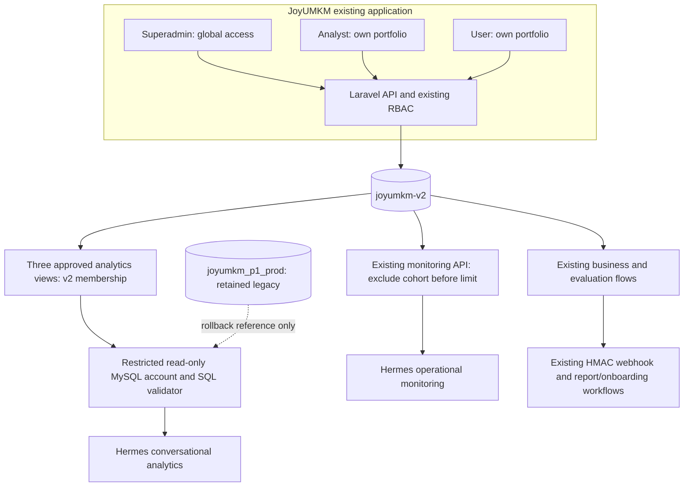
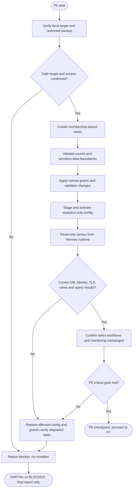
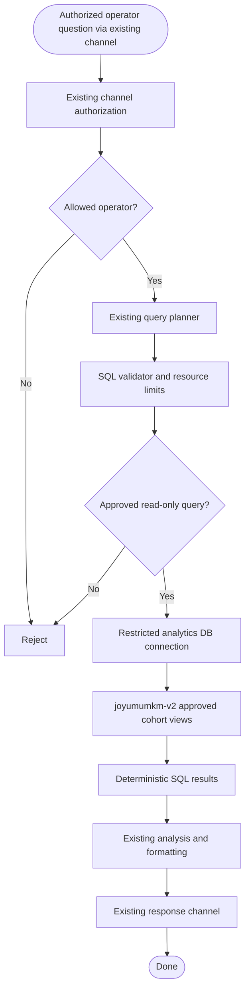
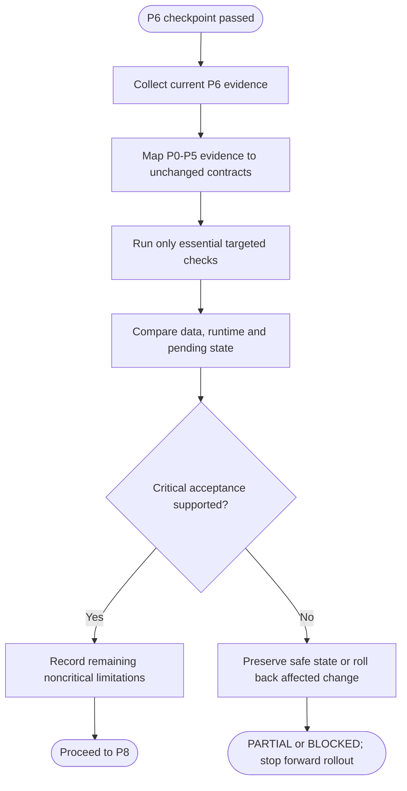
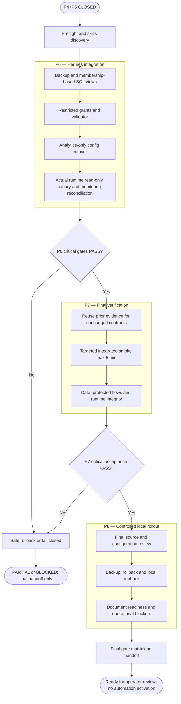

# PRD P6+P7+P8 — Hermes Integration, Final Verification & Controlled Rollout

**Project:** JoyUMKM — Enhanced Superadmin–Analyst–Owner & Unified Analytics  
**Version:** 1.0 — 27 November 2026 (WIB)  
**Execution agent:** Claude Code — Sonnet  
**Repository:** `joytimess/dip-joyumkm`  
**Workspace:** `C:\laragon\www\joyumkm`  
**Runtime:** Existing Laravel / Vue / MySQL (Laragon) / Hermes Agent Docker Compose  
**Scope:** Final combined milestone, executed strictly in order **P6 → P7 → P8**.  
**Authorization:** Local development integration and final handoff only. No production rollout, commit, push, or automatic activation of workers/cron.  
**Strategy:** Implementation-first; bounded verification; reuse prior evidence; preserve existing business flows.

## 1. Product objective

Complete the multi-role development by making `joyumkm-v2` the single authoritative database for JoyUMKM and its synthetic conversational analytics. Hermes must read the 458-member synthetic cohort independently of who owns each UMKM, while operational monitoring continues to exclude that cohort. Preserve existing assessment, PDF/XLSX, real report email, real onboarding email, prediction, webhook, recovery, authorization, audit and workflow contracts.

Deliver one final milestone with three separate checkpoints. P6 is actual implementation and local analytics cutover. P7 is targeted integrated verification, not an extensive regression campaign. P8 is local controlled rollout readiness, documentation and final handoff, not production deployment or permission to drain old work. Do not claim operational end-to-end availability when a channel or worker remains deliberately paused.

## 2. Hard execution budget

**30 minutes total wall-clock**, not 30 minutes per phase or agent. Record start/deadline in Asia/Jakarta. Use existing tools, existing credentials and existing runtime only.

| Elapsed | Budget | Work | Required output |
|---|---:|---|---|
| 0–3 min | 3 min | Preflight, skills discovery, identify exact active analytics config and backup | Verified target and safe scope |
| 3–17 min | 14 min | P6 implementation and critical cutover checks | New views, restricted connection, actual analytics read-path evidence |
| 17–22 min | 5 min | P7 final targeted verification | Integrated acceptance and evidence classification |
| 22–27 min | 5 min | P8 local readiness and documentation | Recoverable runtime, runbook, limitations |
| 27–30 min | 3 min | Final handoff | Three reports and verdict |

Do not start new work outside its window. Maximum one retry per failing operation, maximum two minutes of debugging per issue inside the budget. Avoid long builds, graph rebuilds, dependency installations, repeated baselines, full suites or comprehensive QA. Mandatory P6 security and runtime checks are part of P6, not deferred to P7. If critical checks fail, stop the forward path, restore affected configuration/grants/views if safe, and write handoff. Safety and recovery may exceed the deadline when necessary; disclose this explicitly. Optional closure run maximum 10 minutes only after separate operator approval. No parallel execution of P6, P7 and P8; parallel work within a phase is optional and must not cause write conflicts.

## 3. Skills and agent discovery

Discover project instructions (`CLAUDE.md`, available skill/plugin inventory, relevant agent definitions) at startup. Use relevant skills that actually exist; these names are candidates, not a guarantee of installation.

| Skill / capability | Use |
|---|---|
| Graphify | Orient to Laravel/Hermes dependency graph, verify against real source; no expensive full rebuild |
| Superpowers — Executing Plans | Execute this PRD in the defined sequence |
| Ponytail | Prefer small changes over new architecture or overengineering |
| Verification Before Completion | Obtain concrete evidence before declaring a gate passed |
| Systematic Debugging | Bounded diagnosis only for blockers |
| Security-oriented review / security-auditor | SQL grants, query validator, TLS, sensitive data and rollback |
| Test Driven Development (optional) | Small focused assertions only where needed |

Do not install new skills, plugins, packages or MCP servers. Maximum **3 subagents total**, optional: database engineer, Hermes integration engineer, integration reviewer. Main agent owns decisions, all runtime mutations, cutover, evidence and verdict. Subagents may inspect separate source areas but must not independently execute DDL, alter config, restart services, consume queues or run real workflows. Direct execution is acceptable. If Graphify is available, update its existing index once after code changes if cheap and appropriate; otherwise document why skipped. Report actual skills/agents used, not just the suggested list.

## 4. Entry baseline and source authority

Read relevant actual P0–P5 documents and inspect current source/runtime. Prioritize `docs/development/multi-role-unified-analytics/phase-2/`, `phase-3/`, `phase-4-5/` final handoffs and P1 protected-flow baseline. Preserve all existing uncommitted changes. Do not reset, revert, stash away, or overwrite unrelated work. Validate facts against current runtime; all counts below are prior baseline values, not permanent limits.

| Area | Reported baseline |
|---|---|
| P0 | PASS, 8/8 audit gates |
| P1 | CLOSED — WITH ACCEPTED LIMITATIONS; real report and onboarding email received by operator; no need to repeat |
| P2 | RBAC, membership, monitor exclusion and Hermes scoped guard; Superadmin later provisioned manually and confirmed |
| P3 | PASS; seeder/planner/verifier/exporter membership-based; v2 completed cohort |
| P4+P5 | CLOSED — WITH ACCEPTED LIMITATIONS — READY FOR P6 REVIEW; operator UAT 12/12 PASS; 199 backend tests, 46 JS tests, build PASS (reported) |
| MySQL | Local MySQL 8.4.3, operational `joyumkm-v2`, isolated `joyumkm_testing` |
| Whole DB | 487 UMKM, 1,429 3D, 1,407 6F, 22,826 answers |
| Synthetic v2 cohort | 458 members (428 original + 30 new), 1,374 final 3D, 1,374 final 6F, 21,984 answers at baseline |
| Analyst ownership | Cohort allocation 153/153/152; total portfolios 164/158/159; other users 6 UMKM |
| Legacy synthetic owner | User ID 7 retains historical account and cohort metadata, owns 0 UMKM |
| Legacy analytics | `joyumkm_p1_prod`, 3 existing analytics views, historical 428/1,284/1,284; owner-based selection |
| Prior grants | `joyumkm_analytics_ro@localhost`, SELECT on 3 views, SSL requirement reported at P0; confirm actual authenticated account and host from Hermes |
| Monitoring | 29 eligible non-cohort, 0 cohort; current response cap 100; P3 reverified selector |
| Runtime | Existing Compose project `jobsheet2` under `C:\laragon\jobsheet2`; reported 3 Hermes-related containers: `hermes-agent`, `hermes-workflow-ingress`, `hermes-webhook-proxy`; persistent `hermes_data` mounted at `/opt/data`; 7 existing Visual Workflows reported |
| Pending | Outbox #23/#24 pending, #25 delivered; jobs #30/#31 untouched; 0 transfers at P4+P5 baseline |
| Paused | Windows worker/scheduler tasks Disabled; Hermes `jmi-recover`, `jmi-recover-prod`, `workflow:umkm-monitoring` paused at earlier check; re-query actual current state, never assume |

P4+P5 limitations retained: `six_factor_draft`, `report_in_flight`, `delivery_in_flight`, `invalid_source`, and deadlock retry branches verified by code review only; live email UAT not repeated; raw browser UAT not archived (operator attestation only). Do not rewrite those gates as newly tested. P3 full live `db:seed`, fresh DB real-password seed, live transfer and restore rehearsal were not performed. P2 guard was tested without network; no live gateway scope UAT. Preserve distinctions in final report.

These are the known pending P6 items: owner-based analytics views/connection, monitoring cap, `methodology_status=partial`, previous `test_analytics_workflow` and `test_commands` failures. Other known RSK-01/RSK-08, secret rotation, pending queue/status reconciliation and real Telegram/WhatsApp/LLM verification require separate operator authority. No silent scope expansion.

## 5. Target architecture and data boundaries



| Consumer | Allowed scope |
|---|---|
| Superadmin UI/API | Global operational data according to existing RBAC |
| Analyst and User UI/API | Their own resources only |
| Hermes conversational analytics | Current approved synthetic cohort only, via the existing restricted analytics views |
| Hermes scheduled monitoring | Eligible non-cohort operational UMKM only |
| Existing report and onboarding paths | Existing event-specific access and delivery eligibility only |

Do not connect the general Hermes agent to Laravel's privileged DB credentials. Do not expose all 487 UMKM to conversational analytics, or add Analyst-specific chat authorization that was not part of the existing operator-only workflow. Do not change operational webhook connections or report snapshot data sources as a side effect of the analytics-only cutover. Legacy DB remains intact, not synchronized or deleted. Rollback to legacy is a temporary degraded state; it is not the successful target.

# P6 — Hermes Integration Reconciliation

## 6. P6-01 — Preflight and recoverability (read-only first)

- Confirm actual Git/worktree state, application URL (`http://joyumkm.test` previously verified), APP_ENV, database identity and connection target. Do not infer production safety from a DB name alone. Verify `joyumkm-v2` is the intended local operational schema, `joyumkm_testing` is isolated, and legacy analytics DB is distinct.
- Inspect current Docker/Compose status, persistent mounts, actual analytics runtime entrypoint, config precedence, exact env/key names, SQL validator/allowlist, existing query templates, active identity and TLS settings. Use `docker inspect` selectively; never dump secrets or full environment to output. Inspect existing Visual Workflow metadata and relevant schedules read-only, not trigger them.
- Inspect actual current membership tables, exact cohort version/key, old view definitions, column aliases/types and expected row grain. Read `SHOW CREATE VIEW` and current grants with sanitized output. Identify all analytics references to old schema/owner filters, including qualified SQL, prompt schema metadata, allowlists, health checks, scripts and workflow config. Separate active references from docs, rollback and historical records.
- Record a compact current baseline: cohort/non-cohort IDs/counts or safe fingerprints, evaluation totals, ownership, protected outbox/jobs, notification-related metadata fingerprints, transfer audit count, runtime tasks/cron/flags, workflow identifiers/config hashes. No plaintext contacts, credentials, sensitive payloads or user records in evidence.
- Before any mutation, take restricted backup of relevant DB schema/data (including triggers and existing view definitions), exact current analytics grants/account metadata without printing password hashes, analytics source/config files and persistent volume paths to be changed. Store backups outside repository with restrictive ACL/permissions; checksum and verify readability. Preserve pre-existing working copies and config. Prepare rollback before applying changes. If safe target/backup or necessary privileged access cannot be confirmed, stop runtime mutation and report blocker; code-only preparation is not a completed cutover.

## 7. P6-02 — Membership-based analytics SQL views

Create the equivalent of the existing three analytics views in `joyumkm-v2` using their **actual existing names, column aliases, types, units, ordering semantics, data grain and eligibility rules**. Do not invent a new public SQL contract. Logical purposes (confirm source): cohort UMKM, 3D evaluations, 6F evaluations.

- Anchor every view to `analytics_dataset_members` joined by `umkm_id`, and the exact intended `analytics_dataset_cohorts` identity/version (`v2`); confirm unique membership. Do not select by legacy `analytics_dataset_cohorts.user_id`, sample emails, name pattern, `umkms.user_id`, or an arbitrary union of all cohorts. Owner field is provenance only. Use joins/predicates that prevent cross-cohort, orphan and duplicate rows. No `SELECT *`.
- Preserve existing final/draft evaluation eligibility, period timezone (Asia/Jakarta), category/scoring and analytical semantics. New legitimate final evaluations may change counts later; do not truncate to three records per UMKM merely to match a baseline. Use exact equality to observed baseline where no legitimate concurrent changes exist; otherwise report and reconcile evidence, never edit rows to force counts.
- Expose only necessary synthetic fields and existing approved analytics columns; no passwords, tokens, real user contacts, personal identifiers, business emails, raw webhook payloads, secrets, or credential/operational tables. If the old contract exposes sensitive data, constrain it safely and adapt dependent consumers explicitly. Do not add `user_id` as a selection dependency or expose account email to analytics. Transfer to another Analyst must not change cohort inclusion.
- Use maintainable, version-controlled migration or existing project SQL provisioning convention, separate from secret-bearing operational config. MySQL DDL auto-commits: stage each change and record applied steps, not a pretend transaction for the whole migration. Do not modify legacy views, copy synthetic records into another DB, rerun seeders, or drop old schema. Do not run unrelated pending migrations automatically.
- Verify the three new view counts against direct membership-derived aggregates: expected baseline 458 / 1,374 / 1,374. Confirm no non-cohort IDs, duplicates or unexpected evaluation statuses. Check an existing aggregate/category query for semantic agreement; owner independence through definition review and, if inexpensive, a small isolated fixture. Never transfer a live UMKM to test the view. Existing 21,984 answers are integrity evidence, not authority to expose an additional answers view.

## 8. P6-03 — Read-only access and query security

- Inspect `CURRENT_USER()` from the actual Hermes analytics connection to determine the MySQL user@host match. Do not assume `@localhost` authenticates the container. Retain existing secure authentication and SSL/TLS requirements; never set `--ssl-mode=DISABLED`, disable verification, expose port 3306 publicly, grant wildcard host access as a shortcut, or reuse the application root/DB user.
- Prefer the existing restricted analytics identity if suitable. If a new dedicated local identity is required, use the narrowest verified source host and securely provision its secret only through approved existing mechanisms; no arbitrary password generation/storage in repository, shell history or output. If required credentials cannot be accessed securely, stop with BLOCKED and keep prior runtime intact.
- Grant SELECT on the three intended views only, not `joyumkm-v2.*`, base tables, system schemas, DDL/DML, GRANT OPTION, FILE, or global privileges. Review effective roles and inherited grants; database account must actually be restricted. Preserve old grants needed for explicitly documented rollback during staging; after cutover, narrowly remove legacy analytics access from the active principal if safe and authorized, retaining exact reversal steps. Never revoke unrelated user privileges. If legacy access is retained temporarily, disclose why and verify qualified legacy queries cannot pass the active validator; do not claim full grant-level legacy isolation.
- Where existing design uses `SQL SECURITY DEFINER`, use an explicit stable least-privileged definer with necessary base-table SELECT privileges only; ensure it exists on the verified local host. The restricted consumer must not obtain those base-table privileges. Do not use an overprivileged/root definer as a shortcut. If definer provisioning is blocked, do not solve it with broad consumer grants. Review actual view dependency and effective grants.
- Preserve existing SQL validator and allowed query policy. Update only schema/view references needed by the cutover. Permit supported bounded read-only SELECTs against approved views; reject writes, DDL, multi-statements, unauthorized schemas/tables, unsafe functions and file access, and unsupported constructs according to actual parser semantics. Do not weaken the validator to make tests pass. Preserve parameterization, row limits, timeout and result formatting. If the existing validator cannot reliably enforce necessary boundaries, keep analytics cutover blocked; no direct free-form SQL fallback.
- Evidence: successful approved SELECTs through restricted identity, effective grants and TLS status, rejected direct base-table access (use harmless `SELECT 1 FROM <table> LIMIT 0`, not sensitive data), and validator rejection of representative mutation/cross-schema/multi-statement attempts without sending those statements to the DB. Never test writes on live tables, even if expected denied.

## 9. P6-04 — Controlled analytics cutover

Use actual active Hermes configuration, not a guessed `.env` key. Stage a minimal config delta to switch only conversational analytics to `joyumkm-v2`. Make it persistent via the existing authoritative configuration mechanism (existing volume/config/declarative Compose source), not an ephemeral container patch that disappears on restart. Do not create new containers, reinstall Hermes/plugins or alter routing/proxy unrelated to analytics.

1. Confirm no active analytics job can be disrupted or inadvertently triggered; if uncertain, defer the switch. Keep existing paused schedules and workers unchanged. Never run `docker compose down`, global restarts, queue drain, or task activation.
2. Validate staged config and source with read-only checks; preserve all unrelated configuration, including onboarding/report/webhook/recovery, tokens and scope pin. Do not print secrets.
3. Apply minimal analytics-only config change. Use existing safe reload mechanism if necessary and verified not to start pending work. If a restart/recreate is required and its effects cannot be excluded, stop and request separate operator authorization; do not silently restart the shared agent. A file change not consumed by the runtime is not proof of cutover.
4. Execute a bounded read-only canary **through the actual Hermes analytics connection/DB adapter in its runtime context** using a preselected deterministic query; no Telegram, LLM, real workflow run, or outbound messaging. Confirm server-side `DATABASE()`, effective `CURRENT_USER()`, TLS, approved view counts and one existing aggregate/query shape. Exercise existing validator/formatter without model calls using deterministic fixture or stub where needed. Direct admin SQL alone is insufficient to prove Hermes cutover.
5. Verify active analytics configuration no longer selects the old owner-based database, and there is no silent automatic fallback to stale legacy data. If runtime adapter cannot be invoked without a live model/workflow, verify connection by safe lower-level route and report adapter/complete cutover limitation; do not claim end-to-end PASS. For failed critical checks restore prior config and grant/view changes in reverse safe order; if old source restored, label DEGRADED/LEGACY and keep forward phase blocked.
6. Record exact changed files/key names (redacted values for secrets), durable configuration location, local reload semantics, previous/new DB identity and actual evidence. Keep legacy DB unchanged for separately controlled rollback. Do not move/delete legacy data.

### Activity diagram — analytics cutover and rollback



### Activity diagram — normal conversational analytics (future operation, not UAT authorization)



Do not execute this live channel flow in the combined development run. P6 proof is controlled SQL/adapter evidence only.

## 10. P6-05 — Monitoring reconciliation

- Preserve existing Laravel monitoring selector `whereDoesntHave('datasetMember')` or equivalent, applied before order/limit. Eligibility must be membership-independent of ownership and must not be changed to a role filter. Current baseline: 29 eligible non-cohort, 0 cohort, not truncated. Verify actual counts via safe read-only API/selector without sending alerts or running cron.
- Inspect current `meta.count`, `truncated`, ordering and cap 100 in both Laravel and Hermes. If straightforward within scope/time, add bounded backward-compatible cursor/keyset pagination to the existing endpoint and consumer, preserving default legacy response, authentication and selection logic. Stable ordering, no skipped/duplicate IDs, finite page count, explicit truncation/error reporting; do not increase an unbounded limit or silently treat a partial run as complete. Only test with small isolated fixture/stubs, no live monitoring workflow.
- If pagination is not safely completed, leave current 100 cap unchanged, document current baseline below cap and operational limit. Ensure readiness statement explicitly says cron must remain paused if truncation or pending work is unresolved. No automatic schedule activation. No modification to alert thresholds, recipients, consent or suppression logic.

## 11. P6-06 — Compatibility and existing backlog

| Item | Required handling |
|---|---|
| Old owner-based analytics views / connection | Mandatory actual cutover, no stale data as success |
| SQL allowlist and schema metadata | Mandatory consistency and security |
| `methodology_status=partial` | Locate actual reason in methodology/source/config; fix only if evidenced, retain honest partial if underlying methodology remains incomplete |
| `test_analytics_workflow` formatting failures | Address only if directly relevant to new query result and simple; preserve channel formatting and escaping |
| `test_commands` FakeCtx errors | Fix minimal fixture/mock defect if directly needed, not blanket test rewrites |
| `JMI_HOME` ambiguous-outcome test defect | Do not run unsafe test against real persistent state; only isolate if needed; otherwise retain backlog |
| RSK-01 secret rotation / RSK-08 queue and status reconciliation | Separate authority; inspect relevant state without changing secrets/flags or replaying pending jobs |

No synthetic methodology or invented business conclusions. No `partial` → `complete` status edit without satisfying actual contract. No broad Python refactor or forced cleanup of unrelated plugin errors.

## 12. P6-07 — Protected flows and P6 exit checkpoint

Verify diff and actual active config preserve:

- 3D/6F scoring, existing finalization and evaluation history.
- `evaluation.finalized` v2 → existing outbox/queue → Hermes snapshot/pipeline → PDF/XLSX → manifest/hash/upload/callback → authorized report download/Tab Intelligence → eligible real email/status sync. Recipient remains `umkms.business_email` and existing eligibility/consent/suppression/fingerprint; never use current logged-in actor email instead.
- `user.registered` v1, server-assigned Analyst on authorized creation, default User for public registration, encrypted existing onboarding queue and exactly-once intended dispatch. No changes to SMTP or email allowlist as shortcut.
- Existing prediction, monitoring, recovery and other Hermes Visual Workflows; preserve IDs, definitions, state, schedules and routing except explicitly required analytics configuration delta. Preserve P2 scope guard (including malformed/expired/closed pin fail-closed); never delete/rename a pin to bypass safety. Inspect read-only and report if it prevents normal workflow availability.
- Existing role scoping, inactive account enforcement, append-only ownership audit, legitimate transfer retention and P3 seeder no-op. No data mutation through cutover.

**Checkpoint P6:** G678-01 and G678-02 must PASS, and core G678-03 must PASS (no cohort in monitoring, no regression in protected workflow contracts, no unauthorized runtime side effect). A documented noncritical monitoring cap/methodology backlog may remain with schedules paused; do not treat a broken integration or failed grant/validator as an accepted limitation. If a critical requirement is unverified or failed, stop before P7/P8 forward rollout; perform safe recovery and produce reports marked PARTIAL/BLOCKED. No fake PASS from source review alone for actual cutover.

# P7 — Final End-to-End Verification (bounded smoke)

## 13. P7 verification window (5 minutes total)

Only begin after P6 checkpoint. This is integrated acceptance using the evidence already obtained plus targeted new checks. It is not a complete new live E2E run. Use evidence labels **LIVE-RO** (actual read-only runtime), **ISOLATED** (test DB/stubs with no external network), **CODE** (source/config review), **REUSED** (previous verified evidence, identify phase), **OPERATOR** (operator-reported UAT), **NOT RUN**. Never relabel a previous or mocked check as live.

| Check | Minimum evidence / method |
|---|---|
| V678-01 Database and analytics | Reuse actual P6 restricted-runtime canary, correct DB/view counts, allowed query and denied access; compare final active config |
| V678-02 Cohort and application integrity | Read-only counts/fingerprints vs preflight, 458 membership and 29 non-cohort baseline, unchanged legitimate ownership/business emails and audit; no reseed |
| V678-03 Role-based app | Reuse 199 backend and 46 JS PASS/build and operator UAT 12/12 P4+P5 if unchanged; focused source check, `/up` and existing shell smoke where useful; no password reset or live creation |
| V678-04 Protected report flow | Reuse P1 real email/PDF/XLSX evidence and P4+P5 Tab Intelligence operator check; review changed contracts; if materially changed, small isolated no-network test or mark PARTIAL |
| V678-05 Onboarding | Reuse P1 real onboarding evidence and P4 isolated exactly-one dispatch proof, review untouched event/queue/recipient contracts; no new registration/email |
| V678-06 Monitoring and analytics compatibility | Zero cohort, observed count/truncation, deterministic result formatter/validator test if changed; no live cron, LLM or channel |
| V678-07 Pending state and safety | Compare outbox/jobs, task/cron status, workflow IDs/config/state, container/mount topology, delivery/status-sync flags and scope pin; no processing, replay or flag change |

Run at most one small targeted test command per materially changed component when useful, bounded to the five-minute total. Confirm test target `joyumkm_testing` before any writes; Python tests must use isolated temporary `JMI_HOME`, faked network/model/callback, and never touch `/opt/data` live job state. No full PHPUnit, pytest, SQLite, Playwright, repeated P3 seeder suite, broad regression, live email UAT, real Telegram/WhatsApp, model calls, or unnecessary rebuild. If frontend unchanged, reuse P4+P5 build. No new extensive evidence folders or screenshot requirements.

### Activity diagram — final verification and gate transition



**Checkpoint P7:** G678-04 and G678-05 must pass to their explicitly bounded evidence scope. Real-world email delivery is previously demonstrated, not newly proven by this run. If a protected contract changed materially without adequate verification, cannot reuse it as PASS. No P8 readiness claim when P7 critical acceptance fails. Report any pre-existing drift without reverting legitimate operator activity.

# P8 — Controlled Local Rollout & Final Handoff

## 14. P8-01 — Final source and configuration review

- Review final diff of P6–P8 plus relevant P2–P5 dependencies. Preserve unrelated changes and actual audit history. Confirm no secrets/dumps/logs are newly tracked, no duplicate config source, no hardcoded 487/458 as a perpetual business limit, no accidental fallback to legacy owner-based analytics. Redact any output that could expose credentials or actual customer data.
- Confirm migration/provisioning changes are repeatable on intended local schema using existing conventions and no implicit destructive actions. Document fresh setup prerequisites and existing `ANALYTICS_DATASET_AUTO_SEED` production opt-in without executing production seeding. Do not rerun `db:seed` in live or reassign owners. Graphify index update once if available and cheap; do not block handoff on an unavailable skill.
- Confirm actual active local config for application and analytics DB, allowed views and user@host (without secret), TLS policy, persistent volume/config path, startup/reload behavior and commands for safe read-only verification. Document config names discovered in source, not invented placeholder names represented as facts.

## 15. P8-02 — Backup, rollback and runbook

- Take/verify final restricted backup or targeted final snapshot for changed artifacts and local schema, with checksums. Reuse verified preflight backup for unchanged assets; do not make multiple full unnecessary backups or copy secrets to repository. Record actual locations and coverage, including views/grants/config. Never claim restore rehearsed unless performed; P1 rehearsal can be cited as prior evidence only.
- Write concrete rollback order for P6: safely stop use of affected analytics path if necessary via existing approved mechanism (do not alter unrelated schedules), restore prior analytics config/source and exact previous grant changes, remove/revert only new views/definer grants if safe, verify restricted legacy connection with known degraded 428 baseline if applicable, and report local status. No global DB restore, no dropping existing audit/history, no P3 rollback after actual P4 transfer, no destroying legacy DB or volumes. MySQL DDL commits implicitly; record each applied/reverted step. If rollback cannot be safely completed, preserve fail-closed state and escalate.
- Provide local operator runbook with actual commands for app health, Docker Compose status, analytics canary and relevant read-only queue/schedule checks. Use safe redacted placeholders for passwords, not secret values. Include how to reproduce setup and how to request a separately authorized operational activation. Do not give a blind `queue:work`, replay or cron enable command as the immediate next action.

## 16. P8-03 — Local readiness vs operational activation

Local integration readiness means the intended configuration is active and verified, with application UI already operator-verified and analytics adapter reading the new restricted views. It does **not** mean all automated business flows are now running.

| Runtime area | Final policy |
|---|---|
| Laravel / Vue / MySQL | Local readiness checked; preserve existing app URL and data |
| Hermes analytics | Active new `joyumkm-v2` restricted connection only if P6 PASS |
| Legacy analytics DB | Retained unchanged, rollback reference only |
| Pending outbox #23/#24 and jobs #30/#31 | Preserve; no replay, retry, drain, delete, acknowledge or force status |
| Outbox #25 | Preserve delivered state |
| Windows tasks and Hermes cron | Preserve disabled/paused state; record actual status, never auto-activate |
| `uat-scope.json` | Preserve exact state and fail-closed semantics; stale pin is an operational blocker to normal intake, not a reason to remove it |
| Delivery flags / status-sync | Read-only reconcile expected vs actual values and known mismatch; no automatic enable/disable; note outstanding sync risk |
| Hermes containers/volumes/workflows | Preserve topology, ports, mounts, existing workflow state; no new container or reset |
| Production | NOT DEPLOYED / separate authorization |

Before any future automation activation, require operator-approved reconciliation of pending events/job identities, existing delivery receipts and duplicate-send risk; verify current scope pin and email status sync; confirm monitoring completeness/cap; obtain explicit approval of which tasks/workflows can resume. RSK-01 secret rotation/RSK-08 queue and status reconciliation are separate work. No actual activation in this PRD. If flags or pending state are inconsistent, report operational activation BLOCKED even when local development completes.

## 17. Unified development flowchart (strict phase order)



## 18. Mandatory quality gates (seven total)

| ID | Phase | PASS criteria |
|---|---|---|
| G678-01 | P6 | Actual Hermes analytics read path uses `joyumkm-v2` and correct cohort views; 458/1,374/1,374 baseline or justified observed data; no owner-based inclusion or silent old-source fallback |
| G678-02 | P6 | Restricted effective principal, intended view-only access, TLS and validator preserved, safe negative checks, no sensitive/base-table access |
| G678-03 | P6 | Monitoring excludes cohort before limit; no unauthorized side effects or unrelated workflow change; cap/methodology limitations clearly documented |
| G678-04 | P7 | Application/RBAC/cohort/ownership integrity supported by current read-only checks and clearly identified prior evidence; no unexplained mutation |
| G678-05 | P7 | Protected PDF/XLSX, email, onboarding, webhook and delivery eligibility contracts unchanged or adequately isolated-verified; previous live evidence explicitly reused; no new external sends |
| G678-06 | P8 | Verified local config, recoverable backup/rollback, operational activation blockers recorded; no unauthorized deployment/activation |
| G678-07 | P8 | Three concise documents, actual timing, gate evidence, exact limitations, source/config changes and next operator action |

Use PASS / PARTIAL / BLOCKED / FAIL / NOT RUN and evidence type. No blanket PASS from code review for the actual connection, security or cutover. Preserve prior accepted limitations rather than reclassifying them. Noncritical new limitations must be explicit and accepted by operator before declaring final closure with accepted limitations. Never use a timebox as grounds to ignore a critical security/data-integrity failure. If P6 or P7 fails, remaining forward phases NOT RUN; handoff still mandatory, but documentation is not P8 rollout PASS.

## 19. Non-negotiable boundaries

- No modification of existing operational UMKM, evaluation scores/history, ownership, business_email, consent, credentials, roles or reports/artifacts. No full/live seeding or transfers. SQL view/least-privilege grant/provisioning and narrowly scoped analytics config/source changes are allowed only on verified local target after backup.
- No email, Telegram, WhatsApp, LLM, live workflow execution, report regeneration, callback replay, job processing, retry/recovery activation, or unrelated config change. Do not invoke commands that hide these side effects. No changes to SMTP, event HMAC secret, app key, delivery flags, global auth or scope pins as workaround.
- No new Docker container, no unrelated service restart, no new deployment topology or plugin installation. Maintain existing Compose configuration and persistent state. No destructive DB action, no production changes, no commit/push/deploy.
- No broad grants, root credential use by Hermes, disabled TLS/validator, secret leakage, or unbounded SQL. No production credential copying or public port exposure. Maintain existing least privilege.
- Respect 30-minute total, 5-minute P7 verification, max 3 subagents and one retry. Avoid unnecessary complex QA and repeated previous tests. Safety/recovery overrides deadline if necessary.

## 20. Deliverables — three Markdown documents only

```text
docs/development/multi-role-unified-analytics/phase-6-7-8/
├── P6-P7-P8-IMPLEMENTATION-REPORT.md
├── P6-P7-P8-VERIFICATION-RESULTS.md
└── P6-P7-P8-FINAL-HANDOFF.md
```

**Implementation report:** actual start/end; skills/agents used; P6 exact view names and query grain, membership predicate, schema/config/grant changes with no secrets, actual connection and persistence, monitoring cap/methodology decision, changed files; P7/P8 work actually done. Identify all deviations from PRD.

**Verification results:** gate matrix with evidence labels and compact sanitized proof, before/after counts/fingerprints, actual runtime analytics identity/database/TLS and read-only canary results, negative access/validator checks, workflow/pending state, reused evidence references (P1 and P4+P5 operator UAT), limitations and NOT RUN list. Do not fabricate evidence or claim real workflow execution.

**Final handoff:** phase-by-phase verdicts; combined verdict; final active local architecture/config; secure backup locations/checksums and concrete rollback; actual runbook commands; known backlog and operational activation blockers; next operator decision. Include no credentials or raw PII. Keep runbook and architecture in these reports (update existing README only if small and necessary, without creating additional reports). No massive evidence dumps or screenshots required. Stop after handoff.

## 21. Final verdict and execution instruction

Execute now with Claude Code Sonnet using this PRD as the complete plan. Begin with **P6**. Do not start P7 until P6 critical checkpoint is satisfied; do not start P8 until P7 critical checkpoint is satisfied. Do not pause for arbitrary confirmation between successfully passed local phases, but stop if an action requires separate authority or a mandatory gate fails.

Target verdict, only if all critical requirements and final handoff are supported:

**JOYUMKM DEVELOPMENT COMPLETED — READY FOR OPERATOR REVIEW (LOCAL SCOPE)**

If new noncritical limitations remain, report **READY FOR OPERATOR REVIEW — ACCEPTANCE PENDING** with the precise items; after operator acceptance they may be closed with accepted limitations. If a critical gate is not met, report **P6+P7+P8 PARTIAL / BLOCKED**, actual completed phases and safe recovery state. Operational activation and production deployment have their own status, independent of local development completion. The final milestone must not be declared 100% complete just because files changed, tests were skipped, or the timebox ended.
