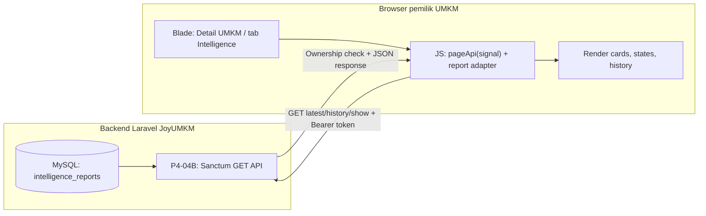
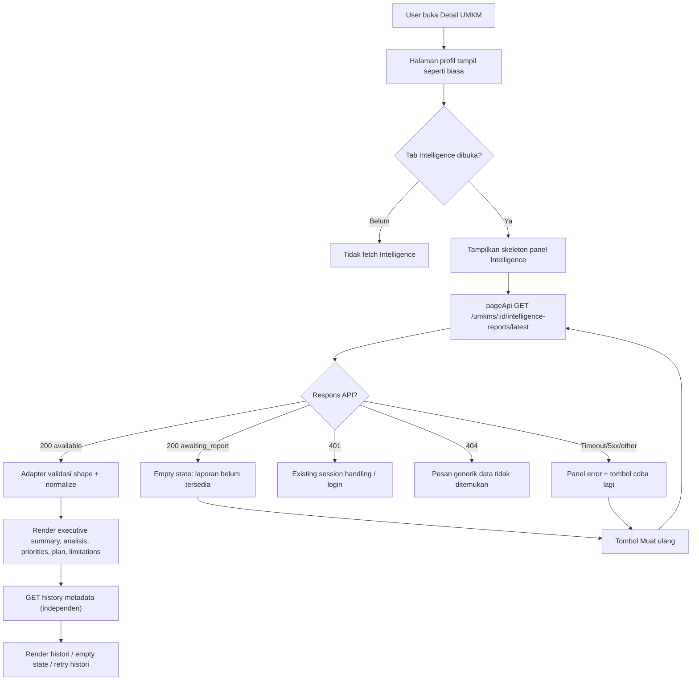
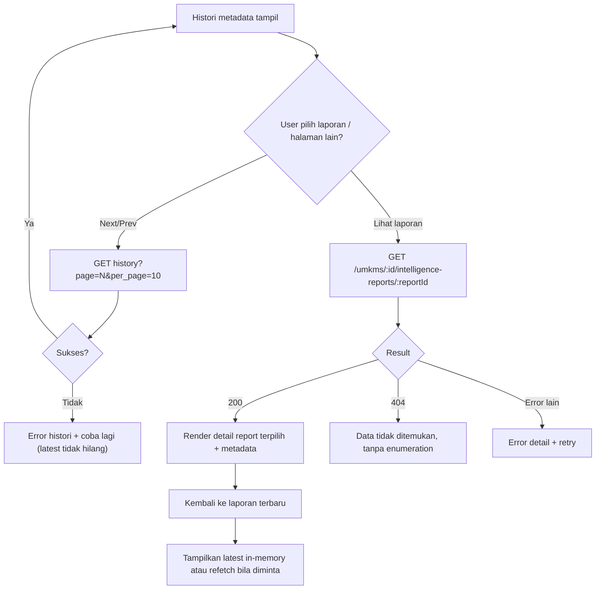

# PRD P4-05 — Frontend Intelligence Reports (JoyUMKM)

**Status:** SPEC LOCKED — brief implementasi frontend  
**Tanggal:** 23 November 2026  
**Implementor:** **Codex 6.2 Sol** (gunakan model/profile Sol 6.2 yang tersedia di lingkungan Codex; jangan menggantinya dengan Sonnet)  
**Repo target:** `C:\laragon\www\joyumkm` — **Laravel**, bukan Hermes Docker  
**Standar desain:** `C:\laragon\www\joyumkm\DESIGN.md` — **sumber kebenaran visual** untuk seluruh UI P4-05 (lihat §1.1)  
**Output:** perubahan frontend terintegrasi, pengujian, dan handoff; dokumen ini adalah PRD, bukan bukti bahwa implementasi sudah dilakukan.  
**Baseline fungsional:** P4-04A/B/C sudah PASS menurut handoff, callback nyata telah menaruh **3 Intelligence Reports** di Laravel untuk evaluasi **12, 13, 14** (UMKM 5), GET dibatasi pemilik UMKM.  
**Keputusan UI:** Tambahkan tab **Intelligence** di **Detail UMKM**; jangan buat halaman mandiri/menu navigasi baru dalam fase ini.

---

## 0. Mandat implementor dan sumber kebenaran

1. Jalankan pekerjaan **di repo Laravel Windows**, bukan `/opt/data/joyumkm-intelligence`.
2. **Audit source code lokal dan perubahan yang belum di-commit sebelum menulis kode.** Source lokal, termasuk P4-04A/B dan perubahan frontend yang belum di-commit, lebih otoritatif daripada GitHub `main`.
3. Referensi struktur yang sudah teramati pada GitHub `main` saat penyusunan PRD (bisa berbeda dari lokal):
   - `resources/views/umkm-detail.blade.php` memakai `@extends('layouts.app', ...)` dan tab `profil`, `lokasi`, `kontak`, `penilaian`.
   - `resources/js/pages/umkm-detail.js` menginisialisasi detail via `pageApi(signal)`, mengelola tab, dan memakai `AbortSignal`.
   - `resources/js/api.js` menyediakan `pageApi`, Bearer Sanctum, timeout, penanganan 401, dan pembatalan navigasi.
   - `resources/js/pages/six-factor-evaluation.js` memiliki pola rendering/format penilaian serta komponen yang dapat ditelusuri ulang.
4. **Jangan mengubah kontrak P4-04A/B/C**, mengirim callback ulang, memanggil model AI, atau menjalankan evaluasi baru. Bila kontrak API berbeda dari gambaran dokumen ini, telusuri implementasi aktual; catat perbedaannya, pertahankan semantik yang sudah disetujui.
5. **Tidak boleh** `git reset --hard`, `git clean`, `migrate:fresh`, `db:wipe`, menjalankan suite destruktif pada `joyumkm-v2`, atau menyentuh database recovery.
6. Pertahankan working tree pengguna, termasuk Blade/UI dan webhook yang mungkin belum di-commit. Jangan mengklaim pekerjaan sudah bersih/committed tanpa bukti.
7. **`DESIGN.md` wajib dibaca penuh sebelum menulis Blade, JS render, atau CSS.** Seluruh keputusan visual (warna, tipografi, spacing, radius, bayangan, komponen kartu/tab/badge/skeleton/empty state/alert, pola responsif, aksesibilitas) harus mengikuti `DESIGN.md`. Jika `DESIGN.md` bertentangan dengan PRD ini soal visual, **`DESIGN.md` menang**; catat selisihnya di handoff. Jika `DESIGN.md` tidak mengatur suatu komponen, turunkan dari komponen yang sudah ada di UI lokal, jangan mengarang gaya baru.

### 0.1 Discovery wajib: skills dan agents lokal milik pengguna

Direktori yang harus **diperiksa langsung oleh Codex** di mesin Windows:

- **Skills:** `C:\Users\itsba\.agents\skills`
- **Agents:** `C:\Users\itsba\.codex\agents`
- **Design standard (wajib dibaca):** `C:\laragon\www\joyumkm\DESIGN.md`

**Nama-nama skill dan agent aktual belum diverifikasi dari lingkungan penulis PRD; jangan mengarang daftar nama atau mengasumsikan semua tersedia.** Pada preflight, lakukan inventarisasi read-only, baca metadata/instruksi yang relevan, lalu pilih hanya yang benar-benar ada dan sesuai tugas.

Contoh perintah PowerShell untuk discovery (aman, read-only):

```powershell
Get-ChildItem 'C:\Users\itsba\.agents\skills' -Force -ErrorAction SilentlyContinue |
    Select-Object Name, FullName, PSIsContainer
Get-ChildItem 'C:\Users\itsba\.agents\skills' -Recurse -File -Include SKILL.md,skill.md -ErrorAction SilentlyContinue |
    Select-Object -ExpandProperty FullName
Get-ChildItem 'C:\Users\itsba\.codex\agents' -Force -ErrorAction SilentlyContinue |
    Select-Object Name, FullName, PSIsContainer
Get-ChildItem 'C:\Users\itsba\.codex\agents' -Recurse -File -ErrorAction SilentlyContinue |
    Where-Object { $_.Extension -in '.md','.toml','.yaml','.yml','.json' } |
    Select-Object -ExpandProperty FullName
```

Praktik wajib:

- Pilih skills yang tersedia dan relevan untuk **Laravel/Blade, JavaScript frontend, desain UI, keamanan rendering, testing/QA, dan dokumentasi**. Jika tidak tersedia, lanjutkan dengan kemampuan dasar Codex dan laporkan gap; jangan memasang dependency/tool baru tanpa kebutuhan terbukti.
- Pilih agents berdasarkan **role yang didefinisikan dalam file agent** (implementasi, frontend/design, QA/review), bukan nama yang diasumsikan. Maksimalkan audit independen jika tersedia; **maksimum 3 agent/subagent aktif sekaligus**.
- Ikuti instruksi keterampilan/agent yang valid dan sesuai prioritas; **jangan mengunggah isi file lokal, token, secret, atau data personal usaha** ke dokumentasi publik.
- Bila Graphify tersedia dan mengindeks repo Laravel saat ini, boleh dipakai untuk navigasi dependency; **selalu verifikasi graph terhadap kode aktual**. Graphify tidak menggantikan inspeksi source dan bukan prasyarat blocking jika tidak tersedia.
- Cantumkan dalam handoff: nama/role setiap skill/agent yang **benar-benar digunakan**, path aslinya, fungsi dan hasilnya; sebutkan bila tak ditemukan.

---

## 1. Ringkasan produk

**Masalah:** Backend sudah menyimpan dan melayani Intelligence Reports, tetapi pemilik UMKM belum memiliki antarmuka untuk melihat ringkasan analisis AI, rekomendasi, action plan, keterbatasan metodologi, atau histori laporan.

**Tujuan P4-05:** Hadirkan tab **Intelligence** pada Detail UMKM yang secara aman mem-fetch P4-04B GET APIs, menampilkan laporan terbaru dan riwayat, serta menangani keadaan belum tersedia, error, dan akses yang dibatasi. Hasil harus terasa native terhadap UI JoyUMKM yang sudah ada.

**Pengguna:** pemilik UMKM yang login dan memiliki akses ke UMKM terkait. Bukan superadmin, operator global, atau publik.

**Non-goal:** form penilaian baru, edit laporan, tombol generate AI, mengubah scoring, unduh PDF, ekspor/print khusus, dashboard analitik global, automasi Hermes, perubahan skema database, membuat API baru bila P4-04B sudah cukup, redesign landing/login/register, atau halaman Intelligence terpisah.

### 1.1 Standar desain: DESIGN.md

- **`DESIGN.md` adalah standar desain resmi** untuk tab Intelligence. Semua token, komponen, dan aturan di dalamnya dipakai apa adanya; tidak membuat tema kedua atau gaya paralel.
- Nilai berikut hanyalah **gambaran referensi** arah visual JoyUMKM dan **bukan sumber otoritatif**: Poppins, primary `#0207CA`, secondary `#0297DE`, accent `#FC734D`, sidebar midnight navy `#101E40`, SaaS profesional minimalis. Bila berbeda dengan `DESIGN.md`, ikuti `DESIGN.md`.
- Gunakan variabel/token CSS dan kelas komponen yang sudah ada; hindari hardcode hex/ukuran bila token tersedia.
- Dropdown/three-dot/aksi sekunder umumnya netral; warna destructive hanya untuk aksi destruktif.
- Pertahankan sidebar dengan grup **Beranda / Manajemen UMKM / Penilaian / Analitik** yang sudah diputuskan dalam refinement sebelumnya. **Tab Intelligence bukan menu sidebar baru.**
- Layout publik dipertahankan; jangan membuat navigasi antarhalaman menampilkan spinner layar penuh "Memeriksa sesi Anda…"; gunakan loading per-panel.

---

## 2. UX dan Information Architecture

### 2.1 Titik masuk

**Detail UMKM** (`resources/views/umkm-detail.blade.php`, konfirmasi di lokal), di samping tab-tab yang ada, tambah:

`Profil Usaha | Lokasi Usaha | Kontak Usaha | Penilaian | Intelligence`

- Tab baru memakai pola `role=tab`, `role=tabpanel`, `aria-controls`, `aria-labelledby`, `aria-selected`, `tabindex`, dan keyboard navigation yang sudah dipakai oleh detail page.
- Default tetap **Profil Usaha**; membuka detail UMKM tidak otomatis mem-fetch laporan Intelligence.
- Fetch **lazy pada tab Intelligence pertama kali dibuka**. Setelah ter-load boleh mempertahankan state in-memory selama halaman aktif. Berikan tombol **Muat ulang** eksplisit untuk refresh.
- Pada navigasi SPA/internal workspace atau pergantian UMKM, buang state laporan sebelumnya, abort request lama, dan jangan sampai data UMKM A muncul sekilas di UMKM B.
- Optional deep link berbasis fragment/query hanya jika mekanisme tab yang sudah ada mendukungnya dengan aman, tanpa menciptakan route server baru.

### 2.2 Struktur tab Intelligence (desktop)

1. **Header:** "Intelligence Report", identitas UMKM, tanggal laporan dihasilkan, identitas evaluasi (jika metadata API memuatnya), dan tombol **Muat ulang**.
2. **Indikator metodologi:** `partial` muncul sebagai **"Metodologi parsial"** dengan penjelasan jelas dan akses ke daftar keterbatasan. Jangan menyatakan laporan "Lengkap/Terverifikasi" ketika metadata tidak membuktikan itu.
3. **Executive Summary:** narasi ringkasan eksekutif sebagai bagian utama dan mudah dibaca.
4. **Analisis enam faktor:** daftar faktor dengan temuan/narasi serta skor hanya bila benar-benar tersedia. Jangan mengarang skor, persen, kategori, atau sumbu grafik.
5. **Analisis tiga dimensi:** uraian tiga dimensi sesuai struktur laporan aktual (jangan menamai dimensi berdasarkan asumsi bila payload berbeda).
6. **Perspektif dan insight lintas instrumen:** temuan prioritas, kekuatan, risiko, hubungan antar hasil penilaian; render dari `perspectives` dan `cross_instrument_insights` jika ada.
7. **Top Priorities:** item rekomendasi yang diberi hirarki jelas, tanpa mengubah urutan bisnis aslinya.
8. **Action Plan:** langkah yang dapat dilakukan, bergantung struktur `action_plan` aktual; kelompokkan per tahap jika memang ada datanya.
9. **Limitations:** tampilkan keterbatasan secara eksplisit, terutama saat `methodology_status=partial`; hindari menyembunyikan caveat di tooltip semata.
10. **Riwayat Laporan:** metadata-only daftar laporan terdahulu, pagination **10 default, max 50** mengikuti backend, aksi **Lihat laporan** membuka detail report melalui API `show`; sediakan **Kembali ke laporan terbaru**.

Rancang panel sebagai kartu/seksi yang mudah discan. Jangan menampilkan JSON mentah sebagai tampilan produk atau mencetak key internal (`snake_case`) tanpa label manusiawi. Tampilan kartu, heading, badge metodologi, skeleton, dan empty/error state mengikuti komponen yang didefinisikan di `DESIGN.md`.

### 2.3 Mobile

- Layout satu kolom dengan kartu tersusun vertikal; tab navigation scrollable/accessible, tidak memotong label.
- Riwayat tampil sebagai **card list**, bukan tabel horizontal.
- Tidak ada overflow horizontal pada viewport kecil; tombol dapat dijangkau, fokus terlihat, konten naratif mudah dibaca.
- Tanggal/label/metadata yang panjang dapat wrapping; tidak memotong atau menyembunyikan keterbatasan analisis.

### 2.4 States wajib

| State | Kondisi pemicu | Tampilan dan aksi |
|---|---|---|
| Idle | Tab belum dibuka | Tanpa request laporan; panel siap load |
| Loading latest | Tab baru diaktifkan / refresh | Skeleton **hanya panel Intelligence**, sidebar/header stabil |
| Available | `200`, `status=available`, `data` valid | Render laporan; muat histori secara independen |
| Awaiting report | `200`, `status=awaiting_report`, `data=null` | Empty state "Laporan Intelligence belum tersedia"; **jangan klaim AI sedang memproses** |
| Empty history | Response histori kosong | "Belum ada riwayat laporan" |
| Loading history/detail | Membuka history/menentukan laporan | Skeleton di area terkait tanpa mereset laporan lain |
| Error network/5xx | Request gagal | Pesan Indonesia yang aman + **Coba lagi**, tidak leak pesan mentah backend |
| 401 | Session habis | Ikuti existing session logout/redirect handling |
| 404 | UMKM/report bukan milik user / tak ditemukan | Pesan generik **"Data tidak ditemukan"** tanpa bocor identitas |
| Missing/partial fields | Field laporan tidak lengkap | Tampilkan seksi yang tersedia; hindari undefined/blank cards, catat keterbatasan |
| Stale request | Tab/UMKM/navigasi berganti saat fetch | Abort atau abaikan hasil respons lama |

**Penting:** `awaiting_report` berarti **belum ada laporan tersimpan**, bukan status job Hermes. Tidak ada infinite spinner/polling agresif. Tombol "Muat ulang" adalah default; bila memilih refresh otomatis, harus bounded, non-blocking, dan tidak mengubah kontrak status.

---

## 3. Kontrak API P4-04B (read only)

Seluruh endpoint di bawah **sudah ada menurut handoff P4-04B**, berada di bawah `/api`, dilindungi `auth:sanctum`, dan hanya bisa dibaca **pemilik UMKM**. **Codex wajib cek route, controller, resource, JSON aktual di repo lokal sebelum memetakan key respons**.

| Tujuan | HTTP | Path API | Ekspektasi |
|---|---|---|---|
| Latest | GET | `/api/umkms/{id}/intelligence-reports/latest` | `200 {"status":"available","data":{...}}` atau `200 {"status":"awaiting_report","data":null}` |
| History | GET | `/api/umkms/{id}/intelligence-reports?page=1&per_page=10` | Metadata paginasi, **tanpa isi `report` penuh**; format page/meta sesuai API aktual |
| Show detail | GET | `/api/umkms/{id}/intelligence-reports/{reportId}` | Satu laporan lengkap jika terotorisasi |

- Frontend memanggil melalui **`pageApi(signal)`**, menggunakan path relatif seperti `/umkms/${id}/intelligence-reports/latest`, **bukan** hardcode `/api` dua kali dan bukan `fetch` paralel yang mengabaikan sesi.
- Header Bearer token, 401, timeout, `AbortSignal`/session-change mengikuti `resources/js/api.js` yang ada. **Jangan menyimpan report di localStorage atau membocorkannya di HTML static/server render.**
- Jangan menggunakan endpoint internal `POST /api/internal/intelligence/callback` dari browser: endpoint tersebut **khusus Hermes → Laravel**, tidak boleh dipanggil oleh frontend.
- Format yang terlihat di PRD adalah **kontrak semantik**, bukan asumsi pasti semua nesting objek; read-only verifikasi fixture pada endpoint lokal diperlukan untuk mapping akurat.
- Jangan modifikasi P4-04B untuk kebutuhan formatting jika sudah dapat dilakukan di frontend. Jika ada gap kontrak yang benar-benar memblokir, bukti dan usulan patch minimal harus dijelaskan sebelum mengubah backend.

### 3.1 Struktur laporan V4 yang wajib ditangani

Sesuai laporan Hermes V4 dan handoff callback, isi `report` memiliki seksi berikut (nested structure harus diperiksa dari data sesungguhnya):

```json
{
  "executive_summary": "...",
  "business_profile": {},
  "six_factor_analysis": {},
  "three_dimension_analysis": {},
  "perspectives": {},
  "cross_instrument_insights": [],
  "top_priorities": [],
  "action_plan": {},
  "limitations": []
}
```

Metadata yang mungkin diterima dari API termasuk: `event_id`, `evaluation_id`, `umkm_id`, `generated_at`, `methodology_status`, `schema_version`, `prompt_version`, dan `knowledge_version`. **UI tidak wajib menampilkan metadata internal seperti provider/model/hash.** Jangan bergantung pada urutan key JSON, dan jangan menganggap isi objek narasi selalu satu string.

**Adapter/normalizer read-only:** pisahkan parsing response API dari rendering. Buat view-model stabil berdasarkan tipe dan skema aktual; handle `null`, array kosong, objek kosong, dan teks panjang tanpa crash. Bila struktur yang aktual melampaui contoh, buat mapping eksplisit untuk subbagian yang dapat ditampilkan, bukan dump JSON.

---

## 4. Flowchart & sequence integrasi backend → frontend (MANDATORY)

### 4.1 Architecture: arah aliran data dan batas kepercayaan



**Keterangan:** proses penyediaan laporan berada di backend. P4-04C sudah menyimpan laporan dari Hermes ke database melalui callback, tetapi browser **tidak terhubung langsung** ke Hermes dan **tidak memanggil endpoint callback**.

### 4.2 Flowchart inti: fetch latest saat tab dibuka



**Ketentuan:** request saat tab aktif harus dibatalkan/dikesampingkan saat berpindah halaman, UMKM, atau sesi. Loading histori tidak boleh menghapus latest yang sudah muncul. `awaiting_report` tidak otomatis berarti Hermes sedang running.

### 4.3 Sequence: navigasi sampai API aman dengan Sanctum

```mermaid
sequenceDiagram
    autonumber
    actor User as Pemilik UMKM
    participant Blade as Detail UMKM (Blade)
    participant JS as umkm-detail.js / Intelligence module
    participant API as Laravel P4-04B (auth:sanctum)
    participant DB as MySQL intelligence_reports
    User->>Blade: Buka Detail UMKM
    Blade-->>User: Profil/tab tampil; shell tetap stabil
    User->>JS: Klik tab Intelligence
    JS-->>User: Skeleton panel Intelligence
    JS->>API: GET /api/umkms/:id/intelligence-reports/latest + Bearer
    API->>API: Authentikasi & verifikasi kepemilikan UMKM
    alt 401 / 404
        API-->>JS: Error aman
        JS-->>User: Session handling / data tidak ditemukan
    else Akses sah
        API->>DB: Ambil latest report by UMKM
        DB-->>API: Report atau kosong
        alt Belum ada report
            API-->>JS: 200 awaiting_report, data null
            JS-->>User: Empty state + tombol Muat ulang
        else Ada report
            API-->>JS: 200 available + data
            JS->>JS: Normalize + render text safely
            JS-->>User: Summary, analisis, plan, limitations
            JS->>API: GET history?page=1&per_page=10
            API-->>JS: Metadata-only pagination
            JS-->>User: Riwayat laporan
        end
    end
```

### 4.4 Flowchart histori dan membuka report lama



---

## 5. Implementasi teknis frontend — rancangan minimum

### 5.1 View Blade

- Edit **hanya bagian relevan** di `resources/views/umkm-detail.blade.php` untuk menambah `tab-intelligence` dan `panel-intelligence`.
- Panel baru berisi region semantik: heading, loading/skeleton, alert/error, report container, limitations, history, pagination, refresh. Tidak memuat report bisnis saat compile Blade.
- Pertahankan `role=tab`, `aria-labelledby`, `aria-controls`, `hidden`, dan pola kelas detail page yang ada.
- Jangan mengubah form edit profil, lokasi, kontak, atau workflow penilaian.

### 5.2 JavaScript

- Integrasikan tab baru pada `resources/js/pages/umkm-detail.js`; modul terpisah seperti `resources/js/pages/intelligence-report.js` **boleh dibuat** agar logic fetch/render tidak memenuhi satu berkas besar.
- Gunakan `pageApi(signal)` dari `resources/js/api.js` untuk semua panggilan API; tidak membuat auth/token manager kedua.
- Pisahkan `fetchLatest`, `fetchHistory`, `fetchDetail`, `normalizeReport`, dan `render...` sehingga mudah diuji.
- Debounce/disable tombol refresh saat request aktif untuk mencegah request paralel; cache hanya selama halaman aktif.
- Normalisasi tanggal dengan `Intl.DateTimeFormat('id-ID', ...)`, serta fallback aman untuk tanggal tidak valid.
- Render konten AI sebagai **teks tidak tepercaya** (`textContent` / DOM node), **bukan** `innerHTML` mentah. Jika rich text/Markdown diperlukan, harus memakai sanitizer yang sudah disetujui dan tersedia; jangan tambahkan parser secara sembarang.
- Jangan menampilkan HTML/JS dari AI sebagai kode berjalan, URL yang tidak divalidasi, atau memasukkan JSON ke HTML attribute tanpa escaping.
- Gunakan cleanup event listeners, `AbortSignal`, dan lifecycle `workspace` yang sudah ada.
- Tidak perlu ApexCharts bila metrik valid untuk grafik tidak tersedia; utamakan narasi aktual.

### 5.3 CSS/responsive

- Ikuti `DESIGN.md`; reuse stylesheet/token proyek. Tambahkan class minimal yang scoped ke panel Intelligence agar tidak mengubah global dropdown/theme. Jangan menambah token/warna baru di luar `DESIGN.md` tanpa mencatat alasannya di handoff.
- Skeleton pendek per bagian, tidak blok seluruh shell.
- Tampilkan status metodologi dengan teks dan aksesibilitas, bukan warna saja.
- Kontras warna, wrapping konten panjang, dan keyboard focus harus terjaga.

### 5.4 Keamanan dan privasi

- Frontend **tidak** menentukan hak akses; Laravel Sanctum/ownership tetap sumber otoritas.
- No sensitive report data in URL query strings, analytics events, console logs, `localStorage`, atau `sessionStorage`.
- Error 404 owned-vs-unowned tetap sama; jangan tampilkan nama pemilik/UMKM yang tidak boleh dilihat.
- Cegah cross-UMKM stale response; state tidak bertahan di luar sesi halaman.

---

## 6. Test plan dan verification matrix

**Prioritas:** tes terhadap frontend dan endpoint GET yang aman. **Tidak mengulang evaluasi AI**, tidak mengirim callback baru, tidak menyentuh Hermes, dan tidak menjalankan tes DB destruktif di `joyumkm-v2`.

| Test | Expected |
|---|---|
| T-01 Tab muncul | Tab Intelligence tersedia di Detail UMKM, profil default tetap |
| T-02 Lazy load | Belum ada GET report sebelum tab dibuka |
| T-03 Available | GET latest menampilkan report yang benar dari API |
| T-04 Awaiting | `200 awaiting_report` menampilkan empty state tanpa infinite spinner |
| T-05 Methodology partial | Indikator dan `limitations` terlihat |
| T-06 Report nested | Semua section valid ter-render sesuai payload nyata; field kosong aman |
| T-07 History | GET metadata-only, page 1→2→1, pagination 10/halaman |
| T-08 Show | Memilih histori mem-fetch `/reportId`, kembali ke latest berhasil |
| T-09 Auth 401 | Ikuti redirect/session handling existing; tidak leak report |
| T-10 404 | Nonowner dan missing report memiliki error generik |
| T-11 Timeout/5xx | Error/retry scoped ke panel, shell stabil |
| T-12 Abort race | Switching UMKM/tab/navigasi tidak menampilkan report salah |
| T-13 XSS/escaping | Payload mengandung `<script>`/HTML berbahaya tetap teks biasa |
| T-14 Accessibility | Keyboard tab, focus, ARIA, status/loading dapat diakses |
| T-15 Responsive | Desktop dan mobile card list tanpa overflow horizontal |
| T-16 Regression | Profil, lokasi, kontak, penilaian, navigasi, session tidak rusak |
| T-17 Real E2E GET | Login pemilik UMKM 5, report dari evaluasi 12/13/14 dapat dibaca; nonowner 404 |
| T-18 No side effects | Tanpa perubahan intelligence_reports saat GET; tanpa panggilan AI/HTTP ke Hermes |
| T-19 Kepatuhan DESIGN.md | Token, tipografi, spacing, dan komponen panel Intelligence sesuai `DESIGN.md`; tidak ada hardcode warna/ukuran yang menyimpang; selisih (jika ada) tercatat |

### 6.1 Lingkungan test

- Unit/mock API untuk loading/error/shape/race-XSS; gunakan test runner yang tersedia di repo, jangan mengarang perintah.
- Test API Laravel bila diperlukan harus pada **database testing yang benar-benar terisolasi**, dengan konfigurasi yang eksplisit diverifikasi sebelum menjalankan migration; **jangan pernah** `migrate:fresh --env=testing` tanpa `.env.testing` dan verifikasi koneksi DB aktual.
- Smoke test live development **GET read-only saja**. Data yang sudah ada: tiga laporan evaluasi 12, 13, 14 (UMKM 5). Semua nama usaha dan konten harus di-redact pada screenshot atau handoff publik.
- Catat baseline kegagalan existing secara terpisah dari regresi P4-05. Jangan menyebut semua test PASS bila ada baseline failures tanpa daftar bukti.
- Jika alat screenshot/QA browser tersedia secara lokal, ambil bukti desktop dan mobile, termasuk awaiting/error via mock; jika tidak, laporkan jujur NOT RUN, jangan mengklaim uji visual manual.

---

## 7. Acceptance criteria / gates

- **G-05-01 — Read-only audit:** inventory local repo, changes, API contract, skills & agents selesai, tak ada data terhapus.
- **G-05-02 — Native integration:** tab Intelligence benar-benar terpasang di Detail UMKM; tab lain dan sidebar tak berubah semantik.
- **G-05-03 — Fetch:** API latest/history/show diakses melalui existing authenticated `pageApi` dan ownership ditegakkan di backend.
- **G-05-04 — States:** loading, available, awaiting, empty history, 401, 404, 5xx, retry, abort race bekerja.
- **G-05-05 — Report fidelity:** sections nyata V4, partial methodology, dan limitations ditampilkan tanpa mengarang nilai.
- **G-05-06 — History UX:** pagination metadata + detail report + kembali ke latest.
- **G-05-07 — Security:** XSS-safe, tak ada unauthorized data, tidak bocor ke log/storage/browser URL.
- **G-05-08 — Responsive/accessibility:** desktop + mobile card list, keyboard, ARIA, focus, no overflow.
- **G-05-09 — Regression:** tidak merusak UI/penilaian/navigasi yang sudah ada; perubahan minimal.
- **G-05-10 — Evidence:** pengujian otomatis, smoke test GET read-only, dan handoff sumber bukti memadai.
- **G-05-11 — Scope:** tidak ada AI call, callback resend, DB migration baru, destructive test, atau perubahan Hermes.
- **G-05-12 — Skill/agent provenance:** agent/skill aktual yang dipakai tercatat secara akurat; tidak ada nama fiktif.
- **G-05-13 — Design compliance:** `DESIGN.md` dibaca sebelum implementasi dan dipatuhi; penyimpangan (bila ada) tercatat beserta alasannya. Bila `DESIGN.md` tidak ditemukan/tidak terbaca, tandai BLOCKED atau PARTIAL dan jelaskan, jangan menebak isinya.

**PASS final** hanya jika semua gate esensial terbukti. Jika visual browser tidak dapat dilakukan, tandai sebagai bukti yang belum tersedia dan jelaskan dampaknya; jangan menyamakan NOT RUN dengan PASS.

---

## 8. Rencana kerja Codex 6.2 Sol

1. **Preflight:** `git status`, **baca `DESIGN.md` penuh**, baca Blade, JS page module, API helper, layout/css, route & controller Intelligence P4-04B di lokal; cek 3 laporan via GET berotorisasi/redacted; enumerasi skills/agents lokal yang benar-benar ada.
2. **Contract mapping:** tuliskan mapping konkret shape latest/history/show → view-model + fallback. Konfirmasi hanya apa yang terlihat di source/fixture aktual.
3. **Implementasi minimal:** Blade tab + modul JS + scoped CSS; pertahankan lifecycle tab dan session.
4. **QA otomatis:** test parsing, pagination, states, concurrency, XSS, auth, regression; tidak ada operasi tulis DB dev.
5. **QA visual:** desktop & mobile, keyboard, loading, long content dan limitations. Gunakan agen reviewer jika memang ditemukan dan relevan.
6. **Handoff:** ringkasan file changed, skills/agents yang digunakan, tabel gate dan bukti, hasil build/tests, risiko, serta batasan NOT RUN; **berhenti di P4-05**.

### 8.1 Handoff yang diminta

```text
P4-05 Final Handoff
- Model: Codex 6.2 Sol
- Status: PASS / PARTIAL / BLOCKED
- Source baseline (commit + uncommitted changes preserved): ...
- Discovered skills and agents (actual filenames, selected roles): ...
- Files created/modified: ...
- DESIGN.md compliance (token/komponen yang dipakai, selisih dari PRD): ...
- API contract evidence (redacted): ...
- Tests executed + exact results / baseline failures: ...
- Desktop/mobile verification & screenshot paths (if any): ...
- G-05-01..13 verdict & evidence: ...
- Security and ownership verification: ...
- No DB destructive operations / no AI / no Hermes modifications: ...
- Remaining issues / risk: ...
```

---

## 9. Kelanjutan setelah P4-05 (di luar scope)

Setelah frontend terverifikasi, opsi terpisah yang boleh dibahas: ringkasan Intelligence di dashboard Analitik, ekspor PDF, notifikasi saat laporan siap, dan visualisasi lanjutan jika ada data numerik yang valid. **Jangan implementasikan fitur-fitur itu dalam P4-05 tanpa keputusan baru.**

**Kesimpulan:** P4-05 menyambungkan **data Intelligence dari MySQL Laravel → GET P4-04B → `pageApi(signal)` → tab Blade/JS Detail UMKM**, dengan akses pemilik, report fidelity, kepatuhan `DESIGN.md`, dan UX error/loading yang jelas. Tidak ada permintaan pengisian penilaian baru atau generasi AI ulang.
