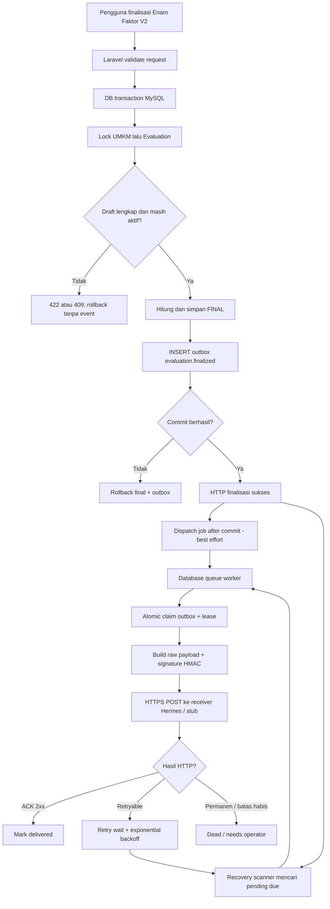
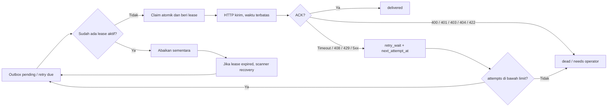
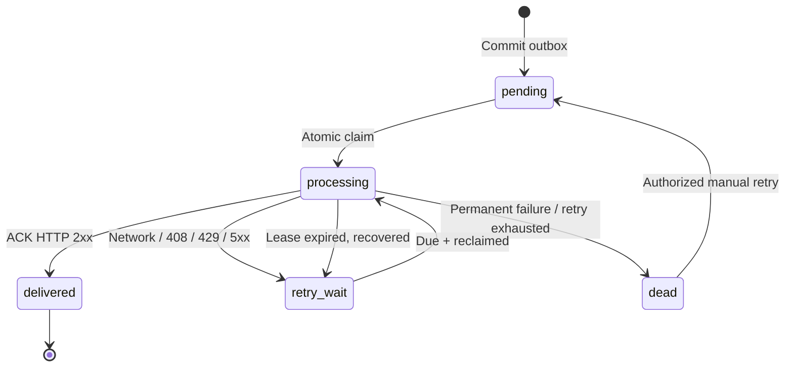

# PRD — JoyUMKM P4-01: Laravel → Hermes Webhook Sender

**Versi:** 1.0 — Implementation Brief  
**Tanggal:** 22 November 2026  
**Status:** APPROVED DIRECTION / READY FOR IMPLEMENTATION (implementasi P4-01 belum dijalankan)  
**Repository:** `https://github.com/joytimess/dip-joyumkm`  
**Branch referensi:** `main`  
**Baseline audit:** commit `7ed7b09835467775396b6293b15f78002042c5e9` (re-audit HEAD sebelum modifikasi)  
**Implementor wajib:** **Codex 6.2 Sol — seluruh implementasi, testing, dan review; tanpa Claude Code / model lain**  
**Skill directory pengguna:** `C:\Users\itsba\.agents\skills`  
**Agent directory pengguna:** `C:\Users\itsba\.codex\agents`  
**Stack:** Laravel, MySQL, Laravel Database Queue, HTTPS, Hermes Agent (receiver pada P4-02)

> **Definisi scope:** P4-01 mengimplementasikan **sisi pengirim di Laravel saja**. P4-02 menguji/mengerjakan receiver Hermes sungguhan, P4-03 eksekusi `joyumkm-intelligence`, P4-04 QA end-to-end. P4-01 harus lulus secara mandiri menggunakan receiver uji/stub dengan kontrak yang terdefinisi. Tidak perlu mengirim hasil AI balik ke Laravel.

---

## 1. Executive summary

Saat **Penilaian Enam Faktor V2** bertransisi secara sah dari `draft` ke `final`, Laravel harus secara **atomik** menyimpan hasil final beserta satu event `evaluation.finalized` di **transactional outbox**. Proses pengiriman event dilakukan terpisah melalui Laravel **database queue** dan HTTPS webhook bertanda tangan HMAC-SHA256. Jika Hermes tidak tersedia, **finalisasi tetap berhasil** dan event dipertahankan untuk retry atau pemulihan. Jangan mengubah perhitungan skor, kategori, API finalisasi, maupun lifecycle evaluasi yang sudah ada.

**Definisi delivered:** acknowledgement HTTP yang memenuhi kontrak penerimaan receiver, **bukan** bukti AI selesai menganalisis. Sistem adalah **at-least-once delivery**, bukan jaminan exactly-once transport; `event_id` stabil dan penerima P4-02 harus melakukan idempotent deduplication.

## 2. Fakta baseline repository (hasil audit statis)

- `app/Services/SixFactorEvaluationService.php`: `finalize()` menghasilkan atribut final pada baris 59–84; `transition()` menangani transaksi MySQL dengan urutan **lock UMKM → lock evaluasi** pada baris 133–151. Finalisasi ulang dari status terminal ditolak `409`.
- `app/Models/SixFactorEvaluation.php`: enam faktor kanonis: `sumber_daya`, `kepemimpinan`, `lingkungan_kerja`, `nilai_organisasi`, `stabilitas`, `kinerja`.
- `routes/api.php`: endpoint saat ini `POST /api/umkms/{id}/six-factor-evaluations/{evaluationId}/finalize` dalam `auth:sanctum`.
- `config/queue.php`: driver database tersedia, tabel `jobs` / `failed_jobs` telah didefinisikan oleh migration `0001_01_01_000002_create_jobs_table.php`.
- `.env.example` pada snapshot masih `QUEUE_CONNECTION=sync`; pengguna telah menyatakan `.env` lokal diganti ke `database` dan `queue:work` aktif. **Tetap verifikasi, jangan menganggap environment production sama.**
- Belum ditemukan implementation code khusus outbox / Hermes webhook sender atau recovery scanner pada baseline.
- Test concurrency MySQL sudah tersedia di `tests/Feature/SixFactorEvaluationConcurrencyTest.php` dan harus dipertahankan/ditambah.
- Folder `C:\Users\itsba\.agents\skills` dan `C:\Users\itsba\.codex\agents` berada di Windows pengguna; **isinya belum diinspeksi dalam PRD ini**. Nama skill/agent pada §12 adalah kategori pencarian/opsi kondisional, bukan klaim tersedia.

**Catatan konflik dokumentasi:** commit terbaru sudah memuat implementasi Detail UMKM walaupun PRD Detail UMKM yang baru menyatakan belum diimplementasikan. P4-01 **tidak terkait** dengan refactor ulang Detail UMKM; jangan gunakan PRD lama untuk mengulang fitur existing.

## 3. Tujuan, batas, dan non-goals

### 3.1 Goals

1. Satu transisi `draft → final` sukses menghasilkan **tepat satu event logis** yang persisten, walaupun finalisasi dipanggil dua kali/paralel.
2. Outbox event dan perubahan evaluasi commit/rollback **bersama**.
3. Finalisasi HTTP tidak terblokir HTTP outbound ke Hermes.
4. Pengiriman webhook memakai Laravel Database Queue, HMAC, bounded retries, dan audit delivery.
5. Gangguan queue/worker, crash, timeout, 429, atau 5xx tidak menyebabkan event hilang.
6. Recovery scanner menangani event `pending`, retry due, dan lease yang sudah kedaluwarsa; ada kemampuan retry operator yang aman.
7. Semua perilaku diuji pada **MySQL sesungguhnya**, termasuk concurrency multi-process dan regresi API penilaian.

### 3.2 Non-goals

- Tidak membuat/memodifikasi receiver Hermes Docker dalam P4-01.
- Tidak mengeksekusi AI atau skill `joyumkm-intelligence` dari Laravel.
- Tidak menambahkan callback Hermes → Laravel, dashboard hasil AI, atau tabel hasil analisis AI.
- Tidak memicu event untuk Draft, Batal, Kuesioner Tiga Dimensi, edit Profil/Lokasi/Kontak, ataupun update UMKM.
- Tidak mengganti autentikasi Sanctum atau mengubah aturan penilaian Enam Faktor.
- Tidak menggunakan SQLite total suite sebagai kriteria gate; **MySQL targeted + regression** yang relevan.

## 4. Arsitektur usulan



### 4.1 Aturan transaksi

- Jadikan **transisi resmi dalam `SixFactorEvaluationService`** satu-satunya titik pembuatan event. Pertahankan lock order saat ini.
- Sisipkan pembuatan outbox **di dalam transaksi yang sama** setelah atribut final valid dan tersimpan; kegagalan outbox insert harus membatalkan transisi.
- Unique constraint **`(event_type, aggregate_id)`** untuk `evaluation.finalized` / ID evaluasi. Setiap finalisasi sah mendapat satu event logis unik; `event_id` UUID stabil selama retry.
- Jangan menjalankan `Http::post`, job synchronous, atau pekerjaan AI di dalam transaksi.
- Setelah commit, lakukan dispatch queue **best-effort** (`afterCommit()` atau mekanisme setara); bila dispatch gagal, scanner harus bisa menemukan event outbox yang commit.
- Jangan menelan exception transaksi dan menampilkan final sukses jika penyimpanan outbox gagal.

### 4.2 Alur pengiriman dan recovery



- Dua worker tidak boleh memiliki lease aktif valid untuk event yang sama. Gunakan row-lock/conditional update dan **lease token** agar worker lama tidak dapat mengubah status setelah lease berakhir.
- Ketika receiver menerima event tetapi response timeout, retry **mungkin mengirim payload yang sama lagi**. `event_id` tidak boleh diganti; idempotensi pemrosesan di receiver P4-02 wajib.
- Scanner terjadwal harus memeriksa pending, retry due, dan stale processing, lalu mengantrekan pengiriman idempotently; scanner jangan mengunci DB selama request HTTP.
- Worker/cron/scheduler **tidak boleh diasumsikan berjalan otomatis**. Dokumentasikan perintah dan pengecekan untuk Laragon/Windows dan deployment nyata.

## 5. Data design: `webhook_outbox`

Nama tabel rekomendasi: **`webhook_outbox`**. Implementor boleh menyederhanakan naming agar konsisten repo, tetapi seluruh semantik berikut wajib dipenuhi.

| Kolom | Tujuan |
|---|---|
| `id` | Primary key internal |
| `event_id` | UUID unik dan stabil lintas retry |
| `event_type` | `evaluation.finalized` |
| `event_version` | `1` |
| `aggregate_id` | ID baris `six_factor_evaluations` |
| `payload` | Snapshot JSON immutable dari state Final |
| `status` | `pending`, `processing`, `retry_wait`, `delivered`, `dead` |
| `attempts` | Jumlah usaha kirim; naik secara atomik ketika attempt dimulai |
| `next_attempt_at` | Waktu retry eligible |
| `lease_token`, `lease_expires_at` | Atomic claim, recover crash/stale worker |
| `last_http_status` | Kode HTTP terakhir, nullable |
| `last_error_code`, `last_error_summary` | Error terklasifikasi, **tanpa token, secret, atau PII** |
| `created_at`, `updated_at`, `delivered_at` | Audit waktu |

Constraints/index:

- Unique (`event_id`).
- Unique (`event_type`, `aggregate_id`) untuk menghindari duplikasi event Final.
- Index (`status`, `next_attempt_at`) untuk recovery; index (`lease_expires_at`) untuk stale claim.
- `payload` **tidak berubah** saat retry; perubahan format memerlukan versioning/migration eksplisit.
- Pertimbangkan foreign key ke evaluasi yang tidak menyebabkan penghapusan history secara diam-diam; mengikuti kebijakan retensi dan DB existing.
- Simpan hanya payload minimum; audit log tambahan opsional asal tidak mencetak body berisi data sensitif.

## 6. Kontrak event `evaluation.finalized`

Payload contoh **non-produksi**, sesuai field kanonis backend:

```json
{
  "event_id": "550e8400-e29b-41d4-a716-446655440000",
  "event_type": "evaluation.finalized",
  "event_version": 1,
  "source": "joyumkm",
  "occurred_at": "2026-11-22T10:00:00Z",
  "data": {
    "evaluation_id": 125,
    "umkm_id": 42,
    "status": "final",
    "scores": {
      "sumber_daya": 4,
      "kepemimpinan": 3,
      "lingkungan_kerja": 3,
      "nilai_organisasi": 4,
      "stabilitas": 3,
      "kinerja": 4
    },
    "total_score": 21,
    "category": "Sehat"
  }
}
```

**Kontrak data:**

- Snapshot harus berasal dari hasil final **yang disimpan server**, bukan skor input frontend.
- `total_score` adalah 6–30, kategori mengikuti aturan existing: 6–12 `Kurang Sehat`; 13–18 `Cukup Sehat`; 19–24 `Sehat`; 25–30 `Sangat Sehat`.
- `occurred_at` mengacu waktu finalisasi UTC; gunakan serialisasi yang konsisten.
- Tidak mengirim nama pemilik, WhatsApp, email, nomor dokumen, alamat, atau token aplikasi.
- Jaga event envelope kompatibel dengan receiver `joyumkm-events` **jika** route tersebut masih tersedia. Jangan berasumsi route/status/format receiver lama masih sama: P4-01 perlu **contract fixture** yang dapat diuji tanpa Hermes live.

## 7. HTTPS & keamanan webhook

- Webhook hanya aktif bila dikonfigurasi secara eksplisit; sediakan flag mis. `HERMES_WEBHOOK_ENABLED=false` default, `HERMES_WEBHOOK_URL`, `HERMES_WEBHOOK_SECRET`, `HERMES_WEBHOOK_TIMEOUT_SECONDS`, serta retry/backoff settings yang terbatas.
- **Dilarang mengirim** event ke URL tanpa HTTPS di lingkungan non-test. Validasi host/tujuan untuk mengurangi SSRF dan kesalahan konfigurasi. HTTP loopback boleh hanya dalam tes terkontrol.
- HMAC-SHA256 wajib menggunakan **secret server-side** dan raw bytes body yang dikirim. Sertakan timestamp/replay guard, dan bila dibutuhkan key identifier. Gunakan perbandingan constant-time saat receiver memvalidasi.
- **PENTING:** format header & canonical signing input harus mengikuti kontrak receiver Hermes yang benar-benar tersedia. Jika belum dapat diinspeksi, gunakan **adapter terisolasi + kontrak provisional dalam fixture**, jangan menyatakan integrasi Hermes live sudah PASS. Pilihan provisional: tanda tangan `timestamp + '.' + rawBody`, dengan `X-JoyUMKM-Event-ID`, `X-JoyUMKM-Timestamp`, `X-JoyUMKM-Signature`. **Tidak boleh hardcode sebagai fakta Hermes** tanpa verifikasi P4-02.
- Rahasiakan secret di `.env`, gunakan `config/services.php` atau konfigurasi setara; dokumentasikan konfigurasi di `.env.example` dengan nilai kosong/palsu, bukan secret nyata.
- Batasi connect/read timeout; jangan menunggu proses AI Hermes selesai; jangan mengikuti redirect lintas host tanpa kontrol; sanitasi log response/error.

## 8. Retry, error policy, dan state machine



**Aturan rekomendasi yang perlu diterapkan dan didokumentasikan:**

- `2xx` adalah ACK transport **hanya jika** sesuai kontrak receiver; bukan hasil analisis AI.
- Network error/timeout, `408`, `429`, dan `5xx`: retry dengan exponential backoff, jitter, cap; hormati `Retry-After` yang masuk akal untuk 429/503.
- `400`, `401`, `403`, `404`, `422` biasanya menandakan schema/signature/path/config salah: tandai `dead`/operator action, bukan infinite retry.
- Contoh batas: maksimum **5 attempts**, delay 30 detik → 2 menit → 5 menit → 15 menit (jitter dan cap ditentukan satu tempat). Angka final dapat diselaraskan sebelum coding dengan konfigurasi host, tetapi harus **bounded dan teruji**, bukan infinite.
- `dead` tidak boleh mengubah evaluasi dari Final; operator boleh retry event **yang sama**, tidak membuat event baru.
- Jika disabled/missing config: jangan kirim, jangan membuang outbox, tampilkan state operasional yang dapat diinspeksi. Salah konfigurasi harus terlihat di logs/metrics tanpa membuka secret.
- Hindari double retry yang tidak terkendali antara `queue:work --tries`, Laravel Job backoff, dan `next_attempt_at`; pilih **satu sumber kebenaran jadwal retry di outbox**, queue hanya eksekutor.

## 9. Struktur implementasi (brief, bukan instruksi wajib menamai kelas)

Rangkaian kode minimal yang diharapkan:

1. **Migration + model repository outbox:** schema, indices, status/lease functions, typed casts.
2. **Domain integration:** insert event di transaksi `SixFactorEvaluationService::transition()` saat Final sukses; jangan memodifikasi fungsi skor/hasil.
3. **Event envelope builder:** snapshot dari model final, `event_id` UUID, version.
4. **HTTP sender + HMAC signer:** envelope raw JSON, header signature, timeout, response classification; diisolasi supaya mudah diuji.
5. **Queue job:** claim atomik outbox → kirim → update status atau retry scheduling; siap dipanggil oleh `queue:work database`.
6. **Recovery scanner + Artisan command / scheduler:** dispatch due pending, retry_wait, stale leases; idempotent, aman pada scanner paralel.
7. **Config & docs:** `.env.example`, operasi worker/cron, status inspection, requeue aman, rotasi secret bila berlaku.
8. **Tests:** unit signer + feature MySQL + concurrency + integration stub; test fail points, recovery, dan regresi existing.

**Jangan** mengimplementasikan outbound HTTP dengan observer model atau controller yang bisa terpanggil dari read path. Pertahankan pemisahan service/domain dan transport.

## 10. Acceptance criteria / QA gates

| ID | Kriteria PASS yang wajib dibuktikan |
|---|---|
| P401-AC01 | Finalisasi Draft lengkap menjadi Final tetap mengembalikan body/status API lama; muncul tepat satu event outbox |
| P401-AC02 | Draft save, Cancel, validasi gagal, Final ulang 409, dan GET history/latest **tidak** membuat event |
| P401-AC03 | Forced rollback (termasuk kegagalan INSERT outbox) membatalkan Final dan outbox bersama |
| P401-AC04 | Dua request finalisasi paralel pada MySQL menghasilkan satu Final sukses, satu konflik, satu event logis |
| P401-AC05 | Dispatch gagal/worker berhenti pascacommit: data Final + outbox tetap aman dan scanner dapat memulihkan |
| P401-AC06 | Worker paralel, stale lease, dan worker crash tidak menyebabkan kehilangan event; lease token mencegah stale write |
| P401-AC07 | `event_id`, payload, total, kategori, dan `event_version` stabil lintas retry |
| P401-AC08 | Signature HMAC valid terhadap **exact raw request bytes**; negative tests modified body, secret, timestamp, replay guard fixture |
| P401-AC09 | HTTPS policy + validasi URL/host dan tidak ada secret/PII dalam log/error |
| P401-AC10 | HTTP ACK 2xx mengubah status `delivered`, tetapi tidak mengklaim AI completed |
| P401-AC11 | Timeout, 408/429/5xx retry bounded; 400/401/403/404/422 masuk state operator, tanpa loop tak berujung |
| P401-AC12 | `dead` dapat di-requeue dengan event yang sama secara aman, dan tidak mengubah hasil Final |
| P401-AC13 | Disabled/missing config: finalisasi tetap berjalan; event tidak lenyap dan keterlambatan teramati |
| P401-AC14 | Existing MySQL six-factor API, service, concurrency, dan UI-related regression tidak memburuk |
| P401-AC15 | Dokumentasi operasional menyatakan syarat worker + scheduler/cron, recovery, inspeksi status, dan cara test stub |
| P401-AC16 | Test dan build yang dijalankan dilaporkan secara jujur sebagai PASS/FAIL/NOT RUN; tidak mengklaim integrasi Hermes asli sebelum P4-02 |

**Database testing:** MySQL terisolasi, mis. `joyumkm_testing`, dengan verifikasi nama DB sebelum destructive test. Jangan gunakan production/development data untuk truncate. User mengarahkan untuk **skip SQLite total suite**; jalankan targeted MySQL + regresi relevan.

## 11. Delivery plan yang boleh dijalankan Codex autonomously

### 11.1 Audit cepat

- Konfirmasi `git status`, HEAD, Laravel version, skema MySQL, queue, service finalisasi, tes concurrency, konfigurasi hosting/worker. Jangan overwrite perubahan lokal user.
- Validasi bahwa route Hermes lama dan kontrak signature bukan sekadar asumsi. Bila belum bisa diakses, tetapkan contract fixture dan dokumentasikan gap P4-02; **jangan menjadikan live Hermes dependency P4-01**.
- Baca `AGENTS.md` yang berlaku dan aturan repo sebelum menulis kode.

### 11.2 Implementasi

- Migration outbox → model/repository → finalization integration → signer/sender → job → scanner → config/docs → tests.
- Perubahan minimal dan additive; hindari refactor massal UI/autentikasi/engine penilaian.
- Jangan memberi verdict PASS bila ada gate yang gagal atau NOT RUN; bedakan blockers environment vs bug implementasi.

### 11.3 Verifikasi & handoff

- PHPUnit targeted MySQL (service/API/concurrency + new sender tests), linter/format, regression relevan, serta test HTTP fakes + stub server bila layak.
- Tulis ringkasan artefak, file berubah, environment keys (tanpa secret), commands worker/recovery, tabel test results, risiko residual.
- Tidak mengubah remote Hermes, production secret, ataupun melakukan push/deploy tanpa otorisasi eksplisit pengguna.

## 12. Instruksi skills dan agents untuk Codex 6.2 Sol

**Path yang diminta pengguna:**

```text
Skills: C:\Users\itsba\.agents\skills
Agents: C:\Users\itsba\.codex\agents
```

**Discovery WAJIB sebelum eksekusi**, karena isi folder lokal ini **belum diverifikasi** oleh pembuat PRD:

1. Enumerasi direktori dan baca `SKILL.md` dari skill yang relevan (juga file referensi yang diwajibkan skill). Jangan menganggap suatu skill tersedia hanya karena ada di daftar contoh.
2. Enumerasi file konfigurasi/prompt agent di `C:\Users\itsba\.codex\agents` (`*.md`, `*.toml`, `*.yaml` atau format sebenarnya). Baca kontrak peran/permission, bukan sekadar nama file.
3. Selalu prioritaskan aturan sistem, repo `AGENTS.md`, dan instruksi skill yang benar-benar ditemukan.
4. Pilih skill yang mendukung pekerjaan konkret; hindari memakai seluruh skill indiscriminately.
5. Semua pekerjaan termasuk subagent **harus Codex 6.2 Sol**; jangan memanggil Claude Sonnet/Opus atau model lainnya.
6. Bila folder tidak dapat diakses, kerjakan dengan kemampuan standar Codex dan sebutkan **NOT VERIFIED** untuk skill/agent lokal. Jangan mengarang nama file atau klaim skill digunakan.

**Kategori skill yang relevan (gunakan jika benar-benar ditemukan):**

| Prioritas | Kategori yang dicari | Peran P4-01 |
|---|---|---|
| P0 | `laravel-best-practices` / Laravel architecture | Transaction boundary, queue, HTTP client, migration, artisan command |
| P0 | `testing-best-practices` / PHPUnit + MySQL testing | MySQL concurrency, transaction rollback, HTTP fakes, deterministic fixtures |
| P0 | security / API / webhook practices | HMAC raw bytes, secrets, SSRF, replay safety, redaction |
| P1 | database / performance / MySQL | Unique constraints, claim/lease, indexing, deadlock safety |
| P1 | code review / audit | Review transaksi, race conditions, error handling |
| P2 | documentation / PRD | Handoff, runbook deployment and recovery |

**Kategori agent yang relevan (peran, BUKAN nama file yang sudah terverifikasi):**

- **Main Codex 6.2 Sol / Backend Implementor** — pemilik utama perubahan Laravel, migration, sender, jobs dan dokumentasi.
- **MySQL/Concurrency Reviewer (opsional)** — hanya bila ada agent lokal cocok; audit lock-order, insert atomik, state machine dan overlapping requests.
- **QA/Security Reviewer (opsional)** — hanya bila ada agent lokal cocok; audit HMAC, replay, retry, PII, regression.

**Batas delegasi:** satu implementor utama, opsional maksimal dua reviewer subagent di bawah Codex Sol. Jika tidak ada profil agent yang cocok atau modelnya bukan Sol, **jangan delegate**; main Codex tetap melaksanakan QA dan review sendiri. Tidak perlu Hermes Task Manager, Kanban, atau model Claude untuk P4-01.

**Contoh discovery lokal untuk Windows PowerShell (untuk Codex, bukan permintaan menjalankan sekarang):**

```powershell
Get-ChildItem 'C:\Users\itsba\.agents\skills' -Directory | Select-Object Name,FullName
Get-ChildItem 'C:\Users\itsba\.agents\skills' -Recurse -Filter SKILL.md -File | Select-Object FullName
Get-ChildItem 'C:\Users\itsba\.codex\agents' -File | Select-Object Name,FullName
```

Jika skills/agents ada di dalam subdirektori atau format yang berbeda, sesuaikan pencarian, dan utamakan instruksi nyata yang ditemukan.

## 13. Definition of Done / handoff akhir P4-01

P4-01 **PASS** hanya jika:

- Seluruh P401-AC01 s.d. AC16 diverifikasi dan bukti dicantumkan.
- Tidak ada regresi fungsional pada API Enam Faktor.
- Outbox durable, queue worker dan recovery berfungsi pada MySQL uji; kegagalan Hermes bukan kegagalan finalisasi.
- Kontrak payload+HMAC terdokumentasi sebagai **verified** (jika receiver diuji) atau **provisional for P4-02** (jika masih stub), tanpa claim palsu.
- Handoff menjelaskan konfigurasi, operasi `queue:work`, `schedule:run`/cron atau CLI scanner, serta cara recovery event `dead`.
- Tidak ada deployment/push/secret disisipkan diam-diam.

### 13.1 Lintasan berikutnya

- **P4-02:** verifikasi konfigurasi `joyumkm-events`, implement/align receiver signature, anti-replay, dedup, ACK semantics di Hermes Docker.
- **P4-03:** jalankan skill `joyumkm-intelligence` atas event Final.
- **P4-04:** end-to-end chaos/recovery/monitoring dan verifikasi operasional menyeluruh.

---

**Instruksi penutup kepada Codex 6.2 Sol:** Laksanakan P4-01 secara utuh dan otonom berdasarkan PRD ini; audit kondisi repo saat mulai, gunakan skills/agents lokal yang benar-benar tersedia dan sesuai, implementasikan plus tes MySQL, laporkan gate dengan bukti. Jika layanan Hermes live belum siap, gunakan receiver stub dan catat gap untuk P4-02; jangan berhenti pada pekerjaan parsial hanya karena receiver P4-02 belum berjalan. Jangan mengubah penilaian yang sudah stabil, jangan melakukan push/deploy, dan jangan mencampur scope P4-02/03/04.
