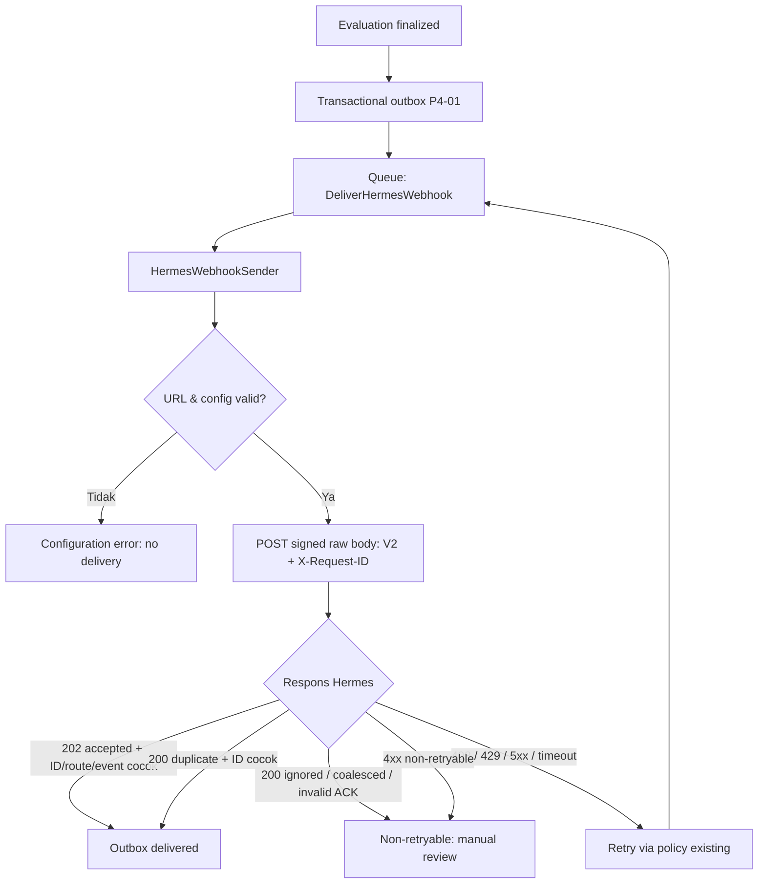

# PRD — JoyUMKM P4-02: Adjustment Laravel untuk Hermes Webhook Receiver

> **Status:** Approved implementation brief (berdasarkan keputusan dan audit bersama, 22 November 2026)  
> **Target implementor:** **Claude Sonnet 5.5 — effort High**  
> **Repository kerja:** JoyUMKM Laravel (`C:\laragon\www\joyumkm`)  
> **Scope dokumen:** **hanya perubahan Laravel** untuk kompatibilitas native Hermes receiver. Konfigurasi subscription Hermes dan live E2E dicatat sebagai dependensi/verifikasi lintas sistem, **bukan pekerjaan perubahan kode Hermes**.

## 1. Ringkasan keputusan

P4-01 sudah membangun **transactional MySQL outbox**, queue delivery, HMAC-SHA256, retry, dan recovery. P4-02 tidak boleh me-rewrite fondasi tersebut. Audit langsung terhadap kode receiver Hermes di container `hermes-agent` mengonfirmasi:

- Endpoint lokal receiver: `POST http://127.0.0.1:8644/webhooks/joyumkm-events` melalui proxy Docker yang sudah berjalan. Ini **baru membuktikan konektivitas HTTP** (`GET` mengembalikan `405 Allow: POST`), belum sukses end-to-end.
- Native generic V2 signature: `X-Webhook-Signature-V2` berisi **lowercase hex HMAC-SHA256** dari `"<timestamp>.<raw_body>"`; timestamp dikirim melalui `X-Webhook-Timestamp` dan diverifikasi terhadap replay window.
- Delivery ID diekstrak dari `X-GitHub-Delivery`, `svix-id`, `webhook-id`, lalu **`X-Request-ID`**. Untuk JoyUMKM gunakan `X-Request-ID: <outbox.event_id>` yang **tetap sama saat retry**.
- Tipe event dibaca dari `payload.event_type` atau `payload.type` (setelah override header provider lain). Event target adalah **`evaluation.finalized`**.
- Jalur agent-run normal: `202 {"status":"accepted","route":"joyumkm-events","event":"evaluation.finalized","delivery_id":"..."}` ketika admission berhasil; `200 {"status":"duplicate","delivery_id":"..."}` untuk pengiriman identik; `200 {"status":"ignored",...}` untuk event/filter yang diabaikan; `503` jika admission unavailable; `202 {"status":"coalesced",...}` berlaku pada konfigurasi coalescing, **tidak diizinkan dalam kontrak P4-02**.
- **ACK accepted berarti Hermes mengakui admission, bukan bukti bahwa pekerjaan AI telah tuntas.**

**Keputusan:** Header Laravel V2 yang sudah diganti secara manual **dipertahankan**. Adjustment sisanya adalah validasi ACK yang ketat, pengecualian loopback HTTP untuk environment pengembangan saja, dan test/regresi yang melindungi kontrak tersebut.

## 2. Sasaran dan non-sasaran

### Sasaran

1. Laravel tidak pernah menandai outbox **`delivered`** hanya karena menerima status HTTP 2xx tanpa ACK Hermes yang valid.
2. Retry event mempertahankan `X-Request-ID` dan menghasilkan signature HMAC V2 atas **raw payload yang sama persis** dengan yang dikirim.
3. Konfigurasi URL `http://127.0.0.1:8644/webhooks/joyumkm-events` valid **hanya** di `local`/`testing`; guard tujuan production tetap ketat.
4. Semantik error ACK, retry, dan status outbox konsisten dengan kontrak P4-01; tidak ada data evaluasi atau event yang hilang/terkirim ganda akibat perubahan ini.
5. Test terarah dan regresi MySQL relevan lulus, dengan bukti yang bisa direproduksi.

### Non-sasaran

- Tidak membuat ulang sistem outbox, queue, idempotency, recovery scanner, atau model database.
- Tidak mengimplementasikan `joyumkm-intelligence`/P4-03, mengganti profile AI Hermes, mengubah Docker image, atau memindahkan delivery ke sistem lain.
- Tidak mengubah subscription Hermes secara otomatis dari Laravel. Penyesuaian route di Hermes dilakukan terpisah.
- Tidak mengubah event schema `evaluation.finalized` kecuali audit kode menemukan incompatibility yang jelas dan melaporkannya sebelum memperluas scope.
- Tidak mengubah kebijakan full production HTTPS, membolehkan IP/host privat umum, atau menonaktifkan pemeriksaan signature.

## 3. Inventaris file dan aturan modifikasi

| Lokasi | Tindakan | Keterangan |
| --- | --- | --- |
| `app/Services/HermesWebhookSender.php` | **PATCH wajib** | Konfirmasi header V2; validasi ACK; konfigurasi localhost yang aman; pertahankan kontrak return existing. |
| `config/services.php` | **INSPECT**, patch bila perlu | Pastikan key dan nama env Hermes sesuai implementasi; hindari membuat konfigurasi duplikat. |
| `.env` lokal | **Konfigurasi operator**, jangan commit | Isi URL/host/secret asli secara lokal; jangan menyalin secret ke laporan, fixture, PRD, atau log. |
| `.env.example` | **PATCH jika perlu** | Dokumentasikan contoh nilai tanpa secret nyata dan kebijakan URL local/production. |
| `app/Jobs/DeliverHermesWebhook.php` | **INSPECT dahulu**, patch minimal jika perlu | Pastikan `invalid_ack`, rejected, dan retryable diproses benar; jangan rewrite pipeline. |
| Existing tests Hermes di `tests/` | **PATCH/ADD wajib** | Temukan nama file aktual dengan pencarian repo; jangan membuat path test fiktif atau duplikat suite. |
| `app/Services/HermesWebhookOutbox.php` dan model terkait | **Read-only audit** | Hanya diubah bila ditemukan mismatch konkret; jelaskan alasan dan regresinya. |

**Catatan:** Path test dan nama variabel `.env` harus dibaca dari repository lokal sebelum perubahan. Kode P4-01 mungkin belum committed; jangan reset, clean, atau overwrite pekerjaan pengguna.

## 4. Kontrak teknis wajib

### 4.1 Request headers dan body

Di `HermesWebhookSender::send()`, gunakan header berikut:

```php
->withHeaders([
    'X-Request-ID' => $event->event_id,
    'X-Webhook-Timestamp' => (string) $timestamp,
    'X-Webhook-Signature-V2' => self::signature($timestamp, $body, $secret),
])
->withBody($body, 'application/json')
```

Fungsi `signature()` yang sudah ada sudah kompatibel bila implementasinya:

```php
hash_hmac('sha256', $timestamp . '.' . $body, $secret)
```

**Ketentuan keamanan:**

- `$body` harus tetap **raw JSON string** dari outbox yang dikirim; jangan `json_decode()` lalu `json_encode()` ulang sebelum signing.
- Gunakan timestamp Unix dalam detik; signature dapat berubah pada retry, tetapi delivery ID tetap.
- Jangan tambahkan `webhook-signature`, `svix-signature`, atau header signature lain yang dapat membuat Hermes memilih family berbeda.
- Pertahankan `withoutRedirecting()`, timeout, dan pengamanan proxy/destination yang ada.
- Jangan mengirim atau menulis raw secret dalam log, exception, laporan, ataupun test output.

### 4.2 Klasifikasi ACK Hermes

**Satu-satunya respons sukses yang diizinkan untuk jalur agent-run normal P4-02:**

| HTTP | JSON wajib | Hasil Laravel |
| --- | --- | --- |
| `202` | `status === "accepted"`, `route === "joyumkm-events"`, `event === "evaluation.finalized"`, `delivery_id === event_id` | **Success**; boleh ditandai `delivered`. |
| `200` | `status === "duplicate"`, `delivery_id === event_id` | **Success**; delivery sudah diterima sebelumnya. |
| `200` | `status === "ignored"` (termasuk `reason=filter`) | **Failure, non-retryable**; jangan tandai delivered. |
| `202` | `status === "coalesced"` | **Failure/contract mismatch** untuk konfigurasi P4-02. |
| `200`/`202` lain | Missing field, mismatch, tipe field salah, JSON invalid, status asing, atau struktur tidak sesuai | **`invalid_ack`, non-retryable**, butuh investigasi/koreksi. |
| `408`, `429`, semua `5xx` | Respons apa pun | **Retryable** menurut retry/backoff existing; hormati `Retry-After` jika didukung. |
| `3xx`, `400`, `401`, `403`, `404`, `422`, dan `4xx` lain (selain 408/429) | Respons apa pun | **Non-retryable**, tetap beri ringkasan aman untuk operator. |
| Network error / timeout | Tidak ada respons valid | **Retryable** sesuai policy P4-01. |

Gunakan **perbandingan ketat (`===`)** terhadap status dan field yang wajib. `route` dan `event` pada `accepted` harus cocok dengan kontrak terkonfigurasi (jangan meng-hardcode dua kali bila sudah ada sumber konfigurasi yang jelas). Untuk `duplicate`, receiver Hermes hanya menjamin field `delivery_id`, maka **jangan mensyaratkan `route`/`event` pada ACK duplicate**.

**Pilihan policy:** ACK 2xx yang tidak valid diperlakukan sebagai **non-retryable/needs-manual-review**, bukan auto retry tanpa batas. Pertahankan pilihan ini untuk menghindari event yang mungkin sudah diterima Hermes diproses kembali karena parser/kontrak berubah. Jika job/outbox lama tidak memiliki status spesifik `invalid_ack`, pertahankan enum/status database yang tersedia dan gunakan kode error diagnostik pada field existing; jangan tambah migration hanya untuk penamaan.

**Kewajiban kontrak return:** Jangan mengganti shape hasil `send()` yang dipakai job: `http_status`, `error`, `summary`, `retryable`, `retry_after`. Untuk ACK sukses pastikan `error === null`; untuk invalid ACK gunakan kode internal deterministik `invalid_ack` dengan pesan operator singkat tanpa mengekspose payload/secret.

### 4.3 Validator URL: loopback development saja

Di `HermesWebhookSender::configurationIssue()` saat ini **HTTP `127.0.0.1`** baru diizinkan untuk `testing`. Ubah menjadi:

- `APP_ENV=local` **atau** `testing`: boleh `http://127.0.0.1:<port>/...` dengan host persis `127.0.0.1`, dan `allowed_host === 127.0.0.1`.
- Semua environment lain: tetap menerapkan kebijakan **HTTPS + FQDN valid** seperti implementasi sekarang.
- Tetap tolak mismatch `allowed_host`, userinfo, query, fragment, backslash, URL tidak valid, protokol lain, dan redirect lintas host.
- Jangan memperluas pengecualian ini ke `localhost`, `0.0.0.0`, `::1`, IP Docker bridge, subnet privat, domain `.localhost`, atau hostname arbitrer tanpa keputusan terpisah.
- Pertahankan ketentuan URL konfigurasi existing lainnya; jangan melemahkan production SSRF guard.

Konfigurasi development yang ditargetkan (nama env **harus dicocokkan** dengan `config/services.php` lokal):

```dotenv
HERMES_WEBHOOK_ENABLED=true
HERMES_WEBHOOK_URL=http://127.0.0.1:8644/webhooks/joyumkm-events
HERMES_WEBHOOK_ALLOWED_HOST=127.0.0.1
HERMES_WEBHOOK_SECRET=<SAMA_DENGAN_SECRET_SUBSCRIPTION_HERMES>
```

**Jangan mencetak nilai secret saat memverifikasi**. Bila config cache digunakan, lakukan refresh melalui prosedur Laravel lokal yang sesuai, dan restart queue worker jika config diubah agar worker mengambil konfigurasi baru.

### 4.4 Job dan outbox tetap kompatibel

Baca `app/Jobs/DeliverHermesWebhook.php` untuk memastikan:

- `send()` sukses hanya pada ACK `accepted`/`duplicate` yang lolos kontrak.
- `invalid_ack`/`ignored` tidak menjadi `delivered`, tidak masuk retry otomatis tanpa batas, dan tetap dapat diamati operator dengan metode existing.
- Retryable network/408/429/5xx tetap mengikuti batas percobaan, backoff, dan recovery P4-01.
- Pemrosesan duplikat mempertahankan `event_id` yang sama; tidak membuat outbox record/event baru ketika retry.
- Perubahan seminimal mungkin; jangan ubah skema database atau concurrency locking kecuali terbukti wajib.

## 5. Diagram alur target



## 6. Matriks verifikasi wajib

Prioritaskan memodifikasi suite Hermes yang sudah ada. Gunakan `Http::fake()`/assertion di unit/feature test untuk ACK dan header, lalu integrasi MySQL lokal bila jalur job/outbox perlu dibuktikan. Jangan menyatakan E2E berhasil hanya dari fake HTTP.

| ID | Pengujian | Ekspektasi |
| --- | --- | --- |
| ACK-01 | HTTP 202 `accepted`, route/event/delivery ID tepat | `send()` success, job boleh menandai delivered. |
| ACK-02 | HTTP 200 `duplicate`, delivery ID tepat | Success, idempotent; tidak membuat event kedua. |
| ACK-03 | HTTP 200 `ignored` (event/filter) | Rejected, non-retryable, bukan delivered. |
| ACK-04 | HTTP 202 `coalesced` | Invalid ACK, bukan delivered. |
| ACK-05 | 202 accepted dengan route/event/ID salah | Invalid ACK, bukan delivered. |
| ACK-06 | 200 duplicate dengan ID salah | Invalid ACK, bukan delivered. |
| ACK-07 | JSON rusak/kosong, `status` asing, field hilang/tipe salah | Invalid ACK dan tidak sukses. |
| ACK-08 | HTTP 408, 429, 503, 5xx, timeout | Retryable; `Retry-After` 429/503 dipertahankan jika ada. |
| ACK-09 | HTTP 400/401/403/404 atau 3xx | Tidak delivered dan tidak retry otomatis (di luar policy khusus existing). |
| SIGN-01 | HMAC-SHA256 atas `timestamp.rawBody` dan header V2 | Cocok dengan expected HMAC; header legacy tidak terpakai. |
| SIGN-02 | Pengiriman ulang event sama | `X-Request-ID` stabil; timestamp/signature valid per request. |
| URL-01 | `local` dan `testing` + HTTP `127.0.0.1:8644` | Valid jika allowed_host cocok. |
| URL-02 | Production + HTTP loopback | Ditolak. |
| URL-03 | Production HTTPS FQDN valid | Tetap diterima. |
| URL-04 | Host mismatch, query, userinfo, fragment, backslash, skema tidak valid, host privat non-loopback | Ditolak sesuai guard existing. |
| JOB-01 | ACK ignored/invalid saat job berjalan | Outbox tidak delivered, status/log operator tepat. |
| JOB-02 | Error retryable saat job berjalan | Backoff/recovery tidak regresi. |

**Minimal QA:** jalankan suite Hermes terkait; ulangi suite P4-01 terdampak; cek test MySQL relevan, terutama retry/concurrency jika ada perubahan job. Hindari menghabiskan waktu pada total SQLite suite yang baseline-nya sudah diketahui bermasalah. Jika full suite dijalankan, laporkan kegagalan baseline secara terpisah, **jangan** diklaim lulus.

## 7. Dependensi live integration (setelah patch Laravel)

Operator Hermes harus memastikan route `joyumkm-events` **enabled**, secret konsisten, events mengizinkan `evaluation.finalized`, dan konfigurasi tidak mengaktifkan `coalesce`, `cron_job`, atau `deliver_only` bila ingin memakai kontrak ACK agent-run normal. Pastikan mekanisme signature V2 diterima/pinned sesuai opsi aktual Hermes. Existing `umkm.health.updated` perlu diperbarui menjadi `evaluation.finalized`.

**Jangan mengubah route/secret secara spekulatif dan jangan membagikan secret ke chat/log.** Konektivitas lokal via `hermes-webhook-proxy` sudah diuji pada port 8644 tetapi proxy saat ini menunjuk IP container `172.17.0.2` yang berpotensi berubah setelah recreate. Ketergantungan ini harus dicatat untuk E2E, bukan dijadikan alasan mengubah arsitektur Laravel.

Live E2E berikut perlu dilakukan setelah Hermes dikonfigurasi:

1. Finalisasi satu evaluasi enam faktor yang sah di Laravel dan pastikan satu outbox event `evaluation.finalized` dibuat.
2. Jalankan queue worker Laravel yang benar dan pastikan Hermes mengembalikan `202 accepted` dengan route/event/ID yang cocok.
3. Pastikan Laravel outbox menjadi `delivered`; cek admission di Hermes tanpa menyamakan ACK dengan selesainya analisis AI.
4. Kirim ulang **delivery ID yang sama** secara terkendali dan verifikasi `200 duplicate` tanpa admission kedua.
5. Uji negative path melalui test/fake atau route uji yang aman; jangan sengaja mengganggu subscription produksi.

E2E belum PASS sampai bukti langkah ini tersedia. Tidak perlu memaksa eksekusi skill AI P4-03 pada fase adjustment Laravel.

## 8. Acceptance criteria / definition of done

- **AC-01:** Header `X-Request-ID`, `X-Webhook-Timestamp`, dan `X-Webhook-Signature-V2` sesuai audit Hermes; raw-body signing benar.
- **AC-02:** `202 accepted` dengan field tepat dan `200 duplicate` dengan ID tepat adalah **satu-satunya ACK sukses** yang menandai delivered.
- **AC-03:** `ignored`, `coalesced`, 2xx invalid, dan respons tidak cocok **tidak** ditandai delivered.
- **AC-04:** Retryable vs terminal failure sesuai policy tabel ACK dan tidak menyebabkan retry tak terbatas.
- **AC-05:** Loopback HTTP terbatas pada `local`/`testing`; production HTTPS guard tetap kuat.
- **AC-06:** Kontrak result sender, transactional outbox, idempotency, queue, dan recovery P4-01 tidak regresi.
- **AC-07:** Semua test terkait yang relevan PASS; laporan menyertakan nama suite, jumlah pass/fail, dan baseline failure bila ada.
- **AC-08:** Perubahan dibatasi ke file yang perlu; `.env` nyata/secret tidak masuk commit; working tree pengguna dipertahankan.
- **AC-09:** Live E2E diberi status jujur **PASS / NOT RUN / BLOCKED** berdasarkan bukti terpisah; test fake tidak dianggap E2E.

## 9. Instruksi implementasi untuk Claude Sonnet 5.5 (effort High)

**Role:** implementor + self-review teknis untuk patch kecil, aman, dan dapat diuji. Jalankan langsung sesuai brief; jangan meminta persetujuan ulang untuk detail yang sudah diputuskan.

1. **Inspect dahulu** `HermesWebhookSender.php`, `DeliverHermesWebhook.php`, `config/services.php`, dan semua existing test terkait. Pastikan user **sudah mengganti header V2 secara manual**; jangan mengembalikannya ke header JoyUMKM lama.
2. Identifikasi kontrak return sender yang dipakai job/outbox. Implementasikan parser ACK 202/200 dengan validasi ketat, error `invalid_ack` yang aman, dan klasifikasi retry yang stabil.
3. Perluas izin HTTP loopback **hanya** untuk `local`/`testing` dengan mempertahankan guard URL production.
4. Patch job hanya bila benar-benar dibutuhkan untuk menjaga status/retry yang tepat. Jangan migration/schema redesign. Hindari refactor yang tidak relevan.
5. Perbarui/ekspansi test yang sudah ada: request headers, HMAC, ACK, URL guard, retry/job. Jalankan test terarah dan MySQL regression jika relevan.
6. Audit diff terhadap scope; pastikan tidak ada kredensial dalam file yang tercatat, tidak mengubah data produksi, tidak `git reset`/`git clean`, tidak commit/push kecuali diminta.
7. Tulis handoff ringkas: file berubah, ringkasan patch, output test faktual, risiko tersisa, contoh `.env` tanpa secret, langkah operator untuk pengujian Hermes asli.

**Aturan keputusan:** Bila repo saat ini memiliki bentuk ACK/event/config yang berbeda dari brief, **utamakan fakta kode aktual**, pertahankan kompatibilitas P4-01, dan nyatakan mismatch/implikasinya dalam handoff. Jangan membuat keberhasilan semu dengan melonggarkan validasi atau memalsukan ACK test.

## 10. Format laporan akhir implementor

```markdown
# Handoff P4-02 — Laravel Hermes Receiver Compatibility

## Verdict
PASS / PARTIAL / BLOCKED (pilih satu berdasarkan bukti)

## Files changed
- path: alasan

## Contract verification
- HMAC V2:
- Request ID stability:
- ACK accepted/duplicate:
- Ignored/invalid ACK rejected:
- Local-only HTTP guard:

## Test evidence
- Command:
- PASS / FAIL counts:
- MySQL relevant tests:
- Baseline failures (if any):

## Live E2E
PASS / NOT RUN / BLOCKED; evidence and next action

## Remaining risks
- ...
```

---

**Batas akhir fase ini:** Laravel siap menerima ACK native Hermes secara aman; konfigurasi dan verifikasi live receiver menjadi langkah operasional berikutnya. Tidak ada klaim bahwa P4-03 intelligence/AI analysis sudah dikerjakan.
