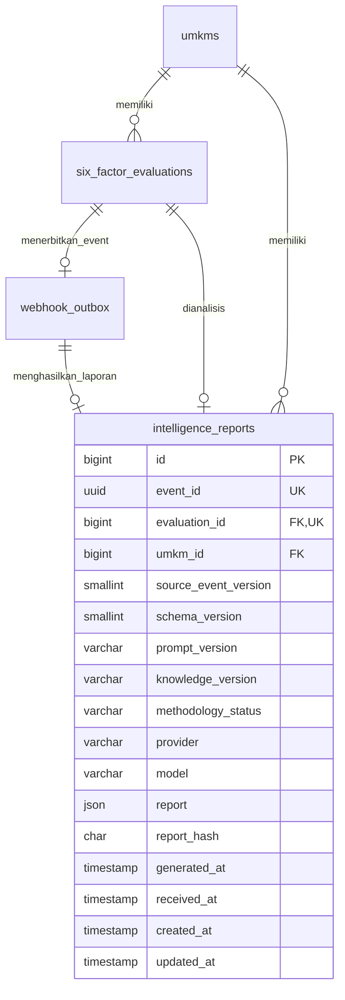
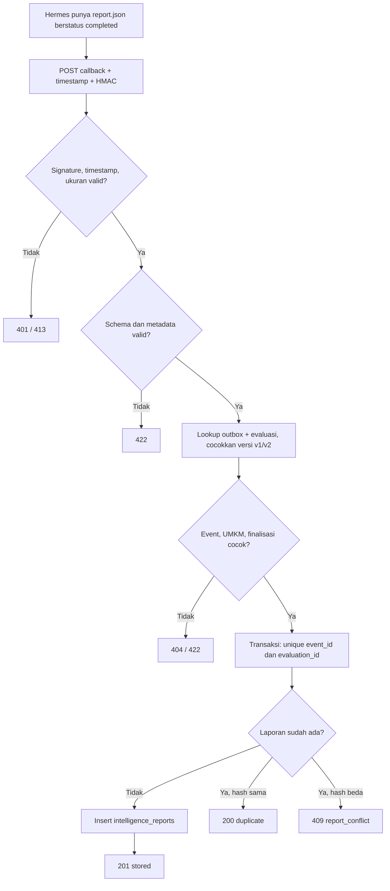
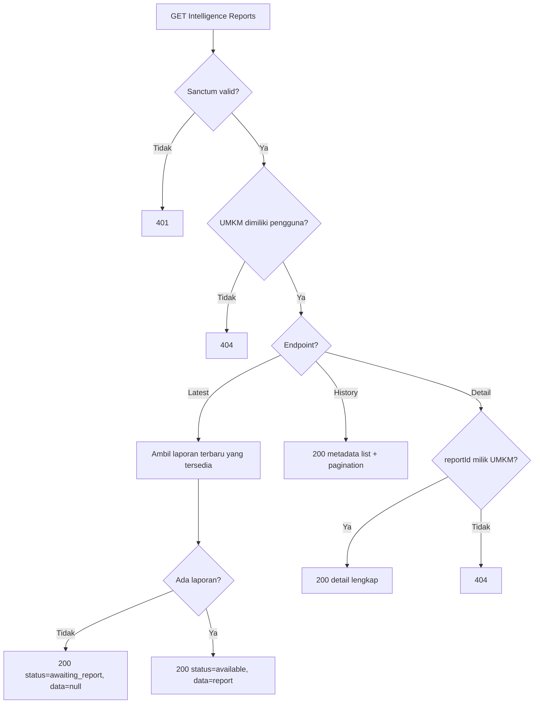
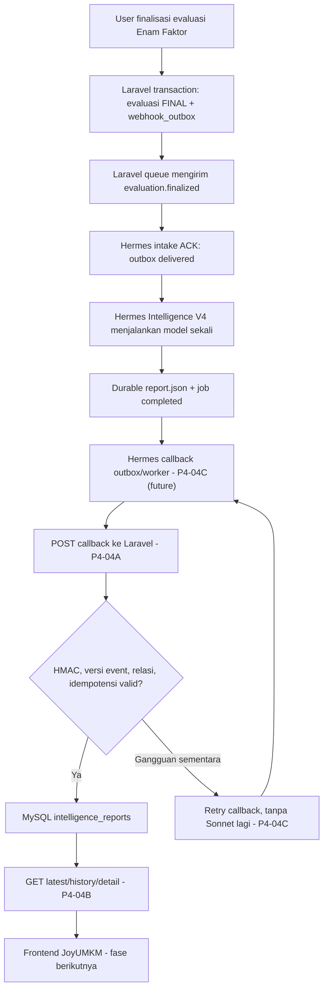

# PRD — JoyUMKM P4-04A & P4-04B: Intelligence Reports

**Status:** APPROVED SPEC / READY FOR IMPLEMENTATION — **belum diimplementasikan**  
**Tanggal spesifikasi:** 23 November 2026  
**Repository:** [joytimess/dip-joyumkm](https://github.com/joytimess/dip-joyumkm)  
**Baseline referensi GitHub:** `main` @ [`485ff922e8d23ba2654c4495403f200f60fb654e`](https://github.com/joytimess/dip-joyumkm/commit/485ff922e8d23ba2654c4495403f200f60fb654e)  
**Target implementor wajib:** **Claude Sonnet 5.5 (`claude-sonnet-5-5[1m]`) — thinking effort HIGH**. Pastikan konfigurasi model/effort pada sesi pelaksana, bukan hanya menuliskan label di laporan. PRD ini sendiri tidak mengubah pilihan model aplikasi.  
**Navigasi repository:** **Graphify wajib dipakai sebagai akselerator peninjauan dependensi dan alur kode**, dengan verifikasi ke source aktual; bukan sumber kebenaran pengganti kode.  
**Stack:** Laravel API + Sanctum + MySQL (Laragon di Windows), Hermes Intelligence V4 (Docker).  
**Scope:** **P4-04A** = callback receiver dan persistence; **P4-04B** = GET Intelligence Reports.  
**Artefak wajib:** PRD Markdown ini memuat **ERD Mermaid** dan **tiga flowchart Mermaid** (callback, GET, serta end-to-end). Diagram adalah rancangan kontrak, bukan bukti fitur telah dibangun.  
**Out of scope:** Hermes callback sender/worker (P4-04C), frontend/dashboard, regenerate AI, backfill event lama, dan perubahan pipeline webhook keluar.

> **Instruksi penting untuk implementor Sonnet 5.5 HIGH:** gunakan Graphify lebih dulu untuk mempercepat penelusuran; lalu baca dan verifikasi kode aktual terlebih dahulu dan pertahankan seluruh perubahan kerja yang belum di-commit. **Jangan** `git reset`, `git clean`, overwrite file lokal, atau mengubah kontrak outbound Laravel → Hermes. Repo GitHub pada baseline masih `event_version=1`; file Laravel lokal yang diaudit pada 23 November sudah mengandung `event_version=2`, snapshot `business_context`, `six_factor`, dan `three_dimension`, serta perubahan yang belum di-commit. Jadikan baseline GitHub pembanding, bukan alasan untuk menghapus perubahan lokal.

## 1. Tujuan dan batas fase

Ketika Hermes selesai membuat `report.json`, Laravel dapat **menerima hasilnya sekali secara aman**, menautkan ke event finalisasi yang benar, menyimpannya permanen, dan menyediakan API untuk **latest, histori, detail** bagi pemilik UMKM. Membuka halaman laporan **tidak** memanggil AI.

- **P4-04A:** `POST /api/internal/intelligence/callback`, HMAC, validasi versi event, transaksi/idempotensi, tabel `intelligence_reports`, pengujian.
- **P4-04B:** tiga endpoint GET dengan Sanctum, ownership, resource response, pagination, status belum ada laporan, pengujian.
- **Antarmuka untuk fase P4-04C:** definisikan kontrak penerimaan agar Hermes nantinya dapat mengirim file `report.json` yang sudah tersimpan, tanpa regenerasi AI dan dengan retry terpisah.

### Keputusan produk/teknis yang dikunci

1. **Event `event_version` 1 dan 2 diterima**, diverifikasi secara ketat berdasarkan snapshot outbox versi masing-masing. `source_event_version` laporan harus cocok dengan versi event.
2. **GET hanya boleh diakses pengguna Sanctum yang memiliki UMKM**; gunakan pola existing `$user->umkms()` / `UmkmService::owned()`, bukan role atau API publik baru.
3. **`methodology_status=partial` tetap valid** jika laporan lolos validasi; API memaparkan status dan limitations agar frontend dapat menampilkan indikator keterbatasan.
4. **Latest tanpa laporan:** `HTTP 200`, `{ "status": "awaiting_report", "data": null }`. Status ini berarti *belum ada laporan tersimpan*, bukan bukti job AI sedang berjalan.

## 2. Existing system dan integrasi tanpa regresi

Pada commit acuan terdapat:

- `app/Services/HermesWebhookOutbox.php`: menulis `evaluation.finalized` dari finalisasi Enam Faktor di transaksi yang sama; commit GitHub memakai `event_version=1`.
- `app/Models/WebhookOutbox.php`, migration `2026_11_22_102512_create_webhook_outbox_table.php`: `event_id` UUID unique; `event_type`, `event_version`, `aggregate_id`, `payload` JSON; unique `(event_type, aggregate_id)`.
- `app/Services/SixFactorEvaluationService.php`: finalisasi evaluasi dan penerbitan outbox.
- `app/Services/UmkmService.php`: pengecekan kepemilikan UMKM; `routes/api.php`: API pengguna dalam `auth:sanctum`.
- `docs/HERMES_WEBHOOK.md`: `delivered` di outbox adalah ACK penerimaan Hermes, **bukan** bukti AI telah selesai.

**Penting:** istilah *event version 1/2* mengacu ke **versi envelope webhook** finalisasi Enam Faktor, **bukan** jenis penilaian V1 Tiga Dimensi versus V2 Enam Faktor. Keduanya harus dibedakan dalam validasi.

## 3. Workflow implementasi: Claude Sonnet 5.5 HIGH + Graphify

### 3.1 Konfigurasi dan prinsip eksekusi

- Jalankan tugas **P4-04A dan P4-04B** pada sesi **Claude Code / implementor Claude Sonnet 5.5 (`claude-sonnet-5-5[1m]`) dengan effort HIGH**. Verifikasi model/effort aktif sesuai UI atau konfigurasi runtime yang benar-benar tersedia. **Jangan** melakukan switching model diam-diam, menambahkan pemanggilan model AI di aplikasi, atau membuat subagent Sonnet untuk pengujian rutin.
- Buka checkout **lokal Laragon** `C:\laragon\www\joyumkm` (repo yang dipakai untuk implementasi), baca `AGENTS.md`/instruksi proyek bila ada, lalu `git status --short` **sebelum** perubahan. GitHub `485ff922` menjadi baseline referensi; **working tree lokal yang lebih baru tetap dipertahankan**.
- Pekerjaan harus menghasilkan implementasi, tes, dan handoff yang nyata. Jangan berhenti pada review atau PRD baru. Targetkan **maksimal tiga subagent bila memang tersedia/dibutuhkan**; pengujian MySQL menggunakan fixture, bukan Sonnet.

### 3.2 Graphify — peninjauan cepat dependency graph sebelum coding (**wajib**)

**Tujuan:** mengurangi pembacaan file secara acak, menemukan call chain dan titik perubahan minimum sebelum menambah callback receiver/GET API.

1. **Pakai Graphify yang sudah terpasang** di lingkungan eksekusi (MCP / extension / CLI sesuai yang benar-benar tersedia). Periksa daftar tool dan sintaks bantuan aktual lebih dahulu; **jangan mengarang nama perintah seperti `graphify init`/`graphify scan` bila tidak terverifikasi**. Bila graph/index repo sudah ada dan mutakhir, gunakan ulang; refresh **hanya** ketika indeks tidak sesuai working tree.
2. Arahkan Graphify ke **checkout lokal JoyUMKM**, bukan ke duplikat baru yang mengabaikan perubahan belum di-commit. Index atau inspeksi bersifat non-destruktif; hasil cache/index jangan ikut di-commit bila bukan bagian proyek.
3. Telusuri dependensi berikut secara terarah:

   | Pertanyaan Graphify | Simbol / file yang ditelusuri | Output yang dibutuhkan |
   |---|---|---|
   | Di mana event finalisasi dibuat? | `SixFactorEvaluationService::finalize/transition` → `HermesWebhookOutbox::recordFinalization` → `WebhookOutbox` | Call chain transaksional; event v1/v2; relasi `aggregate_id` |
   | Bagaimana webhook keluar bekerja? | `DeliverHermesWebhook`, `HermesWebhookSender`, `routes/console.php`, `config/services.php` | Batas integrasi agar callback **tidak** menyentuh jalur outbound |
   | Bagaimana kepemilikan UMKM diperiksa? | `routes/api.php`, `UmkmService::owned`, `User::umkms`, `SixFactorEvaluationController` | Pola `auth:sanctum`, 401/404, service/resource existing |
   | Di mana migrasi/constraint data berada? | migration `six_factor_evaluations`, `webhook_outbox`, model `SixFactorEvaluation`, `Umkm` | Constraint MySQL dan relasi untuk tabel baru |
   | Bagaimana response & test dibentuk? | `app/Http/Resources`, `app/Http/Requests`, `tests/Feature/HermesWebhookOutboxTest.php` | Konvensi API, error mapping, fixture, koneksi DB tes |

4. **Konfirmasi setiap temuan Graphify** pada path + potongan source aktual. Graphify digunakan sebagai **navigator**, bukan otoritas untuk mengubah skema/kontrak. Jika indeks menyebut versi berbeda dari source lokal, **source aktual yang menang**, dan perbedaan dicatat.
5. Jika Graphify tidak tersedia / gagal / graph tidak lengkap, **jangan jadikan blocker berulang**: catat alasannya sekali, lanjutkan audit sempit menggunakan `rg`/`Select-String` dan pembacaan file terkait. Jangan melakukan re-index masif atau memanggil model berkali-kali hanya untuk membangun graph.
6. Dalam handoff, tulis ringkas: **Graphify used / unavailable**, call chain utama, file yang ditemukan, dan apakah temuan diverifikasi pada source. **Jangan tampilkan secret, payload berisi data pribadi, atau konten `.env`** di hasil penelusuran.

### 3.3 Urutan pengerjaan dan batas review

1. **Graphify + source check:** identifikasi titik modifikasi; pastikan perbedaan event v1 di GitHub dan v2 pada working tree lokal.
2. **P4-04A terlebih dahulu:** migration/model, verifier HMAC, validator versi event, service transaksi/idempotensi, route/controller, fixture dan tes MySQL (termasuk concurrency).
3. **P4-04B berikutnya:** GET latest/history/detail, reuse ownership Sanctum, resource/pagination, negative access tests.
4. **Regression:** jalankan tes evaluasi Enam Faktor dan outbox yang berkaitan; jangan menjalankan model Sonnet untuk membuat report. Laporkan AC satu per satu dengan bukti, termasuk status perubahan Git.

---

## 4. ERD final

**Perubahan utama hanyalah satu tabel baru `intelligence_reports`.** Existing evaluations, UMKM, dan outbox tidak perlu dirombak. Satu finalisasi maksimal satu report; satu UMKM dapat mempunyai banyak laporan dari beberapa finalisasi.



**Aturan skema:**

- `event_id` UNIQUE dan mencocokkan `webhook_outbox.event_id`; `evaluation_id` UNIQUE; `umkm_id` terindeks. Relasi FK fisik ke `webhook_outbox.event_id`, `six_factor_evaluations.id`, dan `umkms.id` diutamakan bila kompatibilitas tipe/collation memungkinkan; pastikan `ON DELETE RESTRICT` / tidak ada cascade delete data historis. Jika FK fisik tertentu tidak memungkinkan, wajib ada validasi integritas transaksional dan pengujian.
- Simpan metadata `source_event_version`, `schema_version`, `prompt_version`, `knowledge_version`, `methodology_status`, `provider`, `model`, `generated_at`, `received_at`, serta **JSON `report` utuh**. Gunakan panjang kolom yang aman terhadap versi aktual dan batasi input dengan validator.
- `report_hash` = SHA-256 atas payload semantik laporan yang sudah divalidasi dan dinormalisasi deterministik; urutkan **key objek secara rekursif** tetapi pertahankan urutan array, lalu hash metadata stabil beserta report. Jangan masukkan timestamp HTTP, signature, atau `received_at` ke hash. Tetapkan format kanonis yang sama dalam test v1/v2 sehingga perubahan urutan key JSON tidak dianggap konflik.
- Setelah insert, laporan **immutable** (tidak ada endpoint update/delete). Uniqueness di database adalah pengaman utama terhadap callback paralel, bukan sekadar pengecekan sebelum insert.

## 5. P4-04A — Callback receiver

### 5.1 Route dan keamanan

`POST /api/internal/intelligence/callback`

- Route **di luar `auth:sanctum`**, namun dilindungi middleware/verifier HMAC khusus callback. Tidak menggunakan session, token pengguna, atau secret outbound.
- Secret baru **terpisah** dari `HERMES_WEBHOOK_SECRET`, misalnya `HERMES_INTELLIGENCE_CALLBACK_SECRET`, disimpan hanya di environment/config; gunakan secret berentropi tinggi. Middleware harus fail-closed saat secret kosong.
- Header usulan kontrak: `X-Intelligence-Timestamp: <Unix seconds>` dan `X-Intelligence-Signature: <lowercase-hex HMAC-SHA256>`. Signature = `HMAC_SHA256(secret, timestamp + "." + rawBody)`; verifikasi `hash_equals` constant-time sebelum parsing JSON yang dipercaya.
- Tolak timestamp di luar ±300 detik. Setiap attempt Hermes nantinya membuat timestamp + signature baru untuk raw body yang sama. Idempotensi event mencegah penulisan ulang saat replay dalam jendela sah.
- Batasi body maksimum **2 MiB** sebelum decoding; hanya `application/json`. Validasi tipe JSON, tidak menerima field identitas ganda/ambigu, ID palsu, angka berubah tipe, atau input malformed. Jangan log raw JSON, data usaha, signature, maupun secret.
- HTTP lokal ke `http://host.docker.internal:8000` **hanya untuk development**; deployment mewajibkan HTTPS/TLS dan kontrol jaringan.

### 5.2 Payload dari Hermes Intelligence V4

Receiver menerima envelope `report.json` dengan metadata berikut (nilai merupakan **contoh bentuk**, bukan fixture valid):

```json
{
  "event_id": "1518f3e3-b86c-4c35-b4a9-8e59d6c75f69",
  "evaluation_id": 11,
  "umkm_id": 5,
  "status": "completed",
  "source_event_version": 2,
  "schema_version": 1,
  "prompt_version": "r1-prompt-5",
  "knowledge_version": "joyumkm-methodology-2026-11-22.1",
  "methodology_status": "partial",
  "provider": "claude-subscription-directsdk-experimental",
  "model": "claude-sonnet-5-5[1m]",
  "generated_at": "2026-11-23T08:00:00Z",
  "report": {
    "executive_summary": "...",
    "business_profile": { "data_gaps": [] },
    "six_factor_analysis": { "findings": [], "summary": "..." },
    "three_dimension_analysis": { "available": false, "findings": [], "summary": "..." },
    "perspectives": {},
    "cross_instrument_insights": [],
    "top_priorities": [],
    "action_plan": { "days_1_30": [], "days_31_60": [], "days_61_90": [] },
    "limitations": []
  }
}
```

**Implementor wajib membaca schema/fixture `report.json` aktual dari Intelligence V4** sebelum menulis validator rinci; jangan mengira contoh minimal di atas sudah memenuhi semua field nested. Validasi versi `schema_version` harus eksplisit. Laporan `partial` diterima apabila struktur valid dan limitations/provenance relevan tersaji; data yang tidak tersedia boleh `null`/abstain sesuai kontrak asli, bukan dibuat-buat.

### 5.3 Validasi identitas dan versi event

Di dalam transaksi MySQL, cari `webhook_outbox` dengan `event_id` dan verifikasi:

1. `event_type === evaluation.finalized` dan `event_version ∈ {1, 2}`.
2. `report.source_event_version === webhook_outbox.event_version`.
3. `report.evaluation_id === webhook_outbox.aggregate_id`.
4. `six_factor_evaluations.id` tersedia, `status === final`, dan `umkm_id === report.umkm_id`.
5. **v1:** `webhook_outbox.payload.data.evaluation_id`, `.umkm_id`, `.status`, `.scores`, `.total_score`, `.category` sesuai evaluasi dan identitas laporan; jangan mensyaratkan enrichment v2.
6. **v2:** gunakan `payload.data.six_factor.evaluation_id`, `payload.data.six_factor.status`, `payload.data.umkm_id` serta struktur snapshot `six_factor` (dan `business_context` / `three_dimension` bila ada sesuai kontrak v2 sebenarnya); jangan mengambil V1 `data.evaluation_id` dari payload v2.
7. **Kesesuaian data yang telah berubah:** prioritas snapshot outbox sebagai bukti konteks pada finalisasi; jangan memvalidasi ulang atribut profil UMKM saat ini untuk menentukan kebenaran laporan historis. Validasi skor/total/kategori terhadap snapshot bila relevan, tanpa menganggap ringkasan teks buatan AI pasti identik byte-per-byte dengan sumber.
8. Status outbox `delivered` **tidak wajib** untuk menerima callback jika identitas dan tanda tangan benar: callback dapat datang sebelum penandaan ACK selesai.

**Idempotensi:** insert atomik berdasarkan unique `event_id`/`evaluation_id`. Jika rekaman sudah ada dan hash semantik sama, respons duplicate (tanpa update); jika berbeda, `409 conflict`. Kegagalan concurrent unique key harus direkonsiliasi dengan baca ulang row, bukan menimbulkan duplikasi atau 500 yang tidak perlu.

### 5.4 Respons HTTP

| Kondisi | HTTP | Semantik |
|---|---:|---|
| Laporan valid dan baru | `201` | `status: stored`, sertakan `event_id` dan `report_id` |
| Pengiriman ulang identik | `200` | `status: duplicate`, tanpa mutasi |
| `event_id`/`evaluation_id` sudah dipakai payload berbeda | `409` | `code: report_conflict` |
| Signature salah/secret tidak valid | `401` | Generic error, tidak mengekspos detail verifier |
| Timestamp tidak sah | `401` | Generic unauthorized |
| Event tidak dikenal | `404` | Generic not found |
| Payload atau identitas/relasi invalid | `422` | Error terstruktur tanpa data sensitif |
| Payload > 2 MiB | `413` | Request too large |
| Database sementara gagal | `500`/`503` | Tidak mengklaim laporan tersimpan; dapat dicoba ulang oleh Hermes |

### 5.5 Flowchart P4-04A



## 6. P4-04B — Read API (Sanctum)

Semua endpoint berada dalam grup `auth:sanctum` existing; scope query menggunakan UMKM milik user. Jangan mengekspos laporan melalui endpoint tanpa ownership.

| Endpoint | Respons |
|---|---|
| `GET /api/umkms/{id}/intelligence-reports/latest` | Laporan terbaru yang **sudah diterima**, atau `200` + awaiting |
| `GET /api/umkms/{id}/intelligence-reports` | Histori metadata, pagination (default 10; maksimum 50) |
| `GET /api/umkms/{id}/intelligence-reports/{reportId}` | Satu laporan lengkap milik UMKM tersebut |

**Pola GET:**

- `id` dan `reportId` harus numerik valid. Tolak UMKM yang tidak ada atau bukan milik user dengan `404`, bukan mengungkap kepemilikan.
- Latest urut `generated_at DESC`, `id DESC` dan mengambil laporan **tersedia**, tidak secara otomatis memilih evaluasi terbaru yang masih belum menghasilkan laporan.
- `GET latest` belum ada laporan: `HTTP 200` `{"status":"awaiting_report","data":null}`. Jangan memanggil Sonnet dan jangan menjanjikan status processing.
- Laporan tersedia: `{"status":"available","data":{...}}`. Cantumkan `methodology_status`, `limitations`, waktu, metadata sumber, dan JSON report lengkap untuk detail/latest.
- Histori: gunakan paginator Laravel, urutan stabil, payload **ringkas tanpa seluruh JSON report**; hasil kosong `200` dengan `data: []` dan pagination yang konsisten.
- Detail `reportId` tidak ada atau milik UMKM lain: `404`.
- Gunakan resource/response convention Laravel yang sudah berlaku; integrasikan `data` dan pagination secara konsisten. Tidak ada role admin global atau policy lintas pengguna baru.

**Contoh latest belum tersedia:**

```json
{ "status": "awaiting_report", "data": null }
```

**Contoh latest tersedia (ringkas):**

```json
{
  "status": "available",
  "data": {
    "id": 17,
    "evaluation_id": 11,
    "umkm_id": 5,
    "methodology_status": "partial",
    "generated_at": "2026-11-23T08:00:00Z",
    "report": { "executive_summary": "...", "limitations": [] }
  }
}
```

### Flowchart P4-04B



## 7. Flowchart sistem end-to-end (termasuk kontrak fase setelahnya)

> Bagan ini menjelaskan sistem utuh. Kotak **P4-04C** adalah **fase berikutnya** dan tidak boleh dianggap sudah termasuk implementasi P4-04A/B.



## 8. Implementasi yang diminta (tanpa instruksi code rewrite menyeluruh)

### P4-04A

1. Tambah migration `intelligence_reports`, model Eloquent, indeks/unique constraints dan relasi sewajarnya.
2. Tambah config callback pada `config/services.php` dan `.env.example` (tanpa secret asli).
3. Tambah middleware/verifier HMAC, request validator berbasis schema aktual, service penyimpanan transaksi, controller callback, serta route di luar grup Sanctum.
4. Verifikasi event v1 berdasarkan payload GitHub, dan v2 berdasarkan kode lokal/enrichment; tes keduanya. Jangan mewajibkan v2-only fields untuk v1.
5. Tangani race condition insert, duplicate, conflict, restart/retry, dan error mapping yang stabil.

### P4-04B

1. Tambah controller/service/resource/query untuk latest/history/detail.
2. Reuse pola ownership yang ada, gunakan Sanctum, dan pastikan detail selalu dibatasi `umkm_id`.
3. Terapkan `awaiting_report`, `available`, pagination dan `methodology_status` secara konsisten.
4. Jangan mengubah kontrak endpoint Enam Faktor existing atau menyisipkan pemanggilan AI di GET.

**Batas perubahan:** jangan mengubah desain frontend, queue Hermes keluar, logic Enam Faktor, state `webhook_outbox`, atau sumber laporan; jangan menambah endpoint edit/delete report.

## 9. Quality gates / acceptance criteria

| ID | Verifikasi | PASS bila |
|---|---|---|
| AC-01 | Migration MySQL | Bisa migrate/up pada DB tes terisolasi, unique + FK/integritas benar |
| AC-02 | Callback v1 | Event finalisasi v1 valid diterima dan tersimpan |
| AC-03 | Callback v2 | Event finalisasi v2 valid diterima dan tersimpan |
| AC-04 | Versi salah/mismatch | 422/penolakan terkontrol, tidak ada report tersimpan |
| AC-05 | Security negatif | HMAC invalid, timestamp usang, body rusak/oversized ditolak |
| AC-06 | Partial methodology | `completed + partial` valid disimpan dan indikator terbaca |
| AC-07 | Idempotensi | Pengiriman identik berulang -> hanya satu row; 200 duplicate |
| AC-08 | Konflik & concurrency | Payload berbeda -> 409; race multi-worker -> tidak ada duplikasi/overwrite |
| AC-09 | Latest kosong | 200 `{status:awaiting_report,data:null}` untuk UMKM milik user |
| AC-10 | Latest ada | 200 available, urutan `generated_at DESC, id DESC` |
| AC-11 | History/detail | Pagination, resource ringkas/detail, filter UMKM yang benar |
| AC-12 | Auth & ownership | Tanpa Sanctum -> 401; akses UMKM lain -> 404 |
| AC-13 | Regresi | Suite evaluasi finalisasi dan outbox webhook existing tetap PASS |
| AC-14 | Biaya model | Tes P4-04A/B **tidak** memanggil Sonnet maupun API eksternal |
| AC-15 | Hygiene repo | Semua uncommitted changes user terjaga; tanpa reset/clean |

**Pengujian:** Graphify untuk memilih jalur tes terkait, lalu utamakan feature tests Laravel dan MySQL terisolasi (termasuk konkurensi). Gunakan fixture report V4 yang valid; jangan menyamakan fixture contoh JSON minimal dengan schema lengkap. Tidak perlu menjalankan seluruh suite SQLite dan tidak perlu evaluasi massal model. Dokumentasikan perintah tes, hasil, regresi, dan keterbatasan yang masih ada.

## 10. Definition of Done dan handoff

P4-04A/B **PASS** hanya jika migration, callback positif/negatif v1/v2, konkurensi/idempotensi, Sanctum + ownership, latest/history/detail, dan regresi outbox semuanya lulus. Output handoff minimal:

- Daftar file yang berubah dan alasan perubahannya. Sertakan ringkasan **peninjauan Graphify**, call chain terverifikasi, dan fallback bila tool tidak tersedia.
- Kontrak header HMAC, payload dan respons, serta environment key callback (tanpa mengekspos secret).
- Contoh request signed **fixture lokal** dan respons GET (tanpa data pribadi nyata).
- Bukti pengujian MySQL, verifikasi konkurensi, dan bukti tidak ada panggilan model.
- Catatan bahwa **P4-04C Hermes callback sender belum dikerjakan** dan bahwa HTTP 200 di root Laragon hanya menguji konektivitas, bukan callback.

**Instruksi penyerahan:** model pelaksana **Sonnet 5.5 HIGH**, Graphify untuk penelusuran cepat, **empat diagram Mermaid tetap tercantum di PRD**. Implementasi harus menjaga perubahan lokal dan melewati QA MySQL; tidak perlu menjalankan Sonnet berulang untuk menghasilkan laporan fixture.

**Keputusan yang tidak boleh dinegosiasikan ulang di fase ini:** kompatibilitas event v1/v2, ownership Sanctum, penerimaan methodology partial, latest kosong `200 awaiting_report`, laporan immutable, dan tidak mengubah existing webhook outbox.
