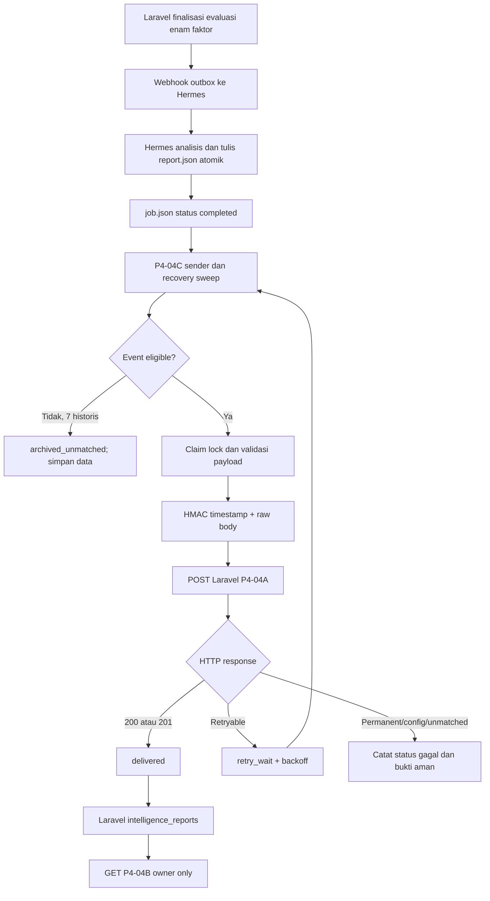
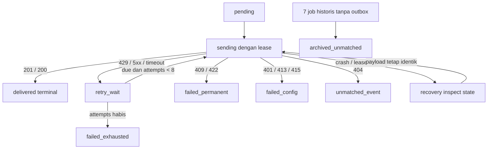
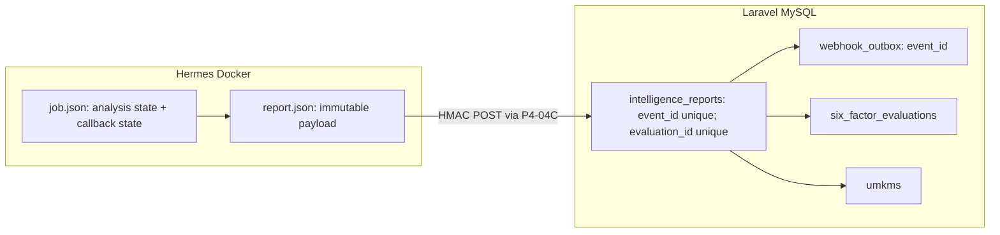

# PRD — JoyUMKM Intelligence R1 V4 · P4-04C Hermes Callback Delivery

**Status:** SPEC LOCKED · Ready for implementation  
**Tanggal:** 23 November 2026  
**Implementor:** Claude Code — **Claude Sonnet 5.5, effort HIGH**  
**Lokasi kerja:** Hermes Agent Docker, `/opt/data/joyumkm-intelligence`  
**Integrasi tujuan (development):** Laravel JoyUMKM, `http://host.docker.internal:8000/api/internal/intelligence/callback`  
**Dependensi:** Laravel P4-04A (callback receiver) dan P4-04B (GET reports) telah diimplementasikan; database development telah dipulihkan.

## 1. Brief dan outcome

Bangun **pengirim callback yang durable** dari Hermes Intelligence ke Laravel. Saat job analisis mencapai `completed` dan `report.json` tersimpan atomik, Hermes mengirim isi laporan melalui HTTP POST ber-HMAC ke Laravel. Jika pengiriman gagal, lakukan retry yang aman **tanpa menjalankan model AI lagi**. Status analisis dan status pengiriman harus terpisah.

**Definisi selesai:** laporan untuk setidaknya satu event valid diterima Laravel sebagai `201 stored` atau `200 duplicate`, tersimpan pada `intelligence_reports`, dan dapat dibaca melalui API P4-04B. Pengujian end-to-end tidak boleh mengulang generasi AI.

## 2. Fakta hasil investigasi dan keputusan owner

- Ada **10 job `completed`**, semuanya memiliki `report.json` dan `job.json`; metadata konsisten, `source_event_version=2`, `schema_version=1`, `methodology_status=partial` dan `limitations` terisi.
- **10/10 laporan** lolos validasi request dan pencocokan finalisasi Laravel secara lokal tanpa HTTP. Ini **belum** membuktikan keberhasilan POST end-to-end.
- Hermes belum memiliki HTTP callback sender, secret callback, atau status callback tersendiri. `jmi-recover` berjalan setiap 5 menit tetapi belum menyapu callback untuk job `completed`.
- Koneksi Docker → `host.docker.internal:8000` terverifikasi; GET ke endpoint POST-only menghasilkan 405.
- Laravel `HERMES_INTELLIGENCE_CALLBACK_SECRET` masih kosong saat investigasi; harus dikonfigurasi sebelum callback sungguhan.
- **Hanya 3 dari 10 event** mempunyai pasangan outbox Laravel: prefix `0a644a17`, `5d13a225`, `6accac11` (evaluasi 12, 13, 14; UMKM 5). Identifikasi menggunakan **UUID lengkap dan relasi asli**, bukan prefix semata.
- **Keputusan final owner: opsi A.** Tujuh job historis tanpa pasangan outbox **diarsipkan dari antrean callback** (`archived_unmatched`), **tanpa menghapus** `job.json`, `report.json`, atau data historis. Tidak boleh membuat outbox palsu atau backfill otomatis.
- Laporan historis menggunakan `prompt_version=p4-03b-prompt-4`; ini tidak sama dengan klaim validasi real-model untuk prompt V4 terbaru. Gunakan fixture asli yang ada, jangan klaim model V4 baru telah diuji.

## 3. Scope

### In scope

1. Konfigurasi endpoint dan secret callback terpisah dari secret webhook outbound Laravel.
2. Pengirim HTTP POST dari `report.json` yang sudah ada.
3. HMAC-SHA256 sesuai middleware Laravel, timeout dan pembatasan payload.
4. Persistensi status callback di `job.json`, claim/locking, idempotensi, retry/backoff, crash recovery.
5. Trigger pengiriman setelah job `completed` dan sweep callback melalui `jmi-recover`.
6. Karantina/arsip tujuh job historis yang tidak cocok dengan outbox Laravel.
7. CLI operator `callback`, `callback-status`, dan `--dry-run`.
8. Pengujian unit, concurrency, recovery, dan minimal satu tes end-to-end nyata ke Laravel tanpa AI.
9. Dokumentasi operasional, rollback, dan bukti hasil gate.

### Out of scope

- Perubahan Blade/UI, P4-05 frontend, penilaian UMKM baru, generasi ulang laporan, backfill empat evaluasi final tanpa outbox (ID 1, 2, 6, 8), perubahan kebijakan API Laravel, penghapusan job historis, atau penulisan ke database Laravel secara langsung dari Hermes.

## 4. Kontrak payload, autentikasi, dan konfigurasi

**POST** `/api/internal/intelligence/callback` dengan `Content-Type: application/json`, `X-Intelligence-Timestamp` (epoch detik), dan `X-Intelligence-Signature` (lowercase hex HMAC-SHA256).

Signature:

```text
body_bytes = json.dumps(report, ensure_ascii=False, separators=(',', ':')).encode('utf-8')
timestamp = str(int(time.time()))
signature = HMAC_SHA256(secret, timestamp.encode() + b'.' + body_bytes).hexdigest()
```

**Wajib** mengirim **byte body yang sama persis** dengan yang ditandatangani. Timestamp dibuat baru setiap attempt (toleransi Laravel ±300 detik). Validasi struktur laporan yang dibaca, batas body **2 MiB**, dan gunakan HTTP timeout eksplisit. Secret minimal **32 karakter**, berbeda dari `HERMES_WEBHOOK_SECRET`, tidak boleh muncul di `job.json`, CLI output, dokumentasi, exception, atau log.

Konfigurasi disarankan melalui environment/container secret, dengan nama yang jelas, misalnya:

```dotenv
INTELLIGENCE_CALLBACK_URL=http://host.docker.internal:8000/api/internal/intelligence/callback
INTELLIGENCE_CALLBACK_SECRET=<set-out-of-band-at-least-32-characters>
INTELLIGENCE_CALLBACK_TIMEOUT_SECONDS=15
INTELLIGENCE_CALLBACK_MAX_ATTEMPTS=8
```

Di Laravel, set nilai identik pada `HERMES_INTELLIGENCE_CALLBACK_SECRET`, lalu reload konfigurasi/proses bila diperlukan. **Jangan menuliskan secret asli ke PRD atau log.** Untuk pengujian gunakan secret lokal terpisah. Sender **fail closed** jika URL/secret invalid, tanpa membuat request jaringan.

**Catatan:** HMAC raw body tidak sama dengan hash laporan. Simpan `payload_hash` SHA-256 atas **byte body kanonis yang dipilih saat pengiriman pertama**; pada retry, pastikan body identik. Bila file berubah, tahan pengiriman dan tandai konflik integritas, jangan diam-diam menandatangani payload baru untuk event sama.

## 5. Desain status dan persistensi

Pertahankan `job.status=completed`. Tambahkan metadata callback yang diperbarui atomik melalui mekanisme store eksisting, tanpa mengganggu data job lainnya:

```json
{
  "callback": {
    "status": "pending",
    "attempts": 0,
    "next_attempt_at": null,
    "last_http_status": null,
    "last_error_code": null,
    "delivered_at": null,
    "payload_hash": null
  }
}
```

Status: `pending`, `sending`, `retry_wait`, `delivered`, `failed_permanent`, `failed_config`, `unmatched_event`, `failed_exhausted`, `archived_unmatched`. `sending` harus punya lease/claim yang dapat dipulihkan setelah crash; implementor boleh menambah `claimed_at`, `lease_until`, dan error metadata yang **tidak menyimpan secret/payload sensitif**. Tentukan schema version metadata bila dibutuhkan untuk backward compatibility.

- Job `delivered` bersifat terminal untuk pengiriman otomatis. **Jangan reset job delivered ke pending untuk regenerasi**.
- Job `archived_unmatched` tetap `completed`, tetap memiliki laporan asli, dan **tidak masuk sweep**.
- Job lama tanpa field callback dimigrasikan secara lazy/idempoten tanpa memodifikasi report; klasifikasi eligible berdasarkan daftar/relasi terverifikasi, bukan asumsi semua job lama eligible.
- Gunakan atomic write/fsync dan lock yang sesuai pola store; hindari lost update terhadap `job.json` yang juga disentuh proses lain.
- Jika Laravel sukses menyimpan tetapi Hermes crash sebelum ACK, kirim ulang **payload identik** sehingga Laravel menjawab `200 duplicate`.

## 6. Kebijakan respons dan retry

| Hasil | Perlakuan |
|---|---|
| `201 stored` | `delivered` |
| `200 duplicate` | `delivered` |
| `409 report_conflict` | `failed_permanent`; jangan overwrite/regenerate |
| `422` | `failed_permanent`; simpan kode kesalahan yang aman |
| `401`, `413`, `415` | `failed_config`; perlu intervensi operator |
| `404` | `unmatched_event`; karantina tanpa retry tak terbatas |
| `503` | retry terbatas jika gangguan sementara; bila konfigurasi secret belum siap, `failed_config`/pause sampai diperbaiki |
| `429`, `500–599` lain, timeout/network error | `retry_wait` dengan exponential backoff dan jitter |
| 8 percobaan habis | `failed_exhausted`; intervensi operator |

**Retry final:** maksimal **8 attempt otomatis**; backoff awal **60 detik**, maksimum **1 jam**, dengan jitter. Pastikan retry `404` bukan kebijakan normal untuk tujuh event historis: ketujuhnya **diarsipkan sebelum pengiriman**. Hindari retry untuk status yang tidak dapat dipulihkan. Jangan mencetak respons mentah yang mungkin berisi informasi sensitif.

## 7. Flowchart Mermaid — end-to-end



## 8. Flowchart Mermaid — state machine dan crash recovery



## 9. ERD/logical data ownership



**Data ownership:** Hermes hanya mengubah state callback di penyimpanan Hermes; Laravel menjadi satu-satunya penulis `intelligence_reports` melalui endpoint P4-04A.

## 10. CLI dan operator runbook

```bash
python3 -m jmi callback-status
python3 -m jmi callback <event_id> --dry-run
python3 -m jmi callback <event_id>
```

- `callback-status`: ringkasan status/attempts, retry due, archived, dan alasan gagal, tanpa secret.
- `--dry-run`: baca dan validasi report, tampilkan identitas dan payload hash, **tanpa HTTP dan tanpa mutasi job.json**.
- `callback <event_id>`: tunduk pada aturan eligibility, lock, status terminal, dan validasi konfigurasi; tidak boleh memaksa pengiriman `archived_unmatched`/`delivered` secara diam-diam.
- Integrasikan recovery callback ke `jmi-recover` 5-menitan; **jangan** mengubah recovery menjadi pemicu analisis ulang.
- Dokumentasikan cara set secret di kedua lingkungan, restart/reload konfigurasi, menginspeksi error, dan prosedur retry operator yang aman.

## 11. Urutan implementasi

1. **Read-only audit:** petakan `engine.process`, `store.update_job`, `jmi-recover`, CLI, dan tests. Gunakan **Graphify** untuk mempercepat dependency/call graph review jika tersedia; **verifikasi semua hasil Graphify ke source code aktual**. Jangan menjadikan graph sebagai satu-satunya bukti.
2. Implementasikan callback state dan atomic claim/lease dengan backward compatibility.
3. Implementasikan payload canonicalization, HMAC, HTTP client, klasifikasi respons, dan retry.
4. Tambahkan hook setelah `completed`, sweep recovery, dan CLI.
5. Arsipkan tujuh job historis secara **non-destruktif**; catat UUID lengkap di evidence internal dan pastikan ketiga job eligible tetap eligible.
6. Unit test dan fault-injection lokal tanpa AI/HTTP eksternal; gunakan fake HTTP server.
7. Setelah konfigurasi secret dan identitas event diverifikasi, uji **satu** event eligible melalui HTTP Laravel nyata, cek DB dan GET API. Uji duplicate 200 dengan payload identik; jangan kirim 7 archived.
8. Handoff dengan bukti gate, perubahan file, risiko, dan instruksi operator.

## 12. Acceptance criteria

- **G-C01:** Kesepuluh laporan historis utuh; tidak ada regenerasi AI.
- **G-C02:** Tujuh job unmatched `archived_unmatched` tanpa penghapusan atau callback.
- **G-C03:** HMAC cocok byte-for-byte dengan middleware Laravel; secret fail-closed.
- **G-C04:** `201 stored` dan `200 duplicate` sama-sama `delivered`.
- **G-C05:** `409/422/401/413/415/404/503/429/5xx/timeout` diklasifikasi sesuai kebijakan.
- **G-C06:** Retry maksimal 8, exponential backoff+jitter, crash recovery dan concurrency aman.
- **G-C07:** Job `delivered` tidak diregenerasi/reset otomatis; payload hash mendeteksi perubahan.
- **G-C08:** CLI status dan dry-run berfungsi; dry-run tanpa HTTP/mutasi.
- **G-C09:** Tes terarah tidak memanggil AI atau HTTP eksternal; fake server dan regression PASS.
- **G-C10:** Minimal satu event valid tersimpan di Laravel dan terbaca melalui GET P4-04B; ulang kirim identik menghasilkan duplicate 200.
- **G-C11:** Secret dan raw payload sensitif tidak muncul di log, source control, atau handoff.
- **G-C12:** Tidak ada perubahan Blade, backfill historis, atau modifikasi Laravel yang tidak disetujui.

**Jangan klaim PASS end-to-end** hanya dari validasi PHP lokal atau konektivitas GET 405; G-C10 memerlukan POST nyata dan pembacaan report melalui Laravel.

## 13. Guardrails dan stop conditions

- Jangan melakukan `git reset --hard`, `git clean`, atau menghapus perubahan kerja tanpa persetujuan.
- Jangan menghapus/mengganti report historis; jangan memanggil Sonnet atau provider AI untuk menguji callback.
- Jangan menyimpan secret ke repo, `job.json`, atau artefak bukti.
- Jangan membuat event/outbox palsu untuk menjustifikasi tujuh job lama.
- Jika identitas event eligible tidak cocok dengan data Laravel, **STOP pengiriman nyata**, laporkan mismatch; jangan mengakali validasi Laravel.
- Jika belum ada secret terkonfigurasi, implementasi dan fake-server tests boleh selesai, tetapi **G-C10 BLOCKED** sampai konfigurasi benar.
- Jika implementasi memerlukan perubahan kontrak P4-04A/B, dokumentasikan dan minta keputusan sebelum mengubah Laravel.

## 14. Handoff yang wajib

Sertakan: daftar file yang berubah; hasil Graphify dan verifikasi source; 10 job awal dan status callback akhirnya (3 eligible, 7 archived sesuai temuan); bukti tests per gate; URL endpoint tanpa secret; hasil POST nyata dan GET API jika dijalankan; bukti retry/idempotensi/crash recovery; status akhir **PASS / PARTIAL / BLOCKED**; dan risiko tersisa. Hentikan pekerjaan setelah P4-04C, jangan otomatis mengerjakan P4-05.
