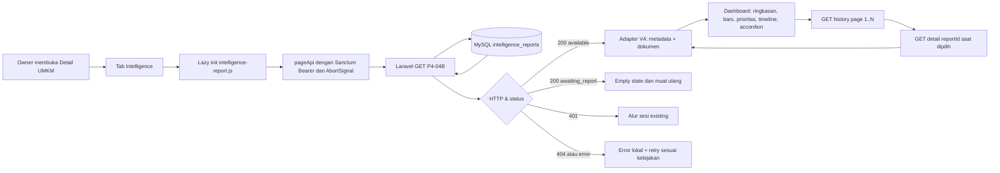
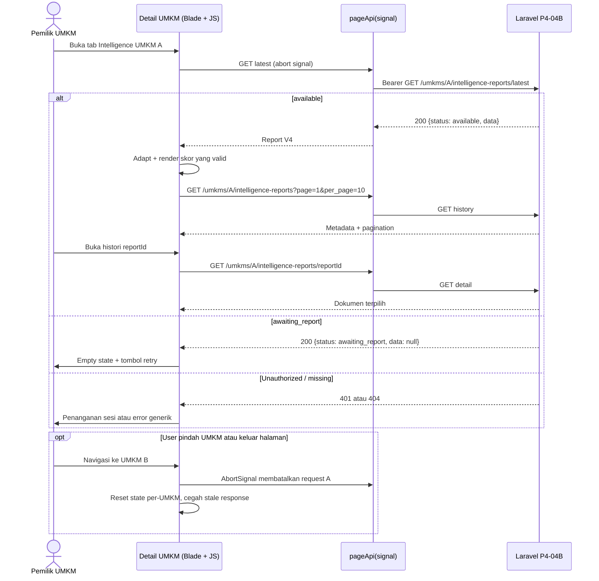
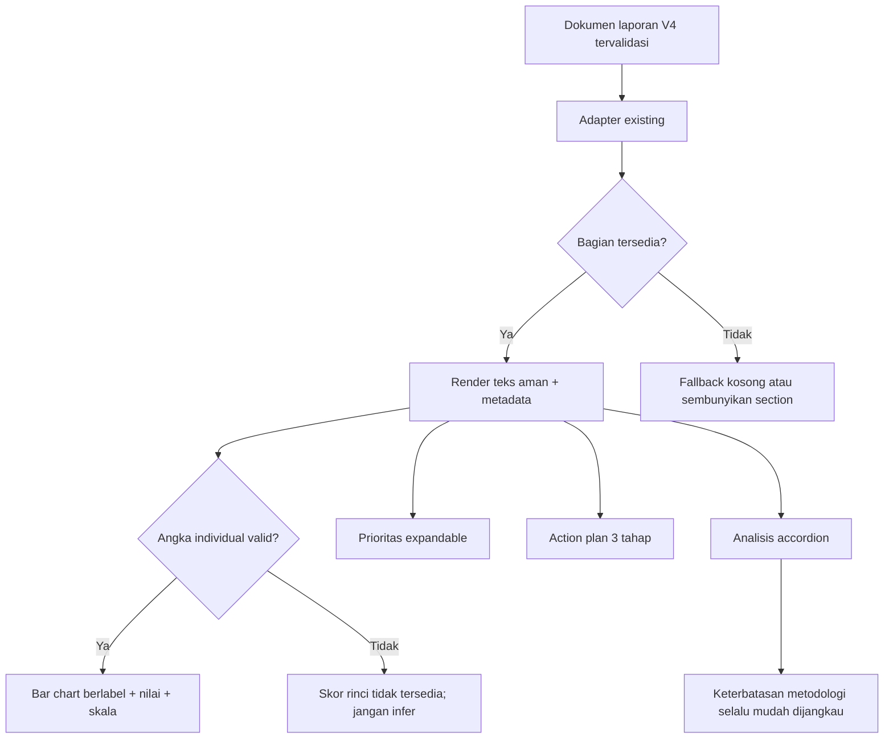
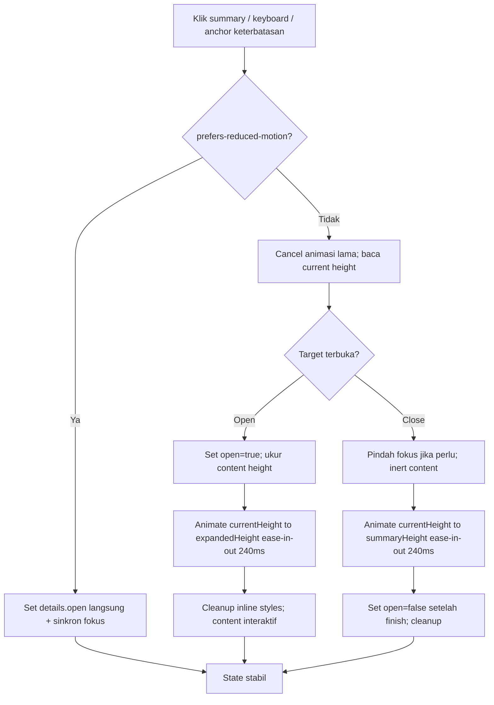

# PRD — JoyUMKM P4-05R: Intelligence Reports UI Refinement

**Tanggal:** 23 November 2026  
**Status:** SPEC LOCKED — brief implementasi  
**Implementor utama:** Codex 6.2 Sol (`gpt-6.2-sol`, sesuai konfigurasi yang tersedia di lingkungan pengguna)  
**Lingkungan:** Laravel JoyUMKM, Windows 11 + Laragon, `C:\laragon\www\joyumkm`  
**Scope:** Perbaikan presentasi **tab Intelligence** pada **Detail UMKM**, tanpa mengubah sumber laporan AI, skema database, atau Hermes Docker.  
**Dasar yang disetujui:** Wireframe interaktif P4-05R dalam percakapan dan screenshot aktual tab Intelligence untuk UMKM Jaya Barokah, evaluasi #14.  
**Sumber aturan desain utama:** `DESIGN.md` pada root repository. **DESIGN.md dan source lokal yang aktual harus diperiksa sebelum menyentuh CSS/Blade/JS.**

> **PENTING — prioritas eksekusi:** Pakai **Graphify terlebih dahulu** untuk menjelajahi dependency dan call chain. Jangan memulai dengan membaca semua file satu per satu. Gunakan pembacaan manual hanya untuk node hasil Graphify yang relevan dan untuk verifikasi kode nyata. Pelihara semua perubahan working tree pengguna.

---

## 1. Latar belakang dan tujuan

P4-04A (receiver Laravel), P4-04B (GET Intelligence Reports API), dan P4-04C (callback Hermes) telah dilaporkan PASS. Laravel sudah menyimpan tiga laporan riil untuk evaluasi #12, #13, dan #14. P4-05 telah menambahkan tab Intelligence di Detail UMKM, lazy fetch, histori 10 per halaman, adapter report V4, serta skeleton/error/retry; verifikasi P4-05 masih **PARTIAL**, karena browser login dengan akun pemilik aktual dan suite PHP berbasis migrasi belum dijalankan.

Screenshot sekarang memperlihatkan laporan yang akurat tetapi sangat panjang: sembilan bagian hampir seluruhnya terbuka dan berisi teks. P4-05R memperbaiki **hirarki informasi dan interaksi pembacaan**, tanpa mengurangi isi ataupun mengubah makna analisis.

### Tujuan

1. Menjadikan laporan terasa sebagai **dashboard analitik operasional JoyUMKM**, bukan dump dokumen panjang.
2. Menyajikan ringkasan, skor valid, dan prioritas terlebih dahulu; analisis lengkap tetap bisa diakses.
3. Mengganti penumpukan daftar teks dengan kartu prioritas, grafik batang aksesibel, tab tahapan rencana aksi, dan accordion animatif.
4. Memberikan **animasi ease-in-out saat accordion dibuka DAN ditutup**, aman untuk keyboard, rapid toggle, dan `prefers-reduced-motion`.
5. Mempertahankan kontrak GET P4-04B, kemampuan histori, isolation antar UMKM, keamanan rendering, desain `DESIGN.md`, dan semua fitur tab lain.

### Non-goals

- **Tidak** mengubah `report.json` historis, mengedit `intelligence_reports`, atau meminta regenerasi Sonnet.
- **Tidak** menambah panggilan AI/Hermes, callback, queue, migrasi, atau endpoint backend baru bila kontrak sekarang cukup.
- **Tidak** membuat task tracker (status selesai/checkbox persist) untuk rencana aksi; timeline bersifat **read-only advisory**.
- **Tidak** memindahkan Intelligence ke menu Analitik terpisah; tetap satu tab di Detail UMKM.
- **Tidak** redesign halaman publik, sidebar, atau profil/lokasi/kontak/penilaian.
- **Tidak** membuang laporan yang keterbatasannya signifikan; `methodology_status=partial` tetap ditampilkan secara eksplisit.

---

## 2. Keadaan awal dan guard implementasi

### Handoff P4-05 yang harus dijadikan referensi source lokal

- `resources/views/umkm-detail.blade.php` — tab Intelligence dan region laporan.
- `resources/js/pages/umkm-detail.js` — lifecycle tab/halaman, identitas UMKM dan pengaktifan tab.
- `resources/js/pages/intelligence-report.js` — fetch GET, skeleton, riwayat, detail, retry.
- `resources/js/pages/intelligence-report-data.js` — adapter dan pemetaan report V4.
- `resources/css/dashboard.css` — styling Intelligence pada workspace.
- `tests/js/intelligence-report.test.js`, `tests/js/intelligence-report-browser.mjs`, `tests/js/intelligence-fixture.mjs` — baseline pengujian P4-05.
- `DESIGN.md` — aturan visual/komponen; `resources/css/tokens.css` dan komponen aktual sebagai sumber implementasi final.

**Peringatan baseline:** versi `main` GitHub yang dapat diperiksa dari luar masih belum menampilkan file `intelligence-report.js` / `intelligence-report-data.js`, sementara handoff menyatakan file tersebut sudah dibuat di lokal. **Jangan mengganti source lokal dengan versi GitHub**; lakukan `git status`, baca graph dan diff lokal terlebih dahulu. Jika `DESIGN.md` berbeda dengan CSS aktual, sesuai isi DESIGN.md sendiri **kode aktual berlaku**, dan setiap perubahan token/komponen harus terdokumentasi.

### Larangan destruktif

- Jangan jalankan `git reset --hard`, `git clean`, `migrate:fresh`, `db:wipe`, atau truncate DB dev.
- Jangan memodifikasi secret, `.env`, `callback.env`, maupun Hermes Docker.
- Jangan meng-commit file graf/temp tanpa kebutuhan; periksa output Graphify dan `.gitignore`.
- Jangan menggunakan migrasi pada `joyumkm-v2` untuk pengujian frontend.
- Jangan menandai P4-05 verifikasi lama PASS secara otomatis karena P4-05R lulus.

---

## 3. Discovery-first dengan Graphify (WAJIB)

### 3.1 Langkah awal Codex

Lakukan inventaris singkat, bukan scanning source penuh:

```powershell
Set-Location 'C:\laragon\www\joyumkm'
git status --short
Get-Item .\DESIGN.md
Get-ChildItem 'C:\Users\itsba\.agents\skills' -Directory | Select-Object -ExpandProperty Name
Get-ChildItem 'C:\Users\itsba\.codex\agents' -File | Select-Object -ExpandProperty Name
```

Baca petunjuk Graphify di `C:\Users\itsba\.agents\skills\graphify\SKILL.md` **bila file benar-benar ada**. Deteksi CLI dan cara query yang nyata dari skill/`--help`, **jangan mengarang nama subcommand**. Handoff P4-05 pernah menjalankan `graphify update .`; jalankan perintah yang sesuai dengan petunjuk versi Graphify lokal dan pembatasan scope.

### 3.2 Target penelusuran graph

Graphify harus membantu menemukan:

1. **Blade root → tab DOM → init page**: `umkm-detail.blade.php` → `umkm-detail.js` → `intelligence-report.js`.
2. **Alur data**: `pageApi(signal)` → API GET `/umkms/{id}/intelligence-reports/...` → adapter V4 → render DOM.
3. **Lifecycle**: tab activation, abort signal, pembatalan request saat pindah UMKM/tab, dan kerja lazy fetch.
4. **Styling**: CSS selector Intelligence dan dependensinya ke `tokens.css` / komponen global / breakpoint.
5. **Tests**: browser fixture, adapter test, navigasi, hooks dan injection points.

Buka **hanya file dan rentang kode hasil penelusuran yang relevan** untuk validasi. Jika Graphify tidak tersedia, error, atau graph stale, catat alasannya dan pakai pencarian tekstual yang dibatasi scope (`rg` / `Select-String`) sebagai fallback; ini bukan izin membaca seluruh repo secara berurutan.

### 3.3 Output audit pra-implementasi

Tuliskan ringkas: graph paths, file aktual, fungsi/komponen yang perlu diedit, aturan `DESIGN.md` yang berlaku, daftar skill/agent yang benar-benar ditemukan, serta perubahan working tree awal. **Jangan menunggu persetujuan ulang jika semua sumber cukup; lanjut implementasi dan pengujian.**

---

## 4. Dasar desain wajib — `DESIGN.md`

Implementasi wajib **mengikuti** aturan berikut dari `DESIGN.md` (diverifikasi terhadap file root dan CSS lokal):

| Aspek | Ketentuan |
|---|---|
| Pendekatan | **Neutral-first**, hirarki melalui tipografi/spasi/state, bukan ornamen dan gradient berlebihan. |
| Canvas & surface | `--canvas` `#F4F7FC`, `--surface` `#FFFFFF`, border `--border` `#E8EDF6`. |
| Primary | `--brand-primary` `#0207CA`; untuk tombol utama, navigasi aktif, fokus, dan fill skor utama. |
| Secondary | `--brand-secondary` `#0297DE`; sebagai fill chart pendukung, **bukan** teks kecil di putih. |
| Teks | `--text-primary` `#101E40`, `--text-muted` `#566781`. |
| Semantik | Amber untuk keterbatasan/peringatan; status tidak dibedakan dengan warna saja. |
| Font | `--font-sans` Poppins, bobot yang dimuat **400/500/600/700**, **jangan** membuat bobot 750/800 yang tidak terpasang. |
| Tipografi | Gunakan `--font-body` (14px), `--font-caption` (12px), `.section-title`, dan ukuran yang mengikuti workspace saat ini. |
| Spacing | Skala `--space-1` sampai `--space-10` (4–40px), padding card default 24px, mobile ~18–19px. |
| Radius/card | `--card-radius` 16px, shadow tipis, border 1px. Sub-card `--radius-small` 8px bila relevan. |
| Kontrol | Target sentuh **44px**, focus-visible outline 2px; keyboard dapat mengakses semua kontrol. |
| Ikon | Gunakan **sprite SVG outline lokal**, bukan emoji atau icon font baru. |
| Motion | Respect `prefers-reduced-motion`; hover/transisi kecil konsisten `--motion-fast` (0.15s). Animasi accordion diatur khusus di §7. |
| Responsive | Gunakan breakpoint dan lebar workspace aktual; pertahankan navigasi sidebar/mobile dan page shell. |
| Rendering | Status/skeleton/error mengikuti komponen dan pattern existing, bukan full-screen spinner. |

**Jangan menyalin CSS warna hardcoded dari wireframe prototipe** bila sudah ada token. Wireframe merupakan panduan interaksi dan hirarki, bukan source of truth desain.

---

## 5. Spesifikasi pengalaman halaman yang disetujui

### 5.1 Struktur hirarki dalam tab Intelligence

Urutan visual desktop dan mobile:

1. **Report header** — nama UMKM, evaluasi, tanggal lokal, badge `Metodologi parsial`, tombol `Muat ulang`.
2. **Navigasi lompat** — `Ringkasan`, `Analisis skor`, `Prioritas`, `Rencana aksi`, `Analisis mendalam`, `Riwayat`; tetap ringkas dan scrollable di mobile.
3. **Ringkasan eksekutif** — narasi asli, satu area temuan utama yang dipilih dari data yang tersedia; tidak mengarang rangkuman baru.
4. **KPI/indikator ringkas** — total Enam Faktor, rata-rata Tiga Dimensi, jumlah prioritas; **hanya jika nilainya valid dan benar-benar ada dalam respons**.
5. **Visualisasi skor** — kartu Enam Faktor dan Tiga Dimensi, masing-masing grafik batang aksesibel.
6. **Tiga prioritas utama** (atau jumlah aktual dari response) — kartu yang bisa dibuka, urutan asli dipertahankan.
7. **Rencana Aksi 90 Hari** — switch tab `Hari 1–30`, `31–60`, `61–90`; isi sesuai `action_plan`, bukan pembuat tugas.
8. **Analisis mendalam** — accordion untuk Perspektif Usaha, Temuan Lintas Penilaian, serta detail analisis lainnya yang memang ada.
9. **Keterbatasan** — accordion yang bisa di-jump dari badge/link dan selalu tersedia ketika metodologi parsial.
10. **Riwayat laporan** — metadata pagination 10 per halaman, buka laporan terpilih, kembali ke latest, tetap terintegrasi dengan state saat ini.

Jika section kosong, tampilkan kondisi kosong yang informatif atau sembunyikan secara eksplisit sesuai kontrak; **jangan membuat content palsu**. Jika histori dipilih, seluruh header, chart, prioritas, dan timeline harus beralih atomik ke laporan tersebut dan tidak bercampur dengan latest/UMKM sebelumnya.

### 5.2 Header, ringkasan, dan KPI

- Identitas laporan tetap terkait UMKM dan evaluasi yang benar; gunakan tanggal lokal browser yang sudah ada di P4-05.
- Badge `Metodologi parsial` terkait ke `Keterbatasan Analisis`; saat diklik, buka accordion dan scroll ke sana.
- Ringkasan memakai teks report yang tersimpan; jangan gunakan template hardcoded untuk semua UMKM.
- KPI merupakan cara **menyajikan angka dari data yang ada**, bukan perhitungan ulang kategori atau inferensi faktor yang tidak tersedia.
- Perbedaan instrumen Enam Faktor dan Tiga Dimensi harus tetap jelas, **tidak digabung menjadi satu skor**.

### 5.3 Grafik skor

- Desain: **horizontal bars** dengan label, nilai dan skala numerik terbaca tanpa mengandalkan warna.
- Enam Faktor: skala 1–5; Tiga Dimensi: skala 0–100. Total Enam Faktor 6–30 tidak dijadikan nilai progress 0–100 tanpa label dan kalkulasi yang eksplisit.
- **Ketersediaan data:** screenshot evaluasi #14 hanya menunjukkan angka individual Sumber Daya 5/5, Kinerja 5/5, Lingkungan Kerja 3/5; tiga nilai lain tidak tampak. Implementasi **tidak boleh menebak** tiga faktor tersisa dari total 25/30. Tampilkan hanya faktor yang terbukti ada; boleh tampilkan keterangan `3 dari 6 skor faktor tersedia untuk visualisasi` jika memang demikian setelah parsing laporan aktual.
- Tiga Dimensi yang tampak pada screenshot: INS 83,3333; ECT 100; OPS 87,5. Gunakan pembulatan tampilan (mis. 83,33) **tanpa mengubah data**, dan label nama lengkap hanya jika metadata faktualnya tersedia.
- Source numeric: pakai field terstruktur bila tersedia. Bila laporan menyimpan hanya prosa, **jangan scrape angka via regex bebas** yang ambigu; evaluasi format adapter yang aman, atau tampilkan placeholder `Skor rinci tidak tersedia`. Tidak perlu menambah endpoint tanpa kebutuhan kuat.
- Grafik bisa dibangun dengan HTML/CSS sederhana agar ringan (atau gunakan komponen/chart yang memang sudah di proyek jika lebih aman). Setiap nilai harus accessible: label + angka + rentang (`<meter>` semantik atau ekuivalen ARIA yang benar). Zero adalah nilai sah bila skala memperbolehkan.

### 5.4 Kartu Prioritas Utama

- Tampilkan indeks 01/02/03, judul, ringkasan singkat dari data sebenarnya, dan badge tingkat prioritas bila tersedia.
- Konten detail yang dapat dibuka: `langkah yang disarankan`, `indikator keberhasilan`, `asumsi` sesuai data; tidak mengubah urutan.
- Default kartu **tertutup** sehingga area lebih ringkas. Bisa membuka beberapa kartu sekaligus kecuali ada alasan UX yang kuat dan tercatat.
- Bagian di dalam kartu harus aman dari XSS, teks disisipkan dengan `textContent` / mekanisme element creator aman.

### 5.5 Rencana Aksi 90 Hari

- Tiga kontrol switch `Hari 1–30`, `Hari 31–60`, `Hari 61–90` yang mengubah isi panel **tanpa HTTP baru** apabila data detail sudah ada.
- Setiap tahap menampilkan kegiatan dan indikator (`action`/`metric`) asli, plus referensi prioritas melalui `priority_id` bila ditemukan; id yang tidak cocok tidak diisi dengan klaim palsu.
- Jangan menampilkan progres selesai, persentase pengerjaan, ataupun tombol simpan status karena backend ini read-only.
- Gunakan pola tab accessible dengan `role=tablist`, `role=tab`, `aria-selected`, `aria-controls`, `role=tabpanel`, dukungan panah kiri/kanan/Home/End dan fokus yang benar; atau pola tombol segmented yang aksesibelnya setara dan terbukti lewat tes.

### 5.6 Analisis Mendalam + Riwayat

- Accordion analisis yang diperlukan mencakup Perspektif Pengembangan, Pemasaran dan Penjualan, Keuangan, Operasional dan SDM, Temuan Lintas Penilaian, Keterbatasan. Sesuaikan dengan struktur aktual report, **jangan memaksakan judul jika tidak ada subbagian**.
- Label `Fakta`, `Interpretasi`, `Kesenjangan data`, `Asumsi` tetap dibedakan secara tipografi. Semua isi lengkap harus tetap dapat ditemukan dengan membuka accordion.
- Bila konten laporan memuat teks berulang (contoh screenshot: estimasi omzet tahunan muncul dua kali), **lacak apakah duplikasi terjadi pada data sumber atau adapter**. Jangan mengubah row database/JSON historis. Dedup tampilan hanya jika aman, identik, dan terdokumentasi; jangan menghapus temuan berbeda yang kebetulan mirip.
- Riwayat mempertahankan pagination backend `10` per halaman, loading lokal, detail histori, `Kembali ke laporan terbaru`, error/retry, kontrol mobile sebagai cards.

---

## 6. Flowchart integrasi Laravel API → Frontend

### 6.1 Diagram end-to-end (read-only)



> GET tidak pernah memanggil Hermes atau Sonnet. UI membaca laporan immutable yang sudah tersimpan di Laravel.

### 6.2 Sequence lazy fetch, detail, dan cancellation



### 6.3 Alur presentasi satu laporan



---

## 7. Spesifikasi animasi accordion — WAJIB (buka dan tutup)

Pengguna secara eksplisit meminta animasi **ease-in-out saat membuka dan menutup**. Ini bukan efek opsional.

### 7.1 Parameter interaksi

| Properti | Keputusan |
|---|---|
| Easing | `ease-in-out` pada animasi buka dan tutup. |
| Durasi target | **220–260 ms**, default **240 ms**. Jangan terlalu lambat untuk bacaan panjang. |
| Properti | Animasi `height` dari tinggi header ke tinggi isi terukur; boleh `opacity` isi secara halus. |
| Ukuran konten | **Dynamic height** mengikuti content dan viewport; **jangan** trik `max-height: 9999px` atau tinggi tetap yang memotong konten. |
| Bentuk | Boleh native `<details><summary>`, dengan JS pengendali transisi agar closing benar-benar teranimasi. |
| Initial state | Semua analisis/prioritas tertutup; bagian yang dibuka lewat `Lihat keterbatasan` segera diekspansi dengan animasi dan di-scroll. |
| Reentrancy | Klik cepat buka–tutup–buka tidak menyebabkan macet, flicker, konten menghilang, atau status/ikon tidak sinkron. |
| Unmount/navigation | Batalkan animasi pending dan bersihkan listener saat ganti halaman/UMKM/report. |
| Reduced motion | `@media (prefers-reduced-motion: reduce)` **langsung ubah state tanpa animasi**. Hormati perubahan media query saat halaman aktif. |
| Aksesibilitas | Keyboard Enter/Space pada `<summary>`; focus terlihat; konten tertutup tidak bisa difokuskan; heading/summary mengumumkan state melalui semantik yang tepat. |

### 7.2 Mekanisme rekomendasi

Gunakan pola **native `<details>/<summary>` + Web Animations API (WAAPI)** atau helper animasi sejenis yang **memenuhi** perilaku berikut:

1. Saat *open*: baca tinggi container tertutup (`summary`), set `open=true`, ukur tinggi konten lengkap, animasikan container dari tinggi tertutup ke tinggi akhir selama 240ms `ease-in-out`, lalu hapus inline height/overflow.
2. Saat *close*: tahan `open=true` selama animasi; ukur tinggi saat ini dan tinggi `summary`, animasikan ke tinggi summary selama 240ms, **baru set `open=false` setelah animasi selesai**. Dengan demikian penutupan **terlihat**, bukan tiba-tiba.
3. Jika user membalik state di tengah animasi: cancel/retarget dari tinggi yang sedang terlihat, tanpa lompatan dan tanpa callback animation finish lama menutup elemen baru.
4. Selama closing, konten yang tidak lagi boleh diinteraksikan harus tidak fokusable (`inert` pada content wrapper, atau penanganan ekuivalen) dan fokus dipindah ke summary bila sebelumnya berada di dalam content.
5. Untuk perubahan konten setelah fetch/viewport resize, jangan menyimpan nilai akhir lama; hitung ulang ukuran bila perlu. Gunakan cleanup `Animation.cancel()` pada unload/abort.
6. Jangan menerapkan `display:none` / `[hidden]` ke seluruh isi sebelum closing animation berakhir, karena efek close akan hilang. Jangan menonaktifkan native `<summary>` keyboard behavior.
7. Untuk testing reduce motion, proses open/close bersifat instan dan semantik benar.

**Catatan teknis:** `transition: height` pada elemen yang langsung mengganti `details.open` dari true ke false sering **tidak** memberi animasi close. Helper harus menunda `open=false` sampai transisi selesai, dengan pengamanan atas animasi yang dibatalkan.

### 7.3 Flowchart state accordion



### 7.4 Kontrak testing animation

- Verifikasi di Chrome nyata bahwa `open` dan `close` berlangsung secara bertahap; screenshot awal, tengah, akhir (bukan hanya DOM final).
- Tutup dari section panjang, section pendek, dan di viewport mobile.
- Double click/rapid toggle (open-close-open), navigasi saat animasi, resize di tengah animasi, reduced motion, keyboard Enter/Space dan fokus.
- Lihat keterbatasan dari header harus membuka accordion sebelum men-scroll; user tetap berada dalam tab Intelligence.

---

## 8. API dan data contract — jangan berubah

| Kebutuhan | Endpoint | Perilaku UI |
|---|---|---|
| Latest | `GET /api/umkms/{id}/intelligence-reports/latest` | `200 {status:"available",data:...}` atau `200 {status:"awaiting_report",data:null}`. |
| History | `GET /api/umkms/{id}/intelligence-reports?page=N&per_page=10` | Metadata only; server pagination, tombol next/prev. |
| Detail | `GET /api/umkms/{id}/intelligence-reports/{reportId}` | Full report untuk histori terpilih. |

Seluruh request menggunakan helper auth `pageApi(signal)` (bukan membuat wrapper fetch tanpa Sanctum), mengikuti AbortSignal existing. UI harus membedakan: 401 (sesi berakhir, ikut alur auth), 404 (UMKM tidak ada/tidak berhak, pesan generik), 5xx/timeout (error/retry), `awaiting_report` (status kosong yang valid, bukan error). Tidak ada polling agresif; tombol `Muat ulang` atas permintaan pengguna.

**Pengujian dengan data nyata:** Laravel dev memiliki laporan 12/13/14 menurut handoff. Backend GET historis dapat diverifikasi **read-only**; pengujian mutatif dan migration harus memakai database testing terisolasi yang diverifikasi eksplisit sehingga **tidak** mengulangi insiden `migrate:fresh` ke database dev.

---

## 9. Skills dan agents — discover & gunakan yang relevan

### 9.1 Lokasi wajib diinventarisasi

```text
C:\Users\itsba\.agents\skills
C:\Users\itsba\.codex\agents
```

Skill/agent berikut **dilaporkan pernah digunakan pada handoff P4-05**; Codex **wajib cek apakah file aktual masih tersedia** dan membaca `SKILL.md` / `.toml` yang relevan. Jangan memperlakukan daftar ini sebagai hasil pemeriksaan langsung P4-05R.

| Skill / Agent | Lokasi yang pernah dilaporkan | Peran di P4-05R |
|---|---|---|
| **Graphify** | `C:\Users\itsba\.agents\skills\graphify\SKILL.md` | **Pertama**: dependency graph, call chain tab–adapter–API–CSS–tests. |
| **Superpowers** | `C:\Users\itsba\.agents\skills\superpowers\skills\...\SKILL.md` | Rencana singkat, TDD, verification-before-completion, pemeriksaan hasil sebelum handoff. |
| **Design Taste** | `C:\Users\itsba\.agents\skills\design-taste\SKILL.md` | Review hirarki, whitespace, visual clarity dan responsive. |
| **Tailwind CSS Development** | `C:\laragon\www\joyumkm\.agents\skills\tailwindcss-development\SKILL.md` (project-local) | Konsistensi styling dan kompatibilitas Tailwind/project CSS; jangan rewrite CSS. |
| **Humanizer** | `C:\Users\itsba\.agents\skills\humanizer\SKILL.md` | Microcopy Indonesian yang jelas, tidak berlebihan; tidak mengubah fakta dalam report. |
| **Ponytail** | `C:\Users\itsba\.codex\plugins\cache\ponytail\ponytail\5.3.3\skills\ponytail\SKILL.md` | Gunakan pendekatan komponen, style dan tooling yang sudah ada. |
| **Frontend Engineer** | `C:\Users\itsba\.codex\agents\frontend_engineer.toml` | Audit komponen, motion, a11y, responsive, clean JS. |
| **QA Engineer** | `C:\Users\itsba\.codex\agents\qa_engineer.toml` | Test plan, Chrome/Playwright, state race, visual dan regression. |

**Delegasi yang diinginkan:** implementor utama Codex 6.2 Sol; bila agents tersedia, delegasi **Frontend Engineer** untuk review UI/accessibility dan **QA Engineer** untuk verifikasi. Maksimal **3 pelaksana aktif** termasuk implementor. Jika agent invocation tidak didukung, lakukan pemeriksaan setara sendiri. Tidak perlu memasang skill/plugin atau memanggil service eksternal.

**Aturan kerja:** skill terkait dibaca sesuai petunjuk lokal terlebih dahulu; hasil Graphify diverifikasi terhadap source aktual; agent QA tidak mengubah DB development.

---

## 10. Rencana implementasi yang dapat dieksekusi

| Fase | Pekerjaan | Bukti yang diharapkan |
|---|---|---|
| R0 — Preflight | `git status`, `DESIGN.md`, inventaris skills/agents, Graphify dependency audit, pilih file target sempit. | Log rute dependency, file scope, diff awal. |
| R1 — Data/UI adapter | Uji kontrak field actual report, numeric availability, fallback, historis, fakta vs interpretasi; buat unit tests dahulu. | Test adapter merah→hijau untuk kondisi nyata/kurang data. |
| R2 — Layout | Header, jump nav, KPI, chart bar aksesibel, priority cards, action plan stages, analysis details, history. | Screenshot responsive dan HTML semantic. |
| R3 — Animation | Implement helper `<details>` open/close 240ms `ease-in-out`, retarget, reduced motion, focus, cleanup. | Test browser animasi buka/tutup & rapid toggle. |
| R4 — Integrasi | Wiring lazy fetch dan history detail tetap, navigasi tab tidak rusak, cancellation/isolation per UMKM. | Chrome test fungsional, no spurious API call. |
| R5 — QA | JS unit, browser 1440/768/390, keyboard, a11y, XSS, no overflow, CSS regression, build. | Evidence dan hasil pass/fail per gate. |
| R6 — Handoff | Dokumen bukti, file diff, screenshot, risk, baseline failure comparison; stop di P4-05R. | Status final PASS/PARTIAL/BLOCKED yang jujur. |

### Urutan pengujian yang aman

```powershell
npm test
npm run build
# Jalankan tes Chrome/Playwright terarah sesuai perintah aktual di repository.
# Semua PHP migration tests wajib memakai DB testing terisolasi, bukan joyumkm-v2.
git diff --check
```

Uji GET Laravel actual **read-only** bila diperlukan. Jangan melakukan login dengan akun riil melalui browser hanya demi mengubah status P4-05 lama menjadi PASS, kecuali bisa dilakukan dengan aman dan scope tes jelas; jika belum dikerjakan tetap tulis NOT RUN.

---

## 11. Acceptance criteria / gates

| Gate | PASS jika |
|---|---|
| **G-05R-01** | Graphify dipakai pertama untuk dependency audit; fallback dan hasil verifikasi manual bila diperlukan didokumentasikan. |
| **G-05R-02** | UI patuh `DESIGN.md` dan token CSS aktual; tidak ada font/bobot/warna/ikon asing. |
| **G-05R-03** | Ringkasan, KPI valid, visualisasi faktor/dimensi dan badge metodologi tersedia; tidak mengarang skor. |
| **G-05R-04** | Kartu prioritas memuat data aktual, bisa expand/collapse dan mempertahankan urutan/fakta. |
| **G-05R-05** | Timeline 1–30 / 31–60 / 61–90 bekerja sebagai view read-only, keyboard accessible. |
| **G-05R-06** | Accordion **buka dan tutup** teranimasi `ease-in-out` (~240ms), termasuk isi pendek/panjang. |
| **G-05R-07** | Rapid toggle, resize, navigation cleanup, reduced-motion, focus, serta keyboard lulus. |
| **G-05R-08** | Analisis/keterbatasan lengkap tetap tersedia; link keterbatasan membuka accordion dan scroll benar. |
| **G-05R-09** | Existing latest/history/detail/pagination/retry/401/404/awaiting_report/abort tetap berfungsi. |
| **G-05R-10** | Teks laporan aman dari XSS; tidak ada HTML raw hasil AI dan tidak ada data laporan dimodifikasi. |
| **G-05R-11** | Desktop 1440, tablet 768, mobile 390: tidak ada overflow, kontrol sentuh sesuai, teks terbaca. |
| **G-05R-12** | `npm test`, `npm run build`, tes browser terarah PASS; baseline failures lama dicatat, bukan disembunyikan. |
| **G-05R-13** | Tidak ada perubahan Hermes, callback, migration, endpoint backend, secret, dan DB development. |
| **G-05R-14** | Handoff menyertakan evidence screenshot, file diff, hasil skills/agents, catatan Graphify, dan status QA jujur. |

**Definition of Done:** Semua gate G-05R yang ada pada scope ini PASS; jika ada gate belum diuji, status harus PARTIAL/NOT RUN secara eksplisit. Jangan menggunakan keberhasilan tes sintetis untuk mengklaim browser login aktual atau production readiness.

---

## 12. Risiko dan keputusan penanganan

- **Data laporan tidak lengkap:** utamakan fallback, bukan memaksa visual yang salah.
- **Akumulasi duplikasi narasi:** identifikasi source vs adapter; jaga dokumen immutable dan log perbaikan tampilan secara eksplisit.
- **Accordion native closing instan:** jangan hanya toggle `details.open`; gunakan orchestration dengan penyelesaian animasi sebelum penutupan.
- **Race saat mengganti laporan:** cancel fetch, cancel animation, reset container; jangan render respons stale.
- **DOM panjang dan performa:** jangan load library chart besar hanya untuk bar sederhana; hindari query/layout measure per-frame.
- **Accessibility:** data bars butuh label angka, bukan warna saja; reduced motion dan fokus wajib.
- **Perubahan CSS global:** scope selector pada tab Intelligence untuk mencegah gangguan halaman lain.
- **Perlindungan database:** selalu konfirmasi DB target sebelum menjalankan tes migrasi; tidak ada operasi tulis ke `joyumkm-v2`.

---

## 13. Handoff dan stop condition

Implementor wajib menyerahkan:

1. `PASS / PARTIAL / BLOCKED` per gate G-05R-01..14.
2. Daftar file diubah/baru, `git status`, dan perbedaan awal vs akhir tanpa membuang working tree.
3. Summary penelusuran Graphify: node/call chain, versi/command yang dipakai, dan verifikasi source.
4. Skill/agent yang benar-benar ada dan digunakan (path aktual, bukan asumsi).
5. Hasil `npm test`, build, Chrome/Playwright dan cek keyboard/reduced motion.
6. Screenshot desktop (1440), tablet (768), mobile (390), contoh accordion **closed/open** dan timeline tahapan.
7. Hasil pengujian `latest/history/detail`, negative auth, abort navigation, fallback missing data, immutable source.
8. Catatan apakah ada pengujian browser login pemilik aktual dan suite PHP migration — masing-masing PASS atau NOT RUN, jangan diasumsikan.
9. Risiko terbuka termasuk data report historis dan isi teks ganda, bila ditemukan.

**Berhenti setelah P4-05R.** Jangan melanjutkan ke fase lain, jangan memanggil AI Intelligence, dan jangan menyentuh Hermes Docker.

---

## Lampiran A — Referensi desain yang disetujui

Wireframe interaktif P4-05R di percakapan adalah **referensi struktur dan perilaku**, meliputi:

- Header laporan + badge metodologi + muat ulang.
- Navigasi lompat antar section.
- Ringkasan, KPI 25/30 dan 90,3/100 **hanya untuk evaluasi contoh #14** jika faktual dalam report.
- Grafik Enam Faktor (hanya nilai yang benar-benar tersedia) dan Tiga Dimensi.
- Tiga kartu prioritas expandable.
- Rencana Aksi 90 Hari sebagai tiga tahap.
- Analisis mendalam dan keterbatasan yang bisa di-accordion.
- Riwayat laporan dengan detail, pagination, dan kembali ke latest.

**Nilai dan narasi di wireframe bukan template global.** Semua isi produksi berasal dari API/adapter untuk UMKM dan report yang sedang dipilih. Perbedaan dengan wireframe yang disebabkan oleh data kosong justru harus ditangani dengan fallback yang benar.

## Lampiran B — Catatan sumber dan verifikasi

- `DESIGN.md` dapat diperiksa pada GitHub `joytimess/dip-joyumkm` saat penyusunan brief, termasuk aturan neutral-first, palet dan token, Poppins 400–700, focus ring, kontrol 44px, dan motion reduced. **Tetapi repository lokal pengguna mungkin lebih baru**; versi lokal dan source aktual yang dikunci saat implementasi adalah acuan akhir.
- Handoff P4-05 mengonfirmasi bagian kode, adapter sembilan bagian, GET kontrak, Chrome pada 1440/768/390, dan daftar skills/agents yang sebelumnya digunakan. Audit source lokal wajib untuk memastikan kondisi implementasi terakhir.
- Screenshot laporan Jaya Barokah dan wireframe interaktif dalam percakapan menjadi referensi UI yang disetujui, bukan fixture pengujian produksi.
