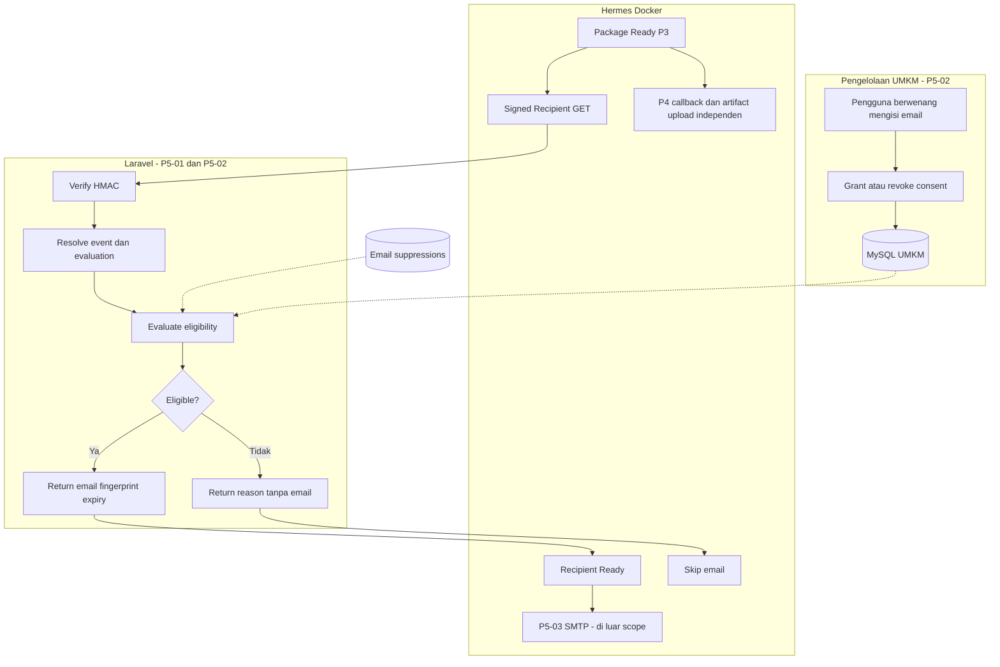
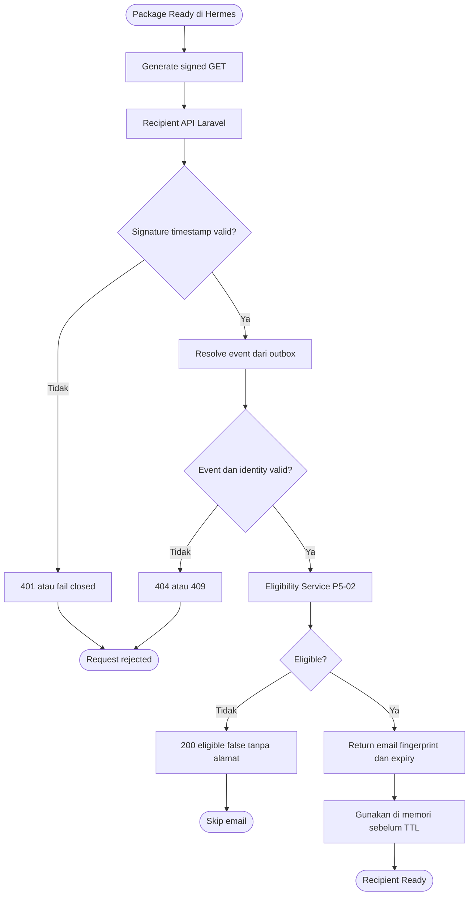
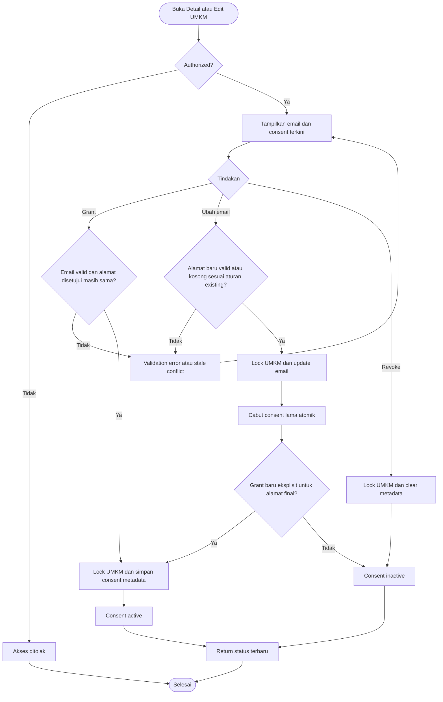
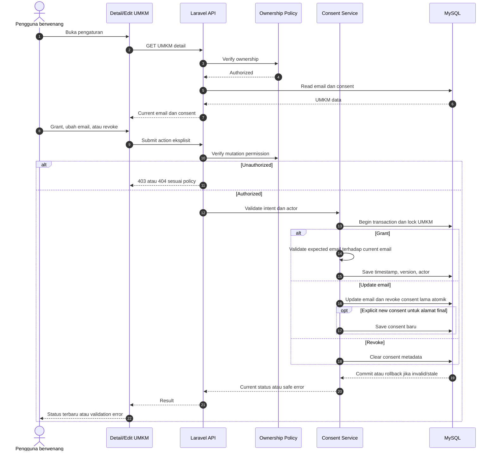
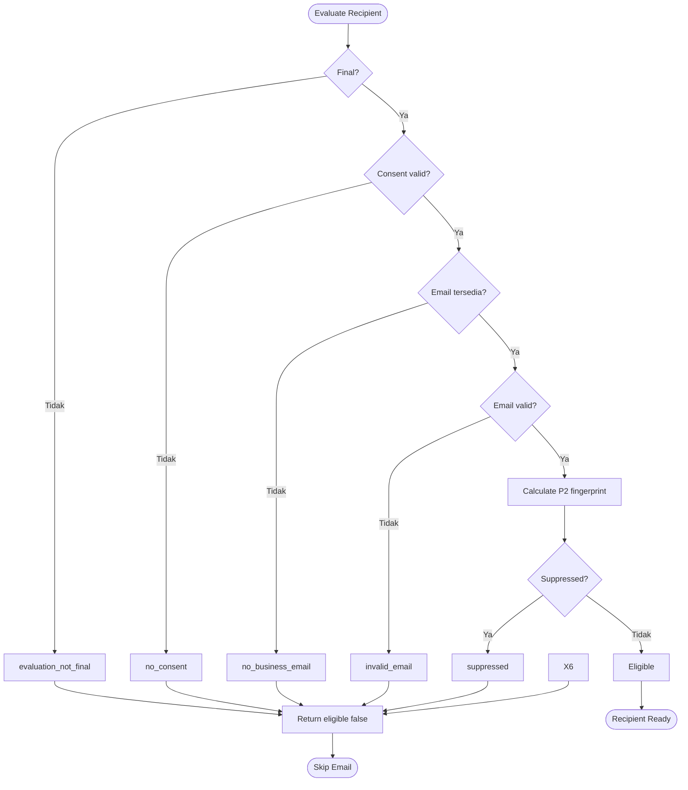

# PRD — JoyUMKM × Hermes | P5-01 & P5-02

**Versi:** 1.0 · **Tanggal:** 24 November 2026  
**Status:** Approved by owner — siap implementasi  
**Scope:** Authenticated Recipient Pull API, Consent & Email Eligibility  
**Target:** Laravel JoyUMKM (Laragon) dan konfigurasi autentikasi privat Hermes Docker  
**Mode:** Implementasi otonom, berurutan, bounded QA
**Klasifikasi:** Internal proyek.

## 1. Executive brief

P5-01 dan P5-02 menyediakan fondasi pengiriman laporan melalui Gmail oleh Hermes. Setelah paket PDF dan XLSX siap di Hermes, sistem harus dapat memperoleh alamat email usaha yang sah dari Laravel melalui signed GET. Laravel menentukan kelayakan berdasarkan identitas event, status Final penilaian Enam Faktor, email usaha, persetujuan eksplisit, dan suppression.

Laravel **tidak mengirim email**. P5-01/P5-02 tidak melakukan koneksi SMTP, pengiriman email nyata, AI tambahan, maupun pembuatan ulang laporan. Transport SMTP, template, attachment dan otomatisasi email dibangun pada P5-03 hingga P5-05; sinkronisasi status email pada P5-06; QA final P5 pada P5-07.

### 1.1 Checkpoint yang diterima

- P2 PASS pada database dev: schema consent, suppression, recipient fingerprint/pepper, periode WIB, koneksi MySQL UTC. P2 final memperbaiki pencabutan consent ketika `business_email` berubah melalui model `Umkm`.
- P3 PASS: canonical `report.json`, PDF, XLSX, immutable manifest, Package Ready dan recovery.
- P4 PASS untuk Laragon menurut handoff terbaru: signed callback/upload, private storage, authorized download, QPDF, ACL dan HTTP aktual. Worker/scheduler terdaftar tetapi belum aktif; dispatch live dan nginx/PHP-FPM hosting NOT RUN.
- Handoff P4 menyediakan `jmi.pipeline.get_ready_package(event_id)` dan `jmi.transport.prepare_verified_package(event_id)` untuk fase email mendatang. Jangan mengubah mekanisme ini.
- SMTP Gmail telah disiapkan oleh owner pada `.env` Laravel; keberhasilan koneksi SMTP belum diuji dan bukan acceptance gate P5-01/P5-02.

### 1.2 Keputusan owner

| ID | Keputusan |
|---|---|
| K01 | Hermes Agent Docker adalah pengirim email; Laravel penyedia data dan otorisasi. |
| K02 | Penerima dinamis berasal hanya dari `umkms.business_email` terkait event. |
| K03 | Recipient pull melalui signed GET dengan dedicated HMAC-SHA256, tolerance 300 detik, TTL respons 60 detik. |
| K04 | Consent eksplisit per UMKM, melalui Detail/Edit UMKM existing; tidak aktif secara default. |
| K05 | Perubahan alamat mencabut consent lama; grant baru harus eksplisit dan terikat alamat terkini. |
| K06 | Suppression dan recipient fingerprint menggunakan fondasi P2; pepper existing tidak dirotasi. |
| K07 | Testing mode aktif; satu-satunya target uji yang diizinkan adalah `owner-approved@example.test`. |
| K08 | Recipient pull tidak bergantung pada report callback atau upload Laravel yang sudah complete. |
| K09 | PII tidak dimasukkan ke webhook, report, manifest, job/evidence/log Hermes. |
| K10 | Tidak ada email nyata pada P5-01/P5-02. |
| K11 | Target implementasi kelompok 20–30 menit (estimasi, bukan jaminan); QA 5–10 menit, hard limit kumulatif 15 menit. |
| K12 | Reuse infrastruktur QA, cleanup wajib, tidak mengulang regresi historis dan tidak membuka kembali P0–P4. |

## 2. Scope dan tanggung jawab

| Task | Output | Target |
|---|---|---|
| P5-01-A | Signed Recipient Pull API dan route binding | Laravel |
| P5-01-B | HMAC dedicated secret, TTL, response contract dan proteksi PII | Laravel + konfigurasi privat Hermes |
| P5-02-A | Grant/revoke consent dan ownership authorization | Laravel |
| P5-02-B | Integrasi consent pada Detail/Edit UMKM existing | Frontend JoyUMKM |
| P5-02-C | Eligibility, suppression, invariant perubahan email | Laravel |
| P5-02-D | Targeted QA gabungan, signed HTTP probe, deployment konfigurasi lokal, cleanup dan handoff | Laravel + Hermes |

Urutan: selesaikan kontrak dan endpoint P5-01 dengan service P2 existing; langsung lanjut P5-02 untuk melengkapi policy, consent UI/API dan integrasi eligibility. Verifikasi gabungan di akhir agar tidak mengulang setup. Jangan berhenti untuk approval rutin di antara subtask. Jika ada blocker nyata, laporkan fakta dan usaha penyelesaiannya.

## 3. Environment dan referensi

- Repository: `C:\laragon\www\joyumkm`.
- Dev DB: `joyumkm-v2`; QA menggunakan MySQL terisolasi (misalnya `joyumkm_testing` setelah memastikan guard dan ownership). Jangan menjalankan fixture/truncation pada dev.
- App/database timezone UTC; periode laporan Asia/Jakarta (WIB); tidak ada perubahan aturan P2.
- Hermes container: `hermes-agent`; persistent volume `hermes_data:/joyumkm-intelligence/`; root container `/opt/data/joyumkm-intelligence/`; `JMI_HOME=/opt/data/joyumkm-intelligence/state` (verifikasi loader aktual).
- Gunakan source code aktual sebagai source of truth. Baca dokumen relevan, bukan mengulang audit global.

Referensi repo:

- `docs/audit/P0_JoyUMKM_Hermes_Integration_Audit.md` — K3/K4, pemisahan jalur delivery.
- `docs/audit/P2_JoyUMKM_FINAL_COMPLETION.md` dan `docs/evidence/p2-data-contract.md` — schema, consent, eligibility, fingerprint, pepper.
- `docs/audit/P4-07_JoyUMKM_Deployment_Hardening.md`, `docs/evidence/p4-07-qa-summary.md` dan handoff final P4 terbaru — lingkungan Laragon dan proteksi runtime.
- `docs/audit/P4_JoyUMKM_FINAL_COMPLETION.md` — antarmuka Package Ready. Jika ada salinan lama dengan verdict PARTIAL, gunakan checkpoint terakhir yang diterima owner dan bukti P4-07 aktual, bukan menjalankan ulang P4.

## 4. Flowchart integrasi



Jalur P4 dan email independen. Pada scope ini, titik akhir adalah Recipient Ready atau keputusan tidak eligible; tidak ada SMTP yang dijalankan.

## 5. P5-01 — Authenticated Recipient Pull API

### 5.1 Functional requirements

`GET /api/internal/intelligence/recipients/{event_id}`

- Route internal machine-to-machine, read-only, tanpa Sanctum user token dan tanpa akses publik. Gunakan middleware HMAC khusus serta rate limiter existing convention.
- `event_id` wajib UUID kanonis huruf kecil; tidak menerima `umkm_id`, `evaluation_id`, email atau query yang mengubah resolusi penerima dari caller.
- Autentikasi sebelum akses database bisnis. Resolve outbox/event v2 → evaluasi Enam Faktor → UMKM yang terikat. Pastikan jenis event dan identitas cocok serta penilaian memang Final; event lama/unsupported atau identity conflict ditolak tanpa membocorkan data.
- Jangan mensyaratkan outbox `delivered`, `intelligence_reports` row, manifest Laravel, `artifact_status=complete`, atau file P4 tersedia. Event autentik yang valid dapat di-resolve sebelum callback/upload. Jangan membuat report palsu untuk memenuhi relasi.
- Gunakan `IntelligenceRecipientEligibilityService`, `IntelligenceRecipientFingerprint` dan `EmailSuppressionService` existing. Pisahkan eligibility tanpa PII dari endpoint pull yang hanya mengembalikan alamat jika eligible.
- Baca email, consent dan data suppression secara konsisten untuk keputusan tersebut; jangan membaca alamat lagi dari snapshot lain setelah eligibility lulus.
- Pull tidak mengubah penilaian, consent, delivery state, outbox, atau report. Tidak ada enqueue email.

### 5.2 HMAC dan konfigurasi

Nama berikut adalah kontrak rancangan yang disetujui; pertahankan convention aktual bila ekuivalen dan dokumentasikan nama efektif.

```dotenv
# .env Laravel (git-ignored; contoh tanpa nilai secret)
HERMES_INTELLIGENCE_RECIPIENT_SECRET=
HERMES_INTELLIGENCE_RECIPIENT_TOLERANCE_SECONDS=300
INTELLIGENCE_RECIPIENT_TTL_SECONDS=60
```

- Generate secret dengan CSPRNG minimal 32 random bytes, misalnya 64 karakter hex. Berbeda dari webhook, callback, snapshot, artifact secret dan recipient pepper. Jangan merotasi secret sebelumnya.
- Sediakan secret yang sama pada konfigurasi privat Hermes, misalnya `JMI_HOME/recipient.env` (mode 0600, owner runtime Hermes); gunakan nama yang sesuai loader, dokumentasikan mapping. Simpan base URL Laragon aktual yang dapat dijangkau dari Docker; reuse local alias yang telah terverifikasi P4. Tidak perlu mengubah SMTP.
- Skema HMAC: gunakan skema signed GET snapshot existing jika dapat mengikat method, canonical path/event dan timestamp dengan aman, menggunakan dedicated secret dan domain separation. Jika tidak ada skema yang cocok, gunakan kontrak `JMI-RECIPIENT-V1` berikut sebagai default yang eksplisit (detail engineering ini melengkapi persetujuan awal):

```text
JMI-RECIPIENT-V1\nGET\n/api/internal/intelligence/recipients/{event_id}\n{timestamp}
```

  `\n` adalah LF aktual; UTF-8, tanpa LF terakhir; timestamp epoch UTC desimal; HMAC-SHA256 dengan secret config, output lowercase hex 64 karakter. Header: `X-Intelligence-Signature-Version: 1`, `X-Intelligence-Timestamp`, `X-Intelligence-Signature`. Tidak ada body/query yang diterima. Gunakan canonical path sesuai routing, jangan menerima alternate path yang mengubah identitas signed request. Gunakan constant-time comparison. Dokumentasikan golden vector dengan secret sintetis, bukan secret runtime.
- Toleransi request: 300 detik, termasuk timestamp terlalu lama dan terlalu jauh di masa depan. TTL respons 60 detik dari saat keputusan diterbitkan; berbeda dengan toleransi request.
- Timestamp + HMAC membatasi replay window dan tampering, bukan jaminan single-use. Endpoint read-only, rate-limited, TLS wajib non-local. Jangan mengklaim anti-replay absolut. HTTP hanya local Docker/Laragon yang eksplisit diizinkan; tidak ada redirect, jangan log header/signature atau body penerima.
- Secret kosong/invalid, pepper tidak valid, atau konfigurasi eligibility gagal: fail closed dengan safe error; tidak mengembalikan alamat.
- Jangan mengirim secret ke frontend, log, Git, PRD evidence atau terminal output. Jangan menggunakan PHP Artisan Tinker. Verifikasi kecocokan konfigurasi tanpa menampilkan nilai.

### 5.3 Response contract

Contoh sintetis, bukan target uji aktual:

```json
{
  "event_id": "11111111-1111-4111-8111-111111111111",
  "umkm_id": 25,
  "eligible": true,
  "recipient_email": "pemilik@example.com",
  "recipient_fingerprint": "<64 lowercase hex>",
  "consent_version": "1",
  "issued_at": "2026-11-24T16:00:00Z",
  "expires_at": "2026-11-24T16:01:00Z"
}
```

`consent_version` mengikuti tipe/versi aktual P2. Fingerprint adalah hasil service P2 terhadap alamat yang dinormalisasi sesuai kontrak existing, bukan hash bebas atau raw address. Response diberikan hanya kepada caller terautentikasi. Timestamp server UTC. `Cache-Control: no-store` untuk seluruh respons endpoint; hindari caching di proxy. Jangan masukkan data kontak lain.

Ineligible:

```json
{
  "event_id": "11111111-1111-4111-8111-111111111111",
  "eligible": false,
  "reason": "no_consent"
}
```

Jangan sertakan alamat, consent actor, atau fingerprint yang tidak diperlukan pada respons ineligible. Internal service tetap mengikuti nullable fingerprint P2.

| HTTP | Kondisi | Tindakan downstream (P5 mendatang) |
|---|---|---|
| 200 | Eligible, respons lengkap dan fresh | Gunakan di memori sebelum expiry |
| 200 | Ineligible dengan reason stabil | Jangan kirim |
| 401 | Signature/timestamp invalid atau hilang | Fail closed |
| 404 | Event tidak dikenal, UUID/jenis event tidak didukung | Jangan kirim |
| 409 | Event dan relasi identitas konflik | Jangan kirim; operator review |
| 400/405 | Framing/query/method tidak didukung | Tolak |
| 429 | Rate limit | Retry terkontrol pada fase email berikutnya |
| 503/5xx | Config/database/service sementara tidak tersedia | Jangan kirim; klasifikasi retry/operator sesuai error |

Ikuti envelope error existing selama tidak membocorkan PII, secret, signature, query SQL atau path. Tetapkan kode error aktual dalam dokumen kontrak; jangan menambahkan response payload tidak stabil.

### 5.4 Flowchart P5-01



### 5.5 Sequence diagram P5-01

```mermaid
sequenceDiagram
    autonumber
    participant H as Hermes Docker
    participant M as HMAC Middleware
    participant A as Recipient API
    participant E as Eligibility Service
    participant DB as MySQL
    Note over H: Package Ready, tidak perlu P4 complete
    H->>M: Signed GET /recipients/event_id
    M->>M: Validate method, path, signature, timestamp
    alt Invalid authentication
        M-->>H: 401 atau safe config error
    else Valid authentication
        M->>A: Authorized request
        A->>DB: Resolve outbox, evaluation, UMKM
        DB-->>A: Bound identity
        alt Unknown or conflicting identity
            A-->>H: 404 atau 409
        else Valid identity
            A->>E: Evaluate recipient
            E->>DB: Read current email, consent, suppression
            DB-->>E: Eligibility data
            alt Eligible
                E-->>A: Eligible decision and matching recipient
                A-->>H: 200 email, fingerprint, expiry; no-store
                H->>H: Use in memory before expiry
            else Ineligible
                E-->>A: Reason only
                A-->>H: 200 eligible false
            end
        end
    end
```

Pada P5-01/P5-02 cukup buktikan signed GET lintas Docker → Laravel menggunakan probe QA yang tidak menyimpan raw response. Runtime consumer otomatis, re-pull sebelum SMTP dan retry adalah pekerjaan P5-03/P5-05. Jangan membuat worker email di kelompok ini.

## 6. P5-02 — Consent dan Email Eligibility

### 6.1 Reuse schema P2

| Existing | Tanggung jawab |
|---|---|
| `umkms.business_email` | Alamat usaha yang sah |
| `umkms.notification_consent_at` | Timestamp persetujuan UTC, nullable |
| `umkms.notification_consent_version` | Versi teks persetujuan |
| `umkms.notification_consent_by_user_id` | Actor authenticated yang memberikan consent |
| `email_suppressions` | Suppression berdasarkan recipient fingerprint dan reason existing |
| `INTELLIGENCE_RECIPIENT_PEPPER` | Secret HMAC fingerprint Laravel, jangan dirotasi atau dikirim ke Hermes |
| `IntelligenceRecipientEligibilityService` | Penilaian eligibility tanpa PII |

Tidak perlu migration baru jika schema P2 memenuhi invariant. Jangan mengulang migration P2/P4 atau timezone remediation. Jika perubahan aditif benar-benar diperlukan, jelaskan alasan, uji pada DB QA, dan backup sebelum perubahan dev. Tidak ada `migrate:fresh`, rollback global atau perubahan histori.

### 6.2 Authorization dan mutasi consent

- Gunakan autentikasi frontend/backend dan ownership policy UMKM existing. Tidak memperluas role. Actor wajib berwenang mengelola UMKM serta menyatakan memiliki persetujuan penerima. Actor ID berasal dari session/token, bukan input client.
- Sediakan grant dan revoke melalui endpoint existing yang sesuai atau endpoint khusus terotorisasi. Rancangan jika endpoint khusus diperlukan: `PUT /api/umkms/{umkm}/notification-consent` dengan intent grant/revoke. Sesuaikan route convention aktual; dokumentasikan kontrak final.
- Grant harus eksplisit, tidak tercentang default; alamat tersedia dan valid; metadata timestamp, version dan actor ditentukan server. Jangan mempercayai timestamp/version/actor dari client sebagai sumber kebenaran.
- Grant terikat pada alamat yang sedang ditampilkan/disetujui. Di dalam transaksi lock row UMKM, verifikasi alamat yang disetujui terhadap alamat terkini (atau versi perubahan ekuivalen). Jika stale, return 409 dan minta refresh/re-consent; jangan memberikan consent kepada alamat yang tidak dilihat pengguna.
- Perubahan email dan revoke consent lama harus atomik. Jika pengguna memberikan grant baru bersama alamat baru dalam satu aksi, grant baru harus eksplisit, sesuai alamat final, dan dijaga transaction yang sama; jika tidak, reset seluruh metadata consent. Mengubah field lain tidak mencabut consent.
- Revoke mengosongkan ketiga metadata consent, idempotent, tidak menghapus report atau mengubah email. Revoke boleh dilakukan walau email invalid/kosong.
- Lindungi dari mass assignment dan direct-write path aplikasi yang melewati hook model P2. Audit jalur update UMKM yang relevan saja; gunakan service/model existing dan transaction. Tidak perlu membangun audit platform baru. SQL administrator langsung di luar aplikasi tetap merupakan batas operasional yang harus didokumentasikan jika tidak dilindungi oleh constraint DB existing.
- Legacy UMKM tetap no consent; tidak ada bulk grant atau backfill consent otomatis. Suppression tidak dihapus dengan pemberian consent; jangan menambah UI pengelolaan suppression pada kelompok ini.

### 6.3 UI Detail/Edit UMKM

Gunakan halaman dan komponen existing, tidak membuat halaman baru atau redesign. Ikuti design system JoyUMKM (Poppins, palette dan komponen yang sudah ada). Letakkan section **Pengaturan Pengiriman Laporan** di Detail/Edit UMKM (pilih lokasi existing yang paling sesuai; dokumentasikan lokasi aktual).

- Field email usaha: reuse `business_email`; jangan menduplikasi sumber data.
- Checkbox persetujuan eksplisit, tidak prechecked kecuali consent valid sudah tersimpan untuk alamat tersebut. Label usulan final: “Saya menyetujui pengiriman laporan evaluasi dan perkembangan UMKM melalui alamat email ini.”
- Teks bantuan: “Laporan dikirim otomatis setelah penilaian Enam Faktor difinalisasi dan laporan Intelligence selesai diproses.” Selama rollout belum aktif, tampilkan keterangan bahwa pengiriman otomatis belum diaktifkan; jangan menjanjikan email langsung.
- Status: aktif/belum menyetujui, email tidak tersedia/tidak valid bila relevan; consent aktif tidak sama dengan semua eligibility gate lulus.
- Ketika email berubah, UI reset checkbox dan beri pemberitahuan bahwa persetujuan lama dicabut setelah perubahan disimpan. User dapat memilih grant baru secara eksplisit untuk alamat baru sesuai aturan server.
- Berikan tindakan revoke yang jelas. Reuse save/update flow, loading, validation, error dan retry existing. Status berhasil hanya setelah server mengonfirmasi.
- Pengguna tanpa izin tidak dapat melakukan mutasi; backend tetap wajib menolak walaupun UI disembunyikan. Hindari exposing internal suppression/fingerprint pada UI publik.

### 6.4 Flowchart consent



### 6.5 Sequence diagram consent



### 6.6 Eligibility policy

Periksa status Final, consent, validitas email, dan suppression secara berurutan. Service harus mengambil data terbaru setiap pull. Tidak melakukan lookup kontak di Hermes snapshot atau meminta AI memilih alamat.

| Prioritas | Kondisi gagal | Reason |
|---|---|---|
| 1 | Evaluasi bukan Final | `evaluation_not_final` |
| 2 | Consent tidak aktif/valid untuk alamat sekarang | `no_consent` |
| 3 | `business_email` kosong | `no_business_email` |
| 4 | Format email invalid | `invalid_email` |
| 5 | Fingerprint masuk suppression | `suppressed` |

Semua gate lulus → `eligible=true`. Fingerprint dibuat dengan service P2 setelah email valid; pertahankan canonicalization existing (jangan menambahkan Gmail dot/plus alias expansion). Gunakan alamat bisnis yang disetujui tanpa fallback ke alamat pengirim.




### 6.7 Freshness dan batas jaminan

TTL respons 60 detik membatasi penggunaan data penerima yang sudah ditarik. P5-03/P5-05 harus pull ulang sebelum SMTP setiap percobaan, menolak response expired dan menghentikan retry bila consent dicabut atau fingerprint berubah. Revocation setelah pull tidak dapat membatalkan pesan yang sudah diserahkan ke SMTP; jangan mengklaim eliminasi seluruh race lintas sistem. Tidak ada email dikirim dalam kelompok ini.

## 7. Acceptance criteria

| ID | Gate | Bukti minimum |
|---|---|---|
| AC-01 | Signed GET eligible | 200, event/UMKM bound, alamat/fingerprint cocok, expiry 60 detik, no-store |
| AC-02 | Authentication negatif | Missing/wrong HMAC, expired/future timestamp, path/method tampering ditolak |
| AC-03 | Unknown event | 404, tidak ada PII |
| AC-04 | Cross-UMKM/identity protection | Caller tidak dapat menentukan penerima lain; tampered/conflicting identity ditolak |
| AC-05 | Consent grant | Authorized grant menyimpan timestamp UTC, version dan actor server; default inactive |
| AC-06 | Consent revoke | Metadata cleared; subsequent pull ineligible; repeated revoke aman |
| AC-07 | Email change | Consent lama reset atomik; stale grant ditolak; grant baru eksplisit sah; unrelated update tidak reset |
| AC-08 | Email validation | Missing/invalid dan non-Final ditolak sesuai precedence P2 |
| AC-09 | Suppression | Suppressed email tetap ditolak meskipun consent aktif |
| AC-10 | Kelayakan email bisnis | Alamat valid dengan consent aktif lulus jika tidak disuppresi |
| AC-11 | PII dan secret protection | Tidak muncul di webhook, canonical report, manifest, log, evidence; ineligible tidak mengembalikan alamat |
| AC-12 | P4 independence | Signed GET berhasil tanpa report/manifest/upload Laravel, dengan event sah |
| AC-13 | UI authorization | Section consent existing berfungsi; perubahan email reset, error/success sesuai respons; unauthorized mutation ditolak |
| AC-14 | Config safety | Dedicated matching secret, berbeda dari existing; config invalid fail closed; SMTP/pepper tidak diubah |
| AC-15 | Operational boundary | Tidak ada AI, SMTP, live dispatch, backlog/replay, atau perubahan data historis |
| AC-16 | Bounded QA dan cleanup | Targeted tests + representative HTTP probe, wall-clock tercatat, tidak ada resource QA task tertinggal |

## 8. Bounded QA — satu eksekusi gabungan

Target 5–10 menit. Hard limit **15 menit kumulatif QA**, bukan per task/test dan bukan batas untuk menghentikan implementasi sebelum dimulai. Catat wall-clock sejak setup QA dimulai sampai pengujian selesai, termasuk setup, rerun dan debugging harness; catat cleanup terpisah juga. Jika hard limit tercapai, hentikan pengujian tambahan, simpan evidence, lakukan cleanup wajib dan laporkan NOT RUN; jangan melemahkan gate agar PASS.

| Alokasi target | Pemeriksaan |
|---|---|
| 1–2 menit | Setup guard DB QA, fixture, shared runtime |
| 3–4 menit | Targeted PHPUnit: recipient HMAC, eligibility, consent, ownership dan model invariant; data-driven negatives |
| 1–2 menit | Satu signed HTTP flow aktual Docker → Laragon isolated QA; eligible tanpa P4 upload, revoke atau ineligible, auth negatif representatif |
| 1–2 menit | Frontend build/lint/test yang relevan dan satu smoke grant/revoke/update pada UI existing |
| Sisa hingga 15 menit | Perbaikan/rerun targeted jika diperlukan |

- Reuse existing MySQL QA/fixtures dan stack yang aman. Utamakan Laragon aktual; jangan mengubah dev service routing permanen. Gunakan DB dan storage QA terisolasi; jangan menghubungkan tes ke `joyumkm-v2`.
- Satu shared QA stack: maksimal satu MySQL QA, satu Laravel QA dan dua Hermes QA container aktif jika memang diperlukan, satu network. Utamakan probe dari runtime yang aman/reusable; jangan membuat container per skenario atau memutasi state produksi.
- Tes consent stale/concurrent update dengan cara terarah (transaksi/locking MySQL nyata, satu skenario race representatif jika perlu). Tidak perlu matriks konkurensi besar.
- Reuse `IntelligenceRecipientConsentTest` P2 dan tambahkan tests hanya pada delta. Jalankan formatter/Pint pada changed files serta syntax/build yang relevan. Jangan menjalankan full historical Hermes regression, full Laravel suite, P3 renderer, P4 fault injection, QPDF atau migration matrix tanpa perubahan konkret yang menuntutnya.
- Tidak ada real Gmail, fake SMTP pun belum diperlukan. Tidak ada real/fake AI invocation; gunakan fixture event dan data yang diperlukan saja.
- Probe/evidence tidak mencetak response body eligible mentah, alamat target, signature, token atau secret. Catat status, match boolean, hash fixture yang tidak mengandung PII, reason dan assertion counts.

## 9. Deployment dan keamanan operasional

- Setelah targeted gates lulus, provision dedicated secret pada konfigurasi privat dev Laravel/Hermes. Backup konfigurasi yang berubah secara privat, dengan permission terbatas. Verifikasi loader dan matching secret tanpa mencetak nilainya; config refresh Laravel sesuai convention. Tidak perlu restart Hermes kecuali diperlukan dan aman; jangan mengaktifkan worker.
- Jangan menyalin SMTP credentials pada P5-01/P5-02; itu scope P5-03. Jangan melakukan SMTP connectivity test sekarang.
- Pertahankan `HERMES_WEBHOOK_ENABLED=false`, `JMI_ARTIFACT_PIPELINE_ENABLED=0`, `JMI_ARTIFACT_DELIVERY_ENABLED=0`, dan email rollout nonaktif (misalnya `JMI_EMAIL_DELIVERY_ENABLED=0` jika variabel sudah dikenalkan). Jangan menghapus pause/kill switch existing, mengaktifkan Windows Task Scheduler, atau memicu cron recovery secara manual.
- Pertahankan 3 report historis, evaluasi 9–11 legacy, 7 archived jobs, dan outbox existing. Jangan melakukan replay, backfill, atau mutasi UMKM asli untuk tes. Consent hanya berubah atas aksi pengguna sah setelah fitur digunakan.
- Tidak ada commit/push, `git reset`, `git clean`, global Docker prune atau perubahan proyek lain.
- Jika source runtime Python ternyata tidak perlu berubah, jangan deploy ulang JMI. QA signer/probe berada di repo Laravel sebagai harness, bukan runtime email. Jika konfigurasi privat Hermes berubah, dokumentasikan path/mode dan verifikasi tanpa membocorkan secret.

## 10. Mandatory cleanup

Inventaris container, network dan volume sebelum QA. Label setiap resource sementara dengan ownership P5-01/P5-02. Simpan evidence dan hapus hanya resource yang dibuat/dimiliki task ini, termasuk anonymous volume yang terbukti eksklusif. Cleanup juga ketika gagal atau timeout. Pertahankan `hermes-agent`, `hermes-webhook-proxy`, `hermes_data`, `joyumkm-p0-mysql` dan semua proyek lain. Jangan menggunakan prune global. Laporkan jumlah sebelum/sesudah dan resource yang dihapus atau dipertahankan. Jika resource external/shared masih diperlukan, jangan hapus dan dokumentasikan.

## 11. Deliverables dan handoff

- `docs/audit/P5-01_JoyUMKM_Recipient_Pull_API.md` — actual route, authentication, response, config, security gates.
- `docs/audit/P5-02_JoyUMKM_Consent_Eligibility.md` — actual UI placement, mutation routes, ownership, eligibility and email-change invariant.
- `docs/evidence/p5-01-recipient-api-contract.md` — canonical signing spec, headers, error codes, TTL, safe synthetic golden vector, Hermes consumer requirements.
- `docs/evidence/p5-02-qa-summary.md` — AC mapping, results, wall-clock, smoke checks and cleanup.
- `docs/audit/P5-01_P5-02_JoyUMKM_Recipient_Consent_Completion.md` — consolidated verdict, changed files, config status tanpa nilai, source/QA limitations, P5-03 handoff. Hindari evidence redundan.

Handoff P5-03 harus menetapkan actual GET endpoint, signer dan config mapping, local/HTTPS policy, eligible response/TTL, safe error classification, fingerprint semantics dan kewajiban re-pull setiap percobaan. Konfirmasi kembali SMTP existing belum disentuh dan tidak ada email nyata. P5-05 harus menggunakan local Package Ready dan tidak bergantung pada P4 remote complete.

## 12. Definition of done dan stop condition

**P5-01 FULL COMPLETION — PASS** jika endpoint signed GET terimplementasi, event/UMKM binding aman, eligible/ineligible contract terverifikasi, TTL dan PII protection lulus, dedicated config tersedia, signed HTTP probe aktual berhasil tanpa bergantung P4 complete.

**P5-02 FULL COMPLETION — PASS** jika grant/revoke dan UI existing berfungsi dengan ownership existing, consent-address invariant dan stale grant protection lulus, precedence eligibility dan suppression terverifikasi, targeted QA dan cleanup selesai.

**P5-01 & P5-02 OVERALL — PASS** hanya jika mandatory gates AC-01–AC-16 lulus. Bila belum, laporkan PARTIAL/BLOCKED dengan bukti aktual dan sisa pekerjaan yang spesifik. P5 keseluruhan belum PASS karena P5-03–P5-07 berada di luar scope. Tidak perlu mengklaim kesiapan Gmail/hosting/dispatch live.

Execution order: inspect relevant code → implement P5-01 → langsung implement P5-02 → bounded combined QA → private config verification → cleanup → handoff. Tidak ada approval rutin, audit ulang, perluasan scope atau pengerjaan fase berikutnya.

**STOP setelah P5-01 dan P5-02 selesai. Jangan memulai P5-03.**
