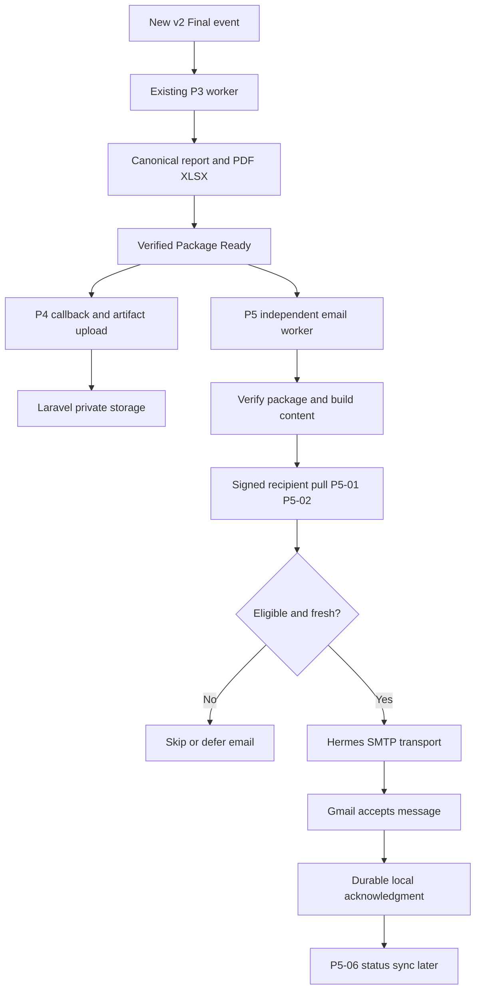
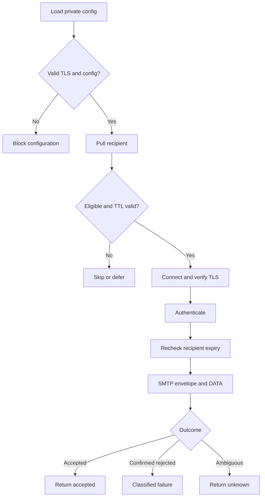
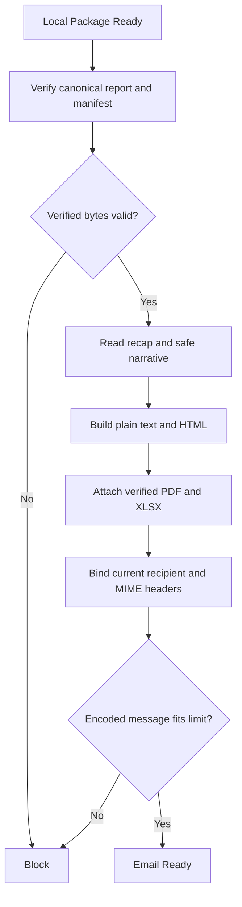
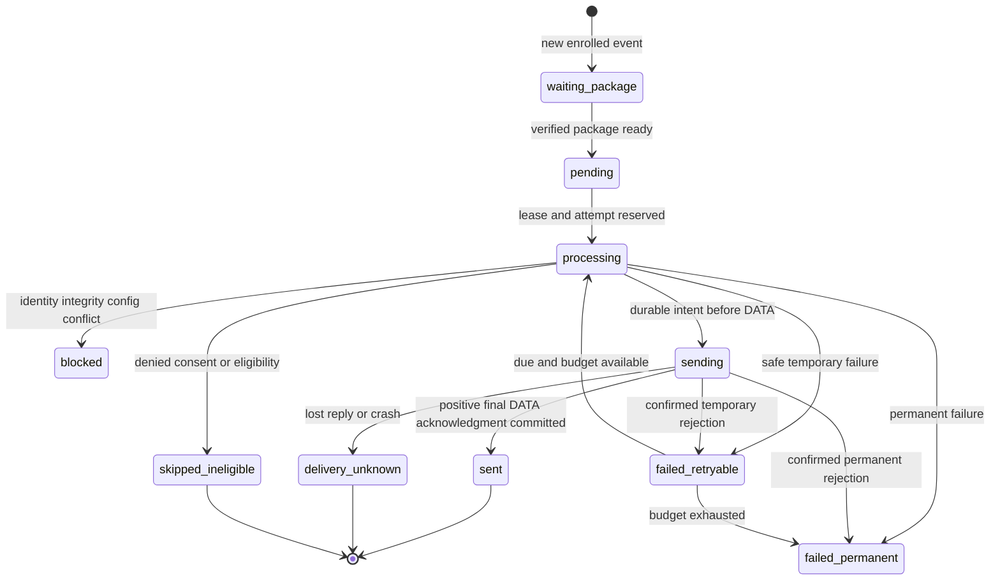
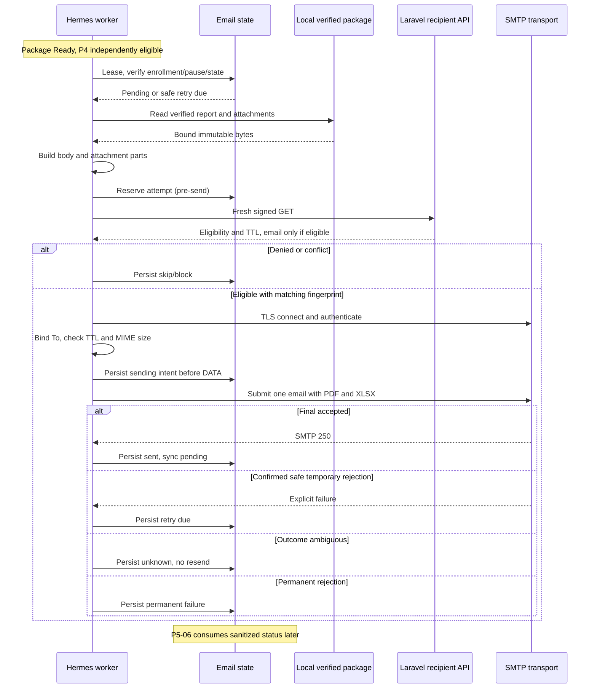
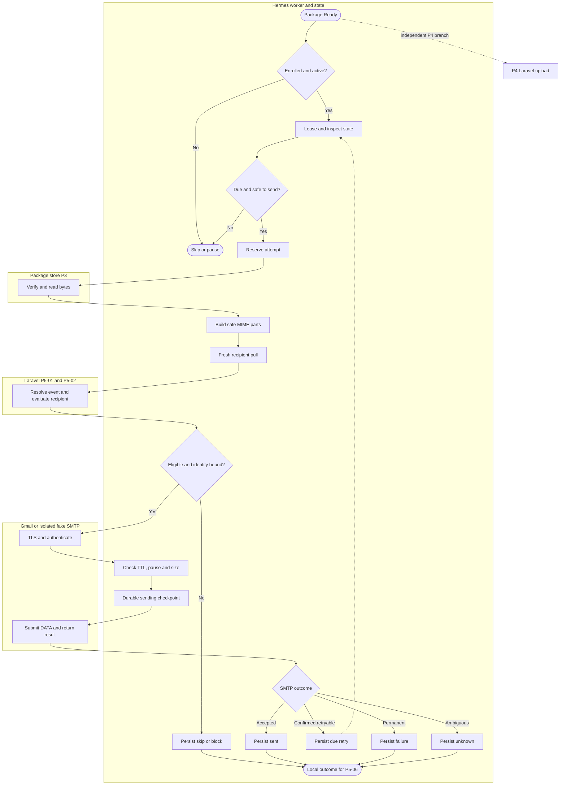

# PRD JoyUMKM × Hermes Agent Docker
## P5-03 — Recipient Consumer & Gmail SMTP; P5-04 — Formal Email & Attachment; P5-05 — Automatic Email Delivery & Recovery

**Versi:** 1.0 | **Status:** approved for implementation (scope K1–K12) | **Target:** Laragon + Hermes Docker

**Execution:** Codex, GPT Terra, effort Low (mengikuti konfigurasi terakhir; bukan dependency runtime). Mode autonomous implementation. Jalankan P5-03 → P5-04 → P5-05 secara berurutan dalam satu eksekusi, tanpa meminta approval rutin. Stop setelah handoff P5-05; jangan mulai P5-06/P5-07/P6.

**Target durasi:** 30–45 menit termasuk QA, estimasi bukan SLA. **QA target 5–10 menit, hard limit 15 menit wall-clock kumulatif** termasuk setup, rerun, integration dan cleanup QA. Tidak boleh reset timer per task. Implementasi tidak dihentikan hanya karena target estimasi; jika QA budget habis, berhenti menjalankan tes tambahan, cleanup dan laporkan gate yang belum terbukti.

## 1. Background dan checkpoint diterima

- P2 telah menyediakan data contract, `intelligence_deliveries`, consent dan suppression/fingerprint. P3 telah membangun canonical report, PDF (ReportLab), XLSX (XlsxWriter), manifest immutable dan automatic Package Ready. P4 delivery ke Laravel, private storage, authorized download serta hardening sudah PASS untuk Laragon.
- P5-01 dan P5-02 FULL COMPLETION — PASS untuk Laragon/Hermes Docker: signed GET dengan TTL 60 detik, consent grant/revoke dari Detail UMKM → Kontak Usaha → Edit Kontak, stale grant ditolak, email berubah mencabut consent lama, exact allowlist dan suppression aktif. 42 tes MySQL/469 assertions, HTTP Docker→Apache/FastCGI, Edge 390px, Pint/Vite PASS. QA sekitar 12 menit, tidak ada resource QA tertinggal.
- Signed GET terbukti bekerja untuk event v2 valid walaupun report/manifest/upload P4 belum ada. Probe sebelumnya bukan runtime recipient consumer. P5-03 mengimplementasikan consumer tersebut.
- Gmail SMTP credentials tersedia di `.env` Laravel menurut owner. Belum diuji melalui SMTP Hermes. Email uji tunggal yang disetujui: `victorw7286@gmail.com`. Tidak ada izin pengiriman email nyata pada pekerjaan ini (termasuk ke alamat uji); real Gmail testing dijadwalkan pada tahap berikutnya dengan otorisasi tersendiri.
- Production rollout masih nonaktif. P1 operational live dispatch dan hosting nonlokal nginx/PHP-FPM belum diverifikasi. Jangan membuka kembali fase yang sudah diterima untuk menutup batas yang bukan scope ini.

### 1.1 Referensi wajib

Baca source aktual dan dokumen berikut sesuai kebutuhan, jangan audit seluruh repository dari awal:

- `docs/audit/P5-01_P5-02_JoyUMKM_Recipient_Consent_Completion.md`
- `docs/evidence/p5-01-recipient-api-contract.md` (normatif untuk signed GET)
- `docs/audit/P5-02_JoyUMKM_Consent_Eligibility.md`
- `docs/evidence/p5-02-qa-summary.md`
- `docs/audit/P4-04_P4-05_JoyUMKM_Delivery_Completion.md` (bagian G, API consumption dan lock order)
- `docs/audit/P4_JoyUMKM_FINAL_COMPLETION.md` (versi final PASS Laragon)
- `docs/evidence/p3-05-manifest-contract.md`, `docs/evidence/p3-06-pipeline-contract.md`
- Source `jmi/pipeline.py`, `transport.py`, `artifacts.py`, `delivery.py`, `engine.py`, `store.py`, `callback.py`, `__main__.py` di persistent volume.

Apabila nama/path aktual berbeda, gunakan source of truth yang tersedia, dokumentasikan perbedaan. Jangan mengganti protokol yang sudah diterima. Handoff P4 terdahulu dengan verdict PARTIAL tidak mengalahkan final P4 PASS.

### 1.2 Environment

| Komponen | Nilai |
|---|---|
| Laravel repo | `C:\laragon\www\joyumkm` |
| Dev DB | `joyumkm-v2` (tidak dimutasi oleh QA ini) |
| Runtime container | `hermes-agent` |
| Persistent volume | `hermes_data` |
| JMI root | `/opt/data/joyumkm-intelligence/` |
| Default JMI_HOME | `/opt/data/joyumkm-intelligence/state` |
| Recipient config | `JMI_HOME/recipient.env` (existing, 0600) |
| SMTP config | `JMI_HOME/email.env` (baru, 0600) |
| Email state | `JMI_HOME/jobs/EVENT_ID/email_delivery.json` (usulan nama final) |

## 2. Product goals dan keputusan K1–K12

Pengguna cukup finalisasi penilaian Enam Faktor; Hermes mengolah data, membuat laporan (P3), mengirim JSON/artefak ke Laravel (P4), dan mengirim satu email formal dengan dua lampiran (P5). Trigger bukan pembukaan dashboard atau jadwal pengiriman laporan bulanan baru. Recovery hanya melanjutkan pekerjaan yang tertunda.

| ID | Keputusan disetujui |
|---|---|
| K1 | SMTP langsung dari Hermes menggunakan Python standard library (`smtplib`, `ssl`, `email.message`). |
| K2 | Provision konfigurasi SMTP existing Laravel secara privat ke Hermes; tidak memakai Laravel Mail sebagai pengirim. |
| K3 | Template formal beridentitas JoyUMKM, minimalis, responsive. |
| K4 | Isi email deterministik dari canonical report; nol AI call tambahan. |
| K5 | Satu email dengan tepat dua lampiran PDF dan XLSX asli. |
| K6 | State email durable, terpisah dari P4 `delivery.json`. |
| K7 | Initial + 3 retry aman, interval 600/1800/5400 detik. |
| K8 | Hasil SMTP ambigu tidak auto-resend. |
| K9 | Pull penerima baru setiap percobaan, TTL dan fingerprint diperiksa. |
| K10 | Jalur email independen dari callback/upload Laravel. |
| K11 | QA fake SMTP/fake clock, satu paket representatif, hard limit 15 menit. |
| K12 | Rollout nonaktif, real Gmail send ditunda. |

**Non-goals:** tidak membuat ulang generator, report schema, consent UI, migration DB, dashboard, recipient API, SMTP provider lain, n8n, bounce mailbox polling, email tracking, status callback P5-06, atau live deployment. Tidak mengubah historical report/job, tidak replay/backfill, tidak kirim ulang laporan lama. Tidak mengubah SMTP Laravel atau pepper P2.

## 3. Architecture dan dependency



- Trigger local Package Ready, not P4 acknowledgment, `report_id`, or remote storage availability. Dua jalur memiliki retry, state dan error isolation sendiri. P4 exception tidak mencegah P5 yang eligible; P5 exception tidak memblokir P4 atau mengubah analysis completed. Tidak wajib threading; sequential scheduling yang bounded diperbolehkan selama keduanya memperoleh kesempatan berjalan dan recovery independen.
- Gunakan `jmi.pipeline.get_ready_package(event_id)` dan `jmi.transport.prepare_verified_package(event_id)` sesuai signature aktual. Gunakan helper read/verify P3/P4, bukan membaca ulang file tanpa lock atau membuat renderer kedua.
- `artifact_set_hash` lokal berbeda dari `transport_artifact_set_hash` (proyeksi Laravel), `source_report_sha256` (byte report) dan `report_hash` semantik Laravel. Simpan identitas masing-masing dengan nama asli; jangan saling mengganti.
- Nama modul yang diusulkan: `jmi/recipient.py`, `jmi/email_transport.py` (boleh pisah MIME builder jika memudahkan tes), `jmi/email_delivery.py`. Perluasan minimal engine/store/CLI bila diperlukan. Tidak ada perubahan Laravel application code di scope ini; bila kontrak existing benar-benar menghalangi, dokumentasikan blocker alih-alih diam-diam memperluas scope.

## 4. P5-03 — Runtime recipient consumer

### 4.1 HTTP dan signing (kontrak existing, bukan redesign)

`GET /api/internal/intelligence/recipients/{eventId}`; canonical lowercase UUID, tanpa query/body/trailing slash. Headers:

| Header | Nilai |
|---|---|
| `X-Intelligence-Signature-Version` | `1` |
| `X-Intelligence-Timestamp` | epoch seconds UTC desimal |
| `X-Intelligence-Signature` | HMAC-SHA256 lowercase hex 64 karakter |

UTF-8 canonical bytes dipisahkan LF aktual tanpa trailing newline:

```text
JMI-RECIPIENT-V1
GET
/api/internal/intelligence/recipients/11111111-1111-4111-8111-111111111111
1795536000
```

Golden vector existing: synthetic secret `synthetic-recipient-key-0123456789abcdef` → `9cd3824ddc3e7bfdbea8d340aba12a9073ee427cff9c3786bb5b1ffb165aba0c`. Secret contoh hanya fixture, dilarang digunakan runtime. Fresh timestamp/signature pada setiap request. Toleransi Laravel 300 detik, bukan TTL izin kirim. Request dapat direplay dalam jendela ini; jangan klaim one-time token.

Load `HERMES_INTELLIGENCE_RECIPIENT_SECRET` dari `recipient.env` dengan loader aman existing. `INTELLIGENCE_RECIPIENT_BASE_URL=http://host.docker.internal` dan `INTELLIGENCE_RECIPIENT_HTTP_HOST=joyumkm.test` adalah konfigurasi Laragon yang sudah diuji. Jangan mengubah secret. HTTPS dengan sertifikat tervalidasi untuk nonlokal; HTTP hanya konfigurasi lokal yang diizinkan secara eksplisit. Host override hanya untuk alias lokal yang telah ditetapkan, tidak dari payload/response. Tidak redirect, tidak downgrade, timeout terbatas, body response dibatasi (usulan 16 KiB), strict JSON object dan duplicate key rejection; jangan log request headers, response body, URL berisi credential, alamat maupun exception mentah.

### 4.2 Validasi response

HTTP 200 eligible memiliki field `event_id`, `umkm_id`, `eligible` (boolean true), `recipient_email`, `recipient_fingerprint`, `consent_version`, `issued_at`, `expires_at`. Validasi event dan UMKM sama dengan paket, tipe field tepat, fingerprint hex 64, versi consent sesuai kontrak saat ini (`v1`), UTC ISO 8601 berakhiran Z, expiry−issued tepat 60 detik, timestamp masuk akal terhadap jam runtime, belum expired. Tolak response rusak/konflik secara fail-closed; tidak boleh fallback ke alamat dari state, report, config sender, atau akun login.

Email harus satu mailbox valid sesuai kontrak Laravel, tanpa display name injection, CR/LF/control, multiple recipient atau comma-list. Normalisasi pembandingan trim+lowercase sesuai P2, bukan menghapus plus addressing atau titik Gmail. Pepper tetap di Laravel; fingerprint diterima dari signed API via transport tepercaya, tidak dihitung dengan secret recipient. Tidak log alamat mentah atau menaruhnya di durable job data.

HTTP 200 ineligible: hanya `event_id`, `eligible:false`, `reason`; event binding tetap diperiksa. Reasons: `evaluation_not_final`, `no_consent`, `no_business_email`, `invalid_email`, `suppressed`, `not_allowlisted`. Unknown reason/malformed schema fail closed, bukan eligible. `Cache-Control:no-store` existing; jangan cache response, jangan reuse address setelah TTL.

| Hasil | Perlakuan |
|---|---|
| 400 invalid_request / 405 method_not_allowed | permanent/configuration error; operator |
| 401 unauthorized | block; clock/secret/signing review, tidak SMTP |
| 404 event_not_found | terminal skip/unsupported; tidak SMTP |
| 409 event_identity_conflict | block conflict; operator |
| 429 rate_limited / 503 atau 5xx / timeout jaringan | bounded retry/defer; tidak SMTP |
| 200 ineligible | `skipped_ineligible`, reason aman; tidak retry otomatis untuk event tersebut |
| Response invalid/identity mismatch | blocked, operator |

Pull tepat sebelum setiap attempt, termasuk retry. Siapkan body dan verified attachments terlebih dahulu supaya TTL tidak habis untuk render. Cek ulang sebelum transaksi SMTP mengirim pesan (sebelum MAIL/RCPT dan sebelum DATA jika handshake lambat). Jika expired, jangan kirim; tutup transaksi tanpa DATA dan lakukan fresh pull dalam budget attempt/retry yang bounded. Jangan menyimpan email mentah dalam checkpoint, MIME spool, dump atau evidence. Pencabutan consent setelah pull memiliki race yang tidak dapat dihilangkan sepenuhnya oleh TTL; pesan yang sudah diterima SMTP tidak dapat ditarik kembali.

### 4.3 Defense in depth testing

Laravel testing mode + allowlist tetap aktif. Provision Hermes testing guard privat dengan exact normalized allowlist yang sama (hanya `victorw7286@gmail.com` untuk dev); jangan hardcode email di Python. QA memakai allowlist override pada state terisolasi dengan synthetic mailbox bila perlu. Testing guard harus fail closed jika flag/allowlist invalid. Tidak memakai allowlist sebagai fallback recipient. Actual envelope recipient dan To wajib cocok dengan eligible response dan allowlist. Tidak CC/BCC, tidak list recipient. Jangan mengaktifkan mode non-testing.

## 5. P5-03 — Gmail SMTP transport

### 5.1 Secure configuration provisioning

Baca nilai `MAIL_*` existing dari `.env` Laravel melalui parser dotenv/config yang aman (jangan `source` atau eval file). Pertahankan quoting, spasi dan karakter password secara benar. Tidak menampilkan credential di stdout/stderr, command arguments, shell history, evidence, source control atau environment inspection dump. Transfer minimal melalui channel privat/stdin, atomic write `email.env` owner Hermes runtime mode 0600, parent directory privat, no symlink, verify permission dan equality tanpa nilai. Backup existing config jika ada ke storage privat; jangan mencampur dengan QA artifacts. Tidak menyalin seluruh `.env`, tidak mengubah mail config Laravel atau secret lain.

Contoh keys yang diusulkan (nama boleh disesuaikan loader existing, dokumentasikan final):

```dotenv
JMI_EMAIL_DELIVERY_ENABLED=0
JMI_EMAIL_DELIVERY_PAUSED=1
INTELLIGENCE_EMAIL_TEST_MODE=true
INTELLIGENCE_EMAIL_TEST_ALLOWLIST=<private owner-approved address>
MAIL_HOST=smtp.gmail.com
MAIL_PORT=587
MAIL_ENCRYPTION=tls
MAIL_USERNAME=<private>
MAIL_PASSWORD=<private>
MAIL_FROM_ADDRESS=<private>
MAIL_FROM_NAME="JoyUMKM Intelligence"
MAIL_TIMEOUT_SECONDS=30
```

Contoh port/encryption adalah rancangan STARTTLS. Gunakan konfigurasi aktual yang valid; dukung implicit TLS port 465 bila existing config memang menggunakan mode tersebut. Tidak boleh fallback plaintext, tidak autentikasi sebelum TLS. Untuk Gmail dev allowlist host provider yang tepat, test fake transport injected secara eksplisit pada QA terisolasi, bukan config produksi. `MAIL_FROM_ADDRESS` harus sender authorized sesuai SMTP account/alias; jangan menebak alias atau mengganti sender jika tidak cocok. Jika credentials invalid atau tidak lengkap, fail closed dan laporkan; real authentication belum diuji dalam task ini.

### 5.2 Transport contract

Python `smtplib`, `ssl.create_default_context()` dengan hostname/cert verification, `EmailMessage`. Gmail 587: connect → EHLO → mandatory STARTTLS → EHLO → AUTH → envelope → DATA. Gmail 465: TLS dari awal → EHLO → AUTH. Bounded connect/read/write timeout dan deadline total, cleanup socket pada error. Tidak retry tersembunyi di transport; orkestrator yang memiliki retry budget. Jangan log SMTP debug transcript, exception/response mentah (dapat mengandung alamat), credential atau body.

Transport mengembalikan typed outcome, sanitized error code, phase SMTP, accepted timestamp bila sukses. `sent` hanya setelah final positive DATA acknowledgment (umumnya 250); bukan inbox delivery, bounce tracking atau read receipt. Failure QUIT setelah final acknowledgment tidak membatalkan accepted outcome. Jangan menggunakan sukses AUTH/RCPT sebagai bukti sent.

| Fase/hasil | Outcome |
|---|---|
| Connect/handshake failure sementara yang pasti belum DATA | retryable safe |
| TLS certificate/hostname invalid, STARTTLS tidak tersedia, invalid config | permanent/block; tidak downgrade |
| AUTH rejected | permanent/configuration, operator |
| MAIL/RCPT rejection eksplisit 4xx | retryable safe |
| MAIL/RCPT rejection eksplisit 5xx | permanent |
| DATA command/final reply eksplisit 4xx yang membuktikan pesan ditolak | retryable safe |
| DATA command/final reply eksplisit 5xx yang membuktikan pesan ditolak | permanent |
| DATA final 250 accepted | sent |
| Timeout/disconnect/crash ketika body mungkin telah diserahkan dan final response tidak diketahui | delivery_unknown; tidak auto-resend |

Jangan otomatis memasukkan suppression karena general SMTP error; P2 suppression tetap sumber otorisasi dan pengelolaannya bukan scope ini. Error ambigu tidak boleh diklasifikasikan retryable berdasarkan jenis exception saja. Implementasikan phase tracking yang membedakan sebelum DATA dan final acknowledgment; bila tidak dapat dibuktikan aman, pilih unknown. Tidak klaim exactly-once SMTP.



## 6. P5-04 — Email builder dan verified attachments

### 6.1 Input dan integritas

Ambil package melalui helper existing. Pastikan report canonical tervalidasi dan sama dengan `source_report_sha256`; dua verified byte buffers PDF/XLSX sesuai manifest, event, evaluation, UMKM, period, MIME, size dan SHA-256. Jangan verify path lalu buka kembali file tanpa perlindungan; gunakan byte yang diverifikasi dari helper under lock. Jika helper tidak menyediakan report bytes, ambil canonical bytes lewat validator/lock existing dengan binding hash sebelum memproses; jangan membuat sumber baru. Lepas source/render locks sebelum network. Batas file masing-masing 10 MiB existing, tidak diperbesar. Tolak package invalid, missing, conflict, format/identity mismatch; jangan generate ulang atau diam-diam mengganti committed manifest.

Canonical report schema aktual adalah sumber skor/narasi; jangan hardcode contoh 24/30 atau skala INS/ECT/OPS. Pakai data rekap deterministik P3-02, bulan WIB `period_month`, current sampai cutoff, previous month, delta dan arah. Data hilang tampil `Belum tersedia` atau tanda pisah dengan penjelasan; jangan ganti null dengan nol atau mengarang kesimpulan. Narasi ringkas berasal dari field tervalidasi, potong aman tanpa mengubah fakta, tidak memanggil model. Jangan menyalin PII yang tidak diperlukan dari report; sanitasi dan escape markup, header dan filenames.

### 6.2 Template formal (approved visual direction)

- Subject: `Laporan Evaluasi dan Perkembangan UMKM — {Bulan Tahun}` dengan referensi laporan aman bila diperlukan. Date dalam email human-readable WIB; MIME Date valid. Tidak memakai recipient raw/email pada subject atau filename.
- Header JoyUMKM, subtitle `INTELLIGENCE REPORTING`, navy `#101E40`, primary `#0207CA`, secondary `#0297DE`; latar neutral, hierarki teks jelas, inline styles/table layout kompatibel email client; mobile responsive, tidak bergantung remote fonts/images atau script. Poppins boleh fallback sans-serif; tidak embed font besar.
- Sapaan `Yth. Pengelola {nama UMKM},` jika nama aman tersedia, fallback `Yth. Pengelola UMKM,`.
- Pembuka formal: menyampaikan laporan evaluasi dan perkembangan berdasarkan penilaian JoyUMKM pada periode tersebut.
- Ringkasan Enam Faktor (sebelumnya, berjalan, perubahan) dan Tiga Dimensi INS/ECT/OPS (skor dan delta jika tersedia), konsisten dengan canonical report. Label unit sesuai data aktual.
- Ringkasan analisis dan pengantar rekomendasi/rencana tindak lanjut 30/60/90 hari yang lengkap di lampiran. Tidak menambah diagnosis atau penilaian yang tidak ada.
- Penutup `Hormat kami, JoyUMKM Intelligence`, footer laporan otomatis berdasarkan data yang tersedia. Tidak mengklaim audit keuangan/kelayakan kredit resmi.
- Plain text fallback memuat fakta dan konteks yang sama, bukan sekadar tautan. Tanpa tracking pixel, remote asset, JavaScript, iframe, form, atau tautan yang diinjeksi dari narasi.

Illustrative layout (angka tidak ditanam dalam template):

```text
JOYUMKM | INTELLIGENCE REPORTING
Laporan Evaluasi dan Perkembangan Usaha
Periode: [bulan WIB] • Referensi: [report reference]

Yth. Pengelola [nama UMKM],
[pembuka formal]

Enam Faktor: [sebelumnya] → [berjalan] ([delta])
INS [nilai/delta] | ECT [nilai/delta] | OPS [nilai/delta]

Ringkasan analisis: [narasi canonical yang aman]
[penjelasan dua lampiran dan tindak lanjut]

Hormat kami,
JoyUMKM Intelligence

Lampiran: JoyUMKM_Report_YYYY-MM.pdf
          JoyUMKM_Report_YYYY-MM.xlsx
```

### 6.3 MIME contract

Satu message `multipart/mixed`, body `multipart/alternative` plain text dan HTML UTF-8, tepat dua attachment:

| Kind | MIME | Filename usulan |
|---|---|---|
| pdf | `application/pdf` | `JoyUMKM_Report_YYYY-MM.pdf` |
| xlsx | `application/vnd.openxmlformats-officedocument.spreadsheetml.sheet` | `JoyUMKM_Report_YYYY-MM.xlsx` |

Content-Disposition attachment; filenames dibentuk dari period tervalidasi, tidak dari user path. Encode bytes via stdlib, tidak memodifikasi decoded attachment. Uji SHA-256 decoded MIME sama persis dengan manifest. `From` trusted config, `To` eligible current recipient, `Message-ID` deterministic dan disimpan dalam state sebelum send. Header injection dicegah. Jangan persistenkan serialized MIME karena mengandung email dan isi laporan.

Batas total message setelah MIME/base64 dan CRLF serialization wajib diukur sebelum DATA. **Default konservatif usulan implementasi: 24.000.000 bytes encoded, configurable downward, serta periksa SMTP advertised SIZE jika tersedia.** Bukan klaim batas resmi Gmail; sesuaikan limit provider aktual sebelum real UAT. Kedua file 10 MiB dapat melampaui cap setelah base64. Oversize → blocked/permanent safe error; tidak mengirim satu lampiran saja, tidak split mail, tidak membuat public link, tidak mengecilkan/re-render file. Batasi memory dengan ukuran sumber dan serialization bounded, jangan simpan salinan di disk sembarangan.



## 7. P5-05 — Automatic email delivery & recovery

### 7.1 Enrollment, scheduling and isolation

- Add durable `email_delivery` enrollment for newly received eligible v2 jobs when `JMI_EMAIL_DELIVERY_ENABLED=1`. This is rollout eligibility, not recipient consent. Existing pipeline enrollment/readiness is required; P4 delivery enrollment or remote acknowledgment is not required. Duplicate intake preserves original enrollment. Never retrofit historical jobs, v1 jobs, archived/unmatched jobs, or previously non-enrolled v2 jobs. Do not create email state for these jobs during recovery.
- Global flag defaults off. Separate pause/kill switch (`JMI_EMAIL_DELIVERY_PAUSED` or private `JMI_HOME/email.pause`, following existing convention) blocks new SMTP sends/retry while preserving state. Recheck immediately before the irreversible send boundary. Pause cannot recall an in-flight SMTP submission; persist its actual outcome. Missing/invalid rollout config must fail closed. Keep all production flags off on handoff.
- Integrate with existing `engine.process` and `engine.recover` after local Package Ready; no duplicate daemon/cron/queue. A bounded recovery pass considers due enrolled jobs, respects cooldown, and avoids starvation by unrelated failed P4 work. Never run AI or generator as a side effect of email retry. Reuse immutable committed artifacts. `waiting_package` can be reconciled once existing pipeline becomes ready; no email-driven rendering.
- Use independent per-event lease e.g. `.email_delivery` and atomic state update, following existing private state conventions. Define lock order consistent with P3/P4; no holding P4 delivery lease or renderer locks across network. Serialize sends per event. If another worker owns lease, skip/defer without incrementing attempts. No in-memory-only deduplication. Persist state before network mutation and after outcome. Use atomic replace, fsync file and directory where supported, bounded parser, private file mode 0600, owner runtime; reject symlinks/hardlinks/path traversal using existing store mechanisms.

### 7.2 Durable state contract

`JMI_HOME/jobs/EVENT_ID/email_delivery.json`, schema version 1. Suggested fields (adapt to actual code conventions, document exact final schema):

```json
{
  "schema_version": 1,
  "event_id": "11111111-1111-4111-8111-111111111111",
  "channel": "email",
  "status": "sent",
  "attempt_no": 1,
  "recipient_fingerprint": "<64 lowercase hex>",
  "consent_version": "v1",
  "artifact_set_hash": "<local package hash>",
  "transport_artifact_set_hash": "<Laravel projection hash>",
  "source_report_sha256": "<report byte hash>",
  "idempotency_key": "<stable local identity>",
  "message_id": "<deterministic opaque id at configured domain>",
  "sent_at": "2026-11-24T16:00:00Z",
  "next_retry_at": null,
  "error_code": null,
  "status_sync": "pending",
  "updated_at": "2026-11-24T16:00:00Z"
}
```

Placeholders are illustrative, not valid fixture values. Bind state to event and verified package, reject identity conflicts. Preserve original fingerprint once first eligible authorization obtained; subsequent pull must match fingerprint and consent version; ineligible response stops sending. Never automatically redirect retry to another address even if newly consented. A same-address revoke/regrant between pulls may be undetectable using existing v1 contract; do not claim otherwise. First valid recipient may be bound after earlier pull failures without a fingerprint. Never persist raw email, SMTP auth data, message body, raw provider response, or recipient API response. Prefer bounded state (e.g. 8–16 KiB), stable error enums and UTC timestamps. `sent_at` only if accepted; not invented provider message ID. Durable status-sync handoff is local only until P5-06.

Idempotency identity includes event_id + channel=email + recipient_fingerprint + local artifact_set_hash (use existing P2 idempotency contract when compatible; retain both hashes to map later). Deterministic Message-ID derived from stable opaque hash, no recipient address, reused across safe attempts; choose configured safe domain (do not invent provider identity). For one event, sent/unknown or recipient conflict is sticky even if recipient or package changes. Do not start a second state with different fingerprint. Message-ID and local key do not cause Gmail SMTP server-side exactly-once delivery.

### 7.3 Status machine and crash boundary

| State | Meaning / next action |
|---|---|
| `waiting_package` | Enrolled, waiting for locally verified package |
| `pending` / `queued` | Ready for first attempt; define mapping for P5-06 |
| `processing` | Preparation/pull/handshake, no message submission possible yet |
| `sending` | Durable pre-DATA intent, SMTP acceptance could become ambiguous |
| `sent` | Final positive DATA reply and durable acknowledgment; terminal automatic send |
| `failed_retryable` | Confirmed safe failure; retry only when due |
| `failed_permanent` | Non-retryable or budget exhausted; operator |
| `skipped_ineligible` | Consent/eligibility denied; terminal for event |
| `delivery_unknown` | SMTP might have accepted; no automatic retry |
| `blocked` / `recipient_changed` | Integrity/config/identity conflict; operator review |

Exact state names can follow existing conventions but preserve distinctions; P5-06 schema compatibility is handoff, not new migration here. Pause is an operational gate, not a mutation that erases terminal status.

Persist attempt reservation before first network request in attempt, to prevent crash resetting retry budget; a pull error consumes a bounded attempt slot even if SMTP not reached (document `attempt_no` versus actual submission count). Persist `processing` for preparation and `sending` immediately before DATA submission can begin. Never send DATA if checkpoint persistence fails. Recheck pause/TTL before DATA. On final 250, persist `sent` promptly before any optional network operation (e.g. QUIT) where practical; acknowledgment is not rolled back by later QUIT failure. If disk failure prevents durable acknowledgment, existing sending intent remains conservative unknown; no auto-resend. An interrupted `processing` state proven pre-DATA may recover safely within budget. An interrupted `sending` state cannot prove non-acceptance and transitions to `delivery_unknown` on recovery. Even crash before DATA after intent is conservatively unknown. If state unreadable, missing after previously established durable send history, or inconsistent, fail closed; do not blindly recreate and resend. Document limits of local state loss/backup rollback; no exactly-once claim under destruction of all durable evidence.



### 7.4 Retry budget

Initial attempt + maximum three safe retries: 600, 1800, 5400 seconds measured from previous retryable failure. Persist due UTC timestamp, attempts, sanitized error. Use existing clock injection or small clock abstraction; QA fake clock, no real cooldown sleep. Retry never bypasses lease, rollout, pause, eligibility, current TTL, bound fingerprint, package verification or size guard. Fresh signed request per attempt. No unbounded immediate retry loop. Use bounded transport timeouts, capped attempts; exhausted becomes failed_permanent with safe error code. For blocked or unknown, no automatic re-enrollment. No CLI generic force-send or unknown reset. Operator tools may expose sanitized read-only `email-status` and safe retry/resume for provably pre-send failures within explicit policy; do not implement resend of sent/unknown/recipient-changed states. If manual reconciliation needed, document procedure as pending policy, not an automatic feature.

### 7.5 Handoff for status synchronization (P5-06)

Maintain durable local outcome and `status_sync` metadata (pending when outcome changes, separate from send state). Expose sanitized projection: event, channel, state, attempt, fingerprint nullable for ineligible, local/transport artifact hashes, deterministic Message-ID, actual accepted timestamp, occurred_at, safe error code. No raw email. Record exact constraints/ordering and how P5-06 may reconcile `delivery_unknown` and statuses unsupported by P2. P5-06 will implement HMAC status callback, remote mapping, independent retry/status sync and DB schema adjustment if justified. Do not implement HTTP status callback here; failed/not-implemented sync never triggers SMTP resend. If Laravel report absent, keep local outcome; SMTP must not require remote report or manifest registration.

## 8. Combined flow and activity diagrams



Activity diagram (swimlane-style flowchart; parallel logical channels, not a promise of threads):



## 9. QA and acceptance criteria

### 9.1 Bounded QA plan

Hard limit 15 minutes for all QA activities in this combined task. Record monotonic wall-clock start/end for QA including setup, reruns, cleanup. Suggested allocation: 4 min focused unit tests, 4 min representative integration, 2 min recovery and privacy checks, 2 min deployment verification and cleanup, 3 min reserve. If time budget insufficient, prioritize mandatory security tests and truthful status. Do not skip mandatory acceptance criteria silently.

Use one isolated synthetic event/package derived from existing valid P3/P4 QA evidence; create a new isolated fixture identity only if existing fixture supports it without mutating committed package. Do not replay live data. Use local fake SMTP with captured MIME and phase-aware fault stubs, no Gmail connection/auth/send. Actual TLS trust validation can be tested using controlled fake context/local TLS fixture; no weakening production SSL. Use fake clock for TTL and retry. QA config and allowlist separate from real credentials. Use existing Hermes image/container or one shared test runner with isolated state; one shared MySQL/Laravel QA service only if necessary for representative signed GET, no new stack per test. Reuse P5-01 real HTTP evidence but run one runtime consumer signed GET probe against isolated Laravel if feasible within budget (not fake API alone for acceptance of runtime interoperability). Event without remote report/upload is the intended representative case. Capture SMTP message only for synthetic data in memory or private temporary file, strip email/PII from permanent evidence. No real SMTP network traffic.

Run only tests for new modules and directly changed integration hooks plus minimal P4 targeted non-regression where hooks changed. Existing P5-01/02 42 tests, full historical Hermes 158 ×2, P4 fault injection A–W, P3 generator QA, five-package matrix, and broad migration/HTTP security matrix are not to be repeated without a concrete changed contract. Recovery proof: one restart or process replacement using same isolated state, covering sent checkpoint and ambiguous intent by focused fixture; do not create a new Docker container per case.

### 9.2 Acceptance matrix (all mandatory for local FULL PASS)

| ID | Testable gate | Minimum evidence |
|---|---|---|
| AC-01 | Private SMTP config copied without leaking secrets; mode/owner correct; no Laravel SMTP change | Boolean config/equality/permissions, malformed config fails closed |
| AC-02 | P5-01 signer and runtime recipient pull match contract | Golden vector + actual Docker→isolated Laragon signed GET, no report/upload required |
| AC-03 | Strict recipient/event/UMKM identity, expiry and fingerprint | Expired/malformed/mismatched responses reject; fresh pull on retry, change/revoke stops send |
| AC-04 | Formal HTML + plain text | Parse MIME, escaped HTML, UTF-8, no remote assets or header injection |
| AC-05 | Canonical values and null semantics | Compare selected current/previous/delta metrics and absent-history case to fixture; no invented scores |
| AC-06 | Two exact PDF/XLSX attachments | Captured decoded MIME sizes and SHA match manifest, no extra attachment |
| AC-07 | Encoded size cap | Oversize rejected before DATA, both attachments retained on valid case |
| AC-08 | Automatic worker path | Enrolled synthetic event with Package Ready invokes email path without manual send command |
| AC-09 | Independent channels | Fake failure P4 does not stop email; email failure does not stop P4; no analysis state rewrite |
| AC-10 | Retry bounded and due times correct | Fake clock 600/1800/5400, max 4 attempts, no busy loop |
| AC-11 | Duplicate/concurrent intake and delivery | Lease/state prevents extra send after accepted; concurrent same event test |
| AC-12 | Ambiguous SMTP failure | Lost final reply or crash at send boundary becomes unknown, no automatic resend |
| AC-13 | Durable recovery | Restart/read persisted state, sent reused and sending intent stays unknown; no AI/render |
| AC-14 | Historical isolation and rollout | Legacy/archived/non-enrolled no state/send; pause/off guard blocks new attempts |
| AC-15 | Privacy and secure transport | TLS enforced, credentials and recipient raw absent from logs/state/evidence; no redirect/plaintext downgrade |
| AC-16 | Testing allowlist | Deny non-allowlisted recipient and fail closed on invalid/missing dev allowlist |
| AC-17 | Persistent deployment | Backup and SHA-256 verification of changed runtime modules/tests, flags off, existing production job state untouched |
| AC-18 | QA budget and cleanup | Measured wall-clock ≤15 min, no task-owned resources left, evidence/handoff complete |

SMTP transport representative fault table: transient pre-DATA failure; explicit permanent AUTH/rejection; final positive accepted; final reply lost; QUIT failure after accepted; invalid TLS; expired recipient before DATA. Cover with parameterized/unit tests where possible; no many-container matrix. Confirm failed/ineligible recipient doesn't call SMTP. Confirm attempts and status are sanitized. Test invalid package or changed hash without re-render. A known baseline failure must be identified, not silently deleted or weakened. No need to rerun historical suites just to obtain a zero-regression claim: scope claim to targeted regression actually performed.

### 9.3 Docker cleanup (mandatory even on failure)

Inventory containers/networks/volumes before QA. Use clear owner labels/names for any temporary resources. Prefer no new containers or at most two Hermes QA containers, one MySQL, one Laravel and one QA network if needed. Reuse resources; no container per test. Cleanup only identified task-owned temporary resources, anonymous volumes proven owned by those QA containers, HTTP listener/browser/temp state if created. Save relevant sanitized evidence first. Preserve `hermes-agent`, `hermes-webhook-proxy`, `hermes_data`, `joyumkm-p0-mysql`, and all unrelated project resources. No global prune or wildcard deletion. Report before/after inventory and exact removals; existing inventory last observed 16 containers, 7 volumes, 4 networks, recheck actual rather than assume.

## 10. Deployment and deliverables

1. Inspect existing source/contracts, confirm environment and scope. Implement recipient/config/SMTP transport P5-03.
2. Implement formal builder, verified attachment consumption, MIME size guard P5-04.
3. Implement independent enrollment/state/lease/worker/recovery P5-05. Complete focused tests and bounded representative flow.
4. Provision minimal SMTP config privately and deploy verified code/tests into persistent `hermes_data:/joyumkm-intelligence/`, not ephemeral container filesystem. Backup previous changed source with timestamp and SHA-256; verify final deployed file hashes and runtime user read access. Do not restore stale job state from a source backup. Do not restart service unnecessarily; if runtime reload needed, use approved local safe mechanism with rollout still disabled and document it. Production job state must not be changed; compare appropriate pre/post checksums excluding intentionally added private config and backup paths. No live dispatch.
5. Cleanup all temporary QA resources. Final handoff and stop.

Files in Laravel repo (documentation and QA evidence only):

- `docs/audit/P5-03_JoyUMKM_Recipient_SMTP_Transport.md`
- `docs/audit/P5-04_JoyUMKM_Email_Template_Attachment.md`
- `docs/audit/P5-05_JoyUMKM_Automatic_Email_Delivery_Recovery.md`
- `docs/audit/P5-03_P5-05_JoyUMKM_Email_Engine_Completion.md`
- `docs/evidence/p5-03-smtp-recipient-contract.md`
- `docs/evidence/p5-05-email-delivery-contract.md`
- `docs/evidence/p5-05-qa-summary.md`

Runtime Python in persistent Hermes `jmi/`; tests in `tests/`; private settings in `state/`; runtime backups under `backups/`. Do not place live SMTP credentials or runtime Python in Laravel source tree. Keep QA scripts only where necessary, no redundant raw logs or captured email PII. If existing documentation filenames are reused, update rather than duplicate.

Consolidated handoff: per-task verdict, AC-01..18 results, actual paths/config key names (no values of secrets), signer/MIME/size policy, SMTP phase/error mapping, local schema/lease/rollout/retry, proof of no resend after acknowledgment/ambiguous crash, exact hash distinctions, deployment backup/SHA and cleanup, elapsed QA, NOT RUN limitations, P5-06 sanitized status projection and P2 mapping issues. Include small diagrams or link this PRD. Explicitly mark real Gmail SMTP acceptance, inbox delivery, nonlocal hosting and real AI/live dispatch NOT RUN. No claim of actual delivery to inbox from fake SMTP.

## 11. Completion gates and hard scope constraints

- **P5-03 FULL COMPLETION — PASS** for local implementation when private configuration, signer/recipient consumer, verified TLS transport and phase-aware SMTP outcomes pass isolated QA. Gmail live authentication/submission remains NOT RUN per approved scope, not a claim of production readiness.
- **P5-04 FULL COMPLETION — PASS** when deterministic formal email and exact two verified attachments, null handling, MIME safety and size cap pass.
- **P5-05 FULL COMPLETION — PASS** when automatic independent delivery, durable enrollment/state, bounded retry, crash recovery, no auto-resend on ambiguity, privacy, allowlist, persistent deployment and QA cleanup pass.
- **P5-03 & P5-04 & P5-05 OVERALL — PASS** only if all mandatory gates pass for local scope. P5 overall remains incomplete until P5-06 and P5-07. If gate unverified or failed, report PARTIAL/FAIL honestly with concrete reason and next action; no false PASS to meet time budget. Do not stop at preflight when implementation is authorized and feasible.

Keep `HERMES_WEBHOOK_ENABLED=false`, `JMI_ARTIFACT_PIPELINE_ENABLED=0`, `JMI_ARTIFACT_DELIVERY_ENABLED=0`, `JMI_EMAIL_DELIVERY_ENABLED=0`; verify actual equivalent pause configuration. No real SMTP/email, no real AI, no backlog, no historic replay, no regenerate committed artefacts, no DB dev fixture mutation, no migration, no consent/pepper changes, no Laravel application source changes, no commit/push, no git reset/clean, no global Docker cleanup, no P5-06/P5-07/P6. Do not expose secrets. No extra PRD or approval loop.

**Design clarifications added to the approved overview:** SMTP message cap 24,000,000 encoded bytes is a conservative local default pending actual provider verification; Hermes-side exact allowlist and independent pause are defense-in-depth; durable pre-DATA intent deliberately favors avoiding duplicate mail over retry when acceptance cannot be proven; pending status-sync projection preserves both artifact hashes. Actual source conventions may refine names, not weaken these invariants.

**END — STOP after P5-05 handoff.**
