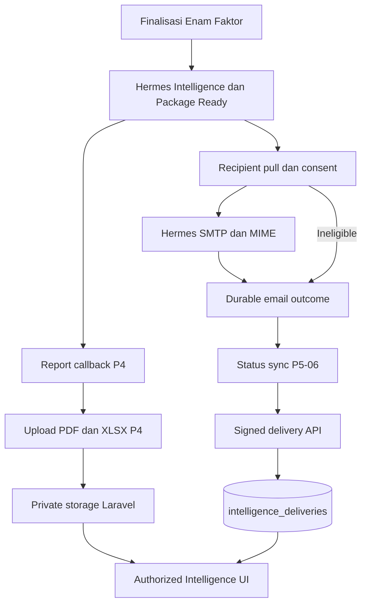
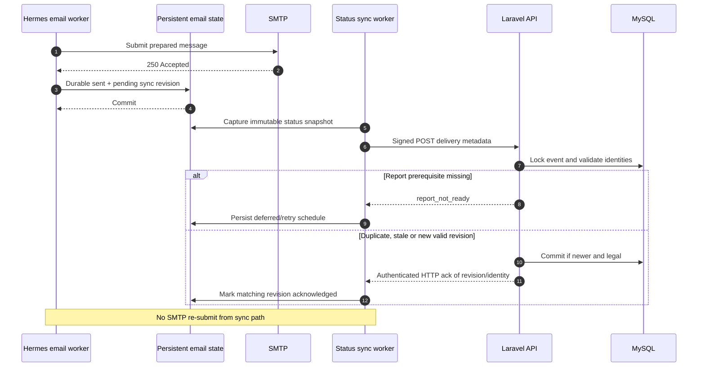
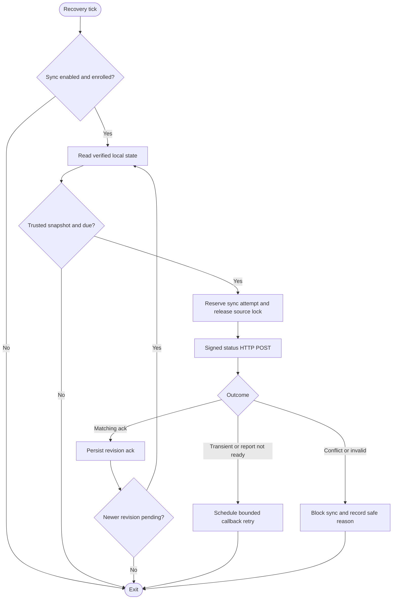
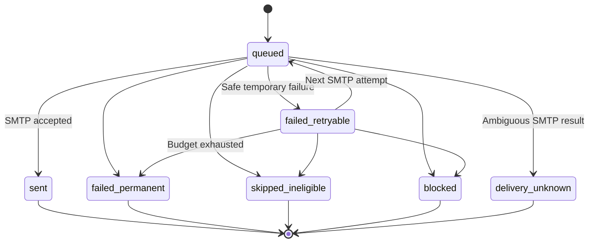
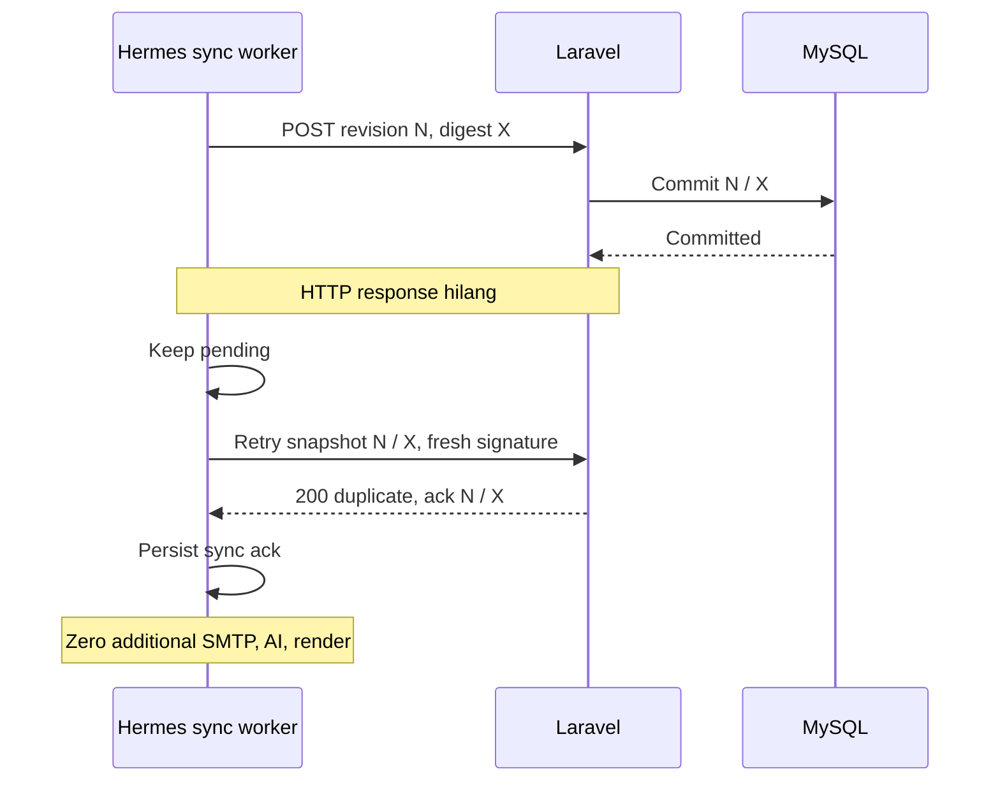

# PRD JoyUMKM × Hermes — P5-06 & P5-07

**Versi:** 1.0 | **Status:** Approved scope, ready for implementation | **Tanggal:** 25 November 2026 (WIB)

**Target:** Laragon (Apache/PHP FastCGI, Laravel, MySQL) + Hermes Agent Docker.  
**Mode:** implementasi otonom satu kali eksekusi, bukan audit-only atau rangkaian approval rutin.  
**Estimasi:** 15–25 menit jika lancar; QA target 5–10 menit, hard limit kumulatif 15 menit. Estimasi bukan jaminan.

## 0. Instruksi eksekusi untuk coding agent

Implementasikan P5-06 dan P5-07 secara berurutan sampai Definition of Done. Gunakan source aktual sebagai otoritas untuk nama class, routing, schema, API resources, loader, dan lock. Lakukan preflight singkat lalu langsung implementasi; jangan berhenti pada audit atau meminta approval untuk keputusan rutin yang sudah disetujui. Laporkan blocker nyata dan lanjutkan pekerjaan independen yang aman. Jangan mengklaim PASS tanpa bukti.

- Repo Laravel: `C:\laragon\www\joyumkm`. Dev DB `joyumkm-v2`; QA MySQL terisolasi `joyumkm_testing` setelah guard nama/koneksi. UTC untuk DB, WIB untuk tampilan. Jangan gunakan SQLite sebagai substitusi MySQL.
- Runtime Hermes: `hermes-agent`, `hermes_data:/joyumkm-intelligence/` → `/opt/data/joyumkm-intelligence/`; `JMI_HOME=/opt/data/joyumkm-intelligence/state`. Source Python `jmi/`, tests `tests/` di volume persisten. Jangan menjadikan scratchpad host atau folder dokumentasi Laravel sebagai runtime Hermes.
- Pertahankan perubahan Git existing. Tidak ada commit, push, reset, clean, destructive migration, replay/backfill, atau pemrosesan backlog. Jangan mengubah data bisnis/histori untuk QA. Jangan menjalankan PHP Artisan Tinker.
- Semua rollout tetap off: `HERMES_WEBHOOK_ENABLED=false`, `JMI_ARTIFACT_PIPELINE_ENABLED=0`, `JMI_ARTIFACT_DELIVERY_ENABLED=0`, `JMI_EMAIL_DELIVERY_ENABLED=0`, `JMI_EMAIL_DELIVERY_PAUSED=1`; pertahankan pause marker dan guard existing. Status sync juga off saat handoff. Jangan start worker/scheduler live, register cron duplikat, atau melakukan restart layanan yang bisa memicu backlog.
- Real Gmail AUTH/send, inbox delivery, real AI, live dispatch, hosting nonlokal/nginx/PHP-FPM berada di P6 atau verifikasi deployment terkait. **Tidak ada pengiriman email nyata pada P5-06/P5-07.** Allowlist pengujian yang sudah disetujui tetap privat (`victorw7286@gmail.com`); jangan hardcode ke source, fixture publik atau evidence. Gunakan mailbox sintetis untuk QA.
- Reuse satu paket sintetis P3/P4 yang sah; jangan render PDF/XLSX, menarik snapshot historis, atau memanggil AI ulang. Jangan mengulang full suite historis. Jalankan targeted regression yang relevan dengan perubahan, fake clock untuk cooldown, SMTP stub/fake transport; cleanup scoped wajib termasuk saat gagal.
- Stop setelah P5-07. Jangan mulai P6. Handoff harus membedakan PASS lokal, NOT RUN, dan risiko yang benar-benar belum ditutup.

## 1. Dasar dan checkpoint yang diterima

| Fase/task | Checkpoint |
|---|---|
| P0–P2 | Audit, stabilisasi dengan pengecualian historis diterima, schema/kontrak data dan UTC dev PASS. |
| P3 | Snapshot, canonical report, PDF, XLSX, immutable manifest, Package Ready PASS. |
| P4 | Signed JSON callback, upload PDF/XLSX, private storage, integrity, authorized download, HTTP Laragon dan hardening PASS. |
| P5-01/02 | 42 tes MySQL/469 assertions; 16/16 AC. Recipient GET HMAC `JMI-RECIPIENT-V1`, TTL 60s, consent grant/revoke, stale grant protection, suppression dan private allowlist PASS. |
| P5-03/04/05 | 18/18 AC, 65 tes Hermes + 7 rerun terarah pada versi akhir, QA utama 676s. Runtime volume persisten, MIME dua lampiran identik, email recovery dan independensi P4 PASS lokal. |

Sumber handoff di repo:

- `docs/audit/P2_JoyUMKM_FINAL_COMPLETION.md`, `docs/evidence/p2-data-contract.md` (inspeksi schema aktual sebelum mengubahnya).
- `docs/audit/P4_JoyUMKM_FINAL_COMPLETION.md`, `docs/evidence/p4-03-callback-manifest-contract.md`, kontrak status/download P4-06, dan hardening P4-07 final.
- `docs/audit/P5-01_P5-02_JoyUMKM_Recipient_Consent_Completion.md`, `docs/evidence/p5-01-recipient-api-contract.md`.
- `docs/audit/P5-03_P5-05_JoyUMKM_Email_Engine_Completion.md`, `docs/evidence/p5-03-smtp-recipient-contract.md`, `docs/evidence/p5-05-email-delivery-contract.md`, `docs/evidence/p5-05-qa-summary.md`.
- PRD sebelumnya P5-01/02 dan P5-03/05.

Fakta handoff: SMTP aktual adalah implicit TLS port 465; kredensial sudah diprovisi ke `state/email.env`, recipient secret di `state/recipient.env`, keduanya mode 0600 dan milik UID Hermes. **Jangan melakukan provisioning SMTP ulang, mengubah pepper atau mengubah consent yang ada.** SMTP nyata belum diverifikasi. State SMTP versi 1 sudah menyimpan `status_sync=pending` sebagai penanda, tetapi belum ada callback status. `python -m jmi email-status EVENT_ID` adalah proyeksi lokal yang disanitasi. Lease email dan durable `sending`/`sent`/`delivery_unknown` telah dibangun.

Catatan: source code runtime dan migration aktual belum diperiksa oleh penyusun PRD ini. Nama endpoint/config berikut adalah kontrak implementasi yang ditetapkan dalam rancangan, bukan klaim fitur sudah tersedia. Periksa constraint aktual dan lakukan perubahan aditif minimal; dokumentasikan penyimpangan kompatibilitas tanpa mengubah prinsip bisnis.

## 2. Keputusan owner K1–K10 (disetujui)

| ID | Keputusan |
|---|---|
| K1 | Reuse `intelligence_deliveries` P2. |
| K2 | Signed status callback dengan autentikasi, timestamp, identity binding, dan proteksi replay. |
| K3 | Perubahan schema aditif minimum untuk status baru dan metadata sinkronisasi yang diperlukan. |
| K4 | Retry status callback independen dari retry SMTP. |
| K5 | Callback duplicate/stale tidak merusak status terbaru. |
| K6 | Email independen dari upload Laravel. |
| K7 | Tampilkan status email pada Intelligence Reporting existing. |
| K8 | Tidak ada halaman baru atau tombol resend manual. |
| K9 | Satu paket representatif, QA maksimal 15 menit kumulatif, mandatory cleanup. |
| K10 | Real Gmail, real AI, live dispatch dan aktivasi tetap P6. |

## 3. Objective dan non-goals

Setelah Hermes mencatat outcome email, Laravel menerima proyeksi metadata terautentikasi, mengikatnya ke event yang sah, menyimpan status terbaru tanpa duplikasi atau regresi, dan menyajikannya pada UI terotorisasi. Jika status callback gagal, Hermes memulihkan **sinkronisasi saja**; tidak pernah mengulang pengiriman SMTP karena callback gagal. Jika email telah diterima SMTP sebelum report masuk Laravel, outcome lokal tetap durable dan sinkronisasi dapat ditunda. Status `sent` hanya berarti server SMTP menerima pesan, bukan inbox atau read receipt.

Non-goals: pembangunan ulang SMTP, consent, recipient pull, analisis, renderer, manifest atau P4; perubahan trigger Enam Faktor; Gmail API/bounce listener/automatic suppression dari SMTP; resend/reconciliation SMTP manual; dashboard baru; penjadwalan email bulanan; aktivasi produksi; migrasi data historis. Tidak membuat webhook baru yang memicu AI. Tidak mengubah aturan P5-05 bahwa terminal `sent`/`delivery_unknown` tidak boleh disubmit ulang otomatis.

## 4. Arsitektur dan flow







## 5. P5-06-A — Laravel Authenticated Status Callback

### 5.1 Endpoint dan autentikasi

`POST /api/internal/intelligence/deliveries` (internal service-to-service, bukan Sanctum user route). JSON UTF-8, Content-Type `application/json`, bounded request/response 16 KiB masing-masing, rate limit awal 60/min/IP mengikuti recipient precedent. Tidak menerima query, redirect, URL pilihan klien, body compression, multipart, attachment, atau metode lain. Reject invalid JSON/duplicate keys, unknown fields dan invalid types; jangan mengandalkan coercion PHP. Gunakan actual raw request body untuk hash. Terapkan batas web/app sebelum parsing; batasi streaming client response. Jangan log body/header/secret.

Gunakan secret dedicated status delivery untuk blast radius kecil, berbeda dari webhook, callback report, snapshot, artifact, recipient dan pepper. Nama config usulan `HERMES_INTELLIGENCE_DELIVERY_STATUS_SECRET`, minimum 32 byte random; buat via CSPRNG dan provision privat kedua runtime. Jangan reuse secret SMTP. Tolerance 300 detik (termasuk future); clock UTC. Signature HMAC-SHA256 lowercase hex, constant-time comparison. Version header `X-Intelligence-Signature-Version: 1`, `X-Intelligence-Timestamp: <epoch seconds>`, `X-Intelligence-Signature: <64 lowercase hex>`. Signature domain:

```text
JMI-DELIVERY-STATUS-V1
POST
/api/internal/intelligence/deliveries
<timestamp>
<sha256 raw body lowercase hex>
```

UTF-8, LF aktual, tanpa LF terakhir. Exact method/path; hash raw bytes; reject framing ambigu dan trailing path variant. Fresh timestamp/signature pada tiap retry; payload snapshot tetap identik. Tolerance hanya membatasi replay window, bukan nonce one-time; idempotency receiver menangani replay sah. Golden vector PHP/Python sintetis wajib. HTTPS dengan verified TLS nonlokal; HTTP hanya local alias yang dibatasi dan Host `joyumkm.test` sesuai kontrak existing, tanpa redirect. Jangan menggunakan server Gmail untuk callback.

### 5.2 Kontrak payload v1 (rancangan final implementasi)

```json
{
  "schema_version": 1,
  "event_id": "11111111-1111-4111-8111-111111111111",
  "channel": "email",
  "revision": 3,
  "status": "sent",
  "attempt_no": 1,
  "recipient_fingerprint": "<64 lowercase hex>",
  "consent_version": "v1",
  "artifact_set_hash": "<64 lowercase hex, local>",
  "transport_artifact_set_hash": "<64 lowercase hex, transport>",
  "source_report_sha256": "<64 lowercase hex, local bytes>",
  "report_hash": "<64 lowercase hex, semantic>",
  "idempotency_key": "<64 lowercase hex, existing SMTP identity>",
  "message_id": "<opaque-stable-id@configured-domain>",
  "sent_at": "2026-11-25T01:00:00Z",
  "occurred_at": "2026-11-25T01:00:00Z",
  "next_retry_at": null,
  "error_code": null
}
```

Contoh menggunakan placeholder, bukan fixture valid. `status` = state Hermes aktual yang disanitasi, bukan label UI. `revision` adalah nomor monotonik snapshot callback per event, tidak sama dengan `attempt_no` SMTP. UUID lowercase canonical, channel hanya email, version integer 1, revision positive bounded integer (mis. signed 64-bit yang dapat diserialisasi konsisten), attempt_no 0–4, timestamp UTC ISO-8601 Z dengan presisi konsisten. Validasi `sent_at`/`next_retry_at` sesuai status; acceptance timestamp wajib untuk `sent`, null untuk status lain; next_retry_at hanya saat retry terjadwal. Timestamp outcome bukan timestamp signature; outcome lama tetap boleh disinkronisasi dengan signature baru, tidak dipaksa berada dalam 300 detik. Validasi hubungan waktu dan future skew yang wajar. Error code allowlist dari kontrak aktual, tidak menerima pesan exception bebas. Message-ID opaque existing, length bounded, format ketat, domain pengirim configured; tidak boleh raw recipient atau header injection. Null bila belum terbentuk. Tidak menerima `recipient_email`, SMTP response mentah, body, PDF/XLSX bytes, file path, enrollment token, password, atau data kontak.

Field fingerprint, consent version, SMTP key/Message-ID boleh null sebelum eligible pertama dan pada skipped/blocked tanpa recipient; jika sudah dipin, tidak boleh berubah. Status `sent` dan `delivery_unknown` setelah checkpoint sending wajib menyimpan fingerprint, key, Message-ID dan paket yang sah. Jangan membuat fingerprint untuk alamat yang tidak diketahui atau melakukan pull recipient baru untuk sinkronisasi historis. Status `recipient_changed` mempertahankan fingerprint lama; tidak menyimpan fingerprint alamat baru. Jika state source rusak/hilang dan identitas tidak dapat dibuktikan, block lokal; jangan membuat status callback fiktif.

Empat hash P4/P5 wajib dipertahankan terpisah. `report_hash` divalidasi dengan report Laravel, `transport_artifact_set_hash` dengan manifest Laravel. Local `artifact_set_hash` dan `source_report_sha256` adalah identitas yang dilaporkan Hermes; pin setelah tersedia, jangan mengklaim Laravel mampu menghitung ulang hash byte report lokal jika tidak memilikinya. `idempotency_key` existing adalah identitas SMTP P5-05; jangan mengubah rumus atau Message-ID existing. Idempotensi status API berbasis event/channel/revision dan snapshot digest, bukan SMTP key semata.

### 5.3 Identity dan report readiness

Validasi event v2 `evaluation.finalized` menggunakan relasi outbox → evaluation Final → UMKM sebagaimana P5-01; cek type, source, version, identity, UUID dan relasi yang konsisten. Jangan mempercayai report_id/umkm_id dari klien; resolve di server. Reject event unknown/legacy/conflicting. Status sync adalah pencatatan outcome historis, bukan pemberian izin kirim: jangan memeriksa ulang consent terkini untuk membatalkan status sent yang sah atau menghitung fingerprint ulang dari email terkini.

Pilihan desain: untuk snapshot yang sudah membawa identitas paket, bind dan validasi report + expected manifest P4 bila tersedia. Jika tabel aktual membutuhkan report/manifest atau hash belum dapat diverifikasi, balas `409 report_not_ready` (retryable, berbeda dari conflict terminal). Ini **tidak** memerlukan PDF/XLSX sudah diunggah atau artifact_status complete; report callback + expected manifest cukup. Jangan buat report/manifest placeholder, menghapus FK, atau menunda SMTP. Jika schema event-level dapat menyimpan status awal tanpa report secara aman, boleh mencatat status provisional yang jelas belum bound dan harus diverifikasi sebelum menjadi bound, tetapi jangan memperkenalkan tabel baru atau kompleksitas tanpa kebutuhan. Default yang direkomendasikan: defer sampai report/expected manifest tersedia. Snapshot waiting_package yang belum punya hash tidak harus dikirim; UI tidak menyimpulkan sent dari ketidakhadiran status. Terminal blocked sebelum identitas paket tersedia tetap terlihat di CLI/operator state; jangan fabrikasi hash. Dokumentasikan keterbatasan UI sebelum report tersedia.

Jika report legacy tidak pernah memiliki expected manifest, jangan meng-upgrade manifest atau report. Klasifikasi mismatch nyata sebagai conflict terminal, bukan retry infinite. Existing history dan report JSON immutable tidak boleh dimutasi.

### 5.4 Response dan klasifikasi

| HTTP | Kode/result | Consumer |
|---|---|---|
| 201 | `stored` | Ack revision identik yang baru diinsert. |
| 200 | `updated` / `duplicate` | Ack revision yang sudah dipersistenkan. |
| 200 | `stale` | Abaikan status lama; balas revision/digest remote; jangan menandai snapshot terbaru secara keliru. |
| 400/405/413/415/422 | invalid request/method/size/media/payload | Block sync, safe reason. |
| 401 | `unauthorized` | Block config/signature/clock, operator review. |
| 404 | `event_not_found` | Terminal sync block; bukan alasan replay event. |
| 409 | `report_not_ready` | Defer dengan bounded retry; tidak mengubah email outcome. |
| 409 | `delivery_conflict` / `report_conflict` / `artifact_conflict` / `event_identity_conflict` | Stop sync dan review; data committed tidak berubah. |
| 429/503/5xx, network/timeout | transient | Retry terbatas sesuai §7. |

Ack minimum: schema_version, result, event_id, channel, accepted_revision, snapshot_sha256 (digest raw snapshot yang tersimpan), mapped status, attempt_no, report_hash dan transport_artifact_set_hash bila bound. Jangan expose recipient email, fingerprint ke public UI, atau private path. Client memvalidasi strict shape, identity, revision, digest dan hash sebelum ack. HTTP 2xx saja tidak cukup. Jika remote stale dengan revision lebih tinggi yang tidak dapat direkonsiliasi dari state lokal, tandai conflict/review (mungkin restore usang); jangan mengganti state sent dan jangan auto-resend. Ack stale tidak boleh mengakui revision lebih baru yang belum dikirim.

## 6. P5-06-B — Database dan status transition

### 6.1 Reuse P2

P2 menyediakan `intelligence_deliveries`, unique `(event_id, channel, recipient_fingerprint)` yang NULL-safe, unique idempotency key, dan CHECK untuk channel, status, timestamp/error. Inspeksi actual migration, SHOW CREATE TABLE, indexes, FK, CHECK, model, factory dan tests. Tambahkan status `delivery_unknown` dan `blocked` jika belum didukung. Jangan melemahkan constraint existing untuk channel artifact atau menghapus historical row. Gunakan migration aditif minimum untuk menyimpan revision/digest, identity metadata, safe reason, timestamps yang diperlukan; manfaatkan kolom existing (`provider_message_id` bila sesuai) dan jangan memalsukan provider ID; Message-ID client bukan provider-assigned ID.

Satu event enrolled memiliki **maksimal satu logical email delivery**. Gunakan stable event-level row identity untuk sync, pertahankan SMTP identity terpisah bila nullable; jangan buat row kedua ketika fingerprint null berubah menjadi pinned. Serialisasi first insert/update dengan transaction dan stable parent row lock (outbox atau parent authoritative existing) sesuai lock order P4/actual service untuk mencegah deadlock dan race null→non-null. Gunakan unique constraint existing dan per-event email invariant yang benar; bila perlu tambah unique khusus email via generated/nullable key setelah audit duplicate, jangan mengubah aturan channel artifact. Jangan menimpa idempotency key legacy. Bila P2 mengharuskan key non-null sebelum eligibility, gunakan key status event-level yang domain-separated untuk kolom yang sesuai dan simpan SMTP key nullable secara eksplisit; dokumentasikan mapping, jangan mengaku key itu bukti SMTP. Audit risiko collision dan length aktual. Tidak ada perubahan report/manifest immutable.

### 6.2 Mapping

| Hermes | Laravel | UI |
|---|---|---|
| waiting_package | queued (bila dapat bound; jika belum, tidak ada row) | Menunggu laporan |
| processing | queued | Sedang diproses (jika substate tersedia) |
| sending | queued | Sedang dikirim (bukan sent) |
| sent | sent | Diterima server email |
| failed_retryable | failed_retryable | Menunggu percobaan ulang |
| failed_permanent | failed_permanent | Pengiriman gagal |
| skipped_ineligible | skipped_ineligible | Tidak dikirim; alasan aman |
| recipient_changed | skipped_ineligible | Alamat penerima berubah |
| blocked | blocked | Pengiriman diblokir |
| delivery_unknown | delivery_unknown | Belum dapat dipastikan |

Pertahankan substate source yang diperlukan untuk validasi transisi, bukan hanya mapping queued. Status `recipient_changed` terminal; jangan mengganti pinned fingerprint dengan recipient baru. `sent`, `delivery_unknown`, `failed_permanent`, `skipped_ineligible`, `recipient_changed`, `blocked` terminal untuk automatic SMTP. Tidak menyediakan jalur operator yang mengubah outcome ambigu menjadi sent tanpa bukti; kebijakan rekonsiliasi SMTP manual di luar scope. Status sync retry tidak mengubah terminal.

### 6.3 Ordered snapshots

- Revision monotonik per event dibuat Hermes dan disimpan durable; timestamp hanya informatif, bukan ordering key. Snapshot digest hash raw JSON bytes yang dipersistenkan untuk retry. Duplicate same revision + same digest → 200 duplicate tanpa perubahan row/timestamp bisnis; same revision + different digest → 409 conflict. Lower revision → stale tanpa write; higher revision → validate legal transition dan pinned identity.
- Attempt_no tidak boleh turun, maksimum 4; retry baru boleh masuk processing/queued dengan attempt lebih besar setelah failed_retryable. Intermediate snapshots boleh terlewati (latest-state projection, bukan audit log setiap perubahan), sehingga first callback dapat langsung terminal. Jangan mensyaratkan seluruh intermediate status sampai di Laravel. Higher revision tidak boleh menghidupkan kembali terminal. Terminal duplicate semantic dengan revision baru hanya boleh mempertahankan identitas, status, sent_at dan business outcome; tidak boleh memalsukan acceptance. Reject fingerprint/hash/SMTP identity changes setelah pin. Missing-to-present hanya untuk field yang sah belum terisi, bukan untuk mengganti identitas.
- Capture `occurred_at` asli; jangan mengubahnya untuk sekadar retry callback. Gunakan transaction+lock, verify ack setelah commit, handle unique race dengan re-read, tidak ada lost update. Jangan mengubah delivery P4, report/artifact status, outbox delivery status, atau source score.



Diagram ini menunjukkan transisi bisnis yang diproyeksikan, bukan kewajiban menerima setiap status intermediate. Snapshot baru boleh melewati queued jika valid dan identity cocok.

## 7. P5-06-C/D — Hermes status synchronization dan recovery

### 7.1 Runtime dan konfigurasi

Usulan `jmi/email_status_sync.py` dengan perubahan minimum pada `email_delivery.py`, `engine.py`, `store.py`, `__main__.py` bila diperlukan. Reuse helper HTTP bounded/no redirect, atomic write/fsync dan lease. Pertahankan boundary SMTP hanya di `email_transport.py`. Tidak perlu duplicate signer recipient, renderer, atau HTTP primitive.

Private config usulan `JMI_HOME/delivery-status.env` (0600, owner UID Hermes):

```dotenv
HERMES_INTELLIGENCE_DELIVERY_STATUS_SECRET=
HERMES_INTELLIGENCE_DELIVERY_STATUS_TOLERANCE_SECONDS=300
INTELLIGENCE_DELIVERY_STATUS_BASE_URL=http://host.docker.internal
INTELLIGENCE_DELIVERY_STATUS_HTTP_HOST=joyumkm.test
JMI_EMAIL_STATUS_SYNC_ENABLED=0
JMI_EMAIL_STATUS_SYNC_PAUSED=1
```

Laravel membaca secret/tolerance melalui config services; `.env.example` hanya placeholder. Provision dedicated random secret sekali dengan backup dan ACL, verifikasi kedua sisi cocok dan distinct secara boolean. Jangan mencetak dotenv, menyalin seluruh `.env`, mengubah SMTP/recipient/pepper atau flag existing. Missing/malformed config gagal tertutup. Flag proses dapat menahan aktivasi. QA memakai isolated state/override; dev tetap off. Status sync boleh diaktifkan terpisah dari SMTP pada P6 agar outcome yang sudah terjadi bisa dicatat saat SMTP dipause; tidak boleh enroll job lama.

### 7.2 Snapshot durable dan concurrency

`email_delivery.json` tetap authoritative outcome. Tambah metadata aditif atau sidecar `email_status_sync.json`; utamakan atomic commit outcome dan marker/revision bila memungkinkan. Jika sidecar, recovery wajib mendeteksi outcome baru setelah crash antarfile dan tidak reuse revision yang sudah allocated atau kehilangan terminal pending. Jangan membangun ulang state yang hilang berdasarkan asumsi.

- Capture sanitized immutable snapshot bytes, monotonik revision, digest SHA-256; commit durable sebelum HTTP. Revision hanya bertambah saat outcome bisnis berubah, bukan retry/ack. Intermediate snapshots boleh coalesce; terminal tidak boleh hilang.
- Lease sync per event untuk satu HTTP in-flight. Capture/update di bawah existing lease email dengan lock order terdokumentasi. Lepas lease email/package/source/P4 sebelum HTTP. Reacquire setelah HTTP, compare revision/digest sebelum menulis ack; jangan overwrite state SMTP terbaru. HTTP bounded, sync tidak memblokir P4/SMTP selama network.
- Persist reservation attempt sync sebelum request. Lost response/crash setelah server commit → retry snapshot identik dengan signature baru. Ack lama tidak mengakui revision baru. Remote revision tak dikenal lebih tinggi → conflict/operator review, bukan overwrite atau resend.
- Metadata sync: pending/synced/blocked, revision, acked_revision, digest, sync attempt_no, next_retry_at, safe error/result, last ack time. Pisahkan dari SMTP counters/sent_at. Expose sanitized projection via `python -m jmi email-status EVENT_ID`.
- Enrolled event v2 baru saja; intake duplikat mempertahankan eligibility awal. No replay legacy/archived/evaluasi 9–11. Corrupt/missing state setelah enrollment → block, no fabricated outcome. Pertahankan seluruh production state existing saat deploy.

### 7.3 Worker dan retry

Integrasikan pada `engine.process` setelah durable outcome dan `engine.recover` dengan kuota/budget sendiri. Gunakan existing `jmi-recover`, jangan register cron baru. Sync due harus tetap dapat diproses ketika SMTP terminal. Status sync tidak pernah memanggil SMTP, recipient pull, AI, renderer, snapshot, upload P4 atau requeue intake. Status callback menggunakan identity dari verified durable state; tidak membutuhkan baca ulang attachment. Korupsi file setelah SMTP accepted tidak menghapus fakta penerimaan.

| Attempt khusus status sync | Cooldown |
|---|---|
| Initial | Segera |
| Retry 1 | 600 detik |
| Retry 2 | 1.800 detik |
| Retry 3 | 5.400 detik |
| Exhausted | Sync blocked; operator review |

Maksimal empat slot per snapshot. Fake clock QA. 429/5xx/network/timeout/`report_not_ready` retryable; auth/config, invalid payload, malformed ack atau conflict block. Jika report tersedia setelah budget habis, sediakan bounded sync-only resume operator (CLI internal, mis. `email-status-sync-resume EVENT_ID`) dengan verified state/enrollment/flag/pause/lease. Bukan SMTP resend, tidak reset SMTP budget, tidak membuat revision untuk menghindari cap. Outcome bisnis baru sah mendapat revision/budget baru. Tidak ada retry unlimited. Audit safe codes tanpa PII.



## 8. P5-06-E — Authorized status API dan UI

Integrasikan pada Intelligence Reporting existing di Detail UMKM. Inspeksi actual route/resource/component; reuse Sanctum/ownership/role policy, report/event yang tepat, bukan status global UMKM. Tidak membuat halaman/menu baru. Proyeksi read-only melalui resource existing atau endpoint status P4 yang sesuai. Jangan expose HMAC, fingerprint, idempotency key, raw recipient, Message-ID, private path, SMTP response atau internal sync metadata. Jangan menampilkan alamat kontak sekarang sebagai penerima historis; state tidak menyimpan alamat tujuan mentah.

- Tampilkan tiga status independen: Analisis Intelligence, Penyimpanan dokumen, Pengiriman email. Pertahankan P4 historical receipt vs actual file availability dan authorized download integrity.
- Gunakan label §6.2. `sent` = **Diterima server email**, waktu acceptance WIB; bukan masuk inbox/dibaca. `delivery_unknown` = **Hasil pengiriman belum dapat dipastikan**. Safe reason lokal untuk consent, suppression, allowlist, perubahan alamat, block; tidak ada error internal mentah.
- Report historis tanpa delivery row: **Belum tersedia**, bukan failed/queued/sent. Jika report belum tersedia, existing empty state. Laravel tidak dapat mengetahui outcome yang belum disinkronisasi; jangan menebak.
- Jika fetch gagal, error/retry read-only per komponen, bukan status email failed. Skeleton lokal, tidak ada full-screen session spinner. Poppins dan brand existing (#0207CA, #0297DE, #FC734D, #101E40), desktop/mobile 390px, no overflow, accessible. Tidak ada tombol kirim ulang manual. Tidak mengubah consent UI P5-02.

```text
Intelligence Reporting — [Periode]
  Analisis Intelligence : Selesai
  Penyimpanan dokumen   : Lengkap
  Pengiriman email      : Diterima server email
                          25 November 2026, 08.00 WIB
  [Unduh PDF] [Unduh Excel] — existing authorized actions
```

Ilustrasi, bukan hardcoded data. Download tetap independen dari status email.

## 9. P5-07 — Integrated QA, deployment dan cleanup

### 9.1 Preflight dan QA policy

Catat Git status read-only, schema actual, DB guard, flags/worker/scheduler disabled, private config permissions, relevant historical hashes/counts dan Docker inventory. Reuse accepted P4/P5 QA. Jika migration diperlukan, test upgrade/fresh/up/down dan compatibility pada MySQL terisolasi. Dev aditif hanya setelah lab PASS dan backup UTC verified (dump, SHA, restore/compatibility sesuai risiko). Jangan rollback P2/P4 atau `migrate:fresh` dev. Jika backup/migration tidak aman, jangan mutate dev; laporkan gate yang belum PASS.

QA target 5–10 menit, hard cap 15 menit wall-clock kumulatif termasuk setup, fixture, rerun, HTTP/browser smoke dan cleanup. Catat start/end. Jika cap tercapai, hentikan tes tambahan, tetap cleanup, laporkan NOT RUN/partial gate. Jangan mengorbankan safety atau memalsukan PASS. Implementasi di luar QA cap.

### 9.2 Representative integrated flow

Reuse satu paket P3/P4 sintetis yang sah, private isolated copy, bytes/manifest identik. Gunakan fake SMTP melalui normal P5-05 outcome commit, bukan hanya insert sent fiktif di DB. Runtime Hermes → signed callback → actual Laragon Apache/FastCGI → isolated MySQL → authorized API/UI. Uji email sent sebelum report/manifest P4, pertahankan outcome dan deferred sync; lalu setelah report+manifest ada, **sebelum upload complete**, status bisa bound. Reuse paket/fixture yang sesuai untuk duplicate/stale/unknown/skip tanpa melanggar immutable event identity. Tidak perlu lima paket.

Minimal satu actual FastCGI signed callback dan authorized read, browser desktop/mobile 390px. Jika actual stack tidak bisa diuji, tandai NOT RUN dengan scope akurat; PHP CLI bukan bukti FastCGI. Inspect registration existing worker/scheduler/cron dan guarded branch tanpa live dispatch. Tidak menjalankan real SMTP/AI atau mengaktifkan dev.

### 9.3 Acceptance criteria

| ID | Gate | Minimum evidence |
|---|---|---|
| AC-01 | Signed callback valid | PHP/Python golden vector, actual Hermes→Laragon HTTP, matching ack revision/identity/digest. |
| AC-02 | Authentication/format invalid | Wrong/missing signature/secret, expired/future timestamp, method/path/body tamper, malformed/oversized JSON, no redirect, zero DB side effects. |
| AC-03 | Identity binding | Unknown/legacy event, outbox/evaluation/UMKM mismatch, report/transport hash conflict, invalid channel; immutable rows unchanged. |
| AC-04 | Duplicate/idempotency | Same revision/digest incl lost response, single email row; null→pinned fingerprint no duplicate; MySQL concurrent insert. |
| AC-05 | Stale/transition | Lower revision no-op, same revision different digest conflict, reject terminal regression/attempt decrease, safe retry→queued, latest-first accepted. |
| AC-06 | Retry independent | Fake clock 600/1800/5400, four slots, Laravel unavailable after sent; SMTP outcome/attempt count unchanged, zero extra SMTP/AI/render. |
| AC-07 | Email before P4 | Sent durable, deferred/event-bound sync; after report+manifest but before uploads complete sync works; no fake report/FK removal. |
| AC-08 | Crash/recovery | Replacement process resumes pending; lost HTTP ack duplicate; newer outcome while sync in-flight, old ack cannot clear new revision. |
| AC-09 | Ambiguous SMTP | Unknown persisted and shown, no automatic SMTP resend. |
| AC-10 | Ineligible | Nullable fingerprint legitimate; consent/suppression/recipient change reasons; no recipient re-pull to rewrite history. |
| AC-11 | Authorization | Anonymous/cross-UMKM denied, exact report/event scope, no internal fields, download authorization unchanged. |
| AC-12 | UI | Desktop/mobile 390px, sent/retry/unknown/skipped/blocked/legacy states, loading/error, no resend, Vite build. |
| AC-13 | Compatibility | Targeted P2 schema/P4 boundary tests, historical reports unchanged, no auto-enrollment/replay. |
| AC-14 | Privacy/config | Matching/distinct secret, private ACL/mode, no raw email/credentials/body in logs/evidence/status, rollout off. |
| AC-15 | Deployment/cleanup | Runtime persistent hashes, backup, migration evidence if applicable, elapsed QA, inventory unchanged, no temporary resources. |

Focused suites only: Laravel delivery schema/receiver/ownership/status resource, relevant P4 boundaries; Hermes sync and narrowly affected email/recovery/transport. Pint/syntax and Vite build. Do not weaken tests or classify historical failures as new without evidence. Parameterized cases, one shared harness, fake clock and bounded sockets. Evidence must establish semantic outcomes, not merely HTTP 200.

### 9.4 Deployment dan cleanup

Reuse existing infrastructure; max satu QA MySQL, satu QA Laravel, dua QA Hermes aktif bila perlu, satu network sementara. Catat exact resource IDs. No global prune. Preserve `hermes-agent`, `hermes-webhook-proxy`, `hermes_data`, `joyumkm-p0-mysql` dan project lain. Scoped cleanup in finally/trap: rollback fixture/hapus hanya QA schema milik run, stop listener, remove staging/profile/container/volume/network temporer. Verify QA baseline, preserve evidence. No dev immutable bypass.

Deploy Laravel source/config dan migration aditif teruji jika diperlukan. Deploy Hermes source/tests ke persistent volume, backup source/config, SHA-256 deployed files, owner/mode, import/syntax sanity, verify config privately. No restart/live dispatch. Bandingkan existing job hashes; jangan mutate historical jobs. Semua rollout disabled, pauses preserved. Catat final Docker inventory, Git status dan safe configuration checks; no commit/push.

## 10. Deliverables dan handoff

Buat/update dokumen ringkas di repo Laravel (bukan runtime Hermes):

1. `docs/audit/P5-06_JoyUMKM_Delivery_Status_Callback.md` — receiver, schema, mapping, sync, UI, verdict.
2. `docs/evidence/p5-06-delivery-status-contract.md` — actual signer dan golden vectors, request/response, identity/revision, constraint, error/retry, CLI dan UI projection.
3. `docs/audit/P5-07_JoyUMKM_Integrated_QA_Completion.md` — QA/deploy/cleanup dan NOT RUN.
4. `docs/evidence/p5-07-qa-summary.md` — AC-01–AC-15, test commands/counts/assertions, actual HTTP/browser, fake SMTP/clock, elapsed QA, inventory, private hashes dan zero additional SMTP/AI/render.
5. `docs/audit/P5_JoyUMKM_FINAL_COMPLETION.md` — consolidated P5 verdict dan P6 handoff.

Catat file changed, migration name/status bila ada, private backup/rollback instructions tanpa secret, flags, safe error codes, CLI. Jangan duplikasi dokumen fase terdahulu; refer ke handoff existing. Evidence tidak mengandung email mentah/secret.

### Handoff P6 (belum dikerjakan)

- Real Gmail implicit TLS 465 AUTH dan controlled send hanya ke alamat allowlist owner; inbox delivery diverifikasi terpisah dari SMTP 250.
- Real AI dan satu evaluasi Final baru yang sah, controlled flags/enrollment, live dispatch worker Laravel dan Hermes recovery; verifikasi outbox, report, manifest, file, email, callback/UI. Hindari replay/backlog; siapkan pause/rollback.
- Hosting nonlokal/nginx/PHP-FPM memerlukan verifikasi service user, QPDF/Python, private ACL/storage, body limits sesuai P4-07.
- Exactly-once SMTP tidak dijamin. Unknown membutuhkan operator, kehilangan seluruh durable state atau restore usang tetap risiko. No auto-resend dari sync.

## 11. Definition of Done

P5-06 FULL COMPLETION — PASS lokal jika receiver, ordered persistence, status sync/recovery, authorized UI dan gate terkait PASS. P5-07 FULL COMPLETION — PASS lokal jika representative flow, actual Laragon HTTP, targeted QA, deployment/backup/migration bila perlu, cleanup dan handoff PASS. P5 overall PASS **untuk scope lokal** hanya jika P5-01–P5-07 diterima. Real Gmail, inbox, AI, live dispatch, hosting nonlokal tetap NOT RUN dan bukan klaim selesai.

Format final coding agent:

```text
P5-06 FULL COMPLETION — PASS / PARTIAL / BLOCKED
P5-07 FULL COMPLETION — PASS / PARTIAL / BLOCKED
P5 OVERALL — PASS lokal / NOT PASS

Implemented: [receiver, schema, sync, UI]
Verification: [AC, targeted counts, actual HTTP, recovery, UI]
QA elapsed: [cumulative]
Deployment: [migration status, runtime hashes, flags]
Cleanup: [before/after resources]
NOT RUN / limitations: [specific]
Handoff: [document paths]
```

Jangan klaim PASS untuk gate belum diuji. Bila blocker nyata, jelaskan exact gate/evidence/langkah minimum tersisa. **STOP setelah P5-07. Jangan memulai P6.**
