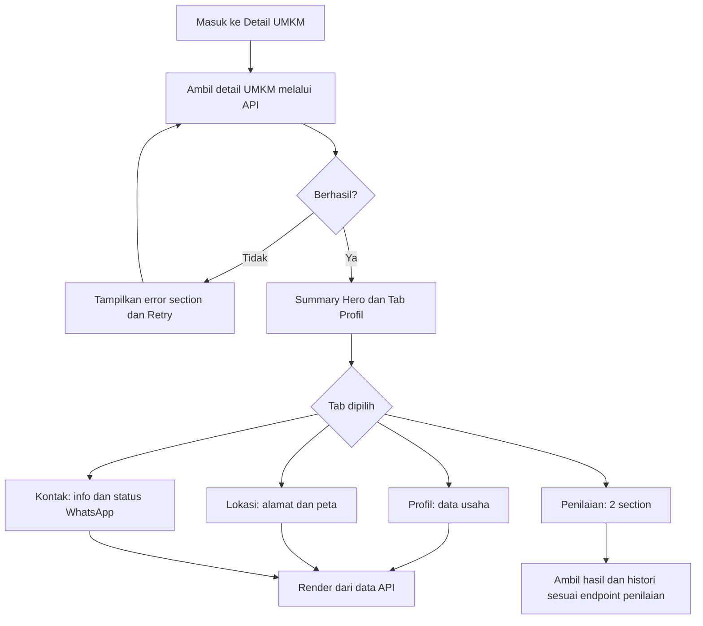
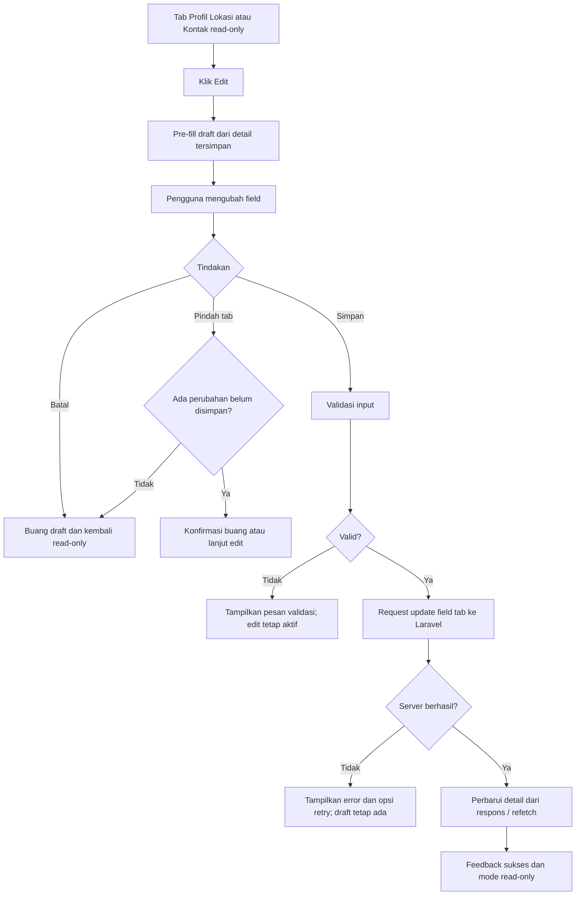
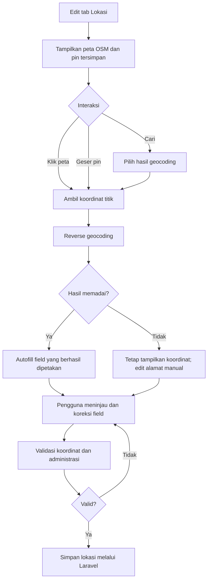
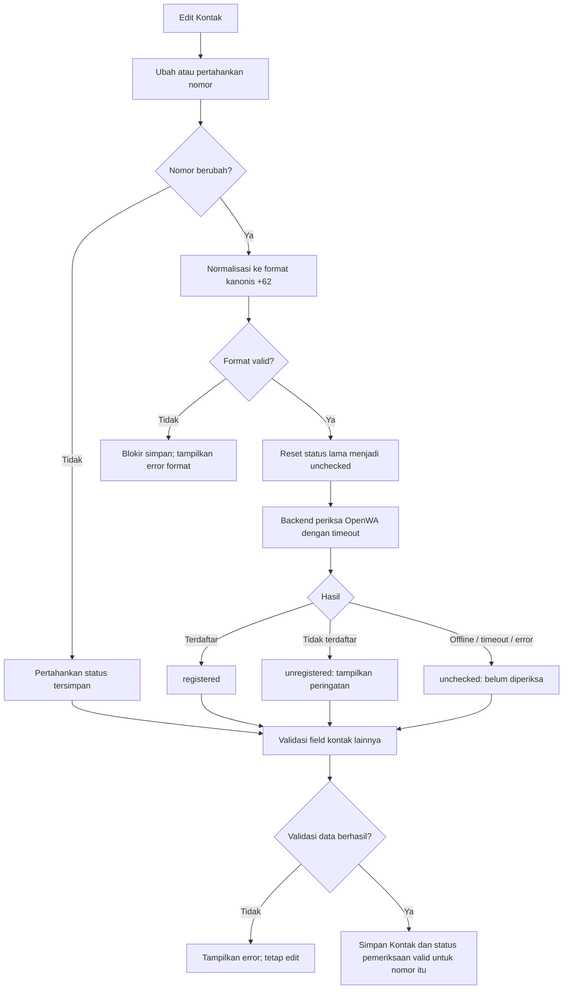
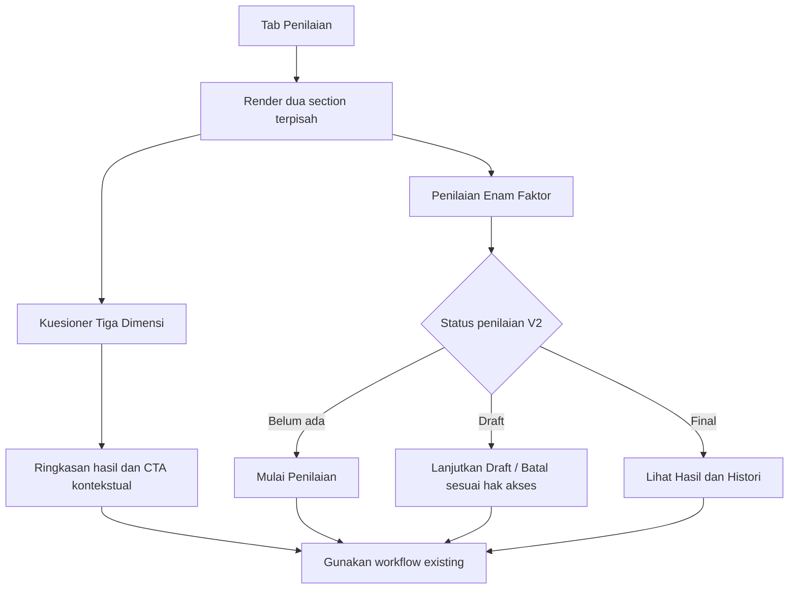

# PRD — JoyUMKM: Refinement Halaman Detail UMKM

**Versi:** 1.0 — Approved Specification  
**Tanggal:** 22 November 2026  
**Status:** Siap untuk implementasi (implementasi dan pengujian **belum** dilakukan dalam dokumen ini)  
**Aplikasi:** JoyUMKM — Laravel API/backend, Vue.js frontend, MySQL  
**Area:** Manajemen UMKM → Data UMKM → Detail UMKM  
**Referensi visual wajib:** `DESIGN.md` di repository dan wireframe interaktif Detail UMKM yang disetujui dalam percakapan.

> **Prinsip implementasi:** Jadikan keputusan dan perilaku fungsional PRD ini sebagai kontrak produk. Wireframe disetujui sebagai arah struktur dan interaksi, **bukan** sumber data produksi, kontrak API final, atau instruksi menyalin data contoh secara literal. Audit kondisi repository sebelum mengubah kode; pertahankan fitur penilaian dan kebijakan WhatsApp yang sudah ada.

---

## 1. Latar belakang dan masalah

Form **Tambah UMKM** sudah berkembang menjadi wizard tiga tahap (Informasi Usaha, Lokasi Usaha, Kontak Usaha) yang mengumpulkan informasi lebih lengkap. Namun halaman **Detail UMKM** sebelumnya masih memperlihatkan ringkasan terbatas—misalnya sektor, provinsi, omzet—sementara area utamanya lebih dominan menampilkan pintasan penilaian. Akibatnya data yang baru dimasukkan sulit dilihat, dikonfirmasi, dan dikoreksi pada satu tempat. Jalur **Ubah UMKM** lama juga belum tentu mencakup seluruh metadata wizard baru.

Refinement ini mengubah halaman Detail UMKM menjadi **single source of truth untuk meninjau dan mengedit data UMKM**, sekaligus menjadi titik masuk untuk dua sistem penilaian **tanpa mengubah engine penilaian**.

### 1.1 Tujuan

1. Menampilkan data UMKM lengkap dan terstruktur dalam empat tab.
2. Mengizinkan pengeditan **per tab secara inline** tanpa wizard atau modal baru.
3. Mempertahankan interaksi lokasi dengan **OpenStreetMap picker** saat mengedit.
4. Mempertahankan input WhatsApp ber-prefix tetap `+62` serta hasil pemeriksaan **OpenWA** yang tidak menghambat penyimpanan untuk status tidak terdaftar/tidak dapat diperiksa.
5. Menempatkan **Kuesioner Tiga Dimensi** dan **Penilaian Enam Faktor** sebagai dua section yang jelas dalam satu tab, menggunakan workflow dan data yang telah ada.
6. Menjaga konsistensi desain, responsivitas, hak akses, dan pengalaman navigasi.

### 1.2 Bukan tujuan

- Membuat ulang wizard Tambah UMKM.
- Mengganti algoritme, aturan skor, atau lifecycle penilaian yang sudah ada.
- Membangun layanan geocoding atau registrasi WhatsApp baru di luar integrasi yang sudah ditetapkan.
- Membuat sistem verifikasi **kepemilikan** nomor WhatsApp. OpenWA pada scope ini hanya memeriksa **keterdaftaran** nomor.
- Merombak desain global aplikasi, autentikasi, atau menu lain tanpa kebutuhan langsung.

---

## 2. Keputusan produk yang telah disetujui

| No. | Keputusan | Status |
|---|---|---|
| D-01 | Detail UMKM menggunakan **Tab Navigation**: **Profil**, **Lokasi**, **Kontak**, **Penilaian** | **FINAL** |
| D-02 | Data diedit **per tab**, bukan dengan wizard tiga tahap | **FINAL** |
| D-03 | Mode pengeditan **Inline Editing**: isi tab berubah menjadi form; aksi **Simpan** dan **Batal** | **FINAL** |
| D-04 | Tab Penilaian mempunyai **dua section terpisah**: **Kuesioner Tiga Dimensi** dan **Penilaian Enam Faktor** | **FINAL** |
| D-05 | Edit Lokasi menggunakan **OpenStreetMap location picker**, dengan pencarian titik, pemindahan pin, dan autofill administratif melalui reverse geocoding bila tersedia | **FINAL — mengikuti refinement Tambah UMKM** |
| D-06 | Edit Kontak menampilkan kode `+62` permanen, menormalisasi input, dan menggunakan kebijakan hasil OpenWA yang sudah disepakati | **FINAL — mengikuti refinement Tambah UMKM** |
| D-07 | Layout, tema, warna, tipografi dan komponen mengikuti **`DESIGN.md`** yang nyata di repository | **FINAL** |

**Catatan:** Field contoh pada wireframe bukan bukti bahwa kolom database/API tertentu sudah tersedia atau wajib diisi. Inventaris field dari model, validasi, endpoint, dan wizard saat implementasi merupakan sumber otoritatif.

---

## 3. Pengguna, izin, dan entry point

- **Pengguna sasaran:** pengguna yang saat ini sudah berhak mengakses Detail UMKM dalam JoyUMKM.
- **Masuk:** Manajemen UMKM → Data UMKM → pilih salah satu UMKM → Detail UMKM.
- **Izin baca/edit:** gunakan permission, policy, guard, dan kepemilikan data yang sudah berlaku pada backend. **Jangan** mengasumsikan semua pengguna yang bisa membaca boleh mengedit.
- **Izin penilaian:** tombol aksi hanya muncul/aktif sesuai kebijakan penilaian, status UMKM, dan role yang sudah ada; backend tetap memverifikasi otorisasi.
- **Navigasi:** breadcrumb kembali ke Data UMKM, URL/route Detail UMKM yang ada dipertahankan sebisa mungkin; tab tidak wajib punya route terpisah.

---

## 4. Information architecture dan layout

### 4.1 Kerangka halaman

1. Gunakan shell aplikasi yang sudah ada: sidebar, header, breadcrumb, workspace.
2. Header halaman: judul **Detail UMKM**, deskripsi singkat, dan identitas UMKM yang sedang dibuka.
3. **Summary hero** ringkas, tetap terlihat di semua tab: nama usaha, sektor, kota/lokasi ringkas, serta status UMKM **hanya bila backend menyediakannya**. Status tidak boleh di-hardcode `Aktif`.
4. Bar tab horizontal: **Profil Usaha | Lokasi Usaha | Kontak Usaha | Penilaian**. Secara produk dianggap empat tab Profil/Lokasi/Kontak/Penilaian; label dapat mengikuti terminologi `DESIGN.md`.
5. Konten tab aktif berada di satu panel utama, bukan empat halaman panjang di-scroll sekaligus.
6. Tabs Profil, Lokasi, Kontak: tombol **Edit [Nama Tab]** di area heading saat read-only; ketika edit, tampil **Batal** dan **Simpan Perubahan**.
7. Tab Penilaian: dua section/komponen terpisah, **bukan** form edit data UMKM dan tidak memiliki tombol `Edit Penilaian` generik.
8. Jangan tampilkan data contoh asli wireframe (contoh nama, pemilik, email, alamat, skor); gunakan data API dan empty state.

### 4.2 Desain visual dan responsif

- Ikuti komponen, spacing, typography, iconografi, states, dan hierarchy dari `DESIGN.md` di project.
- Arah desain yang telah disepakati untuk JoyUMKM: **Poppins**, palet `#0207CA` (primary), `#0297DE` (secondary), `#FC734D` (accent), sidebar midnight-navy `#101E40`; gunakan token/design system repository jika tersedia.
- Tampilan profesional, minimal, ruang putih seimbang; jangan membuat pengulangan card kosong seperti detail sebelumnya.
- **Desktop:** summary hero, bar tab, grid informasi dua kolom bila muat; dua section Penilaian dapat berdampingan.
- **Mobile:** grid informasi satu kolom, tab bisa scroll horizontal, dua section Penilaian ditumpuk, toolbar edit tetap mudah diakses, peta tidak memotong viewport.
- State loading menggunakan **skeleton per section/tab**, bukan full-screen spinner yang membongkar sidebar/header setiap berpindah halaman.
- Label field, empty state, feedback simpan, error, dan aksi destruktif mengikuti standar bahasa Indonesia proyek.

---

## 5. Kebutuhan fungsional per tab

### 5.1 TAB PROFIL — Informasi Usaha

**Read-only:** render semua metadata usaha yang memang diambil dan dikelola wizard Tambah UMKM/API detail. Contoh field yang ditampilkan pada wireframe:

| Field tampilan | Perilaku |
|---|---|
| Nama UMKM | Identitas utama; perubahan tersimpan juga memperbarui summary hero |
| Sektor usaha | Menampilkan pilihan sektor yang nyata dari sumber data existing |
| NIB | Menampilkan nilai atau `Belum diisi` bila optional dan kosong |
| Tahun berdiri | Menampilkan nilai atau empty state bila optional |
| Omzet usaha | Format mata uang `Rp`, angka asli tetap numerik untuk edit/API |
| Deskripsi usaha | Teks multiline yang aman dari HTML injection |
| Metadata usaha lain yang sudah ada di wizard/API | Ditampilkan secara konsisten, bukan diam-diam dihapus |

**Edit Profil:**

- Klik **Edit Profil** → hanya area Profil berubah menjadi form pre-filled dari data server terakhir.
- Gunakan komponen input/select resmi dalam project, mempertahankan tipe field dan pilihan valid yang tersedia pada wizard.
- Aturan wajib, batas panjang, tipe nilai, numeric constraints, dan validasi lain **re-use** aturan backend yang telah berlaku. Jangan mengarang `required` baru hanya karena label contoh pada prototype.
- **Simpan Perubahan** → submit hanya field yang dimiliki tab Profil → validasi → server persist → refresh model detail + summary hero → keluar dari edit mode + feedback berhasil.
- **Batal** → buang draft lokal; nilai tersimpan tidak berubah.

### 5.2 TAB LOKASI — Lokasi Usaha

**Read-only:** tampilkan lokasi usaha dalam peta yang menandai koordinat tersimpan **jika koordinat valid**, diikuti alamat administratif lengkap sesuai data tersedia: alamat, provinsi, kabupaten/kota, kecamatan, kelurahan/desa, kode pos, latitude, longitude. Jika koordinat belum tersedia, tampilkan empty state dan alamat teks, bukan pin fiktif.

**Edit Lokasi:**

- Peta **OpenStreetMap nyata**, bukan background dekoratif; tampilkan attribution yang diperlukan.
- Fasilitas pencarian alamat/lokasi menggunakan penyedia geocoding yang sesuai pengaturan deployment dan ketentuan penyedia layanan.
- Pengguna dapat memilih hasil pencarian, klik peta, atau drag marker. Pin dan koordinat sinkron.
- **Reverse geocoding** mencoba mengisi otomatis alamat, provinsi, kota, kecamatan, kelurahan, kode pos **berdasarkan field yang tersedia**. Karena cakupan OSM dapat tidak lengkap, setiap hasil otomatis boleh dikoreksi secara manual sebelum disimpan.
- Jangan menimpa koreksi manual tanpa sadar ketika hasil request lama datang terlambat; gunakan debounce/cancel/stale-response guard untuk query dan perubahan marker.
- Jangan menganggap semua respons OSM menyediakan wilayah administratif Indonesia dengan format persis sama. Lakukan pemetaan/fallback yang aman. Bila aplikasi memiliki master data kode wilayah, lakukan normalisasi ke ID yang valid dan tampilkan pilihan manual saat mapping tidak pasti.
- Pencarian dan reverse geocoding gagal/timeout **tidak boleh menghapus** alamat/koordinat yang sudah ada. Sediakan retry dan opsi edit manual.
- Validasi koordinat: latitude dalam `[-90,90]`, longitude dalam `[-180,180]`, keduanya angka finite bila disimpan; validasi administratif mengikuti kontrak backend.
- Simpan hanya perubahan tab Lokasi; data Profil dan Kontak tidak ikut dimutasi.

**Aturan layanan peta:** gunakan library/layanan yang disetujui existing stack; jangan menyalahgunakan public geocoding endpoint (misalnya query per-keystroke tanpa debounce, tanpa rate control atau identitas aplikasi); penuhi attribution, kebijakan caching, dan pembatasan layanan yang dipilih.

### 5.3 TAB KONTAK — Kontak Usaha

**Read-only:** tampilkan nama pemilik, email, WhatsApp dalam format `+62…`, nama PIC, website, dan sosial/media kontak **sepanjang field tersebut memang ada di sumber data project**. Nilai optional yang tidak ada diberi empty state.

**Edit Kontak:**

- Mode inline menggunakan isian yang sudah tersimpan sebagai nilai awal.
- Nomor WhatsApp adalah satu field UI dengan **prefix `+62` tetap** dan area input nomor nasional; pengguna tidak perlu mengetik prefix.
- Terima input `08…`, `628…`, dan `+628…`, normalisasi menjadi satu representasi kanonis sesuai service backend existing. Jangan menggandakan `62`.
- Format nomor invalid → **blokir simpan**, tampilkan pesan validasi jelas. Validasi format dan pemeriksaan status WhatsApp adalah dua pemeriksaan **berbeda**.
- Saat nomor **berubah**, status pemeriksaan nomor lama **tidak boleh menempel pada nomor baru**. Ubah tampilan menjadi `Belum diperiksa` sampai ada hasil valid untuk nomor baru.
- Saat nomor **tidak berubah**, hasil pemeriksaan yang sudah tersimpan boleh dipertahankan; jangan memeriksa ulang secara tidak perlu kecuali aturan backend mengharuskan.
- Hasil OpenWA bersumber dari pemeriksaan **backend Laravel**, bukan simulasi response dari client dan bukan request langsung dari browser ke OpenWA. Jangan mengekspos kunci API OpenWA.
- Pemeriksaan asynchronous perlu deadline/timeout terkendali; respons untuk nomor lama tidak boleh diterapkan ke nomor baru (race protection).
- **Penyimpanan tetap diizinkan** pada dua kondisi: nomor valid **tidak terdaftar** (`unregistered`) dan OpenWA **offline/timeout/gagal** (`unchecked`). Hanya format nomor invalid yang menghalangi penyimpanan pada scope pemeriksaan WhatsApp.

| Status penyimpanan pemeriksaan | Teks UI | Kebijakan simpan |
|---|---|---|
| `registered` | Terdaftar di WhatsApp | Boleh |
| `unregistered` | Tidak terdaftar di WhatsApp — peringatan | **Boleh** |
| `unchecked` | Belum diperiksa — termasuk offline, timeout, error | **Boleh** |
| Nomor invalid secara format | Perbaiki format nomor WhatsApp | **Tidak boleh** |

**Konsistensi:** gunakan service/aturan OpenWA yang sudah diterapkan pada Tambah UMKM. Endpoint OpenWA yang digunakan di backend harus memanfaatkan konfigurasi environment eksisting (termasuk prefix path API yang benar); jangan menaruh URL host, API key, atau session ID di kode frontend/PRD.

### 5.4 TAB PENILAIAN — Dua section dalam satu tab

Tab ini hanya **menyusun ulang titik akses dan ringkasan**, bukan mengubah model penilaian.

**Section A — Kuesioner Tiga Dimensi**

- Judul, penjelasan singkat, ringkasan hasil/status terbaru (bila ada), aksi `Isi Kuesioner` atau aksi kontekstual menurut workflow saat ini.
- State kosong: `Belum ada kuesioner tersimpan` (atau copy sesuai terminologi aplikasi).
- Buka route/flow kuesioner yang memang diizinkan sistem saat ini. Jangan menciptakan skema penilaian baru.

**Section B — Penilaian Enam Faktor**

- Judul, penjelasan singkat, ringkasan hasil/status terbaru, aksi `Mulai Penilaian`/`Lanjutkan Draft`/`Lihat Hasil` sesuai state existing.
- Hormati lifecycle **Draft → Final/Batal**, aturan kunci/konkurensi, dan histori dari implementasi yang sudah ada; jangan memperkenalkan aksi finalize langsung dari card.
- State kosong: `Belum ada penilaian final` bila ringkasan yang diambil adalah hasil final; bila ada Draft aktif, tampilkan Draft terpisah dan CTA lanjutkan secara jelas.

**Riwayat penilaian:**

- Tampilkan ringkasan/tautan riwayat sesuai data/endpoint yang sudah tersedia dan hak akses pengguna.
- Kedua sistem tetap punya identitas, hasil terbaru, dan histori yang **terpisah**; tidak boleh menyajikan skor 3D sebagai skor enam faktor, atau sebaliknya.
- Jika hasil perhitungan belum tersedia, tampilkan status/empty state; jangan menghasilkan skor dummy.
- Jangan mengaktifkan kembali penilaian versi lama yang sudah berstatus read-only jika aplikasi telah mengalihkan entry point penilaian baru ke versi terkini.

---

## 6. Kontrak interaksi global Inline Editing

| Keadaan | Tampilan | Perilaku |
|---|---|---|
| Read-only | Data detail + tombol `Edit [Tab]` | Tidak ada input form aktif |
| Edit | Input hanya di tab aktif; tombol `Batal` dan `Simpan Perubahan` | Pre-fill dari server snapshot; belum persisten |
| Saving | Tombol simpan loading/disabled untuk request yang sama | Cegah double submit; pertahankan draft dan konten |
| Success | Kembali ke read-only + feedback sukses | Detail dan summary hero konsisten dengan respons server |
| Validation error (422 atau kontrak existing) | Edit tetap terbuka + pesan per field | Jangan membuang draft |
| Network/server failure | Edit tetap terbuka + pesan bahasa Indonesia + retry | Data server tidak boleh tampak berhasil tersimpan |
| Batal | Keluar edit tanpa request mutasi | Hapus draft lokal dan error edit |
| Perpindahan tab saat ada perubahan belum tersimpan | Konfirmasi untuk membuang perubahan **atau** tetap di tab | Jangan menyimpan diam-diam; satu draft tab pada satu waktu |
| Tidak punya izin edit | Read-only | Tombol edit disembunyikan/dinonaktifkan; backend tetap memproteksi |

Catatan UX: prototype awal langsung membatalkan draft ketika tab dipindah; implementasi produksi **menambahkan konfirmasi buang perubahan** agar tidak kehilangan data tak sengaja. Ini safeguard usability, bukan perubahan konsep edit per tab.

### Flowchart A — Memuat Detail dan Navigasi

### Flowchart B — Edit per Tab

### Flowchart C — Pemilihan Lokasi

### Flowchart D — Pemeriksaan WhatsApp ketika Edit Kontak

### Flowchart E — Penilaian

---

## 7. Integrasi dan data

### 7.1 Strategi backend

1. **Audit terlebih dahulu** route API Detail UMKM, endpoint PATCH/update, response Resource/DTO, FormRequest, service layer, model/migration, relasi wilayah, dan field wizard Tambah UMKM.
2. Gunakan satu endpoint/detail fetch existing sebagai sumber data umum. Tambahkan field yang memang sudah ada namun belum diekspos UI hanya bila diperlukan.
3. Untuk update, **prioritaskan endpoint update UMKM existing** bila aman menerima PATCH subset field. Jika backend membutuhkan operasi terpisah per tab, buat kontrak seminimal mungkin dengan kompatibilitas endpoint lama.
4. Tidak boleh mengubah atau men-null-kan atribut dari tab lain akibat payload parsial. Pastikan field yang tidak dikirim berarti **tidak diubah**, berbeda dari field yang eksplisit dikosongkan.
5. Validation di backend menjadi otoritas; frontend hanya memandu dan memvalidasi dini.
6. Terapkan policy otorisasi, sanitasi, audit/log existing jika tersedia, dan error envelope proyek. Pesan provider/API mentah tidak ditampilkan ke pengguna.
7. Hindari migrasi database tambahan bila field yang diperlukan sebenarnya sudah tersedia. Bila ditemukan gap, tulis delta schema paling kecil, kompatibel dengan data lama.
8. Data status UMKM yang diarsipkan/nonaktif mengikuti kebijakan arsip dan penilaian existing; jangan mengubah record menjadi aktif hanya karena label visual.
9. Refresh cache/state setelah sukses mutasi agar data header, tab, dan daftar UMKM konsisten.

### 7.2 Data OpenStreetMap

- Frontend menggunakan OSM map/tiles yang memenuhi persyaratan atribusi dan ketentuan layanan.
- Search/reverse geocoding boleh melalui backend proxy atau provider terkonfigurasi jika dibutuhkan oleh policy rate limiting/security.
- Rekam koordinat dan alamat sesuai precision/kontrak database yang ada. Jangan menganggap hasil geocoder sebagai data pasti.
- Hindari mengirim data pribadi yang tidak diperlukan ke penyedia geocoding; panggil search/reverse hanya untuk lokasi yang sedang dipilih.

### 7.3 Data dan status OpenWA

- Integrasi tetap melalui service Laravel yang sudah ada; status `registered`, `unregistered`, `unchecked` dipertahankan dengan representasi yang konsisten.
- Jangan memeriksa nomor setiap render halaman; prioritaskan perubahan nomor atau aksi pemeriksaan eksplisit sesuai kontrak existing.
- Pastikan hasil yang di-save merupakan hasil untuk nomor kanonis yang **sama**. Jika respons provider telat, abaikan hasil nomor sebelumnya.
- Kondisi offline/timeout OpenWA **bukan** penyebab gagalnya update UMKM yang field-nya valid.
- Jika pemeriksaan berlangsung setelah data disimpan secara asynchronous, simpan nomor baru sebagai `unchecked` lebih dahulu lalu perbarui status hanya ketika hasil untuk nomor yang sama datang. Jika sinkron dengan batas waktu, pastikan deadline tidak membuat penyimpanan hang.

### 7.4 Integrasi Penilaian

- Baca hasil terbaru dan histori **masing-masing** sistem dari endpoint/service existing.
- Untuk Penilaian Enam Faktor, pertahankan final/draft/cancel semantics, operasi idempoten, serta proteksi konkurensi yang sudah diterapkan.
- CTA bergantung pada state yang benar, izin pengguna, dan versi penilaian yang aktif.
- Backend tidak boleh mengembalikan hasil satu sistem sebagai fallback diam-diam ke sistem lain.

---

## 8. Loading, error, dan empty state

| Kondisi | Expected UI |
|---|---|
| Detail awal loading | Skeleton summary/tab panel; shell navigasi tetap tampil |
| Gagal mengambil detail | Error berbahasa Indonesia + `Coba Lagi` di area konten |
| Field optional kosong | `Belum diisi` atau `—` secara konsisten |
| Koordinat kosong/tidak valid | Placeholder peta; alamat teks tetap terlihat |
| Geocoding gagal | Pesan singkat + opsi edit alamat manual; data draft tidak hilang |
| OpenWA tidak terdaftar | Peringatan non-blocking |
| OpenWA offline/timeout | Status belum diperiksa non-blocking |
| Penilaian belum ada | Empty state per section, dengan CTA yang diizinkan |
| Simpan gagal validasi | Error field terkait; draft tetap tersimpan di UI |
| Simpan gagal server/jaringan | Pesan aman, retry, tanpa klaim sukses |
| Sesi/izin berubah | Gunakan alur 401/403 standar proyek; jangan menampilkan data yang tidak sah |
| Konflik update | Jelaskan perubahan belum tersimpan, sediakan refresh/retry; jangan overwrite buta |

---

## 9. Acceptance criteria (AC)

### AC-01 — Tampilan & navigasi

- [ ] Detail UMKM memuat **empat tab** Profil, Lokasi, Kontak, Penilaian; tab yang aktif terlihat jelas.
- [ ] Summary hero konsisten dengan data backend; status tidak hardcoded.
- [ ] Semua nilai hasil Tambah UMKM yang relevan terlihat pada tab yang tepat; tidak ada lagi metadata baru yang tersembunyi tanpa alasan.
- [ ] Desktop/mobile adaptif dan desain mengikuti `DESIGN.md`; tabs dapat digunakan via keyboard.
- [ ] Sidebar/header persisten; tidak muncul spinner full-screen untuk setiap perpindahan tab.

### AC-02 — Inline editing

- [ ] Setiap tab data (Profil, Lokasi, Kontak) menyediakan `Edit`, `Simpan Perubahan`, `Batal` dalam panel yang sama.
- [ ] Form terisi dari data UMKM tersimpan; perubahan belum tersimpan tidak mengubah tampilan global/backend.
- [ ] Batal tidak membuat request mutasi dan mengembalikan data semula.
- [ ] Validasi gagal mempertahankan draft dan menunjukkan field bermasalah.
- [ ] Simpan berhasil memperbarui panel serta summary hero tanpa reload penuh.
- [ ] Pindah tab dengan draft kotor meminta konfirmasi; tidak terjadi auto-save.
- [ ] Pengguna tanpa akses edit tidak dapat mengubah data, bahkan lewat request API manual.
- [ ] PATCH parsial tidak menghapus/menimpa field tab lain.

### AC-03 — Lokasi OSM

- [ ] View mode memvisualisasikan koordinat yang valid, atau empty state jika belum ada.
- [ ] Edit mode menggunakan peta OSM nyata dengan attribution.
- [ ] Pencarian, pemilihan hasil, klik peta, dan drag pin menghasilkan koordinat yang sesuai.
- [ ] Reverse geocoding mengisi field yang tersedia; pengguna bisa mengoreksi manual.
- [ ] Hasil request geocoder yang terlambat tidak mengoverwrite pilihan lokasi terbaru.
- [ ] Geocoding gagal tidak menghapus data lokasi yang tersimpan.
- [ ] Koordinat di luar rentang valid ditolak.

### AC-04 — Kontak & OpenWA

- [ ] Prefix `+62` tidak dapat diubah; format `08`, `628`, `+628` dinormalisasi konsisten.
- [ ] Nomor invalid secara format memblokir simpan.
- [ ] Mengubah nomor me-reset status lama dan mencegah hasil nomor berbeda dipakai ulang.
- [ ] `registered` menampilkan sukses, `unregistered` peringatan non-blocking, `unchecked` belum diperiksa non-blocking.
- [ ] OpenWA offline/timeout tidak memblokir simpan data kontak yang valid.
- [ ] Tidak ada kredensial/provider secret yang bocor ke client.
- [ ] Status dari server tetap konsisten setelah refresh halaman.

### AC-05 — Penilaian

- [ ] Dua section terpisah selalu terlihat dalam tab Penilaian.
- [ ] Hasil/status terbaru kedua sistem dibaca dari sumber masing-masing.
- [ ] Tombol CTA mengarah ke workflow existing yang benar dan mengikuti izin/status.
- [ ] Draft/Final/Batal Enam Faktor tidak berubah perilakunya akibat refinement.
- [ ] Riwayat/empty state ditampilkan secara akurat; tidak ada skor dummy.

### AC-06 — Kualitas & regresi

- [ ] Tidak ada regresi pada **Tambah UMKM**, wizard OSM, normalisasi nomor, dan integrasi OpenWA.
- [ ] Tidak ada regresi pada daftar UMKM, Detail lama yang sudah digunakan, status/arsip UMKM, dan kedua sistem penilaian.
- [ ] Error backend tidak bocor mentah ke UI, input di-escape/sanitized, serta permission terjaga.
- [ ] Loading, error, retry, dan empty state diperiksa pada desktop serta viewport mobile.

---

## 10. Matriks pengujian yang wajib dikerjakan implementer

| Jenis | Skenario minimum |
|---|---|
| Backend feature/integration (MySQL) | Read detail metadata; PATCH parsial Profil/Lokasi/Kontak; validasi; authorization; konflik; status arsip sesuai policy |
| Unit/frontend | Tab switching; pre-fill; cancel; dirty-state guard; formatting omzet; escaping output; status feedback |
| E2E browser | Alur buka Detail → edit Profil → simpan; edit Lokasi → pindah pin → koreksi alamat → simpan; edit Kontak → cek status → simpan; buka Penilaian |
| OpenWA contract | Nomor normalisasi `08/628/+628`; registered; unregistered; unchecked ketika offline/timeout; response lama/nomor berbeda; unchanged phone |
| OSM/geocoding | Hasil lengkap; administratif parsial; empty response; timeout; dua request berurutan yang selesai terbalik; marker drag |
| Penilaian regression | Kuesioner 3D tetap bisa dibuka; Enam Faktor Draft/Final/Batal dan histori tidak bergeser; hasil terpisah |
| Responsive/a11y | Desktop, tablet, mobile; keyboard navigation/tab; focus-visible; aria labels; loading skeleton |

**Lingkungan regresi:** gunakan test runner dan database **MySQL** yang sesuai project untuk tes mutasi/konkurensi. Jangan menjadikan suite SQLite penuh sebagai prasyarat tambahan bila bukan kebijakan test tahap ini; laporkan baseline failure terpisah dari failure akibat perubahan.

**Kriteria PASS:** seluruh AC dalam scope berjalan; tes relevan PASS; tidak ada regresi terkonfirmasi pada penilaian, status WhatsApp, dan wizard Tambah UMKM. Jangan menyebut PASS jika skenario utama hanya simulasi atau tidak diuji.

---

## 11. Urutan implementasi yang disarankan

**Fase A — Audit & kontrak:** baca `DESIGN.md`; inventaris wizard Tambah UMKM, schema, field API Detail/PATCH, service OSM/OpenWA, route & lifecycle penilaian, authorization. Dokumentasikan gap paling kecil tanpa mengubah kebijakan.

**Fase B — UI dan data binding:** bangun summary hero, empat tab, read-only field lengkap, responsive layout, skeleton/empty/error state. Integrasikan data backend nyata.

**Fase C — Inline editing:** implementasi Edit/Simpan/Batal untuk Profil, Lokasi, Kontak; PATCH parsial, validasi, dirty-state guard, feedback dan server refresh.

**Fase D — Integrasi khusus:** OSM search/marker/reverse geocoding nyata; reuse service OpenWA beserta normalisasi dan status yang benar.

**Fase E — Penilaian & QA:** dua section ringkasan + CTA terhubung, regresi kedua engine, E2E, mobile, authorization, final visual review versus `DESIGN.md`.

Untuk pelaksanaan di mesin developer, inventaris **skills dan agents** yang terpasang bila tersedia; gunakan tool/agent yang relevan tanpa mengasumsikan keberadaan profil tertentu. Hindari refactor besar yang tidak terkait.

---

## 12. Risiko dan guardrails

| Risiko | Mitigasi |
|---|---|
| Field baru sudah ada di wizard tetapi tidak di API detail/update | Audit resource/form request dan expose hanya field yang dibutuhkan |
| PATCH parsial membuat kolom lain null | Definisikan semantics absent vs null; test lintas-tab |
| Geocoder tidak menemukan kecamatan/kelurahan | Koreksi manual; fallback; jangan menebak ID administrasi |
| Public OSM geocoding dibatasi | Debounce/rate limit/cache dan provider terkonfigurasi |
| OpenWA tidak stabil/offline | Status `unchecked`, timeout, penyimpanan tetap diizinkan |
| Respons verifikasi nomor yang lama datang belakangan | Ikat request/result ke nomor kanonis dan buang stale response |
| Hasil 3D dan enam faktor tercampur | Query/service terpisah; status dan CTA berdasarkan lifecycle masing-masing |
| Inkonsistensi tampilan dengan modul JoyUMKM lain | Gunakan `DESIGN.md`, komponen shared, visual regression review |
| Pengguna kehilangan draft saat pindah tab | Konfirmasi discard untuk perubahan belum tersimpan |

---

## 13. Deliverables implementasi

1. Halaman **Detail UMKM** yang memenuhi semua tab dan interaksi disetujui, menggunakan **data nyata dari API**.
2. Update backend/frontend **seminimal mungkin** untuk field, PATCH, dan izin yang diperlukan.
3. OSM picker dan OpenWA check **nyata**, dengan fallback/error-handling yang ditetapkan.
4. Kuesioner Tiga Dimensi dan Penilaian Enam Faktor tetap berjalan melalui workflow lama yang sesuai versi aktif.
5. Test otomatis dan verifikasi tampilan desktop/mobile, dengan laporan **PASS/FAIL/NOT RUN** per acceptance criteria serta keterbatasan yang tersisa.
6. Catatan perubahan API/schema jika ada, tanpa menyisipkan secret atau mengubah kebijakan bisnis diam-diam.

---

## 14. Definition of Done

PRD ini dianggap terlaksana ketika user dapat membuka Detail UMKM, membaca seluruh metadata dari wizard, mengubah Profil/Lokasi/Kontak langsung pada tab terkait, menggunakan OSM picker dan validasi OpenWA nyata sesuai toleransi kegagalan yang disetujui, serta membuka dua jenis penilaian dari satu tab **tanpa regresi fungsi existing**. Seluruh tindakan terproteksi izin dan sudah diuji; ketiadaan uji harus dilaporkan eksplisit sebagai **NOT RUN**, bukan PASS.

**Dokumen spesifikasi selesai. Implementasi belum dilakukan oleh pembuatan PRD ini.**
