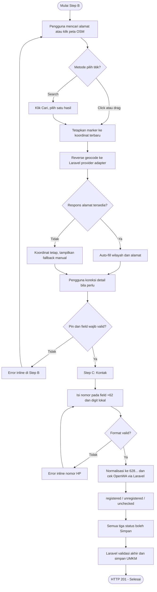
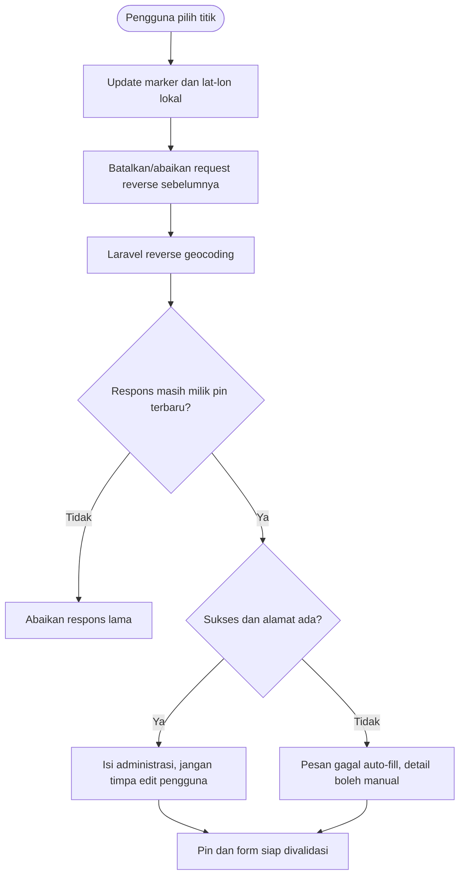
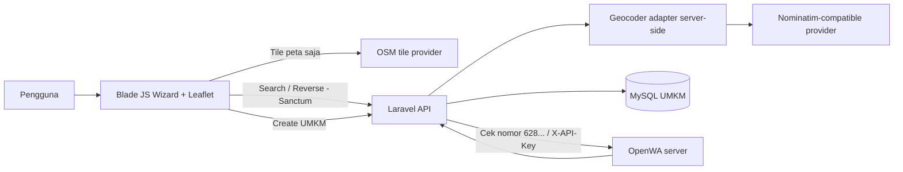

# PRD Refinement JoyUMKM — OpenStreetMap Location Picker & WhatsApp Prefix +62

**Document ID:** `PRD-JOYUMKM-UMKM-WIZARD-R01`  
**Tanggal:** 22 November 2026 (Asia/Jakarta)  
**Status:** **APPROVED FUNCTIONAL REFINEMENT — READY FOR CODEX IMPLEMENTATION**  
**Jenis:** *Refinement patch* untuk wizard Tambah UMKM yang **sudah diimplementasikan**, bukan PRD pembangunan ulang  
**Basis:** `PRD_JoyUMKM_Tambah_UMKM_Wizard_OpenWA.md` dan `docs/evidence/umkm-wizard/handoff.md`  
**Repositori:** `joytimess/dip-joyumkm`; **checkout lokal terkini** sebagai sumber kebenaran  
**Implementor:** **Codex GPT-6.2 Sol — thinking effort HIGH**  
**Prioritas:** P1 — perbaikan UX tahap B dan C  
**Scope:** **HANYA** (1) Step B: picker lokasi pada peta OpenStreetMap yang benar-benar interaktif, (2) Step C: input WhatsApp dengan **prefix +62 tetap**, serta penyesuaian API/validasi/test yang diperlukan.

> **Keputusan produk final:** Di Tahap B pengguna harus **memilih titik usaha di peta**, dapat mencari alamat, klik peta atau menggeser pin. Data lokasi diisi otomatis dengan reverse geocoding sejauh tersedia; pengguna boleh mengoreksi detail alamat. Di Tahap C nomor WhatsApp ditampilkan sebagai **`+62 | {nomorHp}`** — prefix tidak dapat diedit, pengguna cukup mengetik digit nomor lokal. Semua kebijakan OpenWA *fail-open* yang sudah lulus tes **dipertahankan**.

---

## 0. Aturan implementasi — baca sebelum mengubah kode

1. Jalankan pekerjaan pada **Codex GPT-6.2 Sol effort HIGH**. Baca `AGENTS.md` dan **`DESIGN.md` lokal** terlebih dahulu. `DESIGN.md` pada checkout lokal disebut dalam handoff implementasi; jika tidak ditemukan, **laporkan fakta itu**, bukan menciptakan dokumen pengganti. Ikuti token/komponen desain yang benar-benar berlaku.
2. Inventaris dan aktifkan skills yang relevan dari `C:\Users\itsba\.agents\skills`; baca petunjuk setiap skill yang digunakan. Inventaris agents dari `C:\Users\itsba\.codex\agents`, gunakan hanya agent yang benar-benar tersedia dan relevan; **maksimal tiga subagent**. Tanpa dukungan subagent, kerjakan langsung. Jangan mengarang identitas agent.
3. Baca `docs/evidence/umkm-wizard/handoff.md`, PRD wizard awal, komponen modal sekarang, dan tesnya; catat `git status` sebelum mengubah apa pun. **Jangan mengulang implementasi keseluruhan wizard.** Pertahankan semua perubahan lokal yang belum di-commit; tidak boleh `git reset --hard`/`git clean`.
4. Ikuti frontend aktual **Blade + JavaScript native + Tailwind v4/Vite**. Reuse `resources/views/umkms.blade.php`, `resources/js/umkm-form.js`, komponen bersama, serta pola loading/validasi yang sudah ada. **Jangan menambah Vue/React/Livewire** atau merombak dashboard.
5. Boleh memakai library peta yang sudah ada. Bila belum ada, **Leaflet** merupakan opsi ringan yang wajar, tetapi audit dependensi dan perubahan bundle lebih dulu; tambahkan satu dependensi seperlunya, jangan kumpulan plugin peta tanpa kebutuhan. Peta asli wajib interaktif — **tidak boleh memakai SVG statis/ilustrasi mock sebagai pengganti implementasi**.
6. Gunakan MySQL **testing terisolasi** untuk tes yang memodifikasi data; jangan reset database pengguna, tidak menyentuh cPanel OpenWA untuk pekerjaan peta, dan jangan mengekspos API key OpenWA.
7. Implementasi + tes sampai tuntas dalam scope dua refinement ini. Laporkan hasil `PASS`/`FAIL`/`NOT RUN` sesuai bukti, tanpa klaim live yang tidak diuji. Dokumentasi baru selain handoff/evidence yang diminta PRD ini tidak perlu diperbanyak.

### Baseline yang harus dipertahankan

Menurut handoff sebelumnya (sebelum refinement ini): **97 tes PHP terarah PASS**, **37 tes JS PASS**, Chrome QA 320/390/768/1440 PASS, build/Pint PASS; suite PHP penuh **227/232** dengan lima kegagalan seeder baseline. `workspace-browser.mjs` punya selector desktop usang; bedakan baseline dari regresi baru. **OpenWA live belum diuji**, pemeriksaan memakai `Http::fake()`. Tidak satu pun angka tersebut merupakan hasil verifikasi untuk refinement baru.

---

## 1. Tujuan dan batas tegas

### Yang berubah

| Area | Sebelum (handoff/screenshot) | Sesudah (WAJIB) |
|---|---|---|
| **B. Lokasi Usaha** | Provinsi, kab/kota, alamat dan koordinat dominan input manual | **Cari lokasi → pilih titik di peta OSM → auto-fill alamat dan wilayah**; pin dapat digeser, alamat bisa dikoreksi |
| **B. Koordinat create** | Latitude/longitude opsional, boleh kosong | **Wajib pada pembuatan UMKM dari wizard**, diambil dari lokasi yang dipilih pada peta; tidak mengetik bebas pada UI |
| **C. Nomor WhatsApp** | Satu input teks dengan placeholder `08...` atau `+628...` | **Prefix kiri `+62` permanen + input kanan nomor lokal digit saja**; paste `08...`/`628...`/`+628...` dinormalisasi |
| **OpenWA** | Check via Laravel, tiga status, fail-open | **Tidak berubah**; payload tetap `628...`, lookup dan kebijakan simpan tetap sama |

### Yang tidak berubah

- Modal wizard **A. Informasi → B. Lokasi → C. Kontak**, state antar-step, validasi inline, fokus, dialog native, konfirmasi perubahan belum disimpan, UI responsif.
- Field informasi usaha, omzet/periode, data lama, evaluasi V1/enam faktor, create/detail/PATCH, tabel desktop dan kartu mobile, pencarian/filter/pagination.
- Status OpenWA: `registered`, `unregistered`, `unchecked`; **tidak terdaftar dan offline/timeout tetap boleh disimpan**, format salah tetap ditolak. Bukan OTP atau verifikasi kepemilikan.
- **Form Ubah** mempertahankan empat field lama; jangan mewajibkan lokasi untuk mengedit record legacy melalui `PATCH`. Metadata baru tetap tersedia di detail/PATCH.
- Tidak menambah geolocation GPS otomatis, layanan maps berbayar, pencarian POI massal, atau integrasi lokasi ke dashboard lain.

---

## 2. UX/UI Step B — Lokasi Usaha (source of truth: wireframe yang disetujui)

### 2.1 Hirarki tampilan

```text
┌─────────────────────────────────────────────────────────┐
│ Tambah Data UMKM                                       │
│ A. Informasi       B. Lokasi [aktif]      C. Kontak     │
├─────────────────────────────────────────────────────────┤
│ Lokasi Usaha                                           │
│ Cari atau pilih titik usaha langsung di peta.          │
│                                                         │
│ Cari lokasi usaha *                                    │
│ [ Cari alamat/lokasi usaha...                   ] [Cari] │
│                                                         │
│ ┌─────────────────────────────────────────────────────┐ │
│ │ PETA OPENSTREETMAP INTERAKTIF                      │ │
│ │      zoom +/-          📍 marker draggable         │ │
│ │      click/tap memilih titik usaha                 │ │
│ │      © OpenStreetMap contributors                  │ │
│ └─────────────────────────────────────────────────────┘ │
│ ✓ Titik usaha terpilih: alamat singkat + koordinat      │
│                                                         │
│ Detail lokasi (otomatis, bisa dikoreksi bila perlu)     │
│ [Provinsi *             ] [Kabupaten/Kota *           ] │
│ [Alamat lengkap *                                     ] │
│ [Kecamatan              ] [Kelurahan/Desa             ] │
│ [Kode pos               ]                              │
│ [Latitude readonly      ] [Longitude readonly        ] │
├─────────────────────────────────────────────────────────┤
│                              [Batal] [Kembali] [Lanjut]│
└─────────────────────────────────────────────────────────┘
```

**Tata letak:** search di atas map; map penuh lebar dalam konten modal; panel status pemilihan titik tepat di bawahnya; detail administratif sesudah status. Saat mobile, grid menjadi satu kolom, map tetap dapat digeser/dizoom dan tombol footer selalu terjangkau. Gunakan `DESIGN.md` dan primitives dialog/field/status saat ini. Peta ditampilkan sebagai komponen nyata, bukan gambar/mock; jangan tampilkan warna brand berlebihan.

### 2.2 Kebutuhan fungsional peta

**`MAP-FR01` Search eksplisit.** Pengguna mengetik alamat, menekan **Cari** atau Enter. Tampilkan hasil pencarian (jika banyak, pilih salah satu). Search **tidak otomatis mengambil hasil pertama** dan **tidak mengirim permintaan ke public Nominatim pada setiap keystroke**. Placeholder contoh: `Cari alamat / lokasi usaha`.

**`MAP-FR02` Interaksi peta.** Map menampilkan tile OpenStreetMap (atau provider tile berbasis OSM yang sesuai izin). Pengguna dapat zoom/pan, **klik/tap satu titik**, dan **drag marker** untuk mengoreksi posisi. Satu UMKM memiliki **satu pin terpilih**. Pin dan koordinat langsung merefleksikan titik terbaru.

**`MAP-FR03` Reverse geocoding.** Setelah hasil pencarian dipilih atau klik peta / **drag selesai**, panggil layanan reverse geocode. Usahakan mengisi `province`, `city`, `address`, `district`, `subdistrict`, `postal_code`. Tidak ada janji semua field selalu tersedia pada data OSM. **Jangan menyimpulkan kota/provinsi secara asal dari posisi peta**; mapping `city/town/village/municipality/county/state` harus diuji untuk variasi administrasi Indonesia.

**`MAP-FR04` Edit hasil.** Alamat lengkap wajib bisa dikoreksi. Kecamatan/kelurahan/kode pos opsional bisa diedit. **Provinsi dan kabupaten/kota** diisi otomatis ketika tersedia; bila hasil kosong atau keliru, izinkan koreksi manual dengan komponen yang konsisten (provinsi tetap memakai opsi sah aplikasi). `latitude`/`longitude` **readonly di UI**, bersumber dari titik pin; mengubah pin memperbarui keduanya. Jangan menghapus koreksi manual pengguna hanya karena request lama selesai.

**`MAP-FR05` Form state.** Ketika kembali ke A lalu maju ke B, **peta dan pin terakhir beserta koreksi field tetap ada**. Saat modal ditutup/dibatalkan ikuti unsaved changes guard existing. Jangan membuat marker ganda ketika modal dibuka ulang. Inisialisasi ukuran Leaflet/map saat panel B benar-benar terlihat untuk mencegah tile blank pada dialog tersembunyi.

**`MAP-FR06` Validasi.** Tombol **Lanjut** dari B hanya berhasil jika:

- Pengguna **telah memilih satu titik di peta** dan koordinat tersedia, numerik, dalam rentang geografis yang sah.
- **Provinsi**, **kabupaten/kota**, dan **alamat lengkap** terisi dan memenuhi validasi Laravel existing.
- Field opsional (kode pos/kecamatan/kelurahan) valid jika diisi.

Bila belum pilih pin: error inline jelas **“Pilih titik lokasi usaha pada peta terlebih dahulu.”** Fokus diarahkan ke kontainer map/search atau instruksi yang relevan. Jangan menjadikan teks koordinat bebas sebagai pengganti interaksi pin.

**`MAP-FR07` Error dan fallback.** Jika pencarian gagal/hasil tidak ada, peta tetap dapat digunakan untuk memilih titik. Jika **reverse geocoding timeout/error**, **koordinat hasil pin tetap dipertahankan**, lalu tampilkan instruksi *“Alamat belum dapat diisi otomatis. Lengkapi detail alamat di bawah.”*; buka input administratif untuk koreksi manual. Jika **tile peta sama sekali tidak dapat dimuat**, tampilkan error dan aksi **Coba lagi**, tanpa berpura-pura bahwa pengguna sudah memilih titik. Kegagalan eksternal bukan alasan menghapus data form yang sudah diisi.

**`MAP-FR08` Anti race condition.** Saat pengguna memilih/menggeser pin berulang, respons geocoding lama **tidak boleh menimpa hasil terbaru**. Gunakan cancellation atau request version/sequence; reverse request pada `click` atau **`dragend`**, bukan setiap pixel `drag`.

### 2.3 Kontrak data B dan backend

Pertahankan nama field backend yang sudah ada:

| Field | Create via wizard | Sumber/ketentuan |
|---|---|---|
| `province` | Wajib | Reverse geocode → opsi provinsi proyek; koreksi bila gagal |
| `city` | Wajib | Reverse geocode; boleh dikoreksi bila gagal |
| `address` | Wajib | Reverse geocode, **editable** |
| `district` | Opsional | Reverse geocode, editable |
| `subdistrict` | Opsional | Reverse geocode, editable |
| `postal_code` | Opsional | Reverse geocode, editable; 5 digit jika diisi |
| `latitude` | **Wajib untuk POST create baru** | Nilai koordinat pin, valid -90..90 |
| `longitude` | **Wajib untuk POST create baru** | Nilai koordinat pin, valid -180..180 |

**Perubahan kontrak:** PRD lama mengizinkan koordinat kosong. Refinement ini **sengaja mengubah persyaratan `POST /api/umkms` untuk create baru** agar konsisten dengan picker wajib. Lakukan perubahan validasi pada `StoreUmkmRequest` dan tes API dengan sadar; catat dampak bila terdapat klien pembuat UMKM selain wizard. **Jangan menambah kolom atau migration duplikat** bila field koordinat sudah tersedia dari implementasi sebelumnya. Untuk record legacy dan `PATCH` parsial, **dua koordinat tetap nullable/opsional sesuai konteks** dan harus berpasangan bila diperbarui; jangan memaksa pemilik mengisi lokasi baru hanya untuk mengubah nama/omzet lama.

`selected_from_map` adalah state UX frontend, **bukan bukti server yang dapat dipercaya**. Laravel memvalidasi keberadaan dan rentang koordinat; jangan mengklaim server dapat membuktikan klik peta dari request biasa.

---

## 3. Integrasi layanan OSM — aturan operasional

**Pemisahan:** **OpenStreetMap** menyediakan data/tile peta; **geocoding** ialah layanan pencarian alamat dan reverse lookup yang terpisah. Leaflet adalah pustaka tampilan map, **bukan** geocoder. Jangan menyamakan ketiganya.

### Rekomendasi implementasi minimum

- **Map UI:** Leaflet + tile OSM dari sumber yang mematuhi kebijakan; dependency lokal via Vite, inisialisasi saat panel B aktif. Lazy-load hanya jika cocok dengan arsitektur halaman. Tampilkan atribusi `© OpenStreetMap contributors` yang **terlihat**, bukan tertutup footer.
- **Geocoding:** service/adapter Laravel dengan base URL konfigurabel (mis. Nominatim-compatible), menggunakan endpoint Laravel **terautentikasi** untuk search dan reverse; nama route mengikuti convention repo, contoh `GET /api/locations/search?q=...` dan `GET /api/locations/reverse?lat=...&lon=...`. Ini usulan kontrak, cek bentrokan dan route existing sebelum membuat.
- **Pencarian:** request hanya atas tindakan pengguna menekan Cari/Enter; batasi panjang query, hasil, throttle user, serta beri pesan empty/error. **Tidak ada autosuggest ke public Nominatim saat mengetik.** Hasil harus dapat dipilih dengan mouse/touch/keyboard.
- **Reverse:** permintaan setelah memilih pin/hasil lokasi dan saat drag berakhir; tampilkan loading kecil di area map/alamat, bukan spinner seluruh halaman. Request yang lambat/keluar urutan harus aman.
- **Provider configurability:** nama provider, URL, contact User-Agent dan kebijakan request/timeout ditaruh di konfigurasi server. Jangan hardcode secret, alamat pengguna, atau server origin pada log. Tambahkan cache hasil terukur agar pencarian yang sama tidak membanjiri upstream. Pastikan tidak membuat open proxy/SSRF: validasi input dan host provider dari whitelist konfigurasi, bukan URL dari user.
- **Rate-limit global:** bila memakai **public Nominatim OSMF**, batasi agregat **maksimal 1 permintaan/detik untuk seluruh aplikasi**, bukan 1/menit per pengguna saja; gunakan pembatas yang dapat diterapkan secara atomik pada deployment aktual. Berikan `User-Agent` atau referer identitas aplikasi yang valid; cache; sediakan cara berpindah provider; **jangan** melakukan bulk queries/auto-complete. Jika tingkat penggunaan tidak dapat patuh, pakai geocoder alternatif berbasis OSM yang syaratnya cocok, bukan memaksa public API.
- **Tile:** patuhi caching dan attribution OSMF; tidak mengunduh tile massal/offline. URL tile dapat diganti lewat konfigurasi sesuai provider.
- **Privasi:** geocoder pihak ketiga menerima teks pencarian/koordinat yang diminta pengguna. Jangan kirim nomor WA, nama pemilik, atau data rahasia lain ke geocoder; hindari log alamat lengkap tanpa alasan.

**Sumber aturan yang wajib dibaca implementor sebelum mengaktifkan upstream publik:**
- OSMF Nominatim Usage Policy: https://operations.osmfoundation.org/policies/nominatim/
- OSMF Tile Usage Policy: https://operations.osmfoundation.org/policies/tiles/
- Leaflet documentation: https://leafletjs.com/reference.html

**Keputusan penting:** prototype chat punya daftar lokasi contoh lokal, **bukan** geocoder live. Implementasi ini harus memakai geocoding nyata atau fallback error yang jujur; **tidak boleh mengembalikan lokasi contoh/koordinat fiktif** saat pengguna mencari alamat berbeda.

---

## 4. UX/UI Step C — input WhatsApp dengan fixed prefix +62

### 4.1 Bentuk visual wajib

```text
Nomor WhatsApp *
┌──────────┬───────────────────────────────────────┐
│   +62    │ 81234567890                           │
└──────────┴───────────────────────────────────────┘
Kode negara tetap +62. Isi nomor HP tanpa angka 0 di depan.
✓ Terdaftar di WhatsApp / ! Tidak terdaftar / ◷ Belum diperiksa
```

- `+62` adalah **prefix terlihat dan tidak bisa diubah**; bukan bagian dari placeholder input kanan.
- Satu field semantik **Nomor WhatsApp** yang bisa dijangkau keyboard/screen reader; prefix diterangkan secara aksesibel. `type="tel"` dan `inputmode="numeric"` pada bagian kanan. Gunakan existing focus ring/tokens dari `DESIGN.md`.
- Bagian kanan menyimpan representasi UI **nomor nasional tanpa `0` awal**, contoh `81234567890`; total yang dikirim ke Laravel tetap `6281234567890`.
- Tidak ada dropdown negara karena requirement khusus nomor Indonesia, dan tidak perlu library telephone-input berat.

### 4.2 Normalisasi contoh (frontend)

| Yang diketik / dipaste pengguna | Tampilan hasil di sebelah `+62` | Payload backend |
|---|---|---|
| `81234567890` | `81234567890` | `6281234567890` |
| `081234567890` | `81234567890` | `6281234567890` |
| `6281234567890` | `81234567890` | `6281234567890` |
| `+6281234567890` | `81234567890` | `6281234567890` |
| `0812 3456-7890` | `81234567890` | `6281234567890` |
| kosong / format salah | Error inline | **Tidak boleh Simpan** |

**Aturan:** tampilkan hanya digit di field kanan, hilangkan prefix ganda yang dikenali, tangani paste dan pengetikan biasa tanpa merusak caret/selection. Validasi panjang/awalan **harus konsisten dengan validator Laravel existing**; jangan membuat aturan JS baru yang justru menolak nomor valid pada backend. Ketika format menjadi valid, lanjutkan pemeriksaan OpenWA via Laravel **seperti implementasi sekarang**, tidak pada setiap keystroke.

### 4.3 Status OpenWA tidak berubah

| Hasil Laravel/OpenWA | Label UI | Boleh Simpan? |
|---|---|---|
| `registered` | **Terdaftar di WhatsApp** | **YA** |
| `unregistered` | **Tidak terdaftar — periksa nomor** | **YA** |
| `unchecked` (offline/timeout/error/tidak sempat cek) | **Belum diperiksa** | **YA** |
| Nomor kosong/format invalid | Error inline | **TIDAK** |

- Perubahan nomor langsung membatalkan status hasil nomor lama; respons async terlambat tidak boleh muncul untuk nomor baru.
- Backend **tetap sumber kebenaran**: tidak mempercayai status OpenWA dari browser ketika `POST /api/umkms`.
- Existing timeout OpenWA (3 detik), throttle, `Http::fake()`, dan fallback `unchecked` **dipertahankan**. **Jangan mengulang pairing/install OpenWA atau memindahkan API key ke frontend.**

---

## 5. Flowchart utama refinement — Step B lalu C



## 6. Flowchart geocoding — anti stale response + fallback



## 7. Flowchart arsitektur dan batas keamanan



---

## 8. Area kode yang kemungkinan terdampak

| Workstream | Kandidat file (cek lokal, jangan menebak path baru) | Prinsip |
|---|---|---|
| Step B UI | `resources/views/umkms.blade.php`, `resources/js/umkm-form.js`, CSS/tokens existing | Integrasikan map ke dialog yang sudah ada, bukan modal baru |
| Peta/geocoder JS | Modul JS kecil di `resources/js/` **bila diperlukan**, bundle Vite | Inisialisasi/lifecycle dan marker, anti stale response |
| Geocoding API | `routes/api.php`, controller/service Laravel, `config/` dan `.env.example` | Adapter terautentikasi, throttle/cache, provider switchable |
| Validasi data create | `app/Http/Requests/Umkm/StoreUmkmRequest.php` dan tesnya | Wajib lat/lon pada **POST create** baru, tetap kompatibel legacy PATCH |
| Step C UI | `resources/views/umkms.blade.php`, `resources/js/umkm-form.js` | Prefix tetap, normalisasi tanpa regresi OpenWA |
| QA | Tes PHP dan JS existing; `tests/js/umkm-wizard-browser.mjs` | Tes nyata map interactivity dengan provider geocoder dimock |
| Evidence | `docs/evidence/umkm-wizard/` atau subfolder `refinement-r01/` | Screenshot before/after + handoff singkat, tanpa menghapus evidence sebelumnya |

**Perhatian:** jangan membuat migration baru hanya karena koordinat kini wajib pada create jika kolomnya telah tersedia. Jangan memaksa `UPDATE/ PATCH` record lama untuk mematuhi syarat create yang baru. Pastikan GET detail dan penilaian tetap mengembalikan field lama.

---

## 9. Acceptance criteria refinement (baru, bukan mengulang 14 AC lama)

| ID | Kondisi PASS | Bukti minimum |
|---|---|---|
| `R01-AC01` | Step B menampilkan **peta OSM nyata**, zoom/pan, atribusi terlihat | Browser screenshot + interaction |
| `R01-AC02` | Pencarian dengan tombol Cari/Enter menampilkan hasil relevan; pengguna memilih satu hasil dan map berpindah/pin muncul | Browser + mock search API |
| `R01-AC03` | Klik/tap peta memilih lokasi; drag marker mengubah latitude/longitude | Browser desktop + mobile |
| `R01-AC04` | Reverse geocode mengisi provinsi, kab/kota, alamat, kecamatan, kelurahan, kode pos **jika disediakan oleh provider**, tanpa mengarang nilai | Feature/API mock + browser |
| `R01-AC05` | Alamat dan field pelengkap bisa diedit; koreksi manual tidak ditimpa respons async lama | JS race test + browser |
| `R01-AC06` | Tanpa pin, user **tidak dapat Lanjut** dan mendapat error inline yang jelas | Browser |
| `R01-AC07` | Create dengan koordinat tidak ada/salah gagal 422, create valid sukses 201; PATCH legacy empat field tetap sukses | PHPUnit/MySQL test |
| `R01-AC08` | Search kosong/error, reverse error/timeout, dan tile gagal memunculkan fallback **jujur**, tanpa fake alamat/koordinat; pin yang sudah dipilih tidak hilang | JS/browser mock |
| `R01-AC09` | Peta/pin/form tetap benar saat Kembali → Lanjut, modal reopen, dan mobile viewport; tidak ada marker/event listener ganda | Browser 320/390/768/1440 |
| `R01-AC10` | Geocode API memerlukan Sanctum, input aman, batas request, caching; **tidak ada autocomplete public Nominatim**, dan kepatuhan policy terdokumentasi | Feature test + review jaringan/kode |
| `R01-AC11` | Field WA persis **`+62 | nomorHp`** dengan prefix fixed, label/fokus aksesibel, tidak menampilkan `+62` dua kali | Browser + screenshot |
| `R01-AC12` | Paste `08...`/`628...`/`+628...`/spasi-hyphen dinormalisasi; input kanan hanya digit, payload `628...` | JS + Laravel test |
| `R01-AC13` | Format WA salah blokir; `registered`/`unregistered`/`unchecked` tetap boleh simpan; stale response diabaikan | JS + PHP fake OpenWA |
| `R01-AC14` | Tidak ada regresi wizard tahap A, double submit, unsaved changes, create/edit, daftar/card, filter, penilaian, akses akun, dan navigasi partial | Tes existing + targeted browser |
| `R01-AC15` | `npm test`, `npm run build`, Pint, tes PHP terarah, `git diff --check`, screenshot 4 viewport, hasil baseline full suite dibanding secara jujur | Handoff + command logs |

**Definisi selesai:** seluruh `R01-AC01`–`R01-AC15` wajib berstatus nyata `PASS` atau dilaporkan jelas bila `FAIL`/`NOT RUN`; bukti test **tidak cukup** hanya melihat visual map statis. Jangan mengklaim sudah live geocoding/OpenWA kalau yang diuji hanya fake/interception.

### Test scenarios kritis

1. **Search valid:** `Cipedak Raya, Jakarta Selatan` → pilih hasil nyata/mock yang representatif → pin terpasang → kolom administratif terisi sesuai data respons (tidak mengharuskan hasil tertentu dari provider live).
2. **Map click lalu drag:** pilih A → drag ke B → koordinat B benar → respons A terlambat diabaikan.
3. **Search tidak ditemukan:** hasil kosong; peta tetap bisa diklik.
4. **Reverse 503:** pin dan lat/lon tetap, pengguna mengisi required admin/address manual, lanjut sukses.
5. **Tanpa map pin:** required provinsi/alamat terisi manual tetapi tombol Lanjut tetap menolak.
6. **Kembali:** pindah B→A→B; marker dan semua edit tetap.
7. **Paste nomor WA:** `+6281234567890` → tampilan `+62 | 81234567890`, request server `6281234567890`.
8. **OpenWA 503:** nomor valid, status `unchecked`, `POST` tetap `201`.
9. **Legacy edit:** GET dan PATCH nama/omzet UMKM historis tanpa lokasi tetap aman.
10. **Regresi visual:** viewport **320×720, 390×844, 768×1024, 1440×900**; zoom/touch/keyboard, footer tidak menutupi map, tidak ada overflow.

### QA dan deployment

- Jalankan PHP/JS/browser yang relevan **pada MySQL testing terisolasi**, jangan reset DB pengguna. Gunakan `Http::fake()` untuk OpenWA dan geocoder pada pengujian otomatis; browser boleh intersep respons geocoding, tetapi map UI/pin/zoom harus sungguhan, bukan stub screenshot belaka.
- Untuk UAT layanan geocoding real, lakukan **pengujian manual terbatas** yang mematuhi batas upstream; buat hasil `NOT RUN` jika jaringan tidak memungkinkan. OpenWA live terpisah dari QA refinement.
- Catat baseline lima kegagalan seeder PHPUnit terdahulu dan selector runner workspace lama; periksa apakah hasil berbeda sebelum menyimpulkan regresi.
- Tidak menyentuh shared hosting OpenWA atau mengulang login/pairing. Konfigurasi geocoding baru, jika diperlukan, adalah untuk Laravel JoyUMKM, **bukan** OpenWA.

---

## 10. Deliverables Codex dan handoff yang diharapkan

1. Implementasi benar-benar bekerja di checkout lokal: peta OpenStreetMap + klik/pin drag + search/reverse geocoding + form auto-fill/fallback; input WhatsApp `+62 | nomorHp`.
2. Perubahan minimal pada backend Laravel untuk API geocoding, validasi wajib koordinat pada create, serta test terkait; tanpa migrasi duplikat/refactor domain.
3. Screenshot before/after **Step B dan Step C** desktop/mobile (minimal 390 dan 1440 px, verifikasi juga 320/768), bukti interaksi peta, serta rekaman output test.
4. Handoff Markdown singkat berisi: file yang diubah, skills/agents yang **benar-benar dipakai**, status tiap acceptance criterion, regresi baseline vs baru, provider/config yang dibutuhkan, dan langkah aktivasi bila diperlukan.
5. Jangan menandai DONE hanya karena mock layout cocok: **peta harus bisa melakukan search, klik, drag, reverse geocode dan persist koordinat yang benar**.

### Brief langsung untuk Codex

> Implementasikan **hanya** `PRD_JoyUMKM_Refinement_OSM_Location_WhatsApp_Prefix.md` sebagai refinement atas wizard Tambah UMKM yang sudah PASS. Pakai **Codex GPT-6.2 Sol effort HIGH**. Baca `AGENTS.md`, `DESIGN.md` lokal, handoff wizard, skills dari `C:\Users\itsba\.agents\skills`, dan agent profiles dari `C:\Users\itsba\.codex\agents` (maksimal 3 subagents bila tersedia). **Step B** wajib memakai **peta OpenStreetMap yang benar-benar interaktif**: cari lokasi, pilih hasil/klik map, marker draggable, reverse geocode auto-fill alamat + wilayah, fallback manual bila reverse gagal, koordinat wajib untuk create baru. **Step C** wajib fixed prefix `+62 | nomor lokal`, normalisasi paste `08`/`628`/`+628` ke payload `628...`. Pertahankan semua keputusan OpenWA fail-open, wizard, desain dari `DESIGN.md`, data legacy dan penilaian. Terapkan kebijakan penyedia OSM/Nominatim secara benar; jangan autosearch ke public Nominatim setiap ketikan. Jangan instal ulang OpenWA, reset repo/DB, atau menambah framework UI lain. Kerjakan sampai tes/QA dengan bukti AC dan handoff nyata.

---

## 11. Provenance dan batas kepastian

- **Keputusan final pengguna:** percakapan revisi setelah melihat screenshot wizard, dan wireframe interaktif JoyUMKM yang disetujui (step B map picker; step C `+62 | nomor`).
- **Bukti implementasi saat ini:** `docs/evidence/umkm-wizard/handoff.md` yang diberikan pengguna; 14 AC awal dilaporkan PASS, tetapi **refinement ini belum dikerjakan** saat PRD ditulis.
- **PRD dasar:** `PRD_JoyUMKM_Tambah_UMKM_Wizard_OpenWA.md`; ketentuan coordinates opsional sebelumnya **diganti** oleh ketentuan create baru dalam refinement ini.
- **Kebijakan teknis eksternal:** OSMF Nominatim Usage Policy dan OSMF Tile Usage Policy (link di §3), serta dokumentasi Leaflet. Implementor tetap wajib mengecek ketentuan sebelum mengaktifkan layanan publik.
- **Batas inspeksi:** checkout Windows lokal, `DESIGN.md` lokal dan daftar agent Windows belum tersedia langsung dalam sesi penulisan PRD. Nama modul yang berasal dari handoff adalah baseline; Codex wajib memverifikasi working tree lokal sebelum edit.
