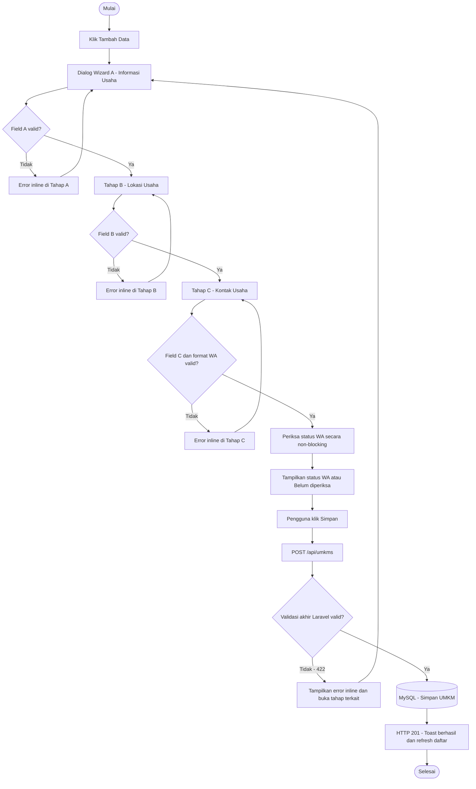
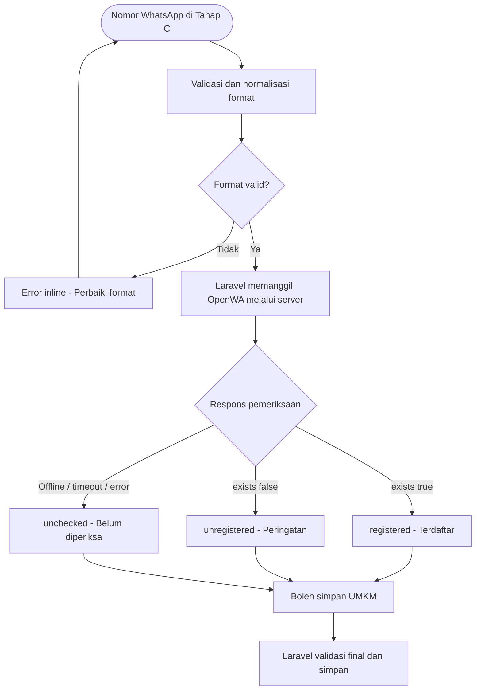
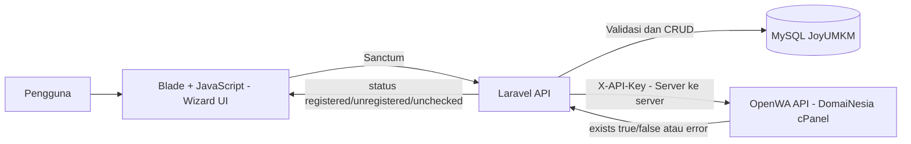

# PRD JoyUMKM — Tambah UMKM Wizard 3 Tahap & Pemeriksaan WhatsApp OpenWA

**ID dokumen:** `PRD-JOYUMKM-UMKM-WIZARD-OPENWA`  
**Tanggal:** 22 November 2026 (Asia/Jakarta)  
**Status:** **FINAL FUNCTIONAL SPEC — READY FOR IMPLEMENTATION** (belum diimplementasikan)  
**Target repositori:** [`joytimess/dip-joyumkm`](https://github.com/joytimess/dip-joyumkm) — gunakan **checkout lokal terkini** sebagai source of truth  
**Implementor yang diminta:** **Codex GPT-6.2 Sol · thinking effort HIGH** (dipilih di lingkungan Codex pengguna; dokumen ini tidak mengubah setting model)  
**Lingkup:** Laravel API, MySQL, Blade/JavaScript/Tailwind UI, integrasi OpenWA, QA/regresi terarah.

> **Tujuan utama:** Pengguna dapat menambahkan UMKM melalui modal wizard **A: Informasi Usaha → B: Lokasi → C: Kontak**. Nomor WhatsApp diperiksa melalui API OpenWA, tetapi hasil **tidak terdaftar** maupun **OpenWA tidak tersedia** **tidak memblokir** penyimpanan. Hanya kesalahan format atau field wajib yang memblokir.

---

## 0. Instruksi eksekusi untuk Codex (wajib dibaca pertama)

1. Gunakan **GPT-6.2 Sol** dengan effort **HIGH** untuk implementasi ini; jangan mengalihkan pekerjaan ke stack/framework lain.
2. Buka **`AGENTS.md`** pada root repo dan semua project rules yang relevan. Buka **`DESIGN.md` di checkout lokal** **sebelum** melakukan perubahan frontend. **`DESIGN.md` tidak ditemukan di snapshot GitHub `main` yang diperiksa saat penulisan PRD**; jangan menebak isinya. Jika ada di mesin lokal, isi `DESIGN.md` lokal menjadi acuan visual utama bersama design tokens/komponen yang benar-benar ada. Jika tidak ada, gunakan design system existing (`resources/css/tokens.css`, dokumen UI-1/UI-2/UI-3) dan catat ketiadaannya pada handoff; jangan membuat `DESIGN.md` rekaan.
3. Inventaris skills dari **`C:\Users\itsba\.agents\skills`**, baca `SKILL.md` untuk domain yang relevan, dan **gunakan** sesuai instruksinya. Pada repo GitHub sudah terlihat skill `laravel-best-practices`, `testing-best-practices`, dan `tailwindcss-development` di `.agents/skills/`; prioritaskan skill lokal jika lebih baru/berbeda. Skill `infer-conventions` **tidak perlu menjalankan sweep** kecuali memang ditugaskan eksplisit.
4. Inventaris agents dari **`C:\Users\itsba\.codex\agents`**, pilih hanya profil yang sesuai backend, frontend, atau QA. Maksimal **3 agents/subagents** bila lingkungan mendukung. Jangan mengarang nama agent yang belum ditemukan. Jika fitur subagent tidak tersedia, lanjutkan implementasi secara langsung.
5. **Audit kode lokal secukupnya terlebih dahulu:** periksa `git status`, rute API/web, migrations/models/requests/resources, implementasi dialog UMKM, existing tests, dan desain aktual. Snapshot GitHub dalam PRD hanyalah baseline informasi, **bukan** alasan menimpa perubahan lokal.
6. Implementasikan **end-to-end** setelah audit singkat: migration → backend → wizard UI → QA. Jangan berhenti pada PRD/analisis saja; hindari blocker administratif yang tidak perlu. Laporkan kendala teknis nyata secara jujur jika ada.
7. Jangan reset/clean/rebase repo secara destruktif; jangan menyentuh data MySQL production. Jangan mengubah `.env` berisi secrets maupun mempublikasikan API key di log, screenshot, commit atau frontend.

### Basis teknis yang benar-benar ditemukan di `main` GitHub

- Aplikasi **Laravel 13/PHP 8.3**, Sanctum, Eloquent, MySQL; frontend **Blade + JavaScript native + Tailwind v4 + Vite**, **bukan Vue.js**. Jangan menambahkan Vue, React, Livewire, atau dependensi UI baru tanpa kebutuhan yang disetujui.
- Modal Tambah/Ubah saat ini berada di `resources/views/umkms.blade.php`, state/event/submit ada di `resources/js/pages/umkms.js`, klien API di `resources/js/api.js`, primitives modal/toast/error di `resources/js/ui.js`.
- API saat ini: `POST /api/umkms`, `PATCH /api/umkms/{id}`, `GET /api/umkms/options`, `GET /api/umkms/{id}`; request di `app/Http/Requests/Umkm/`, model `app/Models/Umkm.php`, service `app/Services/UmkmService.php`, resource `app/Http/Resources/UmkmResource.php`.
- Tabel `umkms` saat ini hanya memiliki `user_id, name, province, sector_id, omzet` dan timestamps. **Field baru membutuhkan additive migration**; tidak boleh diasumsikan sudah tersedia.
- Nilai omzet saat ini berupa **integer rupiah tanpa periode**. Periode wajib untuk **entri baru**, tetapi nilai historis tidak boleh diam-diam ditafsirkan sebagai bulanan atau tahunan.
- Desain existing: Poppins, warna `#0207CA` (primary), `#0297DE` (secondary), `#FC734D` (accent), navy `#101E40`, surfaces netral; gunakan token dan komponen yang sudah ada.

---

## 1. Tujuan, aktor, dan batasan

**Aktor:** pengguna JoyUMKM yang terautentikasi dan berhak mengelola UMKM miliknya.

**Outcome:** entri data UMKM lebih lengkap, terstruktur, dapat disimpan tanpa bergantung pada ketersediaan OpenWA, dan mendapat informasi apakah nomor kontak terdaftar di WhatsApp.

**Non-goals / di luar scope:** OTP, bukti kepemilikan nomor, pengiriman chat, broadcast, pesan otomatis, WhatsApp Business API baru, redesign seluruh dashboard, penggantian arsitektur frontend, workflow approval, integrasi layanan geocoding berbayar, pengubahan rumus penilaian enam faktor/analitik.

**Prinsip kompatibilitas:** daftar UMKM desktop tetap tabel, mobile tetap card list; filter, pagination, pencarian, detail, edit, hapus, penilaian enam faktor, dan penilaian V1 tidak boleh rusak. Pertahankan shell navigasi/partial loading existing.

## 2. Desain pengalaman pengguna (final)

- Titik masuk tetap tombol **Tambah Data** dari halaman UMKM.
- Form **modal/dialog wizard tiga tahap**; bukan halaman/rute baru.
- Header memuat judul, penanda progres A/B/C, dan kontrol tutup. Konten dialog responsif/scrollable; footer menampilkan **Batal/Kembali/Lanjut/Simpan** sesuai tahap.
- **Validasi per tahap** ketika menekan *Lanjut*, pesan error **inline di bawah field** dan fokus menuju error pertama. Field tahap sebelumnya tidak hilang ketika maju/mundur.
- **Tidak ada penulisan UMKM ke database sebelum pengguna menekan Simpan pada tahap C**. Boleh menyimpan state wizard di memori browser selama dialog terbuka; tidak perlu fitur draft baru.
- Saat submit: cegah double-submit, beri state saving pada tombol, tampilkan error Laravel 422 inline, arahkan wizard ke tahap tempat field bermasalah, dan tampilkan toast sukses hanya setelah HTTP `201`.
- Ketika modal ditutup dengan perubahan belum disimpan, ikuti pola *unsaved edits confirmation* existing, termasuk saat navigasi/logout. Fokus dan Escape tetap benar.
- Modal pembuatan diperluas menjadi wizard; **alur Ubah UMKM yang sudah ada tetap harus berfungsi**. Pengembangan edit untuk field baru boleh memanfaatkan komponen yang sama, tetapi jangan memaksa data legacy menjadi lengkap hanya untuk menyimpan perubahan lama.

### 2.1 Field Tahap A — Informasi Usaha

| Field | API key yang disarankan | Wajib untuk create | Ketentuan |
|---|---|---|---|
| Nama UMKM | `name` | Ya | Trim, maksimal 120 karakter; aturan unik per `user_id` existing tetap berlaku |
| Sektor | `sector_id` | Ya | ID dari `GET /api/umkms/options`; wajib valid di database |
| Omzet | `omzet` | Ya | Bilangan bulat rupiah `>=0`, maksimum mengikuti validasi existing |
| Periode omzet | `omzet_period` | Ya | Pilihan eksplisit **`monthly` / `yearly`** (label Bulanan/Tahunan); **jangan** membuat asumsi untuk legacy |
| Tahun berdiri | `year_founded` | Tidak | Tahun integer masuk akal, tidak melampaui tahun sekarang |
| Jumlah karyawan | `employee_count` | Tidak | Integer `>=0` |
| NIB | `nib` | Tidak | String digit sesuai format NIB yang diterapkan proyek; nilai kosong valid |
| Deskripsi | `description` | Tidak | Teks dengan batas panjang wajar dan konsisten convention proyek |

**Catatan omzet:** penambahan periode hanya metadata input baru; jangan otomatis mengonversi omzet atau mengubah perhitungan KPI/penilaian yang sudah berjalan tanpa kontrak dan tes yang jelas.

### 2.2 Field Tahap B — Lokasi Usaha

| Field | API key yang disarankan | Wajib untuk create | Ketentuan |
|---|---|---|---|
| Provinsi | `province` | Ya | Tetap pakai options provinsi existing |
| Kabupaten/kota | `city` | Ya | Input teks tertrim atau dataset existing **jika tersedia di checkout lokal**; jangan menambah provider eksternal |
| Alamat lengkap | `address` | Ya | Tidak hanya whitespace |
| Kecamatan | `district` | Tidak | Teks |
| Kelurahan/desa | `subdistrict` | Tidak | Teks |
| Kode pos | `postal_code` | Tidak | 5 digit bila diisi |
| Latitude | `latitude` | Tidak | Numerik rentang -90 s.d. 90 |
| Longitude | `longitude` | Tidak | Numerik rentang -180 s.d. 180 |

Koordinat opsional **harus berpasangan**; satu koordinat tanpa pasangannya ditolak. Tidak wajib memasang peta/geocoding untuk scope ini.

### 2.3 Field Tahap C — Kontak Usaha

| Field | API key yang disarankan | Wajib untuk create | Ketentuan |
|---|---|---|---|
| Nama pemilik | `owner_name` | Ya | Trim, string |
| Nomor WhatsApp | `whatsapp_number` | Ya | Normalisasi ke format internasional Indonesia `62...`; validasi format server |
| Email usaha | `business_email` | Ya | Email valid; **tidak memakai OTP/email verification baru** |
| Nama PIC | `pic_name` | Tidak | Teks |
| Website | `website_url` | Tidak | URL HTTP/HTTPS valid bila diisi |
| Media sosial | `social_media_url` | Tidak | Satu URL profil/halaman sosial yang valid bila diisi |

**Aturan format WA:** terima input Indonesia yang lazim (`08...`, `628...`, `+628...`) dan normalisasi ke `62...` **tanpa** menganggap nomor terdaftar. Tolak karakter yang tidak dapat dinormalisasi secara aman; format valid tidak sama dengan keberadaan akun WhatsApp. Tidak perlu bergantung pada library nomor baru jika validator project cukup.

## 3. Ketentuan final WhatsApp — tidak boleh diubah

| Kondisi | Status internal | UI | Penyimpanan UMKM |
|---|---|---|---|
| OpenWA menjawab `exists: true` | `registered` | **Terdaftar di WhatsApp** | **Boleh** |
| OpenWA menjawab `exists: false` | `unregistered` | **Tidak terdaftar**, tampilkan peringatan non-blocking | **Boleh** |
| OpenWA offline, `503`, timeout, koneksi gagal, respons tak valid / sesi disconnect | `unchecked` | **Belum diperiksa**, informasikan pemeriksaan gagal | **Boleh** |
| Nomor wajib kosong atau format salah | — | **Error inline** | **Tidak boleh** sampai valid |

- Periksa **registrasi nomor** saja, **bukan verifikasi pemilik**; **tanpa OTP dan tanpa mengirim pesan**.
- Hasil `unchecked` **tidak boleh** diubah menjadi `unregistered`.
- Pengecekan ditampilkan pada tahap C setelah format nomor valid (disarankan saat `blur` atau setelah pengguna selesai mengetik, bukan pada setiap keystroke). Perubahan nomor membatalkan hasil tampilan lama; respons asinkron dari nomor lama tidak boleh menimpa yang baru.
- **Pengecekan bukan prasyarat Simpan**. Bila masih pending saat menekan Simpan, backend memakai batas waktu singkat dan fallback `unchecked`, bukan memaksa menunggu tanpa akhir.
- Status dan waktu pengecekan yang disimpan harus berasal dari **server**, bukan dipercaya mentah-mentah dari request browser. Pada submit, backend memeriksa ulang bila diperlukan untuk memastikan status terkait nomor yang benar; gunakan timeout ketat agar tetap *fail-open*.
- Saat nomor berubah pada update, hilangkan status registrasi nomor lama; evaluasi ulang atau simpan sebagai `unchecked`. Jangan menampilkan status lama untuk nomor baru.

## 4. Flowchart — Wizard Tambah UMKM



**Catatan:** panah kembali dari error akhir melambangkan pengalihan ke tahap yang relevan, bukan selalu tahap A. Semua navigasi Kembali tetap mempertahankan isian.

## 5. Flowchart — Keputusan OpenWA (fail-open)



## 6. Flowchart — Arsitektur sistem



## 7. Kontrak integrasi Laravel ↔ OpenWA

### 7.1 Infrastruktur yang sudah tersedia (jangan instal ulang)

- Base URL OpenWA: `https://open-wa.dokumenkita.online/api`.
- Session eksisting: `b175cb04-0358-49ce-9d1e-58f217c8c7e4` (`joyumkm-wa`).
- Endpoint yang telah dicoba: `GET /sessions/{sessionId}/contacts/check/{number}` dengan header `X-API-Key`.
- Pengujian manual sebelumnya menghasilkan HTTP `200` + payload `{ "number": "...", "exists": false, "whatsappId": null }`. Status sesi pernah `ready`, tetapi pada shared hosting bisa juga terputus. **Jangan mengasumsikan koneksi selalu online**.
- **Tidak perlu pairing/instalasi ulang** sebagai bagian dari implementasi JoyUMKM.

### 7.2 Configuration (server-only)

Gunakan `.env` Laravel + file config Laravel (nama final konsisten dengan conventions repo):

```dotenv
OPENWA_ENABLED=true
OPENWA_BASE_URL=https://open-wa.dokumenkita.online/api
OPENWA_SESSION_ID=b175cb04-0358-49ce-9d1e-58f217c8c7e4
OPENWA_API_KEY=ISI_DI_ENV_LOKAL_BUKAN_DI_REPO
OPENWA_TIMEOUT_SECONDS=3
```

- Jangan hardcode secret di controller, Blade atau JS. **Jangan commit `.env` asli**. Tambahkan placeholder nonsecret ke `.env.example` sesuai convention.
- Gunakan Laravel HTTP Client service khusus (misalnya `OpenWaNumberCheckService`) untuk request, validasi payload, timeout, dan error mapping. Jangan melakukan panggilan eksternal di dalam transaksi database yang panjang.
- Gunakan timeout singkat (target 3 detik maksimal untuk satu lookup), tanpa retry agresif yang menghambat form. Sanitasi URL/path dan nomor telepon. Gunakan `Http::fake()` untuk tests.
- Jangan log `X-API-Key`, body mentah yang mengandung kontak, atau jawaban sensitif. Jangan memberi browser akses langsung ke domain OpenWA.

### 7.3 Laravel endpoint status WA untuk wizard

**Usulan endpoint baru:** `POST /api/umkms/whatsapp-check` (terautentikasi Sanctum, throttled). Tambahkan route **sebelum** route dinamis `/umkms/{id}`.

Request:

```json
{"whatsapp_number":"081234567890"}
```

Sukses pemeriksaan (HTTP `200`):

```json
{"data":{"normalized_number":"6281234567890","status":"registered","message":"Nomor terdaftar di WhatsApp."}}
```

Kondisi nomor tidak terdaftar: HTTP `200`, status `unregistered`. OpenWA error/offline: **HTTP `200` dengan status `unchecked`** (bukan false), pesan aman untuk pengguna. Format salah: HTTP `422` dengan field error `whatsapp_number`. Tidak ada bocoran secret/error teknis mentah.

**Rate limit:** gunakan kebijakan throttle user yang sederhana dan sesuai convention (contoh maksimal 10 pemeriksaan/menit/pengguna), tanpa memblokir `POST /api/umkms`. Jika throttle endpoint cek terlampaui, UI tampilkan `unchecked` dan tetap bisa Simpan; jangan membuat loop otomatis tanpa batas.

### 7.4 Kontrak `POST /api/umkms` (existing)

- Endpoint tetap sama dan tetap menggunakan `auth:sanctum`/ownership existing.
- Tambahkan field A/B/C pada request creation, gunakan aturan validasi server yang cocok dengan UI; kunci `user_id` tetap **prohibited** dari browser.
- **Client tidak boleh mengirim nilai `wa_registration_status` yang dipercaya**. Backend menentukan status sendiri (pemeriksaan server atau fallback `unchecked`).
- Status response **201** tetap melalui `UmkmResource` dan menyertakan field tambahan (termasuk `whatsapp_registration_status`, `whatsapp_checked_at` jika ada) tanpa menghapus field lama seperti `sector`, `omzet`, `latest_score`, `category`, dll.
- Bila OpenWA timeout/503, API **tetap menyimpan UMKM** dan mengembalikan `201` jika field wajib valid.
- Bila `name` duplikat per pengguna atau field wajib salah, kembalikan **422** dengan field error seperti existing.

### 7.5 Update & pembacaan data lama

- `PATCH /api/umkms/{id}` tetap mendukung **perubahan parsial**. Field baru dapat diperbarui bila dikirim dan harus tervalidasi; jangan mewajibkan data baru yang belum pernah dimiliki record legacy hanya untuk mengedit field existing.
- `GET /api/umkms/{id}` boleh menampilkan seluruh metadata tambahan; `GET /api/umkms` dan ringkasan/filter tetap mempertahankan kontrak lama. Field baru additive, bukan perubahan bentuk field existing.
- Jika data lama tidak memiliki field baru, resource mengembalikan `null`/status `unchecked` dengan aman, bukan error atau nilai fiktif.
- **Edit UI existing tidak boleh rusak.** Prioritas utama PRD adalah create wizard. Jika field baru belum masuk edit UI pada iterasi ini, jangan mengklaim sudah bisa diubah lewat UI; handoff harus eksplisit mencatatnya. Namun backend PATCH dan detail harus tetap aman.

## 8. Model data & migrasi

**Additive migration** pada `umkms`, jangan ubah atau drop tabel/data existing:

```text
omzet_period          nullable string(16)              # null hanya untuk legacy
year_founded          nullable unsignedSmallInteger
employee_count        nullable unsignedInteger
nib                   nullable string(32)
description           nullable text
city                  nullable string(120)
address               nullable text
district              nullable string(120)
subdistrict           nullable string(120)
postal_code           nullable string(5)
latitude              nullable decimal(10,7)
longitude             nullable decimal(10,7)
owner_name            nullable string(120)
whatsapp_number       nullable string(20)
business_email        nullable string(254)
pic_name              nullable string(120)
website_url           nullable string(2048)
social_media_url      nullable string(2048)
wa_registration_status string(16) default 'unchecked'
wa_checked_at         nullable timestamp
```

**Wajib saat `POST create`:** `omzet_period`, `city`, `address`, `owner_name`, `whatsapp_number`, `business_email` ditambah empat field existing. **Nullable pada schema** untuk kompatibilitas dengan record lama, bukan berarti opsional pada formulir create baru.

- Perbarui `Umkm` fillable/casts, Form Requests, `UmkmService`, Resource, Factory sesuai convention existing.
- Pertahankan unique key (`user_id`, `name`), FK dan relasi penilaian; tidak mengubah existing records/soft delete/arsip dalam scope fitur ini.
- Jangan memberikan default periode omzet bulanan/tahunan pada data historis.
- Pastikan down migration hanya membuang kolom baru yang memang dibuatnya, tanpa menyentuh data atau tabel lain.
- **Migrasi dijalankan dan diuji pada DB testing terisolasi lebih dahulu**; production deployment tidak termasuk tugas ini.

## 9. UI/UX standard wajib (DESIGN.md + existing design system)

1. Baca `DESIGN.md` checkout lokal jika tersedia; jika tidak ada, pakai design tokens existing dan dokumentasikan. Jangan mengarang style baru yang bertentangan dengan standar JoyUMKM.
2. Reuse `dialog` native dan `bindDialog`, `openDialog`, `clearErrors`, `renderErrors`, `setBusy`, `toast`, dan `createSelectControl` dari codebase bila cocok.
3. Warna netral dominan; primary pada CTA, warna semantik pada indikator pemeriksaan WA, **bukan** menu tiga-titik warna-warni.
4. Label wajib jelas, penanda required konsisten, helper text untuk `omzet_period` dan format WhatsApp, validasi dekat field.
5. `aria-current`/semantik langkah yang sesuai, fokus keyboard, tab order, Escape, restore focus, aria-live untuk hasil cek WA, error summary bila perlu.
6. Mobile 320/390 px: modal tidak melampaui viewport, body dialog scroll independen, footer aksi dapat dijangkau, tombol minimal ukuran target sesuai UI existing; desktop 1440 px tidak terasa terlalu lebar.
7. Indikator cek WA: pending ringan per field, bukan overlay seluruh layar atau spinner **“Memeriksa sesi Anda…”**. Saat timeout, tulis **Belum diperiksa**, bukan pesan kesalahan API mentah.
8. Preserve navigation state/search/filter/sort/pagination, keyboard/unsaved navigation guard, dan mekanisme partial loading. Jangan memperkenalkan loading full-screen pada perpindahan halaman.

## 10. Rencana implementasi minimal & file impact

| Workstream | Hasil yang diharapkan | Area utama |
|---|---|---|
| W1 — Database | Migrasi additive kompatibel legacy | `database/migrations/`, model, factory |
| W2 — API Laravel | Validation create/update, service OpenWA, resource/endpoint check | `app/Http/Requests/Umkm/`, `app/Services/`, `app/Http/Controllers/Api/`, `routes/api.php`, `config/` |
| W3 — Wizard UI | A/B/C, validasi, status WA, responsive/accessibility, state management | `resources/views/umkms.blade.php`, `resources/js/pages/umkms.js`, CSS existing |
| W4 — QA & handoff | PHPUnit/JS/build/browser manual, screenshot, daftar risiko dan status AC | `tests/`, evidence/handoff sesuai convention |

**Urutan pragmatis:** audit → W1/W2 → W3 → W4. Boleh diparalelkan bila file ownership jelas. Jangan membuat framework/arsitektur baru, worker berkepanjangan, atau refactor lintas domain untuk fitur ini.

## 11. Acceptance criteria / release gates

| ID | Acceptance criteria | Bukti minimum |
|---|---|---|
| `UMKM-AC01` | Tombol Tambah Data membuka modal wizard A/B/C tanpa route baru | Browser/manual |
| `UMKM-AC02` | Field A/B/C sesuai tabel; required di setiap langkah; Kembali mempertahankan input | Browser/JS |
| `UMKM-AC03` | Nomor kosong/salah format dan field wajib lain invalid memunculkan error inline, tidak menyimpan | 422 + UI |
| `UMKM-AC04` | Nomor `exists:true` ditampilkan registered, UMKM tersimpan 201 | HTTP fake + API test |
| `UMKM-AC05` | Nomor `exists:false` **peringatan tetapi tetap tersimpan 201** | HTTP fake + API + UI |
| `UMKM-AC06` | Offline/timeout/503/invalid payload → `unchecked`, **tetap tersimpan 201** | HTTP fake + API + UI |
| `UMKM-AC07` | Respons cek nomor lama tidak menimpa status nomor terbaru; tidak ada spam request ke OpenWA | JS/manual |
| `UMKM-AC08` | Error validasi akhir server diarahkan ke tahap & field terkait | API 422 + browser |
| `UMKM-AC09` | Tidak ada key OpenWA di JS/Blade/response/log/client network; endpoint memerlukan Sanctum & throttle | Code review + API test |
| `UMKM-AC10` | Migrasi mempertahankan semua UMKM lama, skor/penilaian, dan omzet tanpa menebak periodenya | MySQL isolated migration + test |
| `UMKM-AC11` | Edit PATCH legacy, daftar/filter/pagination, detail, penilaian tidak regresi | Regression existing |
| `UMKM-AC12` | Tidak ada double-submit, unsaved changes tidak hilang diam-diam, fokus & loading benar | Browser/JS |
| `UMKM-AC13` | UI patuh `DESIGN.md` lokal / tokens existing; responsif pada 320/390/768/1440 & keyboard | Screenshot + manual QA |
| `UMKM-AC14` | `npm test`, `npm run build`, tes PHP terarah, formatter, dan review diff selesai dengan hasil jujur | Command outputs + handoff |

**Definisi PASS:** `UMKM-AC01` s.d. `UMKM-AC14` terverifikasi. Jika tidak dijalankan, tulis **NOT RUN**; jika tidak lolos, tulis **FAIL** dengan temuan nyata. Jangan menyebut keseluruhan PASS karena hanya happy path API lulus.

### Testing minimum

- PHPUnit Feature: auth/ownership, fields wajib A/B/C, normalization nomor, duplicate name, create terdaftar/tidak terdaftar/timeout/offline/503/invalid body, PATCH parsial legacy, leakage API key, rate limiting jika ditambahkan.
- Integration: gunakan `Http::fake()` OpenWA; **jangan** bergantung pada akun WhatsApp real/live saat test otomatis.
- MySQL testing: migrate schema ke DB khusus test, cek integritas legacy, hubungan penilaian, rollbacks bila layak; jangan memakai DB lokal pengguna atau cPanel production.
- JS tests: wizard navigation, inline errors, stale-response suppression, graceful unchecked, double-submit, unsaved guard.
- Browser visual/manual: 320, 390, 768, 1440 px; fokus/keyboard, stepper, status WA, modal scroll, list table/card, detail/edit, partial navigation. Screenshot before/after hanya area yang berubah.
- Jika full suite mempunyai baseline failures, bandingkan dengan baseline teridentifikasi dan **pisahkan** dari regression baru; jangan mengklaim semua PASS.

## 12. Deliverables & handoff Codex

1. **Implementasi kode** yang siap diuji pada checkout lokal, bukan hanya proposal.
2. Migrasi, Laravel service/config/validation/resource, create wizard, integrasi endpoint server-side, dan test sesuai acceptance criteria.
3. Catatan desain: `DESIGN.md` ditemukan atau tidak, path dan rules yang diterapkan; skills/agents **yang benar-benar digunakan** (bukan daftar rekaan).
4. Bukti tes dengan angka PASS/FAIL/NOT RUN, identitas database testing (tanpa secret), dan screenshot desktop/mobile.
5. Ringkasan file berubah, risiko yang tersisa (misalnya stabilitas koneksi Baileys di shared hosting), dan langkah deployment Laravel **terpisah** bila diperlukan. Jangan restart/pairing OpenWA hanya untuk mengimplementasikan UI.

## 13. Instruksi singkat siap tempel ke Codex

> Implementasikan seluruh `PRD_JoyUMKM_Tambah_UMKM_Wizard_OpenWA.md` pada checkout lokal JoyUMKM. Gunakan GPT-6.2 Sol thinking effort HIGH. Baca `AGENTS.md`, `DESIGN.md` lokal (jika tersedia), skills dari `C:\Users\itsba\.agents\skills`, dan agents dari `C:\Users\itsba\.codex\agents`; pilih yang relevan, maksimal 3 subagents. Audit singkat codebase lokal terlebih dulu lalu kerjakan migration, Laravel backend, modal wizard A/B/C, API OpenWA server-to-server, test PHPUnit/JS/browser, dan handoff. Ikuti Blade + JS + Tailwind existing, jangan instal framework frontend baru, jangan mengubah desain di luar `DESIGN.md`/tokens. Nomor WA tidak terdaftar **peringatan dan tetap boleh Simpan**; OpenWA offline/timeout **unchecked dan tetap boleh Simpan**; format WA salah **blokir**. Semua status WA authoritative server-side, tanpa OTP, tanpa pesan. Lindungi data lama, jangan mereset DB/user repo, jangan bocorkan secrets; hasilkan bukti AC nyata dan jangan berhenti di analisis.

---

### Provenance / batas verifikasi

PRD didasarkan pada keputusan pengguna dalam percakapan dan inspeksi beberapa file **GitHub `joytimess/dip-joyumkm` branch `main`** pada 22 November 2026: `AGENTS.md`, request/controller/service/model/DB UMKM, API routes, frontend Blade/JS, design tokens, dokumen UI-1/UI-3, dan sejumlah skills `.agents/skills`. **Direktori Windows lokal (`C:\Users\itsba\...`) dan `DESIGN.md` lokal tidak dapat diperiksa langsung dalam sesi penulisan dokumen ini**. Codex yang bekerja pada PC harus membaca versi sebenarnya sebelum mengimplementasikan, tanpa menganggap snapshot GitHub selalu identik dengan working tree.
