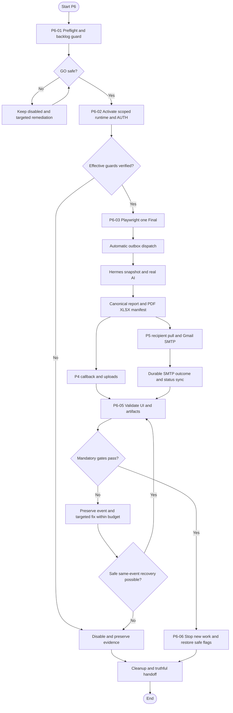
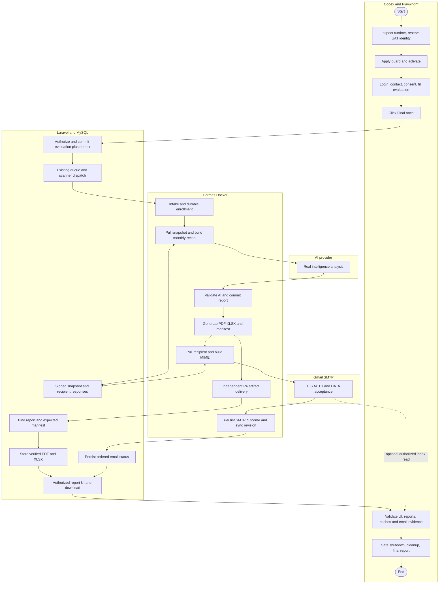
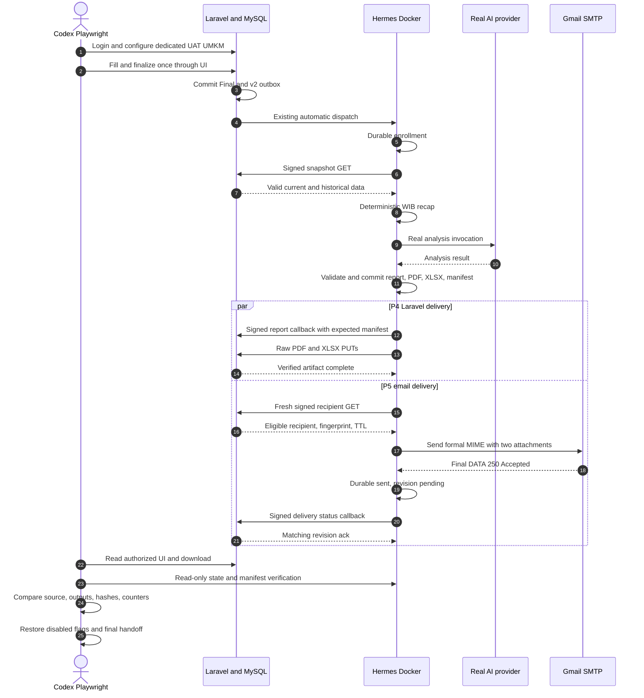
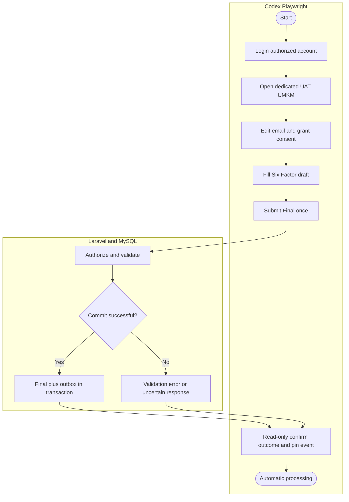

# JoyUMKM × Hermes — PRD & Runbook P6
## Full Autonomous End-to-End UAT & Controlled Activation

**Versi:** 1.0  
**Tanggal:** 25 November 2026 (WIB)  
**Status:** K1–K12 approved by owner; ready for execution  
**Scope:** Laragon lokal + MySQL dev + Hermes Agent Docker existing  
**Pelaksana:** Codex sepenuhnya (operator teknis, browser tester, validator, penyusun handoff).  
**Mode:** Full Autonomous; satu eksekusi P6-01 sampai P6-06.  
**Estimasi:** 25–50 menit jika lancar, bukan SLA. Technical QA maksimal 15 menit kumulatif; window live processing maksimal 20 menit.

---

## 0. Instruksi utama kepada Codex

Jalankan runbook ini, bukan sekadar menyusun rencana atau mengulang audit. Owner telah menyetujui scope dan memberikan otorisasi untuk **satu UAT nyata yang terkontrol**, termasuk satu finalisasi penilaian melalui browser, pemanggilan provider AI existing untuk event tersebut dan satu pengiriman email nyata kepada alamat uji yang ditetapkan. Tidak perlu meminta owner melakukan login, finalisasi, membuka dokumen, menjalankan command atau mengecek inbox secara manual. Tidak ada approval rutin antar-task.

Gunakan Playwright untuk bertindak sebagai pengguna sah melalui website JoyUMKM. Biarkan sistem menyelesaikan workflow bisnis secara otomatis. Gunakan inspeksi teknis read-only untuk membuktikan identitas event, konsistensi sumber, status dan integritas output. Perbaiki hanya bug konkret yang menghalangi scope ini. Jika akses, guard, atau dependency tidak tersedia, selesaikan bagian independen yang aman dan laporkan blocker spesifik; jangan memalsukan bukti, melemahkan keamanan, atau melampaui batas.

**Goal:** satu penilaian Enam Faktor baru difinalisasi melalui UI → live outbox → Hermes → AI nyata → canonical report + PDF/XLSX → delivery Laravel dan Gmail nyata → sinkronisasi status → UI dan dokumen tervalidasi. Semua tindakan UAT dilakukan Codex. Inbox merupakan verifikasi tambahan bila akses sah tersedia. Handoff akhir tanpa pekerjaan manual owner yang wajib.

**Penting:** otorisasi UAT sementara bukan otorisasi rollout permanen, replay histori, deployment hosting, atau pengiriman kepada UMKM lain. Setelah UAT, kembali ke safe disabled state. Jangan memulai fase/fitur baru.

## 1. Keputusan owner K1–K12

| ID | Keputusan disetujui |
|---|---|
| K1 | Seluruh pelaksanaan UAT oleh Codex, tanpa pengujian manual owner. |
| K2 | Playwright sebagai pengguna website JoyUMKM aktual. |
| K3 | Satu UMKM khusus UAT dan satu finalisasi baru. |
| K4 | Real AI dan real Gmail menggunakan konfigurasi/provider existing. |
| K5 | Guard UAT membatasi pemrosesan ke satu event yang disetujui. |
| K6 | Queue, scheduler dan recovery existing menjalankan otomatisasi. |
| K7 | Tidak ada historical replay, backlog processing atau email duplikat. |
| K8 | Targeted bug fix oleh Codex diizinkan, tanpa membuka kembali seluruh fase. |
| K9 | Technical QA maksimal 15 menit kumulatif, tanpa full historical regression. |
| K10 | Inbox diverifikasi otomatis hanya jika akses sah telah tersedia. Jika tidak, NOT RUN. |
| K11 | Rollout permanen tidak diaktifkan tanpa otorisasi tersendiri. |
| K12 | Tidak ada deployment hosting nonlokal. Internet untuk AI dan Gmail tetap digunakan. |

## 2. Accepted checkpoints dan sumber kontrak

| Fase | Checkpoint |
|---|---|
| P0–P1 | Audit/rekonsiliasi/stabilisasi diterima dengan live dispatch ditangguhkan. Evaluasi 9–11 legacy tidak direplay; tujuh archived_unmatched dipertahankan. |
| P2 | Schema/data contract dan UTC dev PASS; consent, suppression dan recipient fingerprint sudah tersedia. |
| P3 | Historical snapshot, rekap WIB, canonical analysis, PDF, XLSX, manifest dan pipeline PASS lokal. |
| P4 | Signed callback dan raw binary upload, private storage, authorized download, QPDF dan Laragon FastCGI PASS lokal. |
| P5-01–02 | Recipient API/consent PASS: 42 MySQL tests, 469 assertions. |
| P5-03–05 | Email engine/recovery PASS lokal: 65 Hermes tests + 7 targeted final tests. Gmail implicit TLS 465 sudah dikonfigurasi; autentikasi nyata belum diuji. |
| P5-06 | Status callback revision-based, retry independen dan UI PASS lokal; migration batch 9. |
| P5-07 | 14 MySQL tests/152 assertions, 11 Hermes tests, Pint, Vite, FastCGI, desktop 1440/mobile 390 PASS. Satu-satunya partial yang dilaporkan adalah folder staging Windows. Owner telah mengonfirmasi `Test-Path=False`; P5 diterima PASS lokal berdasarkan konfirmasi tersebut. |

Referensi repo (baca hanya bagian yang relevan, gunakan versi final terbaru):

- `docs/audit/P1_JoyUMKM_Hermes_Stabilization_Report.md` §3 dan §7 — queue, scheduler, outbox, legacy policy. Instruksi Tinker lama **tidak digunakan**.
- `docs/audit/P2_JoyUMKM_FINAL_COMPLETION.md` — UTC, schema, histori.
- `docs/audit/P3_JoyUMKM_FINAL_COMPLETION.md`, `docs/evidence/p3-06-pipeline-contract.md`, kontrak data P3-02 dan manifest P3-05.
- `docs/audit/P4_JoyUMKM_FINAL_COMPLETION.md`, P4-07 deployment hardening final, kontrak callback/upload/status.
- `docs/audit/P5-01_P5-02_JoyUMKM_Recipient_Consent_Completion.md`, `docs/evidence/p5-01-recipient-api-contract.md`.
- `docs/audit/P5-03_P5-05_JoyUMKM_Email_Engine_Completion.md`, `docs/evidence/p5-03-smtp-recipient-contract.md`, `docs/evidence/p5-05-email-delivery-contract.md`.
- `docs/audit/P5-06_JoyUMKM_Delivery_Status_Callback.md`, `docs/audit/P5-07_JoyUMKM_Integrated_QA_Completion.md`, `docs/evidence/p5-06-delivery-status-contract.md`, `docs/evidence/p5-07-qa-summary.md`, `docs/audit/P5_JoyUMKM_FINAL_COMPLETION.md`.

Preflight harus memeriksa `Test-Path` secara read-only untuk `%TEMP%/joyumkm-p506-work`. Jika absent, tambahkan addendum cleanup berdasarkan konfirmasi owner dan verifikasi aktual, update AC-15 serta verdict P5 yang masih PARTIAL. Jangan mengarang durasi cleanup atau mengubah hasil test historis. Tidak perlu rerun P5. Jika folder muncul kembali, identifikasi ownership sebelum cleanup; jangan bypass policy.

Catatan penyusun: handoff P0–P5 telah dibaca untuk menyusun kontrak operasional ini, namun source/runtime lokal aktual tidak dapat diperiksa dari chat. Nama flag, path, task dan service yang disebut berasal dari handoff atau merupakan desain runbook; Codex harus memeriksa konfigurasi efektif dan source sebelum perubahan. Jangan memperlakukan checkpoint lama sebagai bukti kondisi hari ini.

## 3. Scope, resource dan batas penggunaan

| Parameter | Ketentuan |
|---|---|
| Laravel repo | `C:\laragon\www\joyumkm` |
| Web runtime | Apache/PHP FastCGI Laragon, virtual host existing (`joyumkm.test` bila masih sesuai) |
| Dev database | `joyumkm-v2`, MySQL UTC; periode/report UI Asia/Jakarta (WIB) |
| Hermes | `hermes-agent`, volume `hermes_data` |
| Runtime root | `/opt/data/joyumkm-intelligence/`, default `JMI_HOME=/opt/data/joyumkm-intelligence/state` |
| Browser | Playwright, profil/context UAT privat sementara |
| Business trigger | Satu UMKM UAT sah, satu evaluasi Enam Faktor baru, satu Final |
| AI | Real provider/model configured pada jalur JMI; satu analisis logis yang valid; no extra AI untuk email |
| SMTP | Gmail existing, `smtp.gmail.com:465` implicit verified TLS; AUTH probe tanpa DATA; satu accepted message maksimum |
| Alamat uji | `owner-approved@example.test` (privat, satu-satunya target; jangan hardcode ke source/log/evidence) |
| Recipient policy | Fresh signed GET, consent eksplisit, suppression, fingerprint |
| Artefak | Satu canonical report, PDF, XLSX, immutable manifest |
| Worker | Existing dedicated queue `hermes-webhooks`, Laravel scan/scheduler, Hermes `jmi-recover` |
| Technical QA | Maksimum 15 menit kumulatif, targeted only |
| Live observation | Maksimum 20 menit untuk event UAT, polling bounded; tidak reset per retry |
| Docker stack | Reuse existing; tidak membuat stack baru default |
| Source changes | Hanya targeted fix, diuji pada delta; migration hanya jika benar-benar perlu dan aman |
| Final state | Rollout off, pause aktif, service/task yang diaktifkan khusus UAT dikembalikan ke baseline |

Larangan: full historical regression, replay/backfill, direct SQL Final/insert outbox palsu, manual dispatch event, manual `jmi intake/process/render/send` untuk menggantikan normal workflow, membuat report/manifest palsu, SMTP test email tambahan, manual resend, broad refactor/redesign, credential rotation, provisioning ulang SMTP tanpa kebutuhan, `php artisan tinker`, commit/push/reset/clean, `migrate:fresh` dev, global Docker prune, hosting deployment, membuat subscription AI baru atau mengganti provider tanpa otorisasi. Jangan mengubah konfigurasi OpenWA atau proyek lain.

AI: target satu logical analysis dan satu real analysis submission pada happy path. Periksa retry/correction/provider runner aktual sebelum aktivasi. Jangan jalankan probe prompt nyata terpisah. Jika transient failure jelas sebelum submission, retry terbatas dalam existing policy dan time window; jika provider mungkin sudah memproses tetapi checkpoint belum durable, jangan otomatis membelanjakan panggilan baru tanpa pembuktian aman. Gunakan checkpoint valid. Catat jumlah invocation yang benar-benar terjadi (termasuk validator/correction calls jika runner existing melakukannya) dan keterbatasan metrik; jangan mengklaim satu billable request jika tidak terbukti. Bila batas tidak dapat dijaga, pause dan laporkan. Tidak memproses PII/histori di luar kebutuhan UMKM UAT kepada model.

SMTP: target satu logical message dan satu final acceptance, bukan exactly-once guarantee. Retry aman hanya bila ada bukti pesan belum diterima, existing budget dan window masih memungkinkan. `delivery_unknown` terminal otomatis; jangan resend bahkan jika inbox kosong. Tidak ada percobaan send tambahan melalui Laravel Mail atau client Gmail.

## 4. Scope breakdown dan diagram

| Task | Scope | Output |
|---|---|---|
| P6-01 | Runtime readiness, P5 closeout, test identity, backlog guard | GO/NO-GO preflight |
| P6-02 | Controlled activation, Gmail TLS/AUTH, background services | Effective UAT flags, runtime active in scope |
| P6-03 | Playwright browser flow | Satu Final baru + event UUID terikat |
| P6-04 | Real automatic processing | Report, artifacts, SMTP outcome, status sync |
| P6-05 | Technical/business acceptance | UI, score reconciliation, downloads, MIME dan inbox bila tersedia |
| P6-06 | Safe shutdown, cleanup, final handoff | Verdict dan operating instructions |

### 4.1 Overall flowchart



### 4.2 Activity diagram (swimlane-style)



Fork P4/P5 adalah independensi logis, bukan kewajiban mengeksekusi thread paralel. Status email dapat diterima setelah report dan manifest terikat meskipun upload masih pending.

### 4.3 Sequence diagram normal path



## 5. Runbook P6-01 — Runtime readiness dan backlog protection

### 5.1 Read-only baseline dan readiness

1. Buat run ID UTC dan staging privat owned-by-run; catat source Git status, actual host/container identity, `docker ps -a`, volume/network inventory, port/process/task baseline. Jangan dump environment/secrets. Catat hash relevant historical job files, row counts/digests outbox/report/manifest/delivery dan existing evaluation IDs; capture read-only, bounded. Hanya outbox/queue/job yang relevan; jangan audit seluruh database.
2. Pastikan Laragon, actual Apache/FastCGI, MySQL `joyumkm-v2`, UTC session, schema migration (P5 migration batch 9 sesuai checkpoint), QPDF 12.4.2 dan Python helper dapat diakses service user, disk private dan ACL masih aman. Gunakan inspection read-only, `php artisan migrate:status`, `schedule:list`, `hermes:webhook-status` jika tersedia, existing safe diagnostics. Jangan Tinker, jangan migrate ulang bila tidak perlu. Periksa URL actual browser dan endpoint callback/snapshot/recipient/artifact/status dari perspektif container; local alias `host.docker.internal` + Host header sesuai actual contract. P3 dahulu menggunakan port 8000; pastikan runtime snapshot tidak masih menunjuk server QA yang sudah mati. Jangan menganggap port lama aktif.
3. Hermes: verifikasi volume mount, UID runtime, permissions private env, actual config precedence, route `joyumkm-events` memakai script intake JMI (`joyumkm_intake.py` sesuai P1), bukan legacy agent prompt. Verifikasi authenticated webhook target dan allowed host. HTTPS verified non-local; local HTTP hanya alias yang telah diizinkan. Jangan print signature/secrets. Cocokkan HMAC dedicated secret masing-masing secara boolean saja. Periksa real provider/model runner yang efektif, no fake model/test stub untuk real run. Pastikan provider credential sah tersedia tanpa memanggil model tambahan.
4. Existing worker/scheduler: P4-07 mencatat task Windows `JoyUMKM Hermes Webhook Worker` dan `JoyUMKM Laravel Scheduler` disabled, IgnoreNew, project working directory, dedicated `database:hermes-webhooks`. Inspect actual status, definition, action, user, last run dan other scheduled jobs. Hermes mempunyai satu cron `jmi-recover` ID `5fa98346fe3a`, interval sekitar 5 menit, no-agent script. Gunakan existing mekanisme, jangan duplikasi. Periksa apakah cron sedang berjalan/berpotensi mengambil job lain sebelum membuka guard.
5. Verifikasi folder staging P5 absent dan perbarui catatan verdict sesuai §2. Jangan mengulang QA P5.

### 5.2 Identitas UAT dan browser access

Gunakan akun UAT berwenang dan dedicated UMKM existing yang memang aman untuk test, dengan bukti identitas/ownership. Bila belum ada, boleh membuat akun/UMKM test yang diperlukan **melalui mekanisme sah aplikasi** pada environment lokal (registrasi/login/CRUD existing dan admin provisioning yang sudah diotorisasi). Jangan gunakan credentials orang lain, bypass authentication/2FA/CAPTCHA, forge session/token, atau mengambil akun nyata tanpa izin. Jangan memerlukan owner menjalankan pengujian. Jika akses sah tidak tersedia, laporkan blocker akses; jangan substitute direct service finalization.

Utamakan UMKM test dengan histori bulan sebelumnya dan data Tiga Dimensi existing. Jika tidak tersedia, jangan membuat histori palsu atau finalisasi kedua. Validate null semantics dan tandai comparison dengan data historis penuh NOT RUN bila tidak ada. Gunakan data test minim PII. Catat `run_id`, authorized account ID, `uat_umkm_id` dan ID draft baru bila sudah tersedia. Data Final dari UAT dipertahankan sebagai evidence; jangan hapus row immutable. Jangan mengubah email/consent UMKM non-UAT.

### 5.3 Guard satu event — hard gate sebelum aktivasi

`HERMES_WEBHOOK_ENABLED=false` tidak menghentikan pembuatan pending outbox ketika user finalisasi. P1 mencatat scan dapat mengirim backlog tersebut setelah flag dibuka. Hermes recovery existing juga dapat memproses pending/processing job lama. Flag enrollment P3/P4/P5 saja **bukan** jaminan backlog aman.

- Inspect outbox pending/retry_wait, dedicated queue pending/delayed/reserved dan in-flight dispatch; failed/dead/legacy tetap histori. Inspect Hermes pending/processing, active lease, callback/recovery due, archived, existing enrolled jobs. Jangan menjalankan scanner atau recovery sebagai percobaan preflight.
- Terapkan guard scoped untuk dispatch, intake, analysis/recovery, artifact delivery, SMTP dan status sync. Gunakan existing isolation/filters jika tersedia. Jika tidak, buktikan seluruh jalur candidate kosong/quiescent dan cegah trigger non-UAT selama window (exclusive local access + enforceable event scope). Bila ini tidak cukup, buat guard UAT minimal fail-closed, misalnya allowlist berdasarkan dedicated UMKM + exact authorized draft/finalization identity, kemudian pin UUID event setelah commit. Guard harus berlaku juga pada direct queued job, scanner, gateway intake/recovery dan worker, termasuk pada SMTP. Pastikan tidak ada celah race antara Final commit dan pinning: event UAT boleh tertahan aman sampai identity dipin, lalu diproses oleh **scheduler/worker normal**, bukan dispatch manual. Enrollment flags sudah aktif sebelum first intake.
- Dry-run candidate selection/targeted test tanpa external side effects membuktikan non-UAT tidak bisa terkirim, dianalisis, direcover atau disubmit. Jangan mass-update status outbox, archive job baru untuk menyembunyikan backlog, truncate queues, delete historical jobs, atau menandai backlog delivered. Jangan menghapus atau melemahkan guard untuk mendapatkan PASS.
- Scope gate mencakup one-event admission dan one authorized accepted message, bukan sekadar filter recipient. Pantau guard selama window. Jika ada unexpected event, pause/disable segera dan preserve evidence.

**GO P6-01:** runtime sehat, account dan UMKM UAT sah, no unintended backlog/active work, exact scope enforceable, credentials/config ready, rollback tersedia. Jika gagal, lanjutkan hanya tindakan safe-read/minimal fix dalam budget; jangan enable real AI/SMTP. Catat P6-01 verdict.

## 6. Runbook P6-02 — Controlled activation

### 6.1 Private backup dan SMTP readiness

Sebelum perubahan config, simpan salinan privat dari file env terkait, task definitions/state, applicable process environment overrides dan pause marker metadata. Batasi ACL Windows ke owner/runtime authorized, SYSTEM/Administrators; file Hermes 0600 owner runtime. Simpan hash/boolean checks, bukan nilai secret di evidence. Catat restoration commands sesuai path aktual. Jangan backup atau restore seluruh volume/state secara serampangan.

Gunakan konfigurasi SMTP existing dari `JMI_HOME/email.env`. Dari runtime Hermes sebagai UID yang benar, lakukan koneksi implicit TLS tervalidasi ke `smtp.gmail.com:465`, EHLO dan AUTH, lalu QUIT. **Tidak ada MAIL/RCPT/DATA atau email test terpisah.** Bounded timeout, satu probe; jika perlu targeted retry karena transient sebelum auth, jangan loop. Jangan mencetak password, username atau raw SMTP transcript. Invalid credential, TLS trust failure, missing provider authorization → stop live activation; jangan downgrade TLS, reset password, atau minta owner manual testing. Catat safe result dan exact remediation yang dibutuhkan.

Verifikasi signed GET untuk identitas event UAT, email usaha yang disetujui, consent melalui UI, fingerprint, dan suppression.

### 6.2 Flag matrix (nilai efektif)

Nama/precedence mengikuti source existing. Temukan flag artifact pause, status sync pause dan private config loader dari runtime aktual, jangan menganggap contoh ini sebagai override yang pasti berlaku.

| Komponen | Baseline/final safe state | UAT scoped state |
|---|---|---|
| `HERMES_WEBHOOK_ENABLED` | `false` | `true` |
| `JMI_ARTIFACT_PIPELINE_ENABLED` | `0` | `1` |
| `JMI_ARTIFACT_DELIVERY_ENABLED` | `0` | `1` |
| `JMI_ARTIFACT_DELIVERY_PAUSED` | `1` | `0` |
| `JMI_EMAIL_DELIVERY_ENABLED` | `0` | `1` |
| `JMI_EMAIL_DELIVERY_PAUSED` | `1` | `0` |
| `JMI_EMAIL_STATUS_SYNC_ENABLED` | `0` | `1` |
| `JMI_EMAIL_STATUS_SYNC_PAUSED` | `1` | `0` |
| `JMI_TEST_MODE`, `JMI_FAKE_MODEL`, SMTP mock/stub | Inspect existing configuration; real paths inactive | Real AI/SMTP only for UAT; no fake override |
| `state/delivery.pause`, `state/email.pause`, actual sync pause marker | Preserve baseline; block sends in final safe state | Release only under scoped guard; restore on exit |
| Worker/scheduler Windows | Disabled per P4 handoff, verify actual | Existing tasks running during UAT |
| `jmi-recover` Hermes | Existing cron state | Existing cron with scoped candidates only |

Never overwrite unrelated Hermes/provider configuration. If status sync flag names differ, use and record actual names. Back up pause marker contents/ownership before controlled release.

### 6.3 Activation order

1. Install/verify exact scope guard from §5.3 while outbound and real processing remain disabled. Establish kill switch and cleanup trap. Ensure no overlapping worker/cron processing unapproved events.
2. Enable required Hermes pipeline/delivery/email/status-sync enrollment flags and remove only relevant pause blockers under guard **before first intake**. Ensure runtime user reads file, actual process environment does not override unexpectedly, and real provider selected. Reload only if necessary, preserve durable state; no blind restart.
3. Verify Laravel allowed host/webhook route and effective guarded dispatch config. Refresh Laravel config cache using normal supported commands (no Tinker). Enable `HERMES_WEBHOOK_ENABLED=true` only after guard is enforced.
4. Enable/start existing Windows Scheduled Tasks under authorized account: `JoyUMKM Hermes Webhook Worker` and `JoyUMKM Laravel Scheduler`. If those actual tasks cannot run, a single scoped temporary process per role is permitted with documented PID/ownership and same existing commands. No duplicate scheduler/worker. Inspect scheduled commands and restrict unrelated scheduled work from causing unintended side effects. Existing commands from handoff: `php artisan queue:work database --queue=hermes-webhooks --tries=1 --timeout=20` and `php artisan schedule:work` or Windows Task Scheduler executing `schedule:run` every minute. The existing schedule invokes `hermes:webhook-scan`; **do not manually call scanner to produce the UAT result**. Follow actual registered action and service account.
5. Verify process health and live automatic scan cadence, cron `jmi-recover` ticker/last execution. Do not launch manual `jmi-recover` to substitute for scheduled recovery; do not create cron duplicate. If worker/scheduler unable to start, revert safe flags and report; do not proceed with Final.
6. Validate effective flags/guards for actual worker runtime, receiver route, all lanes and exact target. Record start window. No real event submitted until GO.

**GO P6-02:** SMTP TLS/AUTH valid, real provider config valid, all required enrollment flags enabled before intake, exact scope guard holds, background services healthy, no unexpected outbound work. Any failed gate: safe disable, no new Final.

## 7. Runbook P6-03 — Automated browser UAT

### 7.1 Playwright journey

- Create one isolated browser context, no use of owner's unrelated Chrome profile. Login via existing authorized mechanism. Do not record raw credentials, storage state, cookies, auth headers or CSRF/session tokens in evidence. Use masked/sanitized screenshots and private raw artifacts only when necessary. If existing safe logged-in test session is authorized, use it without exporting credentials.
- Navigate to dedicated UAT UMKM Detail. Verify UMKM/account and baseline scores/history via UI/read-only source. Set `business_email` to approved testing mailbox through **Kontak Usaha → Edit Kontak → Pengaturan Pengiriman Laporan**, explicitly grant consent and save. Confirm state from UI and authenticated API if needed. Existing PATCH handles stale grant/email invariant. No direct DB manipulation of consent, no suppressions removed for convenience.
- Create or use one authorized UAT draft without finalizing. Fill Enam Faktor through actual fields/slider UI. Use valid representative values following current scoring schema; do not hardcode outdated ranges. Record chosen inputs and expected computed total. Tiga Dimensi is read from existing source per contract; do not fabricate missing history. Capture pre-submit screenshot and draft/evaluation identity.
- Ensure exact draft/UMKM authorization guard is still in place. Submit **Final once** through Playwright. Wait for normal response and UI. No repeated clicking, no direct HTTP call as a substitute. If browser response lost or ambiguous, inspect evaluation/outbox read-only first. If Final already committed, never re-submit; bind event. If definitely uncommitted, retain same draft and fix actual UI problem without creating a second Final. No blind retries of destructive action.
- Confirm one new Final, one v2 `evaluation.finalized` outbox row, exact evaluation and UMKM identity, and one new event UUID. Pin UUID to guard atomically or through pre-established hold; release only this event to existing normal scheduled dispatch. Keep all other events ineligible. Start live-processing timer at Final submission (or first dispatch if earlier impossible; record both). Capture timestamps UTC/WIB and sanitized browser proof.

### 7.2 Activity diagram browser



If no Final commit is proven, repair targeted UI/validation and use same draft only; if uncertain, stop rather than create another Final. User-facing QA has one real committed finalization.

**PASS P6-03:** browser login/consent/finalization proven; one Final/outbox UUID bound. This task is not PASS for service/DB-generated substitute triggers.

## 8. Runbook P6-04 — Real automatic processing

Codex is observer after Final. Existing Laravel worker/scanner and Hermes intake/recovery perform business operations. Use bounded polling (e.g. 10–30 seconds depending on stage), not tight loops. Track a single event UUID across all stages and preserve time-stamped, sanitized evidence. Live observation max 20 minutes total, including waits/recovery while event is active. Do not reset window on failures.

| Stage | Required proof |
|---|---|
| Laravel outbox | Exact new event v2, actual automatic queue/scanner dispatch, delivered acknowledgment and attempt count. `delivered` alone is not report completion. |
| Gateway/intake | Authenticated route uses JMI script, event/evaluation/UMKM match, one job, durable pipeline/artifact/email/status-sync enrollment; no archived job replay. |
| Snapshot | Signed pull actual runtime succeeds, correct anchor/cutoff, current/previous period WIB, validated snapshot/manifest hash. |
| Real AI | Actual configured provider/model invocation(s) for only this event; no fake result. Validator accepts analysis; checkpoint committed and reused. Record invocation count/usage only if observable. |
| Canonical report | One validated `report.json`, correct identity, monthly deterministic metrics and analysis grounded in snapshot. |
| PDF/XLSX | Normal pipeline renders one new PDF and one XLSX, local artifact integrity validated. |
| Package Ready | Immutable manifest committed; verified local byte sizes and SHA-256, report/source identities match. |
| P4 report callback | Signed POST `/api/internal/intelligence/callback`, one report and expected manifest bound, semantic report/transport hashes match. |
| P4 artifact delivery | Signed raw PUT `/api/internal/intelligence/artifacts/{event_id}/{kind}` for pdf/xlsx, both committed in private storage, artifact_status complete. |
| P5 recipient | Fresh signed GET `/api/internal/intelligence/recipients/{eventId}`, event + UMKM match, eligibility, fingerprint and 60s TTL; exact approved recipient match boolean, no raw address in evidence. |
| P5 email | Real TLS Gmail SMTP with formal HTML/plain text and exactly two verified attachments, durable pre-DATA intent and final 250 acceptance; `email_delivery.json` = sent. |
| P5 status | Signed POST `/api/internal/intelligence/deliveries` binds report/expected manifest, one logical email row, matching revision/digest ack; `email_status_sync.json` synced. |
| UI | Authorized Detail UMKM output available and download works. |

Use actual runtime state and normal read-only verification CLI where available, e.g. (substitute verified UUID; do not run commands with placeholder):

```powershell
# Read-only diagnostics; verify current CLI contracts first.
docker exec --user hermes -w /opt/data/joyumkm-intelligence hermes-agent python -m jmi manifest-verify EVENT_ID
docker exec --user hermes -w /opt/data/joyumkm-intelligence hermes-agent python -m jmi email-status EVENT_ID
```

`delivery-status`/verification CLI may be used only in documented read-only mode. Do not manually `render-pdf`, `render-xlsx`, `build-manifest`, `process`, `intake`, send, or post callback to turn a failure into artificial PASS. Manual repair/resume permitted only as documented targeted remediation, distinguish in verdict from uninterrupted automatic path; prefer next normal scheduled tick. Never regenerate committed artifacts to hide mismatch. Existing cooldowns 600/1800/5400s are not compressed in live runtime. If retry is not due within window, report deferred, preserve checkpoint and safely stop. Fake clock only for isolated targeted QA, never on live job.

### 8.1 Identity and integrity

Keep the four hash concepts separate: `source_report_sha256` (canonical bytes), `report_hash` (semantic Laravel report), `artifact_set_hash` (local package identity), `transport_artifact_set_hash` (manifest projection Laravel). Match the corresponding identities; do not compare unlike hashes. For PDF/XLSX compare actual raw bytes at Hermes manifest, Laravel authorized downloads, and decoded MIME attachments from legitimate evidence. Validate content type, file size, filename, integrity. `intelligence_deliveries` uses event-bound snapshot with pinned identity and revision; verify one logical email row, not count unrelated artifact rows. Do not infer provider message ID from client Message-ID.

### 8.2 SMTP and sync independence

Email may complete before P4 uploads. If report/manifest is not bound yet, P5-06 may return `report_not_ready`; local accepted outcome remains intact and only sync retries. If report v2 has permanent missing/conflicting manifest, respect conflict semantics. Do not make placeholder report or bypass foreign key. Once report+expected manifest available, status callback can succeed before uploads complete. Verify actual result; do not intentionally break live P4 to manufacture this order because prior P5 QA already covers it.

**PASS P6-04:** real automatic business flow succeeds with the one event and required outputs, no unintended event processing, no duplicate accepted email, no mock provider/SMTP. If not reached by observation deadline, preserve actual state and report partial/blocker; do not keep polling or send more emails.

## 9. Runbook P6-05 — Business and technical acceptance

All validation by Codex. Reuse generated artifacts, no rerendering or new analysis. Technical QA timer covers focused tests, data reconciliation, file/UI inspections, browser smoke, cleanup of QA-specific resources; do not repeat entire prior suites. Browser trigger and live waiting are operational UAT, recorded separately. Mandatory safety cleanup never skipped due to budget.

### 9.1 Cross-output validation

| Output | Validation |
|---|---|
| Laravel source | Final and score fields match submitted values; historical selection according to accepted P3 rules, current month through cutoff vs previous month, latest Final per period, 12-month history where available; Tiga Dimensi independent of Enam Faktor. |
| Canonical report | Actual report values, period WIB, cutoff, current/previous/null semantics, deltas/direction match source and deterministic recap. AI narrative, priorities and 30/60/90-day action plan reasonable, grounded, no fabricated facts or unsupported guarantees. |
| Website | Playwright open active report tied to exact event, score/analysis, artifact and email status independently correct; authorized PDF/XLSX download. Desktop 1440px and mobile 390px representative smoke, no horizontal overflow; existing loading/error behavior preserved. No redesign. |
| PDF | Open actual downloaded PDF, extract text and inspect rendered pages visually (representative layout including key tables, recommendations, page breaks); correct UMKM, period, indicators, history, no clipping or placeholder. Existing QPDF checks remain in normal path. |
| Excel | Open workbook via supported parser/Excel if available, verify five sheets: Ringkasan, Enam Faktor, Tiga Dimensi, Histori, Rekomendasi. Values, types, formula/cache and selected deltas reconcile with canonical data; missing values remain blank/null, not zero. No full historical formula matrix. |
| Email MIME | Verify actual submitted message metadata: approved mailbox match boolean, formal HTML and plain-text alternative, exactly two decoded attachments with manifest SHA-256, correct summary and period, no raw credentials/body in logs. Prefer existing local evidence before send (safe metadata/digests only) or authorized inbox bytes. Do not create a second email to inspect. |
| Database | Read-only joins exact event → evaluation → UMKM → report → expected manifest → two artifacts → one email snapshot. Verify hash/size/identity, revision and terminal accepted status. |
| Runtime | One event job, Package Ready, delivery acknowledgment, email sent, status sync synced; baseline historical rows/files unchanged (except explicitly approved P5 doc addendum and UAT-owned changes). |

When actual outbound MIME evidence isn't sufficient for validating exact bytes and inbox unavailable, implement minimal privacy-preserving instrumentation **before UAT** (if needed) recording attachment digest/size/count and body template validation tied to the exact Message-ID/event; no recipient address, body, full serialized MIME, or secret persisted. Do not label reconstructed MIME as the submitted bytes. If proof cannot be established, report the relevant gate unverified. Verify actual artifact consistency from available evidence, not an unrelated fixture.

### 9.2 Optional inbox verification (K10)

- Use inbox only if already available through a legitimately authorized read-only connection/session for the approved mailbox. Check permission scope and exact mailbox. No new login, password extraction, reuse SMTP App Password for IMAP unless separately authorized access already exists, no 2FA/CAPTCHA bypass, no reading unrelated emails. Do not request manual owner action as part of this run.
- Search narrowly using stable Message-ID/time/subject for the one UAT message. Verify actual received message, inbox vs spam/other folder if available, two attachment names/decoded byte hashes, body rendering when accessible; avoid exporting raw mailbox content. Record minimal sanitized evidence. A message in spam is received but not inbox success; distinguish. Do not move/delete messages or send replies.
- If no authorized inbox access, record **INBOX VERIFICATION — NOT RUN (authorized access unavailable)**. SMTP `250 Accepted` proves server acceptance only. If inbox accessible but message not found within bounded window, report NOT VERIFIED or FAIL for inbox gate, not PASS; do not resend. This does not invalidate proven technical gates automatically. Do not claim full real inbox/business-user acceptance without evidence.

### 9.3 Duplicate and history checks

Compare baseline and final: 1 new Final; 1 new v2 event; 1 new Hermes job; 1 canonical report; 1 expected manifest; 2 artifact kinds; 1 logical email delivery; 1 final positive SMTP acknowledgment; no second accepted send and no non-UAT job/outbox activity attributable to the run. Existing archived_unmatched and legacy 9–11 untouched. Count actual AI invocations if observable, with one logical accepted analysis. No forced duplicate submit or destructive fault injection on live data; prior targeted recovery tests remain accepted. A missing counter is unknown, not zero.

## 10. Failure handling, targeted fixes, and safe rollback

| Failure | Action | Never do |
|---|---|---|
| Preflight/guard invalid | Keep disabled, narrow remediation and recheck | Open global webhook without isolation |
| Browser response ambiguous | Read Final/outbox before next action; retain same event if committed | Blind double click/new Final |
| AI provider failure | Preserve snapshot/checkpoint; verify no submission or reuse valid result; respect budget and existing recovery | Extra model test calls, provider switch, unlimited retry |
| Canonical/report invalid | Stop affected branch, diagnose validator/input, minimal fix | Fabricate report or skip validation |
| PDF/XLSX stage fails pre-commit | Use normal same-event recovery and existing generator | Run AI again |
| Committed package corrupt/conflict | Stop; restore identical verified bytes if supported and authorized | Regenerate manifest/overwrite committed identity |
| P4 upload fails | Preserve local package; retry safe upload via normal recovery | Send second email to demonstrate success |
| SMTP explicit safe transient rejection | Existing bounded retry if due in remaining window | Bypass consent atau suppression or reset counters |
| SMTP auth/TLS/permanent rejection | Stop email branch, safe code, targeted diagnosis | Downgrade TLS, print secret or new test email |
| SMTP ambiguous or sending checkpoint interrupted | `delivery_unknown`; pause automatic send, preserve Message-ID and state | Automatic resend, even if inbox absent |
| SMTP accepted, status callback fails | Retry status sync only; keep sent terminal | SMTP re-submit, AI/render again |
| `report_not_ready` | Retain pending sync; normal retry when report+manifest bound | Create fake report or remove FK |
| UI/download bug after send | Fix UI/receiver, verify same report and download | Re-finalize, resend or regenerate report |
| Time window expires | Disable new work, drain bounded in-flight work safely, preserve outcome/checkpoint | Unlimited polling, reset window or create new event |
| Unauthorized inbox unavailable | Mark NOT RUN and finish other gates | Bypass account security or assume inbox delivered |
| Unexpected non-UAT dispatch/work | Emergency pause and record actual event/side effects; stop UAT admission | Delete history to hide scope violation |

### 10.1 Targeted remediation policy

Codex may change code/config only for root cause proven in P6. Backup changed source, document exact delta, run affected tests within cumulative 15-minute technical QA cap; no broad refactor, dependency upgrades without need, database resets, or policy weakening. No migration unless unavoidable: prove isolated MySQL compatibility and backup/restore before dev change, otherwise stop mutation. Preserve existing uncommitted changes. A remedial action that manually triggers processing is evidence of recovery, not proof of the normal automated trigger; keep the relevant automated gate PARTIAL if not established. Do not create another Final to re-prove a repaired stage. If safe same-event recovery cannot complete in budget, final handoff with specific blocker.

### 10.2 Timers and stop rules

- Target 25–50 min total under normal conditions; no promise. Track monotonic wall time per phase and overall.
- 15 min cumulative technical QA: any targeted unit/regression test, dry-run guard tests, inspections, verification smoke and QA resource cleanup. Ordinary runtime preflight/config preparation and live processing wait tracked separately; do not relabel tests to evade cap. Record separate times for browser operational trigger and actual live wait. No resetting budget per test/task.
- Live processing max 20 minutes in one observation window beginning with Final/dispatch as specified. On timeout stop new work, avoid killing uncertain SMTP DATA, allow bounded graceful settle up to existing network timeout as safety cleanup and disclose overrun. Never extend wait for retry without new authorization. No arbitrary retry sleeps.
- Mandatory safety shutdown/cleanup occurs even if QA/live time cap is exceeded. Report elapsed time honestly, preserve evidence, do not claim budget gate PASS if overrun.

## 11. Runbook P6-06 — Safe shutdown and operational handoff

### 11.1 Safe shutdown (always, PASS or not)

Implement `finally`/equivalent guarded cleanup for all changes. Disable UAT admission and new Laravel dispatch first; ensure non-UAT guard remains enforced until live services stopped. Apply existing pause/kill gates for new SMTP/artifact/status work and new analysis/intake as supported. Do not terminate a possible in-flight SMTP DATA just to meet timer; let existing bounded timeout/ack persistence finish if safe, then classify ambiguous outcome conservatively. Preserve durable state. Stop only processes/tasks started by this run (exact task name/PID), return Windows worker/scheduler to prior disabled state. Restore existing cron config/state and ensure it cannot process pending UAT/non-UAT work after window. If existing Hermes `jmi-recover` is active at baseline, don't disable unrelated Hermes scheduling; use scoped safe gating. If a failed pending analysis might still call model despite rollout flags off, keep explicit job-specific hold/guard or supported pause until authorized; verify this empirically via read-only candidate inspection. **Disabling artifact/email flags alone is not sufficient to stop AI retries.** Document residual holds rather than pretending rollback complete.

Restore all UAT-specific config overrides and pause markers to safe state in §6.2. Verify effective runtime config after restore, not only file content. Preserve credentials, HMAC/pepper, UAT business Final and artifacts, accepted email record and revision evidence. No whole-volume rollback, DB restore over new data, or migration rollback deleting accepted outcome. If source fix must be reverted, use scoped backup after compare; do not destroy newer state or roll back acknowledged send. Do not disable or disturb unrelated projects/services.

### 11.2 Cleanup

Close only run-owned Playwright context/browser/profile and remove temporary tokens/session data, scripts, staging, listener, QA containers/networks/volumes/schema if created. No global prune, no `git clean`/reset. Compare baseline Docker inventory (historical last observed 16 containers/7 volumes/4 networks; recheck actual), OS processes/ports and scheduled task states. Preserve `hermes-agent`, `hermes-webhook-proxy`, `hermes_data`, `joyumkm-p0-mysql`, all unrelated resources and private backups. Remove only positively identified owned temporary paths. If deletion policy blocks cleanup, record exact path and ownership, do not bypass; mark corresponding gate partial. No owner manual cleanup requirement unless unavoidable blocker. Keep final evidence sanitized and minimal.

### 11.3 Permanent rollout is separate

Default final state is **UAT finished, rollout disabled/paused**. Passing P6 is not an authorization to keep background dispatch permanently on. Provide concise activation runbook for later approved operation, including safe backlog policy and exact flag/worker requirements, but do not execute it. Do not remove guard prematurely if it is still needed to hold unfinished event. No hosting deployment. Nonlocal nginx/PHP-FPM verification remains a separate prerequisite: service account, QPDF/Python helper, private ACL/storage and request/timeout limits.

## 12. Acceptance criteria and verdict rules

| ID | Mandatory technical/local gate | PASS proof |
|---|---|---|
| AC-01 | Runtime readiness | Actual local Laravel/MySQL/Hermes, config/permissions, schema and dependencies verified. |
| AC-02 | Backlog protection | Enforced exact scope across dispatch/intake/recovery; no non-UAT processing, history preserved. |
| AC-03 | Controlled activation | SMTP TLS/AUTH probe, flags effective, one target, worker/scheduler/cron actual ready. |
| AC-04 | Browser login | Authorized Playwright session actual website. |
| AC-05 | Consent UI | Approved mailbox configured and explicit consent via existing UI, eligibility true on real pull. |
| AC-06 | One Final | Browser-driven one Final + one v2 outbox event, UUID bound, no synthetic direct insert. |
| AC-07 | Live dispatch | Existing background queue/scanner automatic dispatch to actual receiver. |
| AC-08 | Hermes intake | Exact event/UMKM/evaluation and durable enrolled job, one job only. |
| AC-09 | Real AI | Actual provider invocation and accepted valid analysis, not fake, bounded usage. |
| AC-10 | Canonical report | Source/recap/cutoff/indicator values reconcile, grounded narrative. |
| AC-11 | PDF | Actual generated/downloaded PDF valid, readable and content/layout acceptable. |
| AC-12 | XLSX | Actual workbook valid, five sheets, key numeric/formula/history semantics correct. |
| AC-13 | P4 delivery | Report/manifest bound, two private artifacts and complete status. |
| AC-14 | Integrity | Matching relevant identities and PDF/XLSX SHA-256 across local and authorized download. |
| AC-15 | Real Gmail SMTP | One final positive DATA ack for approved mailbox, durable sent. No accepted duplicate. |
| AC-16 | Email content/attachments | Actual submitted message proof: HTML/plain text, exactly two verified attachments, correct data and target; privacy preserved. |
| AC-17 | Status sync | Matching revision/digest acknowledgment, one logical email record, sent consistent. |
| AC-18 | UI output | Actual authorized report/status/download, desktop/mobile smoke; no new UI regression. |
| AC-19 | Duplicate/history protection | One logical outcome set, no unintended replay/duplicate or historical mutation. |
| AC-20 | Cleanup and handoff | Safe disabled final flags, no run-owned temporary resources left, preserved evidence, cumulative budgets recorded/respected. |
| AC-21 (additional, K10) | Inbox verification | Authorized actual mailbox evidence for the one message and attachments; otherwise NOT RUN/NOT VERIFIED, not assumed PASS. |

**Task verdicts:**

- P6-01 FULL COMPLETION — PASS when readiness, P5 closeout and scope guard verified.
- P6-02 FULL COMPLETION — PASS when scoped activation, real SMTP authentication and live service readiness verified.
- P6-03 FULL COMPLETION — PASS when Playwright proves one Final and event identity.
- P6-04 FULL COMPLETION — PASS when automatic actual end-to-end processing and integrity gates pass.
- P6-05 FULL COMPLETION — PASS (technical/local) when business-content and technical gates pass; report inbox separately.
- P6-06 FULL COMPLETION — PASS when safety shutdown/cleanup, final evidence and handoff complete.

**P6 OVERALL — PASS (LOCAL TECHNICAL UAT)** only when AC-01–AC-20 PASS, real AI and real SMTP demonstrated, no scope violation. If AC-21 also passes, record **INBOX VERIFIED — PASS**. If unavailable, explicitly record **INBOX — NOT RUN; no full inbox acceptance claim**. If actual mailbox reachable but message not verified, mark optional gate NOT VERIFIED/FAIL and disclose. Automated verification by Codex is not a claim that a human owner reviewed business outputs. No mandatory owner manual test.

If mandatory gate fails/not run, report `P6 OVERALL — NOT PASS` with per-task PARTIAL/BLOCKED/FAIL and exact unfinished work. Preserve successful checkpoints, no generic corrective phase or rerun whole suite. Security violation or unintended send/replay must be reported, not hidden. Separate permanent activation from UAT result: `ROLLOUT — OFF / PAUSED` regardless of PASS unless separately authorized (not in this run).

## 13. Deliverables

Keep this runbook as the only execution PRD. Update existing docs rather than create unnecessary duplicates. Save three concise final artifacts in repo Laravel:

1. `docs/audit/P6_JoyUMKM_Full_Autonomous_UAT_Completion.md` — verdict P6-01..06, AC-01..21, scope, actual event UUID, runtime configuration state, changed files and known limitations.
2. `docs/evidence/p6-uat-summary.md` — timestamps, one-event trace, source/score/period validation, provider/model and invocation evidence (no secrets), SMTP safe outcome, hashes, logical output counts, Playwright screenshot references, actual inbox status, time budgets, baseline/final cleanup. Raw evidence kept private, no tokens/PII, not committed.
3. `docs/audit/JoyUMKM_Hermes_FINAL_HANDOFF.md` — consolidated P0–P6 accepted checkpoints, operational start/stop runbook for later activation, exact remaining blockers/NOT RUN (inbox if unavailable, nonlocal hosting, permanent rollout), guard/rollback and safe retry instructions.

Update P5 docs for manual cleanup confirmation only (§2). No additional PRD or post-UAT task unless requested. Preserve UAT Final as evidence. Do not send source/evidence to external systems except actual authorized model and email steps.

### 13.1 Final response format for Codex

```text
P6-01 Runtime Readiness — PASS / PARTIAL / BLOCKED
P6-02 Controlled Activation — PASS / PARTIAL / BLOCKED
P6-03 Automated Browser UAT — PASS / PARTIAL / BLOCKED
P6-04 Real E2E Processing — PASS / PARTIAL / BLOCKED
P6-05 Output Validation — PASS / PARTIAL / BLOCKED
P6-06 Operational Handoff — PASS / PARTIAL / BLOCKED
P6 OVERALL — PASS LOCAL TECHNICAL UAT / NOT PASS
INBOX — VERIFIED / NOT RUN / NOT VERIFIED
ROLLOUT — OFF / PAUSED (permanent activation not executed)

Event: [UUID, evaluation ID, UMKM test ID]
Actual: [1 Final, outbox, job, analysis, report, PDF, XLSX, manifest, SMTP outcome, status ack]
Validation: [AC counts, UI, data integrity, decoded attachment evidence]
Timings: [preflight, browser, live window, cumulative technical QA, total, cleanup]
Safety: [non-UAT count, AI calls observed, accepted emails, historical state, final effective flags]
Changes: [targeted fixes only; migration if applicable]
NOT RUN / blocker: [precise reason, next safe action]
Evidence: [three deliverable paths]
```

## 14. Execution checklist

- [ ] P5 cleanup addendum confirmed; no re-audit.
- [ ] Preflight baseline, authorized test identity, exact scope guard and rollback ready.
- [ ] Gmail TLS/AUTH only, real AI configuration checked.
- [ ] All enrollment flags enabled before intake, guarded background services running.
- [ ] Playwright login, consent, one draft/one Final, pinned UUID.
- [ ] Normal automatic flow produces real AI result, report, PDF/XLSX, manifest.
- [ ] P4 complete and P5 real SMTP sent, revision synced.
- [ ] Read-only verification of actual source values, document content, UI, hashes and counts.
- [ ] Inbox checked only if authorized; otherwise explicit NOT RUN.
- [ ] Disable admission, safe settle, restore flags/tasks, preserve checkpoints, cleanup.
- [ ] Write final truthful verdict and handoff. No extra event, no permanent activation.

**Design clarifications in this runbook:** exact one-event guard must cover AI, recovery, and SMTP; two cumulative timers (technical QA 15 min and live observation 20 min) are tracked separately; no separate live AI smoke prompt or SMTP DATA probe; when inbox access is unavailable, distinguish technical PASS from actual inbox evidence. These operational details implement approved K1–K12 and do not authorize broader access or spending. If actual source differs, use verified supported controls or report a genuine blocker.

**STOP AFTER P6.** No rollout permanen, deployment hosting, historical replay, commit/push or additional feature implementation.
